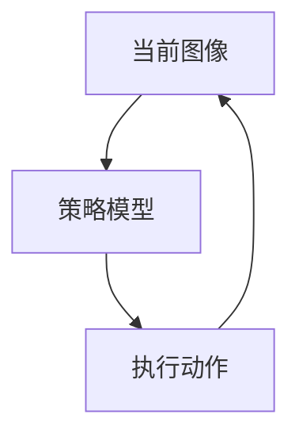

# Markdown 流程图

在文章中使用标为 `mermaid` 的代码块，网站会自动渲染成图表：

````markdown

````

`TD` 从上到下排列，适合博客中的长流程；`LR` 从左到右排列，适合步骤较少的横向流程。

图表支持深浅色模式和站内跳转；较宽的图在手机上可横向滚动。点击“查看图表源码”可展开原文。语法错误时保留源码，便于修正。

首次启用 Mermaid 必须将依赖、锁文件、配置及渲染代码一起提交部署；仅运行 `pnpm publish-post` 发布文章不会更新网站的渲染能力。后续文章继续使用相同写法即可。
