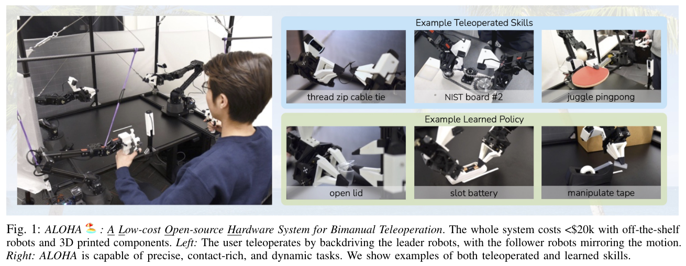
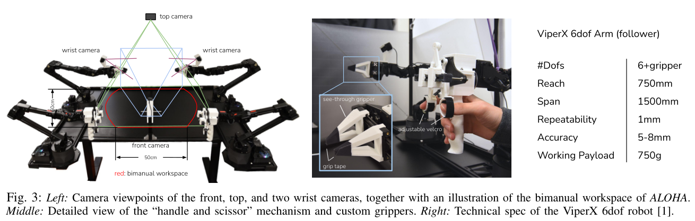
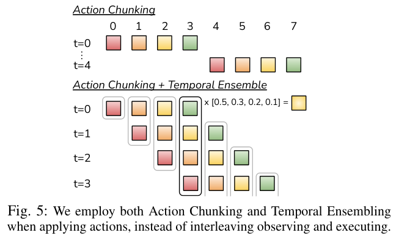
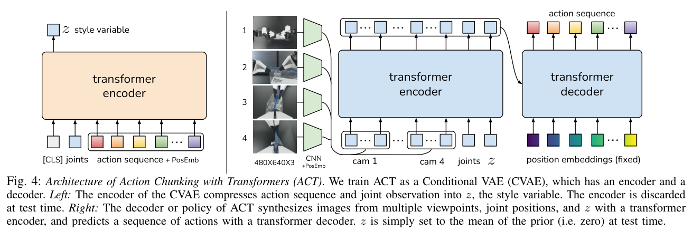
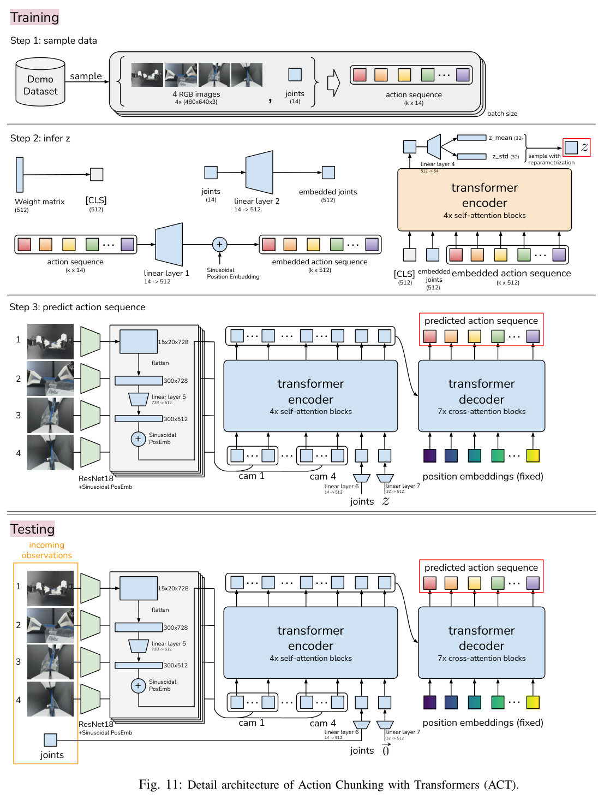
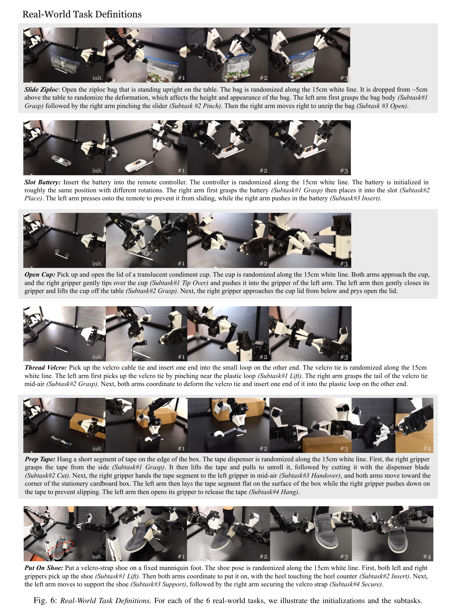
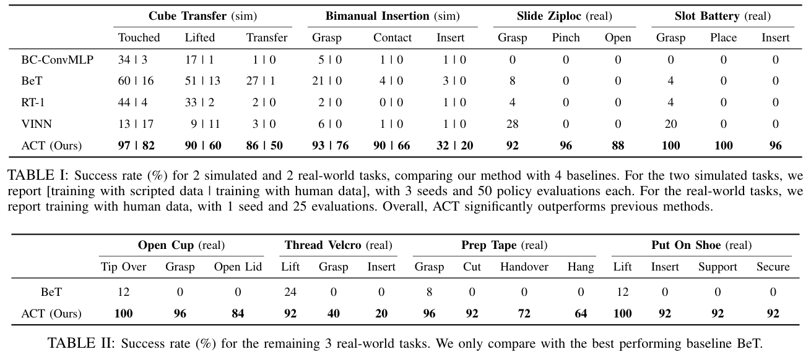
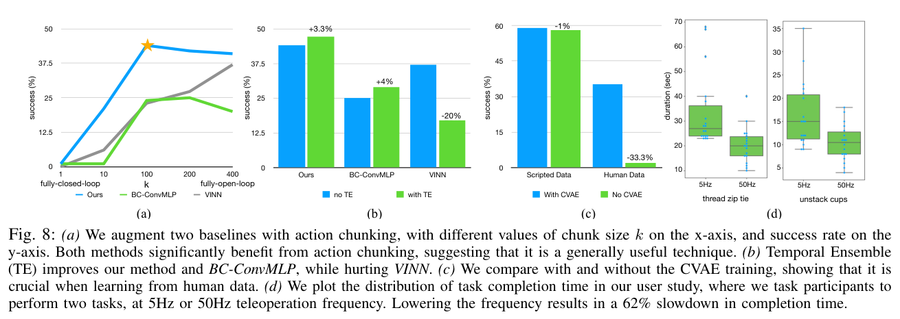

# ACT 论文精读：低成本双臂如何学会精细操作

> 阅读范围：用户提供的本地 PDF 全部 18 页，包括主文、参考文献与附录 A–F。本文页码统一指 PDF 物理页码。论文首页标注 arXiv:2304.13705v1；PDF 文件生成日期 2023-04-27 不作为发表日期。首发日期由首页与[官方存档](https://arxiv.org/abs/2304.13705v1)核对，RSS 2023 由[作者项目页](https://tonyzhaozh.github.io/aloha/)核对。
>
> 证据标记：**【原文】**表示论文陈述或表图数据；**【解读】**表示阅读者的解释；**【推导】**表示从原文进一步计算；**【建议】**表示尚未验证的实验设计。没有进行机器人训练或实机复现。关键事实索引见 [evidence_index.csv](sources/evidence_index.csv)。

## 1. 先把核心结论说清楚

ACT 的价值，是把**高质量、低成本的双臂遥操作数据**和**预测连续动作序列的模仿学习策略**结合起来，使低精度硬件也能完成部分高精度接触任务。ALOHA 解决“怎样采到好示范”，ACT 解决“怎样从少量示范学出稳定动作”。两者共同构成论文的系统贡献。

【原文】ACT 包含三个关键设计：固定长度动作分块、重叠动作块的时间集成，以及训练时使用 CVAE 建模示范的变化。策略输入四路 RGB 图像与双臂当前关节位置，输出未来 $k$ 步的双臂绝对目标关节位置。[§III–IV，pp.3–6]

【原文】六个真实任务的最终成功率依次为 **88%、96%、84%、20%、64%、92%**。其中魔术贴穿环需要 100 条示范，其余任务各 50 条。因此，摘要中的“约 10 分钟示范、80–90% 成功”是部分代表性任务的概括，不能扩展为六项任务都稳定达到这一水平。[表 I–II，p.8；§V-B/C，pp.8–9]

【解读】最值得带走的经验是：高频控制使轨迹变长，也放大逐步模仿中的误差；预测一个动作片段能够引入局部时间结构，再利用新观测不断更新重叠预测，兼顾动作连贯性和一定的反馈能力。论文给出了显著的实验证据，但没有证明这种方法能彻底解决分布偏移。

## 2. 论文在问什么，为什么难

### 2.1 研究问题

能否让价格低、绝对定位精度有限的机器人，直接从 RGB 图像与人类示范中学到双臂精细操作，而不先构建精确的物体模型、接触模型或专用状态估计器？[§I，pp.1–2]

“精细操作”在这里包含三个同时出现的难点：

| 难点 | 论文中的具体表现 | 对学习的影响 |
|---|---|---|
| 几何容差小 | 电池入槽、空中穿环、双臂插接 | 几毫米误差就可能使任务失败 |
| 接触与形变复杂 | 撬开软塑料杯盖、处理胶带和袋子 | 精确前向建模成本高，动作需要反馈修正 |
| 视觉不易辨识 | 透明杯体、胶带、黑色魔术贴与黑背景 | 关键目标只占少量像素，深度感知也未必可靠 |
| 双臂相互约束 | 一只手固定，另一只手插入；空中交接 | 单臂误差会通过相对位姿影响另一只手 |
| 人类示范存在变化 | 停顿、交接位置变化、不同接近路径 | 同一观测未必对应唯一的单步动作 |

### 2.2 单步行为克隆为什么容易失效

【原文】标准 BC 在专家数据上训练，部署时却访问自己动作导致的状态。一次预测误差可能使机器人偏离示范状态，后续预测继续出错，形成 compounding errors。[§II，p.2]

【解读】对于开杯盖，第一次把杯子推偏一点，第二次抓取的相对关系就会改变，最后撬盖的位置误差更大。训练集中的“正确动作”只对示范中的接触状态正确；策略若进入陌生接触状态，并不会自动知道怎样恢复。

另一个问题是示范中的停顿：如果视觉和关节状态几乎不变，却一会儿保持、一会儿继续运动，仅用当前观测回归下一步动作会遇到冲突。动作块能表达“先等一段时间，再继续”的局部时间模式；这不等于获得了任意长度的记忆。[§IV-A，pp.4–5]

## 3. ALOHA：为什么硬件部分直接影响学习结果

### 3.1 硬件与数据采集设计

【原文】两台小型 WidowX 作为 leader，两台较大的 ViperX 作为 follower。操作者直接拖动 leader，follower 在关节空间跟随。末端采用平行夹爪，加入 3D 打印的可视夹指、摩擦胶带、手柄/剪刀机构和橡皮筋重力补偿。[§III，p.3]

| 项目 | 原文配置 / 指标 | 阅读时要注意 |
|---|---|---|
| 系统成本 | 2023 年论文口径下约 18k 美元；含相机等约 20k 美元 | 历史成本，非当前采购报价 |
| follower | 两台 ViperX，单臂 6 关节 + 夹爪 | 双臂观测/动作合计 14 维 |
| leader | 两台 WidowX | 关节映射到 follower，避免在线求 IK |
| 精度 | 绝对精度 5–8 mm，重复定位约 1 mm | 绝对精度与重复定位精度是不同指标 |
| 工作负载 | 750 g | 低成本执行器仍有力矩限制 |
| 视觉 | 前、上、左腕、右腕共四台 RGB 摄像头 | 480×640 图像，腕部视角提供局部细节 |
| 遥操作 / 记录频率 | 50 Hz | 不代表相机每秒采到 50 个独立新帧 |
| 相机流 | 附录 B 写 30 fps | 与 50 Hz 控制需要区分，实际对齐细节未完整给出 |

【解读】关节空间遥操作降低了操作映射和在线逆解的复杂度；腕部相机减轻了精细接触区域像素不足的问题；手柄、重力补偿和夹指设计减少了操作负担。硬件并非只提供“一个便宜平台”，它还改善了专家示范的可控性和质量。

### 3.2 最容易忽略的数据标签细节

【原文】**动作标签记录 leader 的关节位置，观测记录 follower 的关节位置。** 两者的差通过底层 PID 控制隐含影响施加的力。如果直接把 follower 的实际位置当作动作监督，会丢掉操作者在接触中发出的部分目标位置信息。[§IV 开头，p.4]

【解读】“机器人当时在哪里”和“人希望它去哪里”在接触中并不相同。例如推电池遇到阻力时，目标可能继续前进，而实际关节暂时不动。ACT 学的是目标命令。它没有显式的力传感输入，也没有直接输出力矩；不能据此把它称为显式力控制策略。

### 3.3 遥操作展示与自主学习要分开看

【原文】乒乓球动态操作、RAM 插接、NIST 装配等展示了 ALOHA 的遥操作能力；自主策略的系统评估是后文六个真实任务和两个仿真任务。附录中复现其他系统 15 项展示中的 14 项，也是遥操作能力比较。[图1、图9，§III、附录 A]

这些展示不能替代相应任务的 ACT 自主成功率。

## 4. ACT 方法：分块、反馈和生成式训练怎样配合

### 4.1 输入、输出与符号

记当前观测为

$$
o_t=(I_t^{(1)},I_t^{(2)},I_t^{(3)},I_t^{(4)},q_t),\quad q_t\in\mathbb R^{14}.
$$

动作 $a_t\in\mathbb R^{14}$ 是双臂绝对目标关节位置。为避免原文区间记号歧义，本文统一用 $A_t=(a_t,\ldots,a_{t+k-1})$ 表示**恰好 $k$ 步**的动作块。策略预测

$$
\hat A_t=\pi_\theta(o_t,z)\in\mathbb R^{k\times14}.
$$

【原文】论文没有语言输入，也没有用一个共享策略同时学习这六个真实任务；每项任务分别训练模型。[§IV-C，pp.5–6]

### 4.2 动作分块：把局部时间结构作为输出

普通单步策略预测 $\pi(a_t\mid o_t)$，ACT 预测 $\pi(A_t\mid o_t,z)$。不使用时间集成时，策略每隔 $k$ 步接收新观测，生成并顺序执行一个块。[§IV-A，pp.4–5]

【原文】作者将其解释为任务“有效时域”缩短约 $k$ 倍。

【推导】例如一条 600 步轨迹，$k=100$，按整块执行时只需约 6 次策略查询；50 Hz 下一个块覆盖 2 秒。这只是时间结构的说明，不是论文报告的统一任务长度。

【解读】多步监督让网络学习块内动作之间的关系，也减少逐个决策造成的局部不一致。然而，如果机器人在块内遇到意外接触，长时间开环执行可能来不及反应。分块并不能独立保证稳定性或消除误差累积。

### 4.3 时间集成：每一步都观察，但不突然换计划

【原文】为避免整块切换造成的突变，ACT 可以每个控制时刻都查询一次策略。不同时间生成的块覆盖同一个执行时刻，于是把这些对“同一时刻”的动作预测加权平均。[§IV-A，p.5；算法2]

$$
a_t^{\mathrm{exec}}=\frac{\sum_{i=0}^{n_t-1}w_i\hat a_t^{(i)}}{\sum_{i=0}^{n_t-1}w_i},\qquad
w_i=\exp(-mi).
$$

这里必须遵循原文定义：**$i=0$ 对应最早生成、仍覆盖当前时刻的预测。** 当 $m>0$ 时，它得到最高权重；$m$ 变小使权重更接近均匀，新观测对应的预测相对占比增加。不要把该公式解释为“最新预测权重最大”。[p.5 正文]

【解读】时间集成融合的是 $\hat a_{t\mid t}$、$\hat a_{t\mid t-1}$、$\hat a_{t\mid t-2}$ 等不同预测起点对当前时刻的意见。它没有把昨天应执行的动作与今天应执行的动作直接平均。旧预测依然会带来一定惯性，系统突遇扰动时可能需要权衡平滑性与响应速度。

**一个容易混淆的边界：**加入每步查询的时间集成后，策略查询次数又回到了每步一次。此时“有效时域缩短 $k$ 倍”主要是作者对分块建模的解释，不能继续当作部署推理调用减少 $k$ 倍的结论。

### 4.4 CVAE：训练时解释示范变化，部署时固定潜变量

【原文】训练时的后验编码器读取当前关节 $q_t$ 和真实未来动作块 $A_t$，输出对角高斯分布：

$$
q_\phi(z\mid q_t,A_t)=\mathcal N\bigl(\mu_\phi,\operatorname{diag}(\sigma_\phi^2)\bigr).
$$

从中采样 $z$ 后，策略用当前四幅图像、关节和 $z$ 重建动作块。为提高训练速度，CVAE 后验编码器不读取图像；图像由策略分支处理。图11中 $z$ 为 32 维。[§IV-B/C，p.5；附录 C，图11]

正文实现采用的目标可写成

$$
\mathcal L=\mathbb E_{z\sim q_\phi}\bigl[\|\hat A_t-A_t\|_1\bigr]
+\beta D_{\mathrm{KL}}\!\left(q_\phi(z\mid q_t,A_t)\,\|\,\mathcal N(0,I)\right).
$$

【原文】部署时丢弃后验编码器，将 $z=0$，即标准高斯先验的均值，得到确定性的输出。[§IV-B，p.5；附录 C，pp.14–15]

【解读】训练中的 $z$ 给示范轨迹的变化提供额外表达空间，减轻所有差异都挤在一个确定性回归输出中的困难。但论文没有证明 $z$ 自动对应可解释的技能类别，也没有证明 $z=0$ 解码等于动作分布的均值。CVAE 是训练框架，实测部署并非每步随机采样轨迹。

### 4.5 Transformer 在这里负责什么

【原文】训练后验分支采用类似 BERT 的编码器：`[CLS] + 当前关节 token + k 个动作 token`，共 $k+2$ 个 token；取 `[CLS]` 输出预测潜变量分布。

策略分支分为三个步骤：[§IV-C，pp.5–6]

1. 每路 RGB 通过 ResNet18 得到 $15\times20\times512$ 特征，展平为 $300\times512$，加入二维位置编码。
2. 四路合计 1200 个视觉 token，再加一个关节 token 和一个潜变量 token，得到 $1202\times512$，由 Transformer encoder 融合。
3. Transformer decoder 以 $k$ 个未来时间位置为查询，cross-attention 读取融合特征，输出 $k\times512$，再映射到 $k\times14$。

【解读】这里有两个不同层次的“编码器”：CVAE 后验编码器只在训练存在；策略内部的观测 Transformer encoder 在测试时仍然运行。同样，CVAE decoder 指整个策略，不只指最后那个 Transformer decoder。

动作块是一次前向过程输出的序列；不能仅因使用 Transformer，就把 ACT 说成逐个动作 token 自回归生成的语言模型。

## 5. 实验到底测了什么

### 5.1 任务、示范和初始化范围

| 真实任务 | 最终目标 | 关键瓶颈 | 示范数量 |
|---|---|---|---:|
| Slide Ziploc | 固定袋体并拉开拉链 | 透明袋、滑块定位和形变 | 50 |
| Slot Battery | 将电池完全压入遥控器电池槽 | 弹簧反力、双臂固定与插入 | 50 |
| Open Cup | 抓起半透明小杯并撬开杯盖 | 推倒/抓取衔接、盖沿定位 | 50 |
| Thread Velcro | 将魔术贴尾端穿过另一端小环 | 空中再抓取与毫米级穿环 | 100 |
| Prep Tape | 拉出、切断、交接并把胶带挂在纸盒边缘 | 透明胶带、粘附、双臂交接 | 50 |
| Put On Shoe | 给固定假脚穿鞋并扣好魔术贴 | 狭窄配合、摩擦与夹持稳定 | 50 |

【原文】真实物体主要沿 15 cm 白色参考线随机初始化；不同任务还有不同变形或旋转设置，见图6。仿真包括 Cube Transfer 和 Bimanual Insertion，物体在二维区域随机放置，分别采集脚本与人类两类示范，每种设置 50 条成功轨迹。[§V-A/B，pp.6–8]

【原文】真实示范单条约 8–14 秒，即 50 Hz 下 400–700 步。每任务有效示范量约 10–20 分钟；考虑重置和操作失误，实际采集约 30–60 分钟。[§V-B，p.8]

【解读】这些结果主要反映固定工作站、固定任务/物体以及给定初始化分布下的学习效果。它们没有建立对全新物体类别、新房间、新相机位姿或跨机器人迁移的普遍结论。“10 分钟”也不包括全部准备、重置和训练时间。

### 5.2 基线与评估协议

| 方法         | 与 ACT 的关键差异（按本论文实现描述）                      |
| ---------- | ------------------------------------------ |
| BC-ConvMLP | 当前视觉特征与关节拼接，回归单步动作                         |
| BeT        | 历史条件 Transformer，单步输出，动作聚类/偏移；视觉编码器单独训练并冻结 |
| RT-1       | 历史条件 Transformer，离散动作输出                    |
| VINN       | 在示范中按视觉/状态相似度检索邻居并合成动作                     |
| ACT        | 当前观测条件、连续多步动作输出、CVAE 训练与时间集成               |

【原文】仿真：每个设置训练 3 个随机种子，每个种子评估 50 次。真实：每个任务仅 1 个训练种子、25 次评估。四个后续真实任务只比较 BeT。[表 I–II；§V-C，p.9]

【解读】主结果同时改变了分块、视觉训练方式、连续/离散动作和架构等因素，所以不能仅由主表认定“所有优势都来自 Transformer”。本论文设置也不是在复现 RT-1 原始的大规模训练条件，结论应限于这里的少示范精细操作协议。

### 5.3 主结果：真实任务

| 真实任务 | ACT 最终成功率 | 对应成功次数【推导】 | BeT 最终成功率 | 证据 |
|---|---:|---:|---:|---|
| Slide Ziploc | 88% | 22/25 | 0% | 表 I |
| Slot Battery | 96% | 24/25 | 0% | 表 I |
| Open Cup | 84% | 21/25 | 0% | 表 II |
| Thread Velcro | 20% | 5/25 | 0% | 表 II |
| Prep Tape | 64% | 16/25 | 0% | 表 II |
| Put On Shoe | 92% | 23/25 | 0% | 表 II |

【原文】前两个真实任务中，其余三个基线的最终成功率也均为 0%。[表 I，p.8]

【推导】ACT 六项真实任务的简单平均为 74%。这是对表中六个百分数等权平均的阅读者计算，论文没有将它作为一个统一指标报告；六项能力也不能相互替代。

### 5.4 主结果：仿真

下表仅列各任务的最终成功率，数值为“脚本示范 / 人类示范”。[表 I，p.8]

| 方法 | Cube Transfer | Bimanual Insertion |
|---|---:|---:|
| BC-ConvMLP | 1% / 0% | 1% / 0% |
| BeT | 27% / 1% | 3% / 0% |
| RT-1 | 2% / 0% | 1% / 0% |
| VINN | 3% / 0% | 1% / 0% |
| ACT | **86% / 50%** | **32% / 20%** |

【推导】ACT 相对最强既有基线的四项提升为 59、49、29、20 **个百分点**。这对应正文写的 59%、49%、29%、20%，应按成功率差理解，不能写成相对提升百分比。

【解读】人类示范更难学：ACT 的方块传递从脚本示范的 86% 降到人类示范的 50%，插接从 32% 降到 20%。即使 ACT 领先，接触插接也仍然困难。

### 5.5 看阶段结果，定位剩余难点

| 任务 | ACT 各阶段成功率（原表顺序） | 可支持的观察 |
|---|---|---|
| Open Cup | 100 → 96 → 84 | 盖沿操作比推倒与抓起更困难 |
| Thread Velcro | 92 → 40 → 20 | 空中抓取尾端和精确穿环都是瓶颈 |
| Prep Tape | 96 → 92 → 72 → 64 | 交接阶段开始显著损失 |
| Put On Shoe | 100 → 92 → 92 → 92 | 在该数据中主要损失发生在插入阶段 |

【原文】魔术贴的两类常见失败是：右夹爪过早闭合而没抓住尾端；最终穿环位置不准。黑色细带在黑色背景中占很少像素，感知难度是作者给出的解释。[§V-C，p.9]

阶段表不能直接当作独立事件相乘。例如 Thread Velcro 的 40% 不是“在前一步成功条件下的 40%”；论文按各阶段报告成功率，没有给出足够的逐试验联合记录。Slide Ziploc 原表甚至出现 92 → 96 → 88 的非单调值，进一步说明不应强行按严格累积生存率解释。

## 6. 消融：哪些结论有直接证据

### 6.1 动作分块是最有力的机制证据

【原文】关闭时间集成、每个 $k$ 单独训练，在两项仿真任务 × 两类示范的四个设置上取平均。$k=1$ 时约 1%，$k=100$ 时约 44%；继续增大到 200、400 略有下降。给 BC-ConvMLP 和 VINN 加上分块也有明显收益。[§VI-A，p.9；图8(a)]

【解读】这比“ACT 整体赢过单步基线”更能支持动作分块的作用。较大 $k$ 使局部计划更连贯，但也提高长序列预测难度、减少反馈；最佳 $k$ 是任务与控制频率相关的折中。

这里的“$k$ 接近整段长度时接近开环”依赖该消融关闭了时间集成。不能推广为“只要 $k$ 大，任何部署设置都完全开环”。

### 6.2 时间集成提供较小且依赖方法的增益

【原文】比较各自调参后的最好设置，ACT 加时间集成约提升 3.3 个百分点，BC-ConvMLP 约提升 4 个百分点；VINN 反而下降。[§VI-A，p.9；图8(b)]

【解读】时间集成并非对所有策略普遍有效。作者认为参数模型有可平滑的建模误差，而 VINN 检索的是数据里的真实动作。这个解释是作者假设，不是被单独验证的因果机制。

有/无时间集成分别调过超参数，因此这组比较反映的是两套配置的最佳表现，不能当作严格保持其他变量不变的单因素实验。

### 6.3 CVAE 对人类示范的帮助远大于对脚本示范

【原文】在两个仿真任务的人类数据上汇总，去掉 CVAE、仅以 L1 训练动作块，成功率由 35.3% 降到 2%；对确定性脚本数据，去掉 CVAE 几乎不影响结果。[§VI-B，pp.9–10；图8(c)]

【解读】这说明生成式训练对这组有变化的人类数据很有价值。不过，论文没有提供潜变量语义可视化、后验坍塌分析或匹配参数量的所有替代模型，因此不宜断言它已完整解决多模态行为建模。

### 6.4 高频用户研究测的是遥操作时间

【原文】6 名 22–25 岁的计算机研究生，3 人有其他遥操作经验，均未用过 ALOHA。两个任务是穿塑料扎带和分开叠杯；任务和控制频率顺序随机，每种设置适应后尝试 3 次。[§VI-C，p.10；附录 E，p.15]

50 Hz 相比 5 Hz：穿扎带平均约 20 秒 vs 33 秒；分杯约 10 秒 vs 16 秒。作者报告降低至 5 Hz 后整体操作时间增加 62%，重复测量检验 $p<0.001$。

【原文】5 Hz 条件在关节空间插值，再以 50 Hz 发送给机器人。[附录 E]

【解读】它支持高频人机闭环对这些精细任务有帮助，但没有直接测“ACT 在 5 Hz 和 50 Hz 下的自主成功率差”。动作命令更新率、底层执行频率和相机帧率必须分开表述。

## 7. 结果的可靠性、局限与失败案例

### 7.1 作者明确报告的能力边界

【原文，附录 F，pp.15–16】

- 硬件难以完成需要多指独立动作的任务，例如一边压防儿童开启卡扣、一边旋盖。
- 执行器力矩有限，重物、很紧的瓶盖或笔帽仍困难。
- 薄夹爪不能完全替代指甲，难以揭开粘回自身的胶带边缘或打开易拉罐。
- 50 条示范训练的拆糖纸策略：10 次初步评估中拿起 10/10、拉两端 8/10、完全拆开 0/10。糖纸接缝难辨识是作者提出的原因。
- 允许每颗糖尝试 10 次、对 5 颗糖测试时，可打开 3/5。这个“多次尝试协议”的结果不能改写成单次 60% 成功率。
- 对平放的小型拉链袋，策略能拾起，但后续三个空中操作阶段困难；抓取差异导致形变和拉口位置变化。

### 7.2 进一步审视实验结论

**训练种子与评估次数有限。** 真实任务仅一个训练种子，25 次试验的分辨率为 4 个百分点。即使在固定策略、独立同分布 Bernoulli 试验假设下，估计也不精确。

【推导】Open Cup 的 21/25 对应约 65.3%–93.6% 的 Wilson 95% 区间；Thread Velcro 的 5/25 约 8.9%–39.1%。这是阅读者计算、原文未报告的区间，仅说明有限样本的不确定性，不包括训练种子变化、分布变化或真实试验相关性。全部计算保存在 [结果 CSV](data/real_world_results.csv)。

**泛化证据集中在受控范围。** 论文对物体初始位置随机化，有一定形变变化；没有建立跨环境、跨类别或长时序多任务的全面基准。项目页的扰动演示可作为补充观察，不能替代系统化的样本量和统计协议。

**因果归因仍不完整。** 分块和 CVAE 的消融较有说服力，但视觉编码器训练、参数量、优化、动作表示等也会影响基线结果。没有理论证明误差按 $k$ 倍减少，也没有证明集成动作一定保持接触可行性。

**少示范不等于低总成本。** 示范片段本身很短，但需要搭建、遥操作、重置、清洗与训练。作者报告约 80M 参数，每任务在 RTX 2080 Ti 11GB 上训练约 5 小时、单次推理约 0.01 秒。[§IV-C，p.6]

### 7.3 阅读与复现中的原文不一致

| 原文位置 | 不一致 / 容易混淆之处 | 本笔记采用的处理 |
|---|---|---|
| 算法1 p.5 vs §IV-C p.6 | 算法框写 MSE，正文明确实际使用 L1 | 以正文实现说明采用 L1，保留冲突记录 |
| 图11 p.17 vs §IV-C pp.5–6 | 图中视觉特征写 728 通道，正文为 512 | 张量讲解采用正文 512；不默改原图，不宣称已靠代码验证 |
| 表II及 p.9 文字 | 写“remaining 3”，但实际有四个剩余真实任务 | 按表的四列任务记录，合计六个真实任务 |
| 表I Slide Ziploc | 阶段成功率 92、96、88 非单调 | 原样保留，不擅自更正或构造条件概率 |
| 附录 B vs 图10图注 | 文字说六任务示例，图注写五个 | 图像按原图交付，不据此新增任务数据 |
| 表III vs 当前作者项目页 | 论文 $k=100$，项目页演示描述 $k=90$ | 论文复现采用 100；项目页数值另列，避免混用 |
| §III vs 附录 B | 记录/控制 50 Hz，相机流 30 fps | 视作不同系统频率；同步策略列为复现待核查项 |

## 8. 放回相关工作的技术脉络

本节依据本论文 §II 和参考文献建立关系，未声称已精读每篇被引论文。

| 路线 / 工作 | ACT 继承或回应的问题 | ACT 的具体取舍 |
|---|---|---|
| BC / ALVINN，[44] | 从专家观测回归动作 | 将监督单位扩展为连续动作块 |
| DAgger，[47] | 策略偏离专家分布后的纠正 | 不增加部署中的专家标注，而从分块角度缓解问题 |
| DART，[36]；离线纠正数据路线 | 扩充可纠错示范 | 精细任务中加噪可能直接破坏示范，不作为本文主要途径 |
| BeT，[49] | Transformer 与人类行为变化建模 | 使用连续分块输出及 CVAE，视觉/控制共同优化 |
| RT-1，[7] | 视觉 Transformer 控制 | 在本文少数据精细操作设置中采用连续输出及高频动作 |
| VINN，[42] | 用表征检索实现视觉模仿 | 检索基线也能受益于分块，但时间集成不保证有益 |
| CVAE，[55]；VAE，[33]；β-VAE，[23] | 条件生成、潜变量与先验正则 | 后验只用于训练，测试固定 $z=0$ |
| DETR，[8] | 多位置查询和 encoder–decoder 结构 | 将输出查询对应到未来动作时间位置 |

【解读】论文的新意主要体现在硬件、数据采集与动作序列学习的组合，以及精细操作上的系统验证。CVAE、Transformer、leader–follower 遥操作均有明确先例；不能将这些基础组件的发明归给 ACT。

## 9. 对后续研究和工程实践的启示

以下均为【建议】，不属于原论文已完成的结果。

| 想解决的问题          | 有针对性的下一步实验                 | 应观察的量                        |
| --------------- | -------------------------- | ---------------------------- |
| 魔术贴等小目标感知不足     | 调整腕部视角/局部裁剪，在相同示范数下比较      | 空中再抓取和穿环的分阶段成功率              |
| 固定 $k$ 难兼顾平滑与反应 | 在统一训练设置下扫描 $k$、查询间隔和集成参数   | 最终成功率、受扰恢复时间、关节速度/加速度        |
| 不清楚 CVAE 棒在哪里   | 增加无潜变量但匹配容量的对照，扫描 β 和 z 维数 | 多种子成功率、KL、潜变量利用情况            |
| 训练误差与部署成功不一致    | 同时记录验证 L1 和接触阶段成功率         | 两者相关性、错误类型、最优 checkpoint 稳定性 |
| 接触力不可见          | 在控制变量明确时引入触觉或力信号           | 插入失败、挤压变形、物体滑移               |
| 想证明泛化           | 按物体、位置、光照或背景划分训练/测试        | 分布内/分布外成功率及置信区间              |

如果只复现一个结论，优先复现**关闭时间集成的 $k=1$ 与 $k=100$ 比较**，固定其他训练条件并使用多个种子。它最直接检验论文的核心设计。若要迁移到新机器人，先保证动作标签、观测/命令时间对齐和夹爪单位正确，再讨论模型大小。

## 10. 综合评价与自测

以下为阅读者的主观评分，满分10，不代表会议评分或客观排名。

| 维度 | 分数 | 理由 |
|---|---:|---|
| 创新性 | 8 | 动作分块、集成与低成本双臂系统组合有效，基础模型组件有先例 |
| 技术质量 | 8 | 实现直接，训练/推理结构清楚，分块与 CVAE 消融支持设计 |
| 证据充分性 | 7 | 真实精细任务有说服力，但单种子、25次评估及泛化范围有限 |
| 写作清晰度 | 8 | 系统动机与方法连贯，存在损失、维度和图注不一致 |
| 实用性 | 9 | 硬件可获得、采集流程明确、核心动作表示易于迁移 |

可用下面的问题检查是否真正理解：

1. **为什么标签来自 leader，而关节观测来自 follower？** 为了学到操作者的目标命令，保留接触时目标与实际位置差的信息。
2. **$k=100$ 是否意味着只每两秒观察一次？** 只有按整块执行时如此；每步查询加时间集成可以保持 50 Hz 级策略更新。
3. **CVAE 编码器在测试时还运行吗？** 后验编码器不运行，策略内部的视觉/观测编码器继续运行。
4. **时间集成是否平均相邻时刻应执行的动作？** 它平均不同块对同一执行时刻的预测。
5. **为什么不能说六个任务都达到80–90%？** 原表包含20%和64%，且示范数量也不完全相同。
6. **ACT 已经解决分布外恢复了吗？** 分块与反馈改善了表现，但论文没有这样的普遍性证明。
7. **$z=0$ 是否必然对应动作均值或最可能轨迹？** 不必然，非线性解码器不保证这个关系。
8. **主表能证明所有性能差异都来自 Transformer 吗？** 不能，需要分块、训练目标、视觉和动作表示等受控对照。

## 11. 继续阅读与本地材料

- [公式推导、张量维度与复现指南](ACT_公式与复现指南.md)：KL 展开、时间集成索引示例、训练/推理伪代码、超参数及待核查项。
- [知识图谱](ACT_知识图谱.md)：概念依赖、训练与部署流程，以及证据边界。
- [关键图表索引](images/_index.md)：11 张带来源页码的完整裁剪。
- [原文逐页检索副本](sources/paper_text_by_page.txt)：用于检索，公式与表格应回看 PDF。
- [来源与版本清单](sources/source_manifest.json)：原文件 SHA-256、元数据和冲突记录。
- [作者项目页](https://tonyzhaozh.github.io/aloha/)与[官方论文存档](https://arxiv.org/abs/2304.13705v1)：核对元数据和作者公开资源。代码仓库链接见目录说明，本文没有进行代码逐行审计。

## 12. 我的后续笔记

此节供后续人工补充；本次未添加未经验证的个人实验结果。
