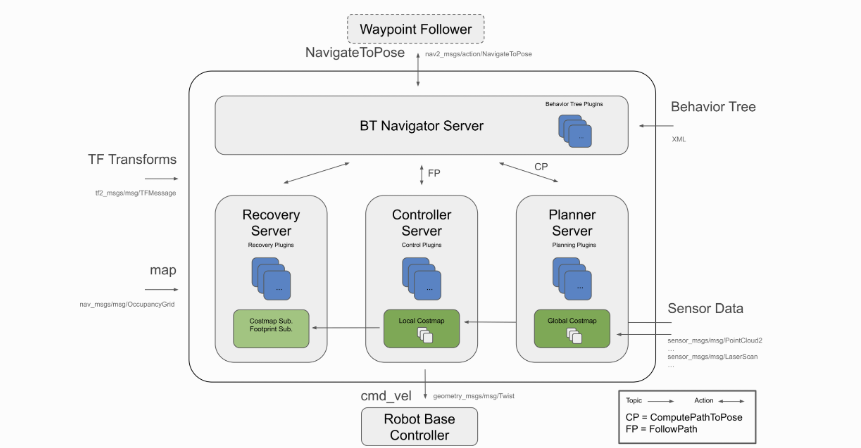

## Nav2框架
Nav2使用行为树 (BT) 调用模块化服务器来完成一个动作。动作可以是计算路径、控制力、恢复或任何其他与导航相关的操作。这些都是通过ROS Action服务器与行为树 (BT) 通信的独立节点。
目前支持主要机器人的底盘类型有 : holonomic（所有自由度都可控）, differential-drive（差速驱动）, legged（足式机器人）和 ackermann（阿克曼)。

它有以下工具：
- 加载、提供和存储地图的地图服务器（Map Server）
- 在地图上确定机器人的位置 (AMCL)
- 规划一条从A到B的且绕过沿途障碍物的路径 (Nav2规划器) 
- 控制机器人沿着路径前进 (Nav2控制器) 
- 将传感器数据转换为世界代价地图（Costmap）表示 (Nav2 2D Costmap) 
- 使用行为树构建复杂的机器人行为 (Nav2 Behavior Trees 和 BT Navigator)
- 计算发生故障时的脱困行为 (Nav2 Recoveries) 
- 跟随连续路标点 (Nav2路标点追踪器)
- 管理服务器的生命周期和看门狗 (Nav2生命周期管理)
- 使用自定义的算法和行为插件 (Nav2 Core)
------------------------------------------------------------------

## 动作服务器（Action Server）
动作服务器是控制导航等长时间运行任务的常见方式。这个Action Server类似于服务通信中的Service。在Nav2软件栈中使用动作服务器通过 `NavigateToPose` 动作消息与最高级别的行为树BT导航仪（Navigator）进行通信。

## 生命周期节点和绑定
生命周期节点是ROS 2独有的。它们是包含状态机转换的用于加载和卸载ROS 2服务器的节点。这有助于确定ROS系统启动和关闭的状态是否正常。
在Nav2中，我们使用 `nav2_util LifecycleNode` 的包装器。这种包装包装了典型应用的生命周期节点的许多复杂性。它还包括生命周期管理器的连接 `bond` ，以确保服务器转换后，它也保持活动状态。如果服务器崩溃，它会让生命周期管理器知道并向下过渡系统，以防止严重故障。

## 行为树 (BT)
行为树为定义多步或多状态应用程序创建了一个更具可扩展性和人类可理解性的框架。这与有限状态机 (FSM) 相反，后者可能有几十个状态和数百个状态过渡。
Nav2项目使用 [BehaviorTree CPP V3](https://www.behaviortree.dev/) 作为行为树库。在 `BT Navigator` 中，创建了可以构建为行为树的节点插件。将节点插件加载到BT中，并且在解析该行为树的XML文件时，将关联注册的名称。此时，我们可以通过该行为树进行导航。使用此库的一个原因是它能够加载子树。这意味着可以将Nav2行为树加载到另一个更高级别的BT中，以将此项目用作节点插件。

--------------------------------------------------------------------
## 导航服务器
**规划器**(Planners)和**控制器**(Controllers)是导航任务的核心。**恢复器**(Recoveries)用于使机器人摆脱不良状态或尝试处理各种形式的问题，以使系统具有容错能力。
这些动作服务器用于托管一个地图算法插件，以完成各种任务。它们还托管由该算法插件使用的环境表达，以计算其输出。
规划器和控制器服务器将在运行时配置名称 (别名) 和要使用的算法类型。这些类型是已注册的插件库名称，这些名称是任务的别名。一个例子：使用名称为 `FollowPath` 的DWB控制器，因为它遵循参考路径。在这种情况下，DWB的所有参数都将放置在该命名空间中，例如 `FollowPath.<param>` 。
然后，这两个服务器会公开与其任务相对应的操作接口。当行为树勾选相应的BT节点时，它将调用操作服务器来处理其任务。该服务器内部的动作服务器回调将通过映射到特定算法的名称 (例如 `FollowPath` ) 来调用所选算法。这允许用户将行为树中使用的算法抽象为算法类。
对于恢复服务器，每个恢复也包含自己的名称，但是，每个插件也将公开其自己的特殊操作服务器。这样做是因为可以创建的各种恢复动作无法共享单个简单的接口。恢复器服务器还包含一个订阅本地成本地图的成本地图订阅者节点，该节点会从控制器服务器接收实时更新以计算其任务。这样做是为了避免为本地成本地图创建多个实例。
另外，由于BT节点是调用操作的简单插件，因此可以创建新的BT节点来调用具有其他操作类型的其他动作服务器。

### Planners
规划器的任务是计算完成一些目标函数的路径。根据所选的命名法和算法，该路径也可以称为路线。一个典型示例是计算一个到达目标位姿的规划（例如从当前位置到达一个目标位姿）。规划器可以访问全局环境表达和缓存在其中的传感器数据。规划器可以被编写为具有以下功能的工具：
- 计算最短路径
- 计算完整覆盖路径 
- 沿稀疏或预定义路线计算路径 
Nav2中规划器的一般任务是计算从当前位置到达目标位姿的一个有效且可能是最佳的路径。
### Controllers
控制器，在ROS 1中也被称为局部规划器，是我们跟随全局计算路径或完成局部任务的方法。控制器有权访问局部环境表达，以尝试计算要跟随的基准路径的可行控制工作。许多控制器会将机器人向前投射到空间中，并在每次更新迭代时计算局部可行路径。
在Nav2中，控制器的一般任务是计算一个有效的控制工作以跟随全局规划路径。

### Recoveries
恢复器是容错系统的支柱。恢复器的目标是处理系统的未知状况或故障状况并自主处理这些状况。例子包括感知系统中会导致环境表达充满假障碍物的故障。这样就会触发清除成本地图恢复以允许机器人移动。

------------------------------------------------------------------------

## 状态估计
根据ROS社区标准，在导航项目中，需要提供两个主要的坐标转换。 `map` 到 `odom` 的坐标变换由定位系统 (定位，建图，SLAM)提供， `odom` 到 `base_link` 的坐标转换由里程计系统提供。

## 全局定位: 定位与SLAM
全局定位系统 (GPS、SLAM、运动捕捉) 的工作是至少提供 `map` -> `odom` 的坐标转换。Nav2项目提供的 `amcl` 是一种基于粒子过滤器的自适应蒙特卡罗定位技术，用于静态地图的定位。

## 里程计
里程计系统的作用是提供 `odom` -> `base_link` 的坐标转换。里程计可以来自许多数据源，包括激光雷达、车轮编码器、VIO和IMUs。里程计的目标是提供基于机器人运动的平滑和连续的局部坐标系。全局定位系统会相对全局坐标的坐标变换进行更新，以解决里程计的漂移问题。

## 代价地图
代价地图(Costmap)是包含来自未知、空闲、占用或膨胀成本的单元格的规则2D单元格网格。然后该代价地图被寻找以计算全局计划或采样以计算局部控制工作。

## Filters
代价地图过滤器是基于成本地图图层的方法，可以将过滤器掩码中注释的空间相关行为变化应用到Nav2软件堆栈中。代价地图过滤器是作为成本地图插件实现的。这些插件之所以被称为 "filters" ，是因为它们会通过过滤器掩码上标记的空间注释对代价地图进行过滤。通过使用代价地图过滤器可以实现以下功能：
- 机器人永远不会进入的禁区域/安全区域。
- 限速区域。进入这些区域的机器人的最高速度将受到限制。
- 机器人在工业环境和仓库中移动的首选通道。

## Other Forms
还存在各种其他形式的环境表征。包括: 
- 梯度图，类似于成本地图，但梯度图会表达表面梯度以检查可穿越性
- 3D代价地图，以3D形式表示空间，但这样就也需要3D规划和碰撞检测
- 网格图，类似于梯度图，但具有多个角度的表面网格
- "向量空间" ，接收传感器信息并使用机器学习算法来检测要跟踪的单个物品和位置，而不是对离散点进行缓冲区计算。

## 参考文献

[Nav2 — Navigation 2 1.0.0 文档](http://dev.nav2.fishros.com/doc/)