机器人一边高速运动，一边接收并非同时采样的激光点，怎样及时估计位姿并维护可查询的地图？FAST-LIO2 的回答是：**用 IMU 预测和补偿扫描内运动，直接把采样点与地图中的局部平面配准，再用能够增量插入、删除和重建的 ikd-Tree 承担持续增长的地图操作。**

它的关键不是简单地“省掉特征提取”。省下特征模块之后，系统要能高效处理更多点；状态估计、最近邻查询和地图维护必须一起成立。

> **阅读范围**：本文以用户提供的 19 页本地 PDF 为准，页码均指 PDF 物理页码。[arXiv 官方记录](https://arxiv.org/abs/2107.06829)核实首发于 2021-07-14；对应期刊条目为 *IEEE Transactions on Robotics* 38(4):2053–2073，2022，见 [DOI](https://doi.org/10.1109/TRO.2022.3141876)。本地 PDF 的 19 页与期刊页码分别计数，不据此声称文件完全相同。博客笔记创建于 2026-11-23。
>
> **证据标记**：**【原文】** 表示论文陈述或实验；**【代码】** 表示固定提交中的实际实现；**【解读】** 表示本文解释；**【推导】** 表示公式整理；**【示意】** 表示人工构造的数字；**【建议】** 表示尚未执行的复现方案。本次完成论文与局部源码静态核对，未编译 ROS 工程、回放数据集或进行实机复现。

## 1. 先确定它解决什么问题

论文准确题目为 **FAST-LIO2: Fast Direct LiDAR-inertial Odometry**，作者为香港大学机械工程系的 Wei Xu、Yixi Cai、Dongjiao He、Jiarong Lin、Fu Zhang，前两位为共同第一作者。[首页，p.1]

| 项目 | 本文中的含义 |
| --- | --- |
| 输入 | 带逐点采样时刻的 LiDAR 点云，以及带时间戳的三轴角速度、三轴加速度 |
| 输出 | IMU 位姿、速度等状态估计，以及变换到全局坐标系的局部三维点云地图 |
| 估计方式 | 紧耦合、在流形上迭代的卡尔曼滤波；不是神经网络，也没有训练阶段 |
| 地图 | 以全局坐标存储、随机器人移动而裁剪的局部地图，使用 ikd-Tree 索引 |
| 公开材料 | 官方 FAST_LIO 与 ikd-Tree 源码，README 提供部分 rosbag 和数据转换入口；没有模型权重这一概念 |
| 功能边界 | 里程计与在线建图，不含论文内置的回环检测、回环校正或全局重定位 |

**【原文】** 系统延续 FAST-LIO 的紧耦合迭代滤波、IMU 前向传播、反向运动补偿和高效增益计算；FAST-LIO2 的主要推进是直接点云配准与增量地图数据结构。不要把整条算法链都视为第二代才出现的创新。[§I、III–V，pp.1–10]

**【解读】** “直接”在这里表示不先提取一组人为设计的边缘点、平面特征点，再只对这些特征做配准。它仍需要采样、最近邻查询、局部平面拟合和有效约束筛选。原始点直接参与配准，也不等于每个原始点都一定参与最终更新。

## 2. 从一帧输入看完整信息流

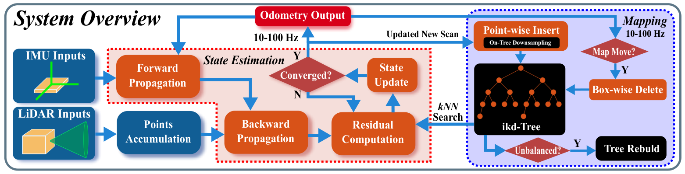

图1的红色虚线框是状态估计，蓝色虚线框是地图维护。两者通过“用地图查询近邻”和“把校正后的新点写入地图”相连。[图1、§III，p.4]

**【原文】** 顺序到达的点先累积 10–100 ms，对应 100–10 Hz 的扫描更新；IMU 通常以更高频率到达，文中举例为 200 Hz。因此一次 LiDAR 更新之前通常经历多个 IMU 传播步。[pp.4–5]

| 环节 | 输入 → 输出 | 持续保留的量 |
| --- | --- | --- |
| 数据对齐与累积 | 一段点流、IMU 序列 → 当前扫描及覆盖其时间段的 IMU | 上帧末状态、跨帧 IMU 信息 |
| 前向传播 | 上次后验与 IMU → 扫描末先验状态及协方差 | 状态轨迹、协方差 |
| 扫描去畸变 | 每个点的时刻与运动轨迹 → 统一到扫描末坐标系的点 | 当前去畸变点云 |
| 构造几何约束 | 当前点投到地图 → 最近 5 点拟合平面、点到平面残差 | 匹配和有效约束 |
| 迭代更新 | IMU 先验、几何残差 → 校正状态 | 本帧最终后验 |
| 地图更新 | 校正后点云 → 全局点、体素代表点、ikd-Tree 更新 | 下一帧可查询的地图 |
| 地图管理 | 当前位置和地图边界 → 移动地图盒、删除离开区域的点 | 有限范围的局部地图 |

关键顺序是：**先利用旧地图校正当前扫描，再把校正后的点插入地图。** 若先将当前点以错误先验写入地图，再立即拿它与自己匹配，会形成没有意义的自洽约束。[算法1、式(16)，p.6；代码主循环亦遵循此顺序]

这是一套在线估计与维护循环。没有离线训练集，也没有“训练时输入真值、推理时输入观测”的模型接口；公开数据集在论文中用于评价算法。

## 3. 坐标系、状态与一条样本

文中 $G$ 是全局坐标系，取初始 IMU 坐标系；$I$ 为 IMU 坐标系，$L$ 为 LiDAR 坐标系。记 $R={}^G R_I$、$p={}^G p_I$，外参 $R_e={}^I R_L$、$t_e={}^I p_L$ **把 LiDAR 坐标变到 IMU 坐标**，不是相反方向。[§IV-A，p.4]

**【原文】** 论文的状态流形与排列可写为：

$$
\begin{aligned}
x&=(R,p,v,b_\omega,b_a,g,R_e,t_e),\\
\mathcal M&=SO(3)\times\mathbb R^{15}\times SO(3)\times\mathbb R^3,
\qquad \dim(\mathcal M)=24.
\end{aligned}
$$

两组旋转各有 3 个局部自由度，其他六组向量各 3 维，所以误差状态为 24 维。不能把旋转矩阵的 9 个存储元素计成 9 个自由度。也不要把后续代码中采用球面重力的 23 维局部状态，直接代回这份 PDF 的 24 维公式。

| 字段 | 形状或自由度 | 单位 | 示例与证据 |
| --- | --- | --- | --- |
| 一帧点坐标 | $N\times3$，$N$ 随扫描与采样变化 | m | **【示意】** 一个点 $(2,1,0.12)$；原文不规定固定 $N$ |
| 逐点采样时刻 | 每点一个相对时刻 | s 或驱动约定单位 | **【示意】** 扫描内 0.004 s；单位必须由驱动确认 |
| IMU 角速度 | 每个采样时刻 3 维 | rad/s | **【示意】** $(0,0,0.2)$ |
| IMU 加速度 | 每个采样时刻 3 维 | m/s² | **【示意】** 理想静止、轴与重力方向对齐时读数可为 $(0,0,9.81)$ |
| 位置、速度 | 各 3 维 | m、m/s | 位于全局系；由滤波持续估计 |
| 陀螺、加计零偏 | 各 3 维 | rad/s、m/s² | 随机游走状态，不能当成永久零值 |
| 重力 $g$ | 论文中为 3 维 | m/s² | 全局系重力；初始全局系未必已与竖直方向对齐 |
| LiDAR–IMU 外参 | 旋转 3 自由度、平移 3 维 | rad、m | 论文纳入在线估计；工程中也可使用已标定值 |

这里的加速度计测量是比力。静止时读到约一个重力加速度，经过姿态旋转后与全局重力相加，才应得到约零的运动加速度。

## 4. IMU 传播与扫描去畸变

### 4.1 IMU 给出高频预测，并累积不确定性

省略坐标上标，连续运动学为：[式(1)，p.4]

$$
\begin{aligned}
\dot R&=R[\omega_m-b_\omega-n_\omega]_\times,&\dot p&=v,\\
\dot v&=R(a_m-b_a-n_a)+g,\\
\dot b_\omega&=n_{b\omega},&\dot b_a&=n_{ba},\\
\dot g&=0,&\dot R_e&=0,&\dot t_e&=0.
\end{aligned}
$$

$[\cdot]_\times$ 是叉乘矩阵；$n_\omega,n_a$ 为测量噪声，$n_{b\omega},n_{ba}$ 驱动零偏随机游走。输入为 6 维，过程噪声为 12 维。

**【解读】** 重力和外参的连续导数为零，表示运动预测时把它们建模为常量；不表示它们是已知常量，也不表示测量更新不能校正它们。

用 $\boxplus$ 表示在状态流形上施加局部增量，离散传播写成：[式(2)、(6)–(7)，pp.4–5]

$$
\begin{aligned}
\hat x_{i+1}&=\hat x_i\boxplus\bigl(\Delta t\,f(\hat x_i,u_i,0)\bigr),\\
\hat P_{i+1}&=F_i\hat P_iF_i^\top+G_iQ_iG_i^\top.
\end{aligned}
$$

其中 $\hat P$ 为 $24\times24$，$F_i$ 为状态误差传播矩阵，$G_i$ 把过程噪声映到状态误差。论文离散 $f$ 的位置分量包含半个加速度项，等价于位置更新中的 $\tfrac12 a\Delta t^2$；它不只是简单的 $p\leftarrow p+v\Delta t$。

**【示意】** 已扣零偏的全局运动加速度为 $2\,\mathrm{m/s^2}$，速度 $1\,\mathrm{m/s}$，传播 0.01 s，则速度增加 0.02 m/s，位置增加 $0.01+0.0001=0.0101$ m。与此同时，过程噪声会增大预测不确定性。IMU 让系统在两次激光更新之间持续输出，但不能独自消除积分漂移。

### 4.2 去畸变是在统一时间下表达点

一帧扫描里的点不是同一时刻获得的。对时刻 $t_j$ 的原始点 $p_j^{L_j}$，希望把它改写成扫描末时刻 $t_e$ 的 LiDAR 坐标。

**【推导】** 记齐次变换 $T_{GI}(t)$ 把时刻 $t$ 的 IMU 系变到全局系，固定外参为 $T_{IL}$，则：

$$
p_j^{L_e}=\bigl(T_{GI}(t_e)T_{IL}\bigr)^{-1}
T_{GI}(t_j)T_{IL}\,p_j^{L_j}.
$$

式中点按齐次坐标理解。运动轨迹来自 IMU 前向传播，随后按时间倒序对点做补偿，即原文的 backward propagation。它不是把点云简单反向排序，也不是重新训练一个运动预测器。[§IV-A2、算法1，pp.5–6]

**【示意】** 令外参为单位变换，机器人在一帧内沿 $x$ 正向移动 0.1 m，环境静止。帧初在 LiDAR 前方 5 m 的墙点，统一到帧末坐标后是 4.9 m。再用帧末位姿变到全局系，仍落在原来的世界位置 5 m。若忽略去畸变，不同采样时刻会把同一面墙投成厚层或弯曲面。

真实实现同时补偿旋转和平移；大角速度下旋转补偿尤其关键。点时间戳、时间同步或外参方向错误，无法靠后面的滤波迭代可靠弥补。

## 5. 点到平面残差怎样约束 24 维状态

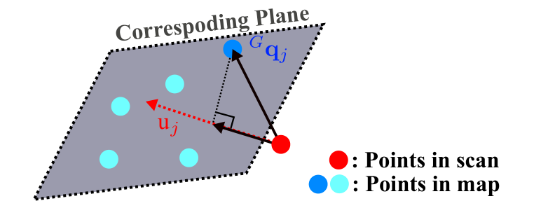

图2中红点来自当前扫描，蓝色点来自地图；灰色区域是局部平面。**【原文】** 对当前点找地图中最近的 5 个点，拟合平面，得到单位法向 $u_j$ 和平面上一点 $q_j$，论文以邻点质心表示后者。[§IV-A2、B2，p.5]

一个去畸变后的 LiDAR 点，先经外参到 IMU 系，再经当前位姿到全局系。其有符号点到平面残差为：

$$
\begin{aligned}
s_j&=R_ep_j^L+t_e,\\
p_j^G&=Rs_j+p,\\
r_j(x)&=u_j^\top(p_j^G-q_j).
\end{aligned}
$$

这对应原文式(4)、(9)的无噪声部分。单位法向使残差单位为米；翻转法向会同时翻转残差和雅可比，合法最小二乘约束不因此改变。论文还考虑量测距离及波束方向噪声，通过线性化得到标量残差噪声方差 $R_j$。[式(3)–(5)、(8)，p.5]

**【示意】** 地图的 5 个近邻都位于 $z=0$，取 $u=(0,0,1)$。当前点为 $(2,1,0.12)$，两组旋转及外参平移取单位/零值，预测 IMU 高度 $p_z=0.03$，则残差为 $0.12+0.03=0.15$ m。地面约束指出点投影高出了平面 15 cm，但单个残差无法唯一决定应如何分配高度、姿态和外参的修正。

### 5.1 旋转为什么不能直接加矩阵

采用右扰动 $R\leftarrow R\exp([\delta\theta]_\times)$。对于本文状态顺序，姿态、位置和外参直接进入残差，速度、零偏、重力没有直接出现。冻结本次线性化所用的平面后，可得：

$$
H_j=\left[
-u_j^\top R[s_j]_\times\quad u_j^\top\quad
0_{1\times12}\quad
-u_j^\top RR_e[p_j^L]_\times\quad u_j^\top R
\right]\in\mathbb R^{1\times24}.
$$

**【推导】** 该式依次对应 $R,p,(v,b_\omega,b_a,g),R_e,t_e$；采用不同扰动或状态排列时，块的形式和位置也会变。不是把这个 $H$ 原样复制到任意 EKF 就正确。

在前述地面例子中，姿态块为 $(1,-2,0)$、位置块为 $(0,0,1)$。这说明滚转、俯仰和高度都会改变点的垂直残差。只有理想水平地面时，沿平面平移和绕法向旋转无法被这组约束充分观测；加更多相同朝向的地面点，不会自动补齐缺失的方向。

### 5.2 速度、零偏为什么也能得到校正

堆叠 $m$ 个有效点，得到 $r\in\mathbb R^m$、$H\in\mathbb R^{m\times24}$，论文采用的残差噪声矩阵为 $R_m=\operatorname{diag}(R_1,\ldots,R_m)$。这里以 $R_m$ 区别姿态矩阵 $R$。

**【解读】** 虽然速度等状态在 $H$ 中对应零列，先验协方差包含位置、姿态、速度与零偏之间的交叉相关。卡尔曼增益利用这些相关性，把几何残差传到其他状态。紧耦合的含义正是在统一状态和不确定性中融合传感器，而不只是把一条 LiDAR 位姿轨迹与另一条 IMU 轨迹平均。

“所有邻点都能拟合出某个平面”也不等于该平面可靠。远离地图、跨越边缘、动态物体或几何分布不佳的邻点，需要有效性筛选；代码核对部分会说明实际实现中的门控。

## 6. 迭代卡尔曼更新：反复线性化，同一先验只用一次

论文中的 IEKF 是 **iterated Kalman filter**，此处不要仅凭缩写将其解释为 invariant EKF。它在流形上反复更新线性化点，以解决非线性点云配准。[§IV-B，pp.5–6]

### 6.1 MAP 目标由先验与几何量测构成

设扫描末 IMU 先验为 $(\hat x,\hat P)$，当前迭代为 $\hat x^\kappa$，待求局部修正为 $\delta x$。原文的 MAP 问题可整理为：[式(10)–(13)]

$$
\min_{\delta x}\;
\left\|e^\kappa+J^\kappa\delta x\right\|_{\hat P}^2
+\left\|r^\kappa+H^\kappa\delta x\right\|_{R_m}^2,
\qquad e^\kappa=\hat x^\kappa\boxminus\hat x.
$$

$\|z\|_M^2=z^\top M^{-1}z$。$J^\kappa$ 把当前迭代处的局部误差映到原先验误差所在的切空间；第一次迭代 $\hat x^0=\hat x$，因此 $e^0=0$、$J^0=I$。旋转变化后，不能始终假设两处切空间完全相同。

### 6.2 为什么修正不只是负残差乘增益

令 $P_\kappa=(J^\kappa)^{-1}\hat P(J^\kappa)^{-\top}$，省去 $H$ 的迭代上标，可写出：[式(14)]

$$
\begin{aligned}
K&=(H^\top R_m^{-1}H+P_\kappa^{-1})^{-1}H^\top R_m^{-1},\\
\delta x&=-Kr^\kappa-(I-KH)(J^\kappa)^{-1}e^\kappa,\\
\hat x^{\kappa+1}&=\hat x^\kappa\boxplus\delta x.
\end{aligned}
$$

第二项表达当前迭代已经偏离原始先验多少。若每次迭代都把当前结果当成一份全新先验，再独立融合同一帧激光，会重复计入量测，产生虚假的高置信度。

**【原文】** 迭代收敛后才将状态和协方差作为本帧后验，论文式(15)给出 $\bar P=(I-KH)P_\kappa$。工程实现还需处理相应切空间的协方差表达，不能只抄欧氏空间公式而忽略旋转的误差重置。[算法1，p.6]

### 6.3 高效增益到底省在哪里

常见形式需要求逆 $HPH^\top+R_m$，其大小为 $m\times m$；等价的信息形式只需求逆状态大小的 $24\times24$ 矩阵。几何信息可以逐点累加：

$$
\Lambda=P_\kappa^{-1}+\sum_{j=1}^{m}H_j^\top R_j^{-1}H_j,
\qquad b=\sum_{j=1}^{m}H_j^\top R_j^{-1}r_j.
$$

**【解读】** 当有效点很多、状态维度固定时，这能显著减少矩阵求逆开销。它不表示整帧计算与点数无关：构造残差、累加信息、查近邻仍随点数增长，重匹配和迭代也有代价。实际实现宜求解线性方程，而非机械显式求每个逆矩阵。

## 7. 连续两帧走查：从预测到下一帧地图

以下全部为 **【示意】**，用一维高度估计代替完整的 24 维非线性系统，目的是手算“先验、量测、迭代和跨帧递推”。它不是论文报告的真实传感器轨迹。

### 7.1 第一帧：校正状态，然后写地图

1. 上一帧状态经 IMU 传播后，预测高度为 0.10 m，方差为 0.04 m²。
2. 当前点按各自时刻去畸变。用旧地图构造地面残差，将本次几何信息抽象为高度伪观测 0 m、方差 0.01 m²。
3. 标量增益为 $K=0.04/(0.04+0.01)=0.8$；后验高度为 $0.10+0.8(0-0.10)=0.02$ m，方差为 $(1-0.8)0.04=0.008$ m²。
4. 这是线性例子，已经得到最优结果。继续对同一份先验和同一量测迭代，结果应仍为 0.02 m、0.008 m²；不能把同一帧又融合一次，错误地进一步缩小方差。
5. 使用校正后位姿把当前点变到全局系，再写入地图。原始点的采样时刻、去畸变时刻和地图全局坐标，至此各有明确用途。

地图插入也不是简单追加所有点。设全局体素为 $[2,2.5)\times[0,0.5)\times[0,0.5)$，中心为 $(2.25,0.25,0.25)$。旧点 $A=(2.10,0.10,0.10)$ 距中心约 0.2598 m，新点 $B=(2.24,0.24,0.24)$ 距中心约 0.01732 m。算法保留更近的**实际点 B**，而不是把两点平均，也不是创建体素中心作为新测量。

### 7.2 第二帧：使用新数据与更新后的地图

1. 第一帧后验向前传播；设 IMU 预测高度变成 0.03 m，传播后的方差为 0.010 m²，已经包含此前后验及新的过程噪声。
2. 第二帧点云匹配第一帧更新后的地图；设几何伪观测为 0.01 m、方差仍为 0.01 m²。
3. 此时 $K=0.5$，后验高度为 $0.03+0.5(0.01-0.03)=0.02$ m，方差为 0.005 m²。数值碰巧与第一帧高度相同，证据却来自新的预测与新的扫描。
4. 若同一体素又来了 $C=(2.249,0.249,0.249)$，距中心约 0.001732 m，则它替换 B。新一帧提供的信息参与地图维护，历史同体素点不会无限累加。

**【解读】** 实际系统会用多方向平面、完整协方差和非线性迭代共同约束状态。上面的标量观测已经把点到平面约束压缩成一个可手算量，不能据此宣称 LiDAR 直接测到了绝对高度，或实际地图误差彼此独立。

## 8. 地图为什么需要 ikd-Tree

如果只省掉特征提取，却每帧重新组织越来越大的地图，性能瓶颈仍会留在地图侧。FAST-LIO2 需要同时满足：查近邻、插入新点、替换体素代表点、批量删除远处点，以及在树失衡时整理结构。[§V，pp.6–10]

### 8.1 局部地图移动，坐标系并不跟着重置

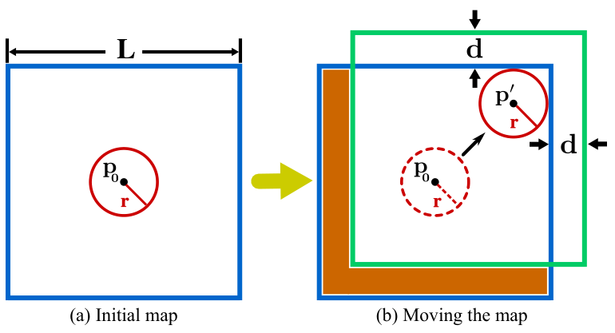

**【原文】** 地图范围是边长 $L$ 的立方体，点坐标仍在全局系。LiDAR 检测区域近似为半径 $r=\gamma R_{\rm range}$ 的球，$\gamma>1$；这里 $R_{\rm range}$ 是探测距离，不能和角度视场或姿态矩阵混为一谈。当检测球碰到地图边界，地图盒沿相应方向移动，文中位移为 $d=(\gamma-1)R_{\rm range}$；从旧盒中离开的薄层区域用箱删除处理。[§V-A，p.6]

图3为二维示意：绿色新盒与蓝色旧盒的差集决定橙色删除区。移动地图盒不等于把所有地图点重新变换一遍。默认 $L=1000$ m 表示地图空间边长，也不表示 1000 个点。

### 8.2 每个节点既保存点，也保存子树信息

ikd-Tree 的内部节点和叶节点都存一个点。节点还包含分割轴、左右孩子、`treesize`、`invalidnum`、点删除标记 `deleted`、整棵子树删除标记 `treedeleted`，以及该子树的轴对齐包围盒 `range`。[Data Structure、表I，p.7]

`treesize` 包括尚未物理移除的无效节点；有效点数要结合无效计数理解。构建平衡树时，沿空间最长维度选择中位数递归划分；增量插入后再检查平衡情况。

### 8.3 树内降采样保留真实测量点

**【原文】** 对新点所在的边长 $l$ 体素，搜索已有点，与新点一起比较到体素中心的距离；删除体素内已有点，再插入最近的实际点。[算法2，pp.7–8]

第7节的 A、B、C 正是这一步的简化例子。它控制地图密度，同时避免用平均点或体素中心替代真实返回值。它并不等于完整扫描预处理只剩这一项：论文还使用 1:4 的时间采样，后续代码也有扫描体素滤波等不同入口。

### 8.4 箱删除利用包围盒和懒标记

对待删除长方体 $C_O$ 与节点子树包围盒 $C_T$，分三种情况处理：[§V-C2、算法3，p.8]

| 几何关系 | 操作 | 为何能省事 |
| --- | --- | --- |
| 完全不相交 | 直接返回 | 子树没有要删除的点 |
| 子树包围盒完全位于删除盒内 | 标记整棵子树删除 | 不必逐点访问并立刻释放节点 |
| 部分相交 | 判断当前点是否在盒内，再递归孩子 | 只细查边界穿过的区域 |

**【解读＋代码核对】** 原文算法3第9行在“当前点 $p\in C_O$”时写成了 `T.treedelete = true`，与正文“删除当前点”的说明不一致，也可能误删盒外后代。按上下文这里应理解为**当前点的删除标记**。固定版本的 `ikd_Tree.cpp` 第780–801行明确区分：完全包含时设置 `tree_deleted` 和 `point_deleted`；仅当前点在盒内时设置 `point_deleted`。因此本文按正文和实际实现解释，不把该伪代码行当成正确的子树删除规则。

懒删除后，查询要跳过无效点；重建时才物理清理这些节点。这把“逻辑上不再参与地图”和“马上回收所有内存”分成了两个时机。

## 9. 局部重建、并行与复杂度的边界

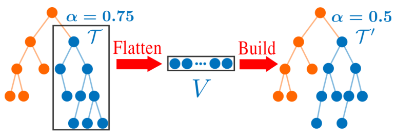

图4只重建需要整理的子树：提取其中有效点，重新构建平衡结构，再接回原树。没有必要每帧把整张地图重建一次。[§V-D，pp.8–9]

**【原文】** 设 $S(T)$ 为子树节点总数、$I(T)$ 为无效节点数，两类平衡条件为：[式(17)–(18)，p.8]

$$
\begin{aligned}
S(T_{\rm left})&<\alpha_{\rm bal}(S(T)-1),\\
S(T_{\rm right})&<\alpha_{\rm bal}(S(T)-1),\\
I(T)&<\alpha_{\rm del}S(T).
\end{aligned}
$$

一类防止有效结构过分偏斜，另一类防止已删除节点长期占据太多空间；任一条件被破坏，都可能触发对应子树重建。论文实验采用 $\alpha_{\rm bal}=0.6$、$\alpha_{\rm del}=0.5$，并行重建规模阈值 $N_{\max}=1500$。[§VI-A，p.11]

**【原文】** 小子树可在主线程中重建，大子树使用第二线程。论文算法4的过程是：[p.9]

1. 暂停该子树的增量修改，将有效点展开到数组；论文设计此时允许查询。
2. 放开修改，旧子树继续服务；新的插入和删除同时记录到操作队列。
3. 后台用快照构建新平衡树，再在新树上重放期间发生的操作。
4. 对访问做短暂同步，替换子树根指针，再释放旧树。

**【解读】** 操作日志让后台快照追上正在变化的在线地图。仅仅“另开线程建新树”而不重放中途更新，会丢失数据；不做访问同步而直接释放旧树，则可能访问已经释放的内存。这套机制仍有锁、快照和指针替换成本，不能称为无锁或零停顿。

**【代码】** 本次固定的后续 ikd-Tree 版本在 `multi_thread_rebuild` 中，展开快照阶段还通过查询计数同步临时阻止搜索，第259–277行可见。它与论文算法4对 `LockUpdates` 的抽象描述并不完全相同；具体锁行为须以使用的版本为准，不能把论文伪代码视为所有版本的并发契约。

| 操作 | 论文分析应怎样理解 |
| --- | --- |
| 单点插入 | 在低维、维持树高和局部降采样区域等条件下分析为 $O(\log n)$ |
| kNN | 利用包围盒下界剪枝；在论文的低维和期望回溯次数假设下为期望 $O(\log n)$ |
| 箱搜索/删除 | 与区域尺寸、数据分布及遍历节点数有关；论文式(19)给出分段条件，不是任意大盒都只需对数时间 |
| 单线程重建 | 对规模为 $n$ 的待重建子树，论文给出 $O(n\log n)$ |
| 双线程重建 | 主线程承担展开等 $O(n)$ 工作；后台仍要建树、重放更新，不能把总工作量也说成 $O(n)$ |

这里的 $n$ 指当前分析的树或子树大小。kNN 搜索在包围盒到查询点的距离已经不可能优于当前第 $k$ 个候选时剪枝；树高受控，也不保证所有分布和查询都只访问一条根叶路径。[§V-E/F，pp.9–10]

## 10. 实验设置：37 段序列并非 37 段精度对比

**【原文】** 公开数据来自五类数据集，附录表VIII列出共37段：18段用于地图数据结构评价，另外19段用于精度与系统耗时评价；精度部分又分为12段有轨迹真值的 RMSE 和7段首尾返回误差。[§VI、附录，pp.10–15、18]

| 数据集 | LiDAR | IMU 与条件 |
| --- | --- | --- |
| lili | Livox Horizon，非重复扫描，约 $81.7^\circ\times25.1^\circ$ FoV | 200 Hz，6轴；LiDAR 10 Hz |
| liosam | Velodyne VLP-16 | 1000 Hz，9轴；LiDAR 10 Hz |
| utbm | HDL-32E，只取左侧 LiDAR | 100 Hz，6轴；车载，最高约50 km/h，LiDAR 10 Hz |
| ulhk | HDL-32E | 100 Hz，9轴；城市道路含大量运动车辆，LiDAR 10 Hz |
| nclt | HDL-32E | 原始 IMU 50 Hz；为运行 LIO-SAM，文中用零阶保持插值到100 Hz |

nclt 的插值提高数据到达频率，不会创造新的惯性信息。不同传感器的扫描模式、点密度和 IMU 条件不同，不能拿一个序列的速度或误差外推所有硬件。

**【原文】** 默认局部地图边长1000 m；送入估计的原始点先按1:4时间采样；地图树内空间降采样边长 $l=0.5$ m。主要计算平台为 DJI Manifold 2-C，Intel i7-8550U、1.8 GHz、四核、8 GB RAM；ARM 平台为 Khadas VIM3，四核 Cortex-A73、2.2 GHz、4 GB RAM。[§VI-A，p.11]

精度基线为 LILI-OM、LIO-SAM、LINS。因为 FAST-LIO2 不含回环，作者关闭 LILI-OM 与 LIO-SAM 的回环，其他功能如滑窗优化仍保留。对照还包括600/800/1000/2000 m地图和 feature 版本。`—` 可能表示传感器或数据字段不满足基线要求，例如 utbm 缺少 LIO-SAM 所需姿态四元数；`×` 才表示完全失败，不能混写成同一类。[§VI-C、表IV/V，pp.12–14]

## 11. 精度结果：优势、反例与一处统计口径冲突

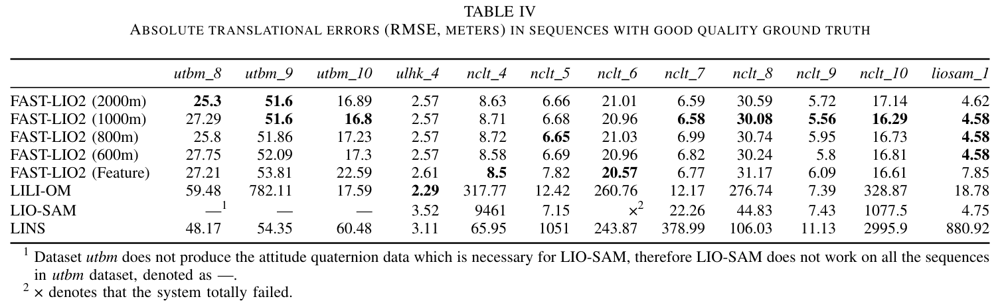

表IV单位为米，比较12段具有合适轨迹真值的序列。以下数值直接取默认1000 m地图列；feature 版本也按原表列出。[p.13]

| 序列 | FAST-LIO2 默认 | feature 版本 | 结果说明 |
| --- | ---: | ---: | --- |
| utbm_10 | 16.80 | 22.59 | 直接法在此明显更低 |
| ulhk_4 | 2.57 | 2.61 | LILI-OM 为2.29，低于这里所有 FAST-LIO2 变体 |
| nclt_4 | 8.71 | 8.50 | feature 略低于默认直接法 |
| nclt_8 | 30.08 | 31.17 | 其他基线分别为276.74、44.83、106.03 |
| liosam_1 | 4.58 | 7.85 | LIO-SAM 为4.75；不能由此推出所有 liosam 序列都最优 |

**【解读】** 数据支持直接法在多种场景中具有竞争力，也支持增量地图在长序列中的鲁棒性收益；它不支持“每个序列直接法都优于 feature”。例如 utbm_8 默认值27.29也略高于 feature 的27.21。增大地图也并非单调提高精度：旧点可能因累积漂移产生不可靠对应，论文正文讨论了这一问题。[§VI-C1，p.13]

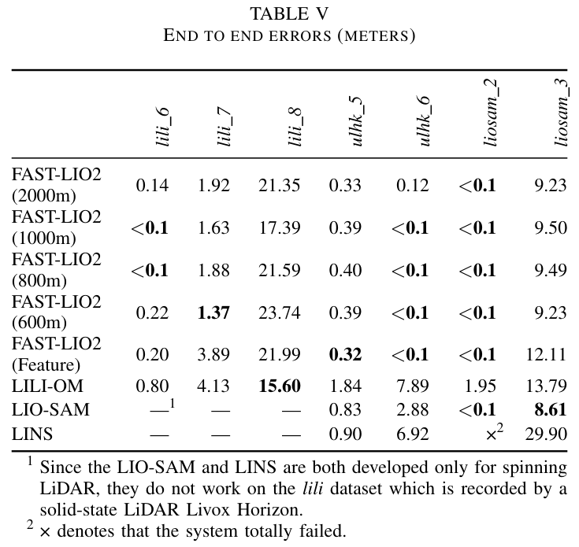

表V评价另外7段首尾回到同一点的序列，单位仍为米。这一指标衡量终点闭合误差，**不能替代整条轨迹的 RMSE 或绝对轨迹精度**。[p.14]

| 序列 | FAST-LIO2 默认 | feature | 其他方法或解释 |
| --- | ---: | ---: | --- |
| lili_6 | <0.1 | 0.20 | 默认直接法明显更低 |
| lili_7 | 1.63 | 3.89 | 600 m变体为1.37；树木和开阔区域对特征提取不利 |
| lili_8 | 17.39 | 21.99 | LILI-OM 为15.60，优于所有列出的 FAST-LIO2 变体 |
| ulhk_5 | 0.39 | 0.32 | feature 是此行更低者 |
| liosam_3 | 9.50 | 12.11 | LIO-SAM 为8.61，优于 FAST-LIO2 变体的最低9.23 |

**【原文与逐项核查】** p.13正文称 FAST-LIO2 或其变体在19段中有18段取得最好表现，并仅提到 ulhk_4 例外。但表IV、V至少还列出 lili_8、liosam_3 这两个明确反例。若按“每行允许选择 FAST-LIO2 任一变体、并列计入最优”的宽松口径读取，表IV可计11/12，表V可计5/7，合计16/19；表V正文自身也写的是5/7。本文因此保留原文主张与表格差异，不把“18/19”当成已被表格直接证实的汇总结论。

这个检查也提醒：地图大小和是否提特征是不同配置。“在多配置中逐行挑最好”比“固定默认配置最优”的口径宽得多，讨论复现结果时必须明确用哪一种。

## 12. 耗时结果：地图操作、整系统和 100 Hz 演示分开看

### 12.1 数据结构：总体更快，不是每项更新都最快

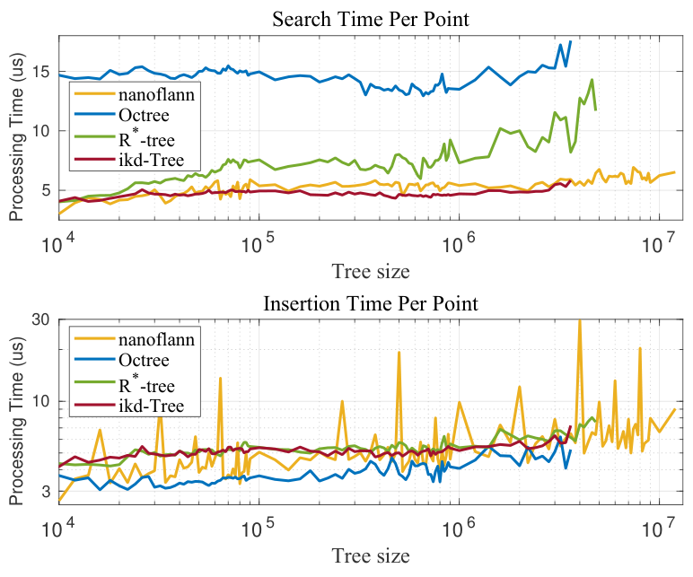

图5上半部分为逐点近邻搜索，下半部分为逐点插入。树规模横轴为对数刻度；低的平均曲线与偶发尖峰表达不同问题。论文使用当时的 nanoflann、PCL octree 和 Boost R*-tree 实现做比较，不代表所有未来版本的绝对排序。[§VI-B、图5，pp.11–12]

表III给出每扫描的平均耗时。例如 ulhk_2：[p.12]

| 数据结构 | 增量更新/ms | 近邻查询/ms | 总计/ms |
| --- | ---: | ---: | ---: |
| ikd-Tree | 3.51 | 22.26 | 25.77 |
| nanoflann | 3.43 | 26.07 | 29.49 |
| Octree | 2.32 | 64.56 | 66.88 |
| R*-tree | 4.23 | 31.75 | 35.98 |

ikd-Tree 总体更低，但这行更新最快的是 Octree。论文报告 ikd-Tree 在 nclt_2 的**最大**增量更新耗时为214.4 ms，其余17段小于150 ms；nanoflann在部分长序列出现数秒尖峰。这支持增量维护缓解大规模停顿，却也说明平均值不能当成硬实时最坏时延保证。[§VI-B2，p.12]

### 12.2 公开数据集：10 Hz 输入下的整系统耗时

**【原文】** 表VI中默认 FAST-LIO2 的平均整帧耗时从 liosam_2 的11.47 ms到 ulhk_6 的31.56 ms；ARM 列约44.26–100.00 ms。这一组公开数据集主要为10 Hz扫描，不能把这些数值与“每帧10 ms”的100 Hz期限混为一谈。[表VI，p.15]

FAST-LIO2把里程计和地图维护集成在一帧流程中。其他基线的 `Odo.` 与 `Map.` 在表中分列，比较整系统时作者将二者相加。某基线单独的里程计模块可能更快，例如 ulhk_6 的 LIO-SAM `Odo.` 为15.16 ms，FAST-LIO2总计为31.56 ms；这不构成完整流程的同口径胜负。文中概括的数倍加速，也不能写成每个序列、每个模块都保持该倍数。[§VI-D，pp.13–15]

### 12.3 私有手持序列：为什么地图维护是关键

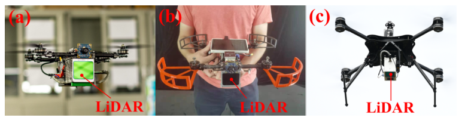

三种平台使用 Livox Avia，内置 BMI088 IMU，约 $70.4^\circ\times77.2^\circ$ FoV。除另行说明，私有实验采用100 Hz扫描和默认1000 m地图。[§VII-A，p.14]

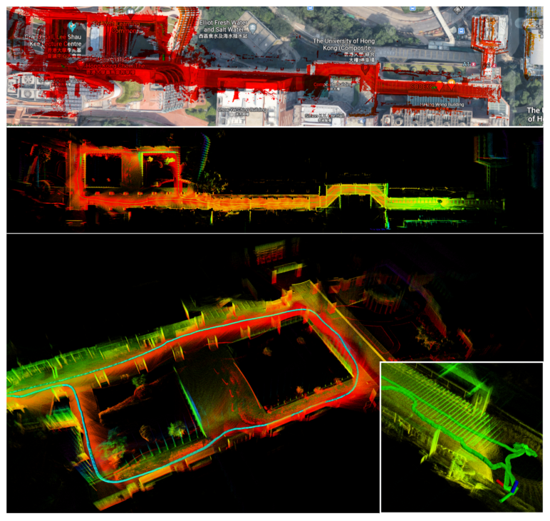

**【原文】** 该手持序列行进约650 m后返回起点，报告首尾误差0.14 m。图7对照卫星影像和局部结构，属于地图质量与返回误差证据，没有提供这一整条轨迹的高精度 ATE。[§VII-B1，pp.14–15]

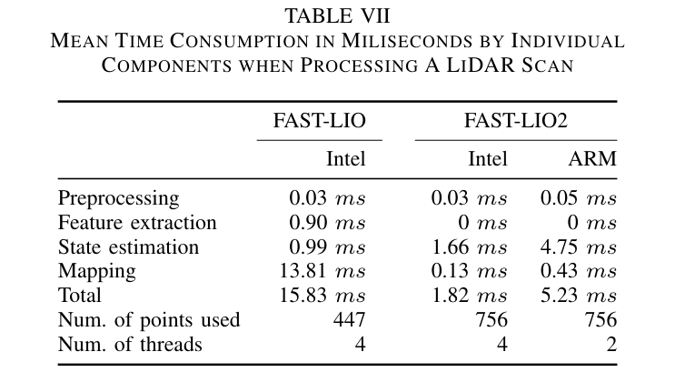

| 配置 | 特征提取/ms | 状态估计/ms | 地图/ms | 总计/ms | 每帧点数 | 线程数 |
| --- | ---: | ---: | ---: | ---: | ---: | ---: |
| FAST-LIO，Intel | 0.90 | 0.99 | 13.81 | 15.83 | 447 | 4 |
| FAST-LIO2，Intel | 0 | 1.66 | 0.13 | 1.82 | 756 | 4 |
| FAST-LIO2，ARM | 0 | 4.75 | 0.43 | 5.23 | 756 | 2 |

各行还包含很小的预处理时间，表中总值按原文保留。**【推导】** 在这一序列、这一 Intel 配置下，总耗时比为 $15.83/1.82\approx8.70$；地图模块之比为 $13.81/0.13\approx106.23$。这不是把单次树操作普遍提升106倍，也不是所有数据集的平均加速比。

FAST-LIO2的状态估计反而从0.99 ms增到1.66 ms，因为它使用更多点；主要节省来自不再每帧重新构建静态地图索引。这样的模块拆分比只说“去掉特征，所以快”更能解释实验。[表VII及其讨论，pp.15–16]

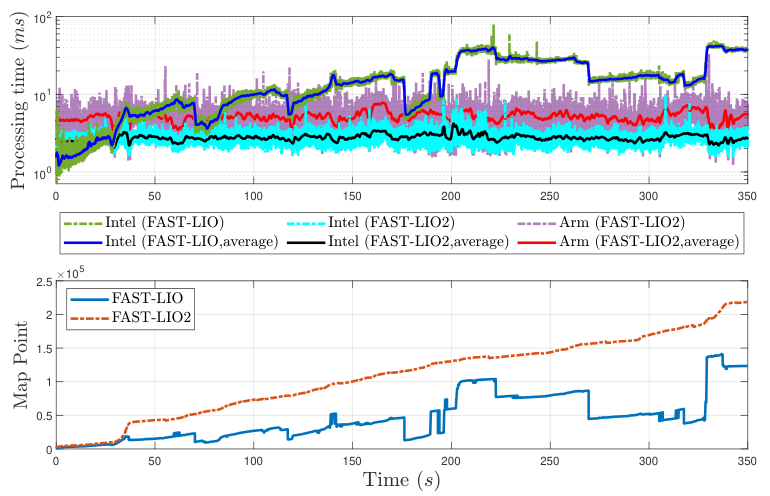

图8上方比较耗时，下方比较地图点数。FAST-LIO2保留更多地图点，耗时仍更低，支持增量维护的重要性。但**【原文】** ARM 上偶尔超过10 ms；Intel在这条序列中始终低于10 ms。作者提到短时可使用 IMU 传播状态供控制器使用，仍不能据此推断任意场景都无超时。[p.16]

## 13. 高动态与航空实验分别证明了什么

### 13.1 无人机翻转

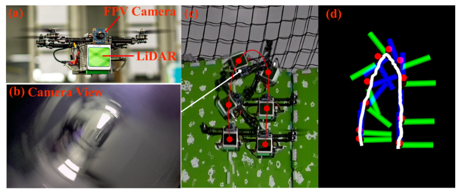

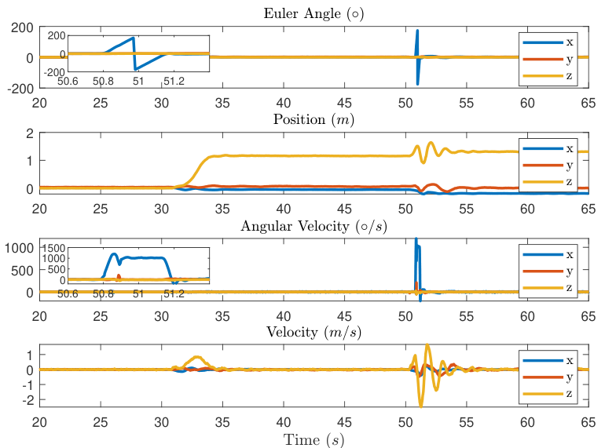

**【原文】** 小型无人机先悬停在约1.2 m高度，再快速翻转，控制器使用 FAST-LIO2状态反馈。50.8–51.2 s翻转区间的平均角速度为912°/s、最大1198°/s，平均每扫描处理耗时2.01 ms。[§VII-B2，p.16]

**【解读】** 图9和图11支持系统能在这一高速转动实验中维持可用状态反馈。它们不等于有独立高精度真值支撑的完整轨迹误差统计；角度图中的欧拉角跳变也不能直接解释为滤波姿态失效，需要考虑角度表示与跨越边界。

### 13.2 快速手持

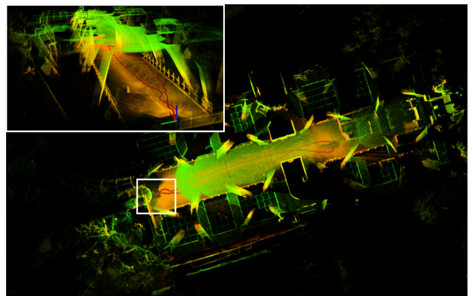

**【原文】** 手持传感器在天桥往返运动，最高线速度约7 m/s，角速度约在±100°/s变化；81 m轨迹的首尾误差小于0.06 m。[§VII-B3、图12/13，pp.16–17]

这里的81 m、0.06 m与前一节650 m、0.14 m来自不同实验，不能拼成同一条轨迹。图12能展示结构细节，但漂移评价仍限于论文报告的返回误差。

### 13.3 航空测绘

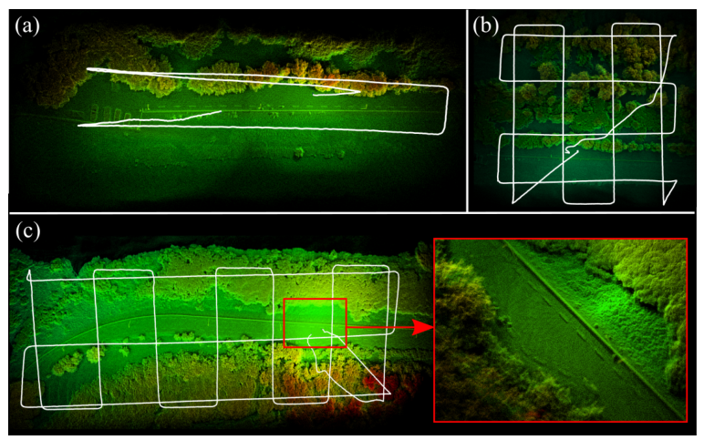

**【原文】** 香港湿地公园的三个场景，飞行高度分别为30、30、50 m；这里**特意改用10 Hz扫描**，平均每扫描耗时分别为19.6、23.9、23.7 ms。飞行器自带 GPS/IMU 用于导航，FAST-LIO2使用的是 LiDAR传感器单元提供的数据，包括其 IMU；不能误读为“FAST-LIO2完全不使用惯性数据”。[§VII-C，p.17]

作者只进行了与导航轨迹的视觉比较，GPS轨迹因技术原因未能用于定量评估。LILI-OM在这三段下视序列中因特征过少而失败，说明不同扫描方向与场景结构会影响特征方法，但这仍是限定实验，而非对所有地形的可靠性保证。

## 14. 对照官方代码：论文公式与工程版本不要混用

本次静态核对的是官方 [FAST_LIO 提交 7cc4175](https://github.com/hku-mars/FAST_LIO/tree/7cc4175de6f8ba2edf34bab02a42195b141027e9)，提交日期为2024-07-23；其 ikd-Tree 子模块固定在 [e2e3f4e](https://github.com/hku-mars/ikd-Tree/tree/e2e3f4e9d3b95a9e66b1ba83dc98d4a05ed8a3c4)。这是晚于论文的实现快照，**不是已核实的2021年实验代码版本**。以下结论来自源码函数体，不只来自 README；FAST_LIO所读文件已与固定提交树中的 Git blob 哈希核对。

| 论文概念 | 实际阅读的位置 | 核对结论 |
| --- | --- | --- |
| 状态与重力 | [include/use-ikfom.hpp，L8–20、L64起](https://github.com/hku-mars/FAST_LIO/blob/7cc4175de6f8ba2edf34bab02a42195b141027e9/include/use-ikfom.hpp#L8) | 重力用 $S^2$，局部误差为23维；函数输出的24维量不能当成24个局部自由度 |
| 逐点去畸变 | [src/IMU_Processing.hpp，UndistortPcl](https://github.com/hku-mars/FAST_LIO/blob/7cc4175de6f8ba2edf34bab02a42195b141027e9/src/IMU_Processing.hpp#L216) | 根据 IMU 轨迹和逐点时间补偿到帧末；实现含旋转和平移，不能只根据注释理解为纯旋转 |
| 地图匹配与门控 | [src/laserMapping.cpp，L650–695](https://github.com/hku-mars/FAST_LIO/blob/7cc4175de6f8ba2edf34bab02a42195b141027e9/src/laserMapping.cpp#L650) | 查询近邻后检查数量、距离，拟合局部平面并筛选残差；“直接”仍有约束选择 |
| 测量雅可比 | [src/laserMapping.cpp，L720–750](https://github.com/hku-mars/FAST_LIO/blob/7cc4175de6f8ba2edf34bab02a42195b141027e9/src/laserMapping.cpp#L720) | 按有效点数生成12个直接观测列；外参估计开关关闭时外参列置零，不能称整系统只估计12维 |
| 状态更新再插图 | [src/laserMapping.cpp，L956–976](https://github.com/hku-mars/FAST_LIO/blob/7cc4175de6f8ba2edf34bab02a42195b141027e9/src/laserMapping.cpp#L956) | 先调用迭代更新、取得新状态，再调用 `map_incremental()` |
| 点/子树删除区分 | [ikd_Tree.cpp，L780–801](https://github.com/hku-mars/ikd-Tree/blob/e2e3f4e9d3b95a9e66b1ba83dc98d4a05ed8a3c4/ikd_Tree.cpp#L780) | 验证第8节对算法3疑似笔误的解释 |
| 并行重建 | [ikd_Tree.cpp，multi_thread_rebuild](https://github.com/hku-mars/ikd-Tree/blob/e2e3f4e9d3b95a9e66b1ba83dc98d4a05ed8a3c4/ikd_Tree.cpp#L230) | 可见快照、操作重放和查询同步；后续实现的锁范围与论文抽象不完全一致 |

**【代码】** `use-ikfom.hpp` 的排列是位置、旋转、外参旋转、外参平移、速度、陀螺零偏、加计零偏、球面重力，与论文排列不同；`df_dx` 的 $24\times23$ 形状也明确区分了运动方程表达维数和局部误差维数。对应雅可比列不能仅按数字对齐。

代码在 `laserMapping.cpp` 第681行使用与量程有关的残差评分，第683行筛选评分大于0.9的点；第671行比较的是**平方距离**。这些是固定实现的具体规则，不能反过来声称论文已经逐项规定了同样阈值。当前代码中的 `feats` 等历史命名，也不能单独证明启用了特征提取。

**【代码＋建议】** 官方 README 强调逐点时间戳与 IMU–LiDAR 同步，给出了外参方向，并建议在已有可靠外参时关闭在线外参估计。若要复现，先固定提交和子模块、确认驱动点时间单位、话题与外参，再回放一个公开样例；不要先调残差阈值去掩盖时间戳错误。本次没有执行这些运行步骤，也没有验证现有依赖环境可成功编译。

## 15. 局限、复现思路与阅读自测

**【解读】** FAST-LIO2 的价值在于用统一估计器和增量地图，使“更多普通点参与配准”在计算上可行。它仍然依赖正确时间、外参、局部几何与初始估计。对以下边界，论文结果不能给出无条件保证：

- **几何退化**：长走廊、单一平面或重复结构可能让部分自由度约束不足；点多不等于信息满秩。
- **运动和传感器误差**：大角速度实验不消除 IMU 饱和、时间偏移、错误逐点时刻或激光失真的风险。
- **地图污染**：当前实现有残差门控，但不能据此称为完整动态物体分割系统；错误状态写入地图也会影响后续匹配。
- **全局漂移**：局部历史点重访可改善匹配，却不等于回环闭合；全局一致地图需要额外机制。
- **时延与精度证据**：平均耗时不等于最坏时延，首尾误差不等于全轨迹精度；私有演示和公共基准应分开评价。

**【建议】** 复现时先保留默认配置做可运行基线，逐步只改一项：特征/直接、点采样密度、地图范围、ikd-Tree维护方式。在相同输入、线程和硬件下同时记录轨迹误差、有效点数、迭代次数、地图有效/无效点数、平均/P95/最大时延；若只报平均帧率，会漏掉控制系统最关心的尖峰。对于没有轨迹真值的序列，应明确使用首尾返回误差或其他可得指标，不补造 ATE。

读完后，可尝试回答：

1. **不用特征提取，为什么仍要拟合平面？** 前者是预先挑选特征点，后者是在地图近邻上构造局部几何残差，属于不同环节。
2. **为何点时间戳不能用整帧时间戳替代？** 扫描内每个点对应不同运动状态，去畸变需要逐点时刻。
3. **$H$ 中速度列为零，速度就不更新吗？** 不是；先验交叉协方差可以传递位姿量测信息。
4. **为什么同一帧可以多次迭代，却不能多次独立融合？** 迭代在改进同一个 MAP 目标的线性化，原始先验和量测证据没有凭空增加。
5. **体素代表点是中心、均值还是实际点？** 论文选择距离中心最近的实际点。
6. **并行重建是不是没有锁和停顿？** 不是；需要快照、日志重放、访问同步和结构替换。
7. **100 Hz、1.82 ms、31.56 ms矛盾吗？** 它们对应不同扫描设置、平台和序列；必须连同实验条件阅读。
8. **19段精度对比能否直接总结成18段最优？** 按本地 PDF 的表IV、V逐项核查不能直接得到该说法，文中已保留冲突与反例。

## 原始资料

- [arXiv 论文记录与版本历史](https://arxiv.org/abs/2107.06829)：核对标题、作者与2021-07-14首发日期。
- [arXiv PDF](https://arxiv.org/pdf/2107.06829)：公开阅读入口；本文实际证据基准为用户提供的本地19页 PDF。
- [期刊 DOI](https://doi.org/10.1109/TRO.2022.3141876)及 [Crossref 元数据](https://api.crossref.org/works/10.1109/TRO.2022.3141876)：核对期刊卷期、页码与2022年出版信息。
- [官方 FAST_LIO 固定代码快照](https://github.com/hku-mars/FAST_LIO/tree/7cc4175de6f8ba2edf34bab02a42195b141027e9)与 [同版本 README](https://github.com/hku-mars/FAST_LIO/blob/7cc4175de6f8ba2edf34bab02a42195b141027e9/README.md)：代码对照与运行前提。
- [对应 ikd-Tree 子模块快照](https://github.com/hku-mars/ikd-Tree/tree/e2e3f4e9d3b95a9e66b1ba83dc98d4a05ed8a3c4)：核对箱删除及并行重建。

本文15张图片来自本地 PDF 中的12幅原图和3张原表，保留原编号；图片维护索引记录原英文图注、页码、裁剪区域与 SHA-256。它只用于本地核查，不形成额外公开文章。论文主张、源码实现、公式推导与数值示意分别标注，方便之后在同一篇笔记中继续修订。
