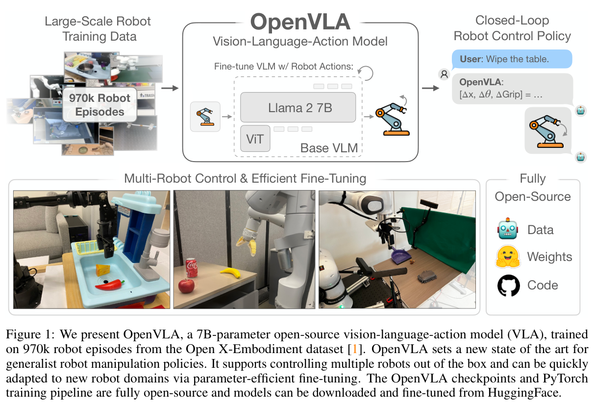
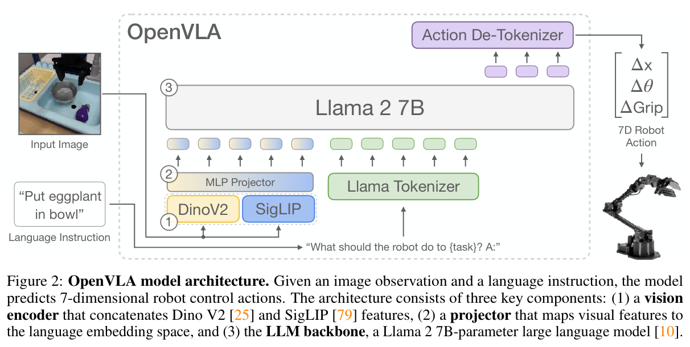
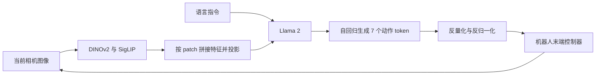
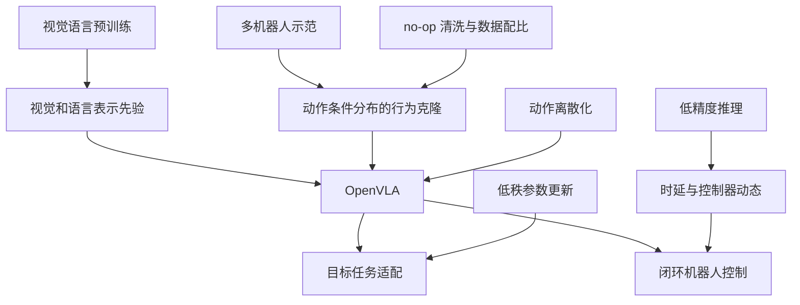

# OpenVLA：从视觉语言模型到可微调的机器人动作策略

> **一句话理解：** 将具备视觉与语言先验的 Prismatic VLM，用大规模机器人示范进一步训练成“看图、理解指令、输出下一步动作”的策略，再以少量目标机器人数据和 LoRA 完成适配。
>
> **阅读边界：** 依据 37 页本地 PDF，覆盖正文及附录 A–E。文中的“结果”都是作者报告；没有本地训练、推理或实机复现。标为“分析”“推导”“建议”的内容是本笔记的解释。

## 1. 论文卡片与核心判断

| 项目 | 核对结果 |
| --- | --- |
| 原题 | OpenVLA: An Open-Source Vision-Language-Action Model |
| 作者 | Moo Jin Kim、Karl Pertsch、Siddharth Karamcheti 等；前三位共同一作 |
| 主要机构 | Stanford、UC Berkeley、Toyota Research Institute、Google DeepMind、Physical Intelligence、MIT，见 p.1 |
| 版本 | 本地首页标记 arXiv:2406.09246v3，2024-09-05；首次提交 2024-06-13，官方 arXiv 历史可核对 |
| 任务 | 语言条件下的单臂视觉运动操作；已覆盖机器人直接部署，以及新场景/新机器人适配 |
| 输入/输出 | 一张 RGB 图像 + 指令 → 单步 7 维末端控制动作 |
| 模型 | Prismatic VLM；DINOv2 + SigLIP 融合视觉特征；Llama 2 7B |
| 机器人预训练数据 | 从 Open X-Embodiment 筛选、清洗和混合的约 970k 条真实机器人轨迹 |
| 训练目标 | 仅动作 token 上的自回归交叉熵，即离散动作空间中的行为克隆 |
| 实验 | 两平台 29 项直接评估；7 项 Franka 适配；LoRA；量化；4 组 LIBERO 仿真任务 |
| 核心贡献 | 开放的通用 VLA 训练与部署路线，兼顾跨任务能力和低成本适配 |

**我的判断：** 这篇论文最有价值的是把 VLA 做成可继续研究和适配的基础模型，并用实机验证数据、视觉适配和控制时延的重要性。动作离散化、自回归预测、LoRA 本身均有前作；贡献主要体现为组合设计、训练配方、工程开放和系统实验。论文没有充分隔离所有因素，因此“优于更大的 RT-2-X”不能解释成“只因模型结构更好”。[§1–3，pp.2–6；附录 C–D，pp.32–35]

## 2. 研究问题：机器人为什么需要可适配的 VLA？

### 2.1 从单任务模仿学习到通用策略

通常，某个机器人在固定桌面、固定物体上的示范可以训练出有效策略，但换背景、换目标物体、增加干扰物、改变物体位置或更换指令后，性能会明显下降。相比之下，互联网预训练的视觉与语言模型已经获得广泛的物体、语义和视觉表示知识。作者希望用这些先验降低机器人策略的泛化成本。[§1，p.2]

这里仍存在两个缺口：

1. **模型获取与研究缺口。** RT-2-X 等强 VLA 主要通过封闭系统提供，研究者难以检查数据配比、训练细节并修改模型。
2. **下游适配缺口。** 一个泛化不错的预训练模型，仍需要适配目标摄像头、控制频率、机器人和任务；先前工作没有系统给出低成本微调方案。

因此，本文要回答的不是单一“能否预测动作”，而是：能否获得一个开放、跨多种机器人训练、又能用较少目标数据有效适配的策略初始化？[§1、§5，pp.2–3、7]

### 2.2 与已有路线的关系

| 路线 | 论文中的角色 | 与 OpenVLA 的关键差异 |
| --- | --- | --- |
| RT-1-X | 非大规模互联网 VLM 路线的通用策略对照 | 较小的机器人策略，非本文的 VLM 全模型迁移方式 |
| RT-2-X | 最接近的 VLA 对照 | 也预测动作 token，但模型封闭；规模、训练数据和共训练方式不同 |
| Octo | 开放通用机器人策略对照 | 可适配、多模态输入更灵活；没有将整个预训练 VLM 直接改为动作生成器 |
| Diffusion Policy | 数据高效的下游模仿学习强基线 | 使用扩散生成连续动作块，更擅长部分精细、狭窄分布任务 |
| Prismatic VLM | OpenVLA 的直接初始化 | 原本执行视觉语言任务，经机器人数据训练后输出动作 |

**分析：** OpenVLA 继承 VLM 的表示与优化基础，再用机器人轨迹学习动作条件分布。这与“让聊天模型输出一段机器人代码”是不同的接口：控制回路直接使用数值动作，论文也没有要求生成显式推理链。[§2–3，pp.3–5]

## 3. 方法精读：图像和语言如何变成动作？

### 3.1 问题定义

给定当前图像 $I_t$ 和语言指令 $\ell$，预测下一步动作：

$$
a_t \sim \pi_\theta(a_t\mid I_t,\ell).
$$

对于本文的典型 7 维接口，可记为：

$$
a_t=[\Delta x,\Delta y,\Delta z,\Delta r_x,\Delta r_y,\Delta r_z,g].
$$

前三维控制末端平移，接着三维控制姿态，最后一维是夹爪控制。这个记法用于解释语义，具体坐标系、角度约定、单位和夹爪编码必须由数据转换与机器人接口共同确定。它不是七个关节角，也不是一段包含七个时间步的动作序列。[Fig.2，p.4；§5.2 脚注 3，p.9]

### 3.2 双视觉编码器与 patch 级融合

同一张图像分别经过 DINOv2 和 SigLIP，得到对应 patch 的特征，再沿**通道/特征维**拼接：

$$
f_k=[E_{\mathrm{DINO}}(I_t)_k;E_{\mathrm{SigLIP}}(I_t)_k],
\qquad v_k=P_\phi(f_k).
$$

$k$ 表示图像 patch；$P_\phi$ 是将视觉特征投到语言模型输入空间的 MLP。语言模型接收视觉 token 和指令 token，再生成动作 token。[§3.1、Fig.2，p.4]

作者的解释是，SigLIP 提供较强语义表示，DINOv2 补充有利于空间关系与局部结构的特征。不过，这是一种表示分工的解释，不代表有一个显式“空间推理模块”，也不等于视觉表征已经包含可直接执行的 3D 位姿。

**为什么强调通道拼接？** 它扩展每个 patch 的特征维度，而不是简单把两套 patch 序列首尾相接；两种做法对序列长度、计算成本和对齐要求不同。[§3.1，p.4]

### 3.3 动作离散化：将连续控制写进词表

论文将每个动作维度独立离散化为 256 个等级。不同维度共享这套数值 token，其含义由生成位置确定：第一个 token 对应第一维，而不是为每一维单独创建 256 个词。[§3.2，p.5]

区间使用训练动作的第 1 与第 99 百分位，降低极端异常值扩大区间后造成的分辨率损失。下面用**理想等宽量化的教学形式**解释，不声称是官方代码的逐行公式：

$$
L_j=Q_{0.01}(a_j),\quad U_j=Q_{0.99}(a_j),\quad
\bar a_j=\operatorname{clip}(a_j,L_j,U_j),
$$

$$
\Delta_j=\frac{U_j-L_j}{256},\quad
b_j=\operatorname{clip}\left(
\left\lfloor\frac{\bar a_j-L_j}{\Delta_j}\right\rfloor,0,255\right).
$$

用 bin 中心解码的概念形式为：

$$
\hat a_j=L_j+(b_j+\tfrac12)\Delta_j.
$$

**推导：** 对区间内、非退化维度，在理想最近中心量化下，单维量化误差不超过半个 bin；区间外裁剪还会带来额外误差。选择分位数是在鲁棒性与尾部动作表达范围之间折中。实际实现的边界处理见后文实现补充。

教学例子：假设某一平移维的有效范围为 $[-0.05,0.05]$ 米，则理想 bin 宽约为 $0.39$ 毫米。**这些数值是解释用假设，不是论文的实测动作统计。** 而且机器人最终定位误差还受感知、控制器、时延和累积误差影响，不能由量化宽度直接推出。

Llama tokenizer 只预留约 100 个新增特殊 token，不够容纳 256 个动作等级。因此作者复用词表末尾的 256 个低频 token，使它们承担动作 token 的语义。[§3.2，p.5]

### 3.4 自回归预测与损失

将动作编码为 $z_t=(z_{t,1},\ldots,z_{t,7})$，则动作分布可写成：

$$
p_\theta(z_t\mid I_t,\ell)
=\prod_{j=1}^{7}p_\theta(z_{t,j}\mid I_t,\ell,z_{t,<j}).
$$

训练采用标准 next-token 目标，交叉熵仅作用于动作 token：

$$
\mathcal L(\theta)
=-\mathbb E_{(I_t,\ell,a_t)\sim\mathcal D}
\sum_{j=1}^{7}\log p_\theta(z_{t,j}\mid I_t,\ell,z_{t,<j}).
$$

这是对 §3.2 的数学重述。训练时通过 teacher forcing 使用真实的前缀动作 token，推理时逐 token 生成。同一步各动作维度可以互相条件化，但这种自回归性没有自动赋予模型跨时间的历史记忆。

**分析：** 离散动作的行为克隆可以充分复用 LLM 训练基础设施；代价是输出连续动作前需多次解码，且交叉熵对相邻 bin 的距离结构利用有限。“错一个 bin”和“错很多个 bin”在标准分类标签里都属于预测错误，虽然其控制后果很不一样。

### 3.5 闭环执行与时序边界

这里“闭环”表示执行动作后获取新图像，再做下一次决策。它不表示推理频率等于电机伺服频率，也不表示模型在一次预测中规划完整轨迹。控制器仍需把策略输出转换成机器人能够执行的指令。[Fig.1–2，pp.1、4；§3.5、§6，pp.6、11]

原版 OpenVLA 的输入没有多帧历史、关节/末端本体状态或腕部图像。遇到同一图像对应不同速度、接触状态或遮挡历史的情况，单帧输入可能不足以确定合适动作。这是由输入设定导出的局限，不是本文单独测出的误差来源。

## 4. 数据与训练配方：效果从哪里来？

### 4.1 970k 轨迹不是完整 OpenX

论文写作时的 OpenX 超过 70 个子数据集、超过 2M 条轨迹。OpenVLA 只采用符合输入输出条件的数据：至少一个第三人称相机、单臂末端控制等；再用主要继承 Octo 的启发式配比，避免低多样性数据主导训练。[§3.3，p.5]

附录表 3 列出 27 项来源。部分采样占比为 Bridge 13.3%、Fractal 12.7%、Kuka 12.7%、DROID 10.0%、BC-Z 7.5%、FMB 7.1%。它们是混合采样比例，不是各数据集原始轨迹数占比。[附录 A、Table 3，p.21]

需要保留三个细节：

1. **970k 指轨迹/episode，不是 970k 张图像，也不是 970k 个动作。** 轨迹提供多个时间步的监督样本。
2. **DROID 不是全程 10%。** 由于动作 token 准确率持续偏低，作者在最后三分之一训练中移除 DROID，并把权重重新分配给其他数据集。
3. **动作空间统一不等于机器人完全同质。** 控制频率、相机视角、动作统计和动力学差异仍然存在。

**分析：** 本文的数据混合具有训练阶段变化，复现时只照抄表 3 的静态占比会遗漏一部分配方。DROID 学习困难也提示，多样性增加并不保证固定模型和固定训练预算下的收益。[§3.3、表 3 脚注 6，pp.5、21]

### 4.2 清洗 no-op：一个会改变闭环行为的细节

在 BridgeData V2 中，每条示范的第一个 transition 记录了全零动作。作者发现模型会模仿这些动作，在部署时停止不动；于是移除每条示范的首个 transition，缓解问题。[附录 C，p.32]

这与 LIBERO 的清洗需要区分：LIBERO 按平移、旋转幅度接近零且夹爪状态不变来过滤 no-op，并且过滤重放失败的示范。本文没有说在 Bridge 中无条件删除所有零动作。[附录 E，pp.36–37]

**分析：** 离线数据中的静止标签在闭环中可能形成吸引状态：模型输出静止，图像几乎不变，再次输出静止。处理时必须保留夹爪切换、必要等待等有意义行为，不能把“动作小”全部解释成脏数据。

### 4.3 关键训练选择

| 选择 | 作者报告 | 如何理解证据 |
| --- | --- | --- |
| VLM 初始化 | 选择 Prismatic；早期对比优于所测 IDEFICS-1、LLaVA 版本 | 较小规模开发实验，不能推广成所有版本的排名 |
| 输入分辨率 | 224×224 与 384×384 在所测任务无明显性能差异，后者训练约慢 3 倍 | 224 是本文预算下的选择，不是高分辨率永远无用 |
| 视觉编码器 | 机器人训练时更新视觉编码器更有效 | VLM 阶段常见的冻结经验不能直接照搬 |
| 训练长度 | 最终约 27 epochs；实机表现持续提高至训练动作 token 准确率超过 95% | 是经验观察，不是通用停止准则 |
| 学习率 | 固定 $2\times10^{-5}$，未发现 warmup 的收益 | 指本文 VLA 训练设置，不应自动作为所有 LoRA 的学习率 |
| 批量 | 2048 | 大规模预训练配置 |
| 算力 | 64 张 A100，14 天，约 21,500 A100 GPU·小时 | 不能与单卡下游微调成本混为一谈 |

[§3.4–3.5，pp.5–6]

**分析：** 训练准确率高只能说明模型拟合监督标签。环境状态分布、延迟和累积误差决定闭环表现，应该用独立 rollout 验证选模型，而不是把 95% token 准确率视为成功率保证。

## 5. 低成本适配：LoRA 和量化分别解决什么？

### 5.1 LoRA 降低更新参数与训练开销

LoRA 的解释形式为：

$$
W'=W+\frac{\alpha}{r}BA,
\quad A\in\mathbb R^{r\times d_{\mathrm{in}}},
\quad B\in\mathbb R^{d_{\mathrm{out}}\times r}.
$$

冻结原矩阵 $W$，只学习低秩更新 $BA$。这是 LoRA 的标准解释；论文将其应用于模型的线性层并比较 $r=32,64$。[§5.3，p.10]

| 策略 | 得分均值 ± 标准误 | 可训练参数 | 显存，batch 16 |
| --- | --- | --- | --- |
| 全量微调 | 69.7 ± 7.2% | 7,188.1M | 163.3 GB，跨 2 卡 FSDP |
| 仅最后层 | 30.3 ± 6.1% | 465.1M | 51.4 GB |
| 冻结视觉 | 47.0 ± 6.9% | 6,760.4M | 156.2 GB，跨 2 卡 FSDP |
| Sandwich | 62.1 ± 7.9% | 914.2M | 64.0 GB |
| LoRA，r=32 | 68.2 ± 7.5% | 97.6M | 59.7 GB |
| LoRA，r=64 | 68.2 ± 7.8% | 195.2M | 60.5 GB |

[Table 1、Table 8，pp.10、32；每种方法 33 次 rollout]

97.6/7188.1≈1.36%，对应论文约 1.4% 的说法。作者报告单张 A100 约 10–15 小时可完成 LoRA 适配，并推荐其测试中的 $r=32$。

**重要边界：** §5.3–5.4 使用较小 OpenX 混合、仅 SigLIP 视觉编码器的模型变体，见 p.10 脚注 4。表 1 不等于最终 DINOv2+SigLIP 模型的统一显存基准。LoRA 参数少，仍需储存基础权重与中间激活，不能由 1.4% 直接推出训练显存也只需 1.4%。

### 5.2 量化降低推理显存，但可能改变控制时序

| 推理精度 | Bridge 得分均值 ± 标准误 | 显存 |
| --- | --- | --- |
| bfloat16 | 71.3 ± 4.8% | 16.8 GB |
| int8 | 58.1 ± 5.1% | 10.2 GB |
| int4 | 71.9 ± 4.7% | 7.0 GB |

[Table 2、Table 5，pp.10、26；8 项任务，80 次 rollout；仍为脚注 4 的模型变体]

int4 显存较该组 bfloat16 减少约 58.3%，平均得分接近。int8 在 A5000 上约 1.2 Hz，而 int4 约 3 Hz；原数据来自 5 Hz 非阻塞控制，这种速度差会改变控制动态。[§5.4，p.11]

附录进一步使用**阻塞控制**：执行完动作再预测下一步，弱化不同预测延迟对动作执行的影响。此时 bfloat16、int8、int4 分别为 70.0±5.1%、74.4±4.9%、68.8±5.2%，没有再出现 int8 明显更差的同样趋势。[附录 D.4、Table 11，pp.34–35]

**分析：** 这支持“int8 主要受推理时延影响”的解释，但不是对所有硬件和任务的量化结论。阻塞控制也改变了系统运行方式，不能当作所有时延影响都已被完美消除的证明。量化需联合检查动作误差、吞吐、延迟分布和实机 rollout。

## 6. 实验精读：论文究竟证明了什么？

### 6.1 实验版图与统计口径

| 实验 | 数据与次数 | 要回答的问题 |
| --- | --- | --- |
| WidowX / BridgeData V2 直接评估 | 17 项，每项 10 次，共 170 次/方法 | 背景、位置、形状、语义及语言选物变化下是否泛化 |
| Google Robot 直接评估 | 12 项，每项 5 次，共 60 次/方法 | 另一已覆盖机器人上的 ID/OOD 能力 |
| Franka 下游适配 | 7 项，10–150 条示范/任务；99+30=129 次/方法 | 用小数据适配新设置是否有效 |
| 参数高效微调 | 两类 Franka 任务及 ID/OOD 变体，共 33 次/方法 | 如何降低适配成本 |
| 量化与消融 | 代表性 Bridge 子集，通常 8 项×10 次 | 显存、时序、数据多样性和视觉设计的影响 |
| LIBERO | 4 个 suite；每组 10 任务；3 seeds×500 次/suite/方法 | 实机预训练能否迁移到仿真 |

实机对照尽量使用一致的初始机器人与物体状态，属于 A/B 评估。[§5.1，pp.7–8]

**评分需要谨慎：** Bridge 若干任务使用 0/0.5/1；Franka 也有部分分，Wipe Table 原始评分为 0/1/2 后归一化。文中的 success rate 在这些设置中是归一化任务得分均值，不是严格“全部完成次数/试验次数”。Google 的表 6 才采用二元成败。[附录 B，pp.21–32]

### 6.2 跨机器人直接评估

| 平台 | RT-1-X | Octo | RT-2-X | OpenVLA |
| --- | --- | --- | --- | --- |
| Bridge，170 次 | 18.5 ± 2.7% | 20.0 ± 2.6% | 50.6 ± 3.5% | **70.6 ± 3.2%** |
| Google，60 次 | 33.3 ± 6.1% | 26.7 ± 5.8% | 78.3 ± 5.4% | **85.0 ± 4.6%** |

[Tables 4、6，pp.26、28；误差均为作者报告的标准误]

按附录的原始任务分数合并：OpenVLA 得分为 $120+51=171$，RT-2-X 为 $86+47=133$，总计 230 次，因此：

$$
\frac{171-133}{230}\times100\approx16.52\text{ 个百分点}.
$$

这与摘要的 16.5 对应；不是每个平台都提高 16.5，也不是相对增幅 16.5%。详见[数值核查](实验结果与证据核查.md)。

**主要模式：** OpenVLA 在 Bridge 整体上优势较大，Google 平台上与 RT-2-X 接近。Bridge 语义泛化类别中，RT-2-X 为 38.8%，OpenVLA 为 36.3%；不能写成 OpenVLA 在每一种泛化上都领先。[Fig.3–4、§5.1，pp.7–8]

**为什么不能把结果只归因于“小模型更强”？** OpenVLA 使用约 970k 轨迹，RT-2-X 约 350k；数据清洗、视觉编码器和预训练方式也不同。RT-2-X 在 Bridge 还采用一直查询第二高概率动作的 no-op 缓解办法。它是系统级对照，不是只改一个模型结构的严格消融。[§5.1、附录 C，pp.8、32–33]

此外，“直接部署/zero-shot”指没有针对这些目标评估任务再微调；它不表示 WidowX、Google Robot 两种机器人完全没有出现在预训练中，也没有证明任意新机器人即插即用。

### 6.3 新设置少样本适配

作者在 Franka-Tabletop 和 Franka-DROID 两种设置中测试 7 项任务。前者控制器 5 Hz，后者 15 Hz；这些是控制设置，不代表每个 OpenVLA 配置都能达到相同推理吞吐。[§5.2，pp.8–9]

| 任务 | 示范数 | OpenVLA 与 Diffusion Policy 的主要现象 |
| --- | --- | --- |
| Put Carrot in Bowl | 50 | 窄分布取放中 DP 具竞争力；OpenVLA 并非全面领先 |
| Pour Corn into Pot | 50 | DP 明显更强，体现精细连续动作建模的优势 |
| Flip Pot Upright | 10 | OpenVLA 在表 7 所列 ID/OOD 条件下表现好 |
| Move object onto Plate | 150 | OpenVLA 在多物体、语言选目标场景下优势明显 |
| Knock object Over | 70 | 预训练通用策略表现较好，具体排序随条件变化 |
| Cover object with Towel | 45 | Octo 优于 OpenVLA，说明没有单一方法统治所有任务 |
| Wipe Table | 70 | OpenVLA 在所测场景及干扰物设置下表现较好 |

[附录 B.3，pp.29–32]

表 7 分平台均值：Franka-Tabletop 中 OpenVLA 为 67.2±4.0%，DP 为 48.5±4.9%；Franka-DROID 中 OpenVLA 为 58.3±7.2%，DP 为 35.0±8.0%。OpenVLA(scratch) 指从预训练 Prismatic VLM 直接用目标机器人数据适配，跳过 OpenX 机器人预训练，**不是随机初始化所有网络权重**。[§5.2、Table 7，pp.9、32]

DP 完整版使用两步观测历史、图像与本体状态、动作块和绝对笛卡尔位置；DP(matched) 则匹配 OpenVLA 的单帧、无本体状态、无历史、单步相对控制。两者都值得保留：一个检验强实际基线，一个缩小输入输出接口差异。[§5.2 脚注 3，p.9]

**必须说明的汇总权重：** 图 5 给出 DP 43.4%、OpenVLA 63.8%，差 20.4 个百分点；将表 7 每次试验先归一化再等权合并，约为 45.35% 与 65.12%，差 19.77 个百分点。进一步核查发现，直接合并原始分数，以 $99\times1+30\times2=159$ 为总满分，可以重现图 5 全部五种方法的汇总值。因此两种计算并非同一指标：图 5 的数值与按原始满分加权一致，擦桌 rollout 权重为其他任务的两倍。**这是由表格和评分规则推出的解释，原文未明确写出汇总公式。**[Fig.5、附录 B.3、Table 7，pp.9、31–32]

### 6.4 消融：数据混合的证据比视觉融合更强

| 模型 | Bridge 代表性 8 任务平均得分 |
| --- | --- |
| OpenVLA：OpenX + 双视觉编码器 | 76.3 ± 4.8% |
| OpenVLA-Bridge：仅 Bridge + 双视觉编码器 | 45.6 ± 5.6% |
| OpenVLA-Bridge-SigLIP：仅 Bridge + SigLIP | 40.6 ± 5.5% |

[Table 9，p.34]

第一、二行相差 30.7 个百分点；第二、三行相差 5.0 个百分点。在这组有限实验中，多数据集机器人训练的关联收益更大。双视觉编码器对部分任务有帮助，但 5 点差异伴随较大标准误，且消融在 Bridge-only 模型上完成，不能声称它在完整 OpenX 模型上具有相同的独立增益。

附录 D.3 在两个 VLM 初始化上比较冻结/微调视觉编码器，支持更新视觉特征；但场景配置与主实验不同，部分冻结实验因性能近零而中止，不能与其他表的绝对数直接拼接。[pp.34–35]

### 6.5 LIBERO：适配成功，但优势有限且不均匀

| 方法 | Spatial | Object | Goal | Long | 均值 |
| --- | --- | --- | --- | --- | --- |
| Diffusion Policy | 78.3% | **92.5%** | 68.3% | 50.5% | 72.4% |
| Octo 微调 | 78.9% | 85.7% | **84.6%** | 51.1% | 75.1% |
| OpenVLA LoRA 微调 | **84.7%** | 88.4% | 79.2% | **53.7%** | **76.5%** |

[Table 12，p.37；标准误与逐组信息见实验核查文档]

每个方法在各 suite 上分别训练一个模型，使用相同的清洗后成功示范。原始每组有 500 条示范，过滤后 Spatial/Object/Goal/Long 分别保留 432/454/428/379 条。作者重新以 256×256 渲染，过滤 no-op，并在其硬件上对图像旋转 180°修正朝向；训练和测试仅使用静态第三人称相机。[附录 E，pp.36–37]

这是有监督适配实验，不是跨 suite 的持续学习，也不是在仿真上零样本部署。OpenVLA 平均领先 Octo 1.4 点，Object 和 Goal 没有获得最佳结果，Long 只有 53.7%。作者把相对较小的优势归因于真实到仿真的域差异，但没有通过加入仿真预训练数据的对照直接证明该解释。

## 7. 官方实现补充：论文解释与当前代码要分开

以下仅作为读论文后的工程提示，来源为整理日核查的官方仓库；`main` 未固定历史提交，不代表与 2024 年实验证明完全一致。

1. [动作 tokenizer](https://github.com/openvla/openvla/blob/main/prismatic/vla/action_tokenizer.py) 使用 `linspace`、`digitize` 与词表末端反向映射。其默认 256 个边界形成 255 个区间中心，并裁剪末端索引。因此前文“256 个等宽区间”的教学公式用于理解概念；做逐数值复现应直接核对目标 checkpoint 的实现与边界测试。
2. [HF 模型接口](https://github.com/openvla/openvla/blob/main/prismatic/extern/hf/modeling_prismatic.py) 包含动作生成、bin 中心解码和基于数据集统计量的反归一化。`unnorm_key` 应匹配目标数据；归一化掩码也需要保留。代码的融合分支投影器结构与论文中“小型 MLP”的概述不应机械等同。

**分析：** 最容易出现“模型跑起来但机器人动作不对”的地方，是动作归一化、坐标和夹爪约定。阅读模型公式之外，还要核对训练样本进入模型与预测离开模型的两条数据路径。

关于“开源”：论文 p.2 脚注 1 说明基础模型的训练数据与代码并非全部公开。OpenVLA 开放的是基于这些组件的训练流程、数据配方和权重；不能扩展成“从互联网原始数据到所有底层模型均可完整复建”。

## 8. 局限与批判性评价

### 8.1 作者明确指出的局限

- 原始模型仅接收单张图像，缺少多视角、本体状态和观测历史。
- 推理吞吐不足以直接覆盖高频精细双臂任务，例如作者提及的 50 Hz ALOHA 设置。
- 多数测试条件还达不到 90% 的高可靠性。
- 计算预算限制了基础模型规模、机器人与视觉语言数据共训练、视觉表示选择等问题的探索。

[§6，p.11]

### 8.2 我认为需要特别关注的证据边界

| 问题 | 为什么影响结论 | 本笔记的保守表述 |
| --- | --- | --- |
| 跨方法数据与架构同时变化 | 无法隔离单一改动的因果效应 | 证明该系统在所测协议下有优势 |
| 部分分与“成功率”混用 | 选对物体但未完成可能也得分 | 必须区分目标选择能力与完整完成能力 |
| 实机每任务试验较少 | 结果会受初始条件、场景和试验噪声影响 | 报告次数与标准误，不自行宣称统计显著 |
| 图 5 可由原始满分加权重现 | 擦桌任务每次满分 2，汇总时权重高于其他任务 | 分清总原始得分比例与 rollout 等权归一化均值 |
| LoRA/量化用简化变体 | 不能直接推广显存与精度结论 | 迁移到最终模型需重新测量 |
| “新任务”不等于全新机器人 | 平台在预训练中有覆盖 | 分清目标任务适配与跨全新本体零样本控制 |
| 量化准确率与时延耦合 | 离线 token 指标可能掩盖闭环问题 | 同测推理延迟与实际任务得分 |
| 动作生成并非显式规划验证 | 高层语义知识不保证接触物理与长期可靠性 | 不把视频示例外推为通用规划能力 |

标准误重叠既不是显著差异的证明，也不是等效性检验。缺少原始 rollout 日志和训练种子分解时，不应自行添加 p 值或“严格无损”的统计判断。

### 8.3 主观阅读评分

以下为个人判断，非会议评审或客观评级。

| 维度 | 分数/10 | 理由 |
| --- | --- | --- |
| 问题与实用价值 | 9 | 开放强 VLA 并提供适配路线，直接降低研究进入成本 |
| 方法独创性 | 7 | 主要是成熟组件的有效整合与机器人训练配方 |
| 实验证据 | 8 | 有多平台实机与附录消融；仍有统计、变体和汇总限制 |
| 可复现性 | 8 | 数据、权重和代码使复现可行；实机条件与预训练算力门槛高 |
| 综合 | 8 | 适合作为理解现代 VLA 及开展后续研究的基础论文 |

## 9. 可进一步研究的问题

以下是由论文局限推导的实验建议，不是本文已证明的贡献。

### 9.1 把空间语义能力与连续运动质量分开测量

假设：VLM 迁移主要改善目标选择与场景泛化，单步 token 动作仍限制精细轨迹。可以在固定视觉、数据和预算下，比较单步离散 token、连续动作头和动作分块，分别报告选物准确率、完整完成率、轨迹平滑度与时延。这样才能判断改进来自语义还是控制表示。

### 9.2 用受控延迟实验研究闭环性能

固定精度和模型，人工加入不同延迟及抖动，再与量化设置交叉对照。测量 p50/p95 端到端延迟、策略更新频率、动作执行时长和任务得分。这比只报告平均每秒动作数更能解释实机差异。

### 9.3 数据清洗与采样权重的系统消融

固定模型和总训练步数，分别改变 no-op 清洗、数据多样性、DROID 权重和阶段调度。既测训练拟合，也测留出场景和目标机器人适配。本文表 9 提示数据作用很大，但未进一步分离轨迹总量与多样性的贡献。

### 9.4 补足状态与时间信息

加入本体状态、腕部视角、短历史，重点评估遮挡、接触和多阶段操作。需使用相同演示、相同任务划分和相近预算，避免把额外传感信息的收益误写成纯模型结构收益。

## 10. 阅读后应记住的知识连接

建议连同论文参考文献 [7] RT-2、[44] Prismatic、[5] Octo、[3] Diffusion Policy、[1] Open X-Embodiment 一起阅读，分别补齐 VLA 起点、VLM 初始化、通用机器人策略、动作生成方法和跨机器人数据背景。这里是基于本文引用关系的阅读顺序，不声称已完成这些论文的独立精读。

## 11. 原文定位与资源

| 需要回查的内容 | 原文位置 |
| --- | --- |
| 动作 token、分位数、损失 | §3.2，p.5 |
| 数据筛选、DROID 调度 | §3.3，p.5；附录 A，p.21 |
| 分辨率、视觉微调、epochs | §3.4，pp.5–6 |
| 实机直接评估 | §5.1，pp.7–8；Tables 4、6，pp.26、28 |
| DP 与匹配版输入输出 | §5.2 脚注 3，p.9 |
| LoRA、量化及变体边界 | §5.3–5.4、脚注 4，pp.10–11 |
| 适配逐任务评分 | 附录 B.3、Table 7，pp.29–32 |
| RT-2-X no-op 与查询方式 | 附录 C，pp.32–33 |
| 消融与阻塞量化 | 附录 D，pp.33–35 |
| LIBERO 设置和结果 | 附录 E，pp.36–37 |

- [完整实验核查](实验结果与证据核查.md)
- [复现路线与自测](复现路线与阅读自测.md)
- [原文图表](图表索引.md)
- [论文版本页](https://arxiv.org/abs/2406.09246v3)
- [项目页](https://openvla.github.io/)
- [官方仓库](https://github.com/openvla/openvla)
