# FAST 原文图片索引

来源：[FAST arXiv v1](https://arxiv.org/abs/2501.09747v1)，用户提供的 19 页 PDF。

本地维护索引，不作为公开文章扫描。编号图保留原图注；两幅未编号消融图的上下文见正文。裁剪坐标、尺寸和 SHA-256 见 index.json。

## 图1：训练收敛与任务展示 · PDF p.1

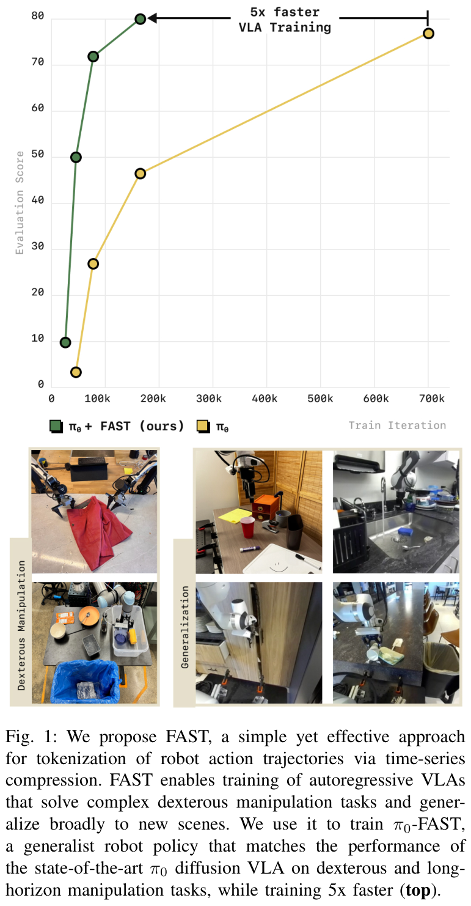

## 图3：采样频率与插值预测 · PDF p.3

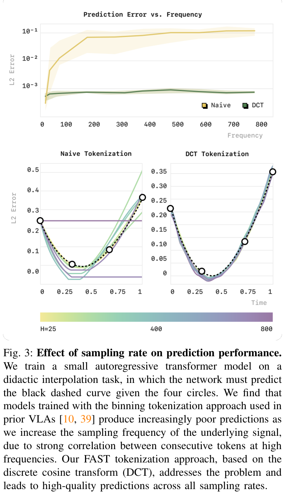

## 图4：FAST 编码流程 · PDF p.5

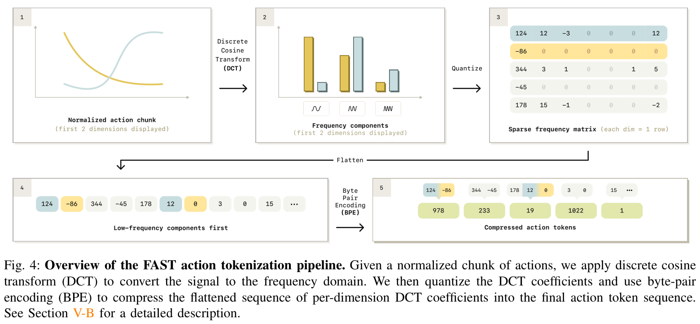

## 图5：七类评估环境 · PDF p.6

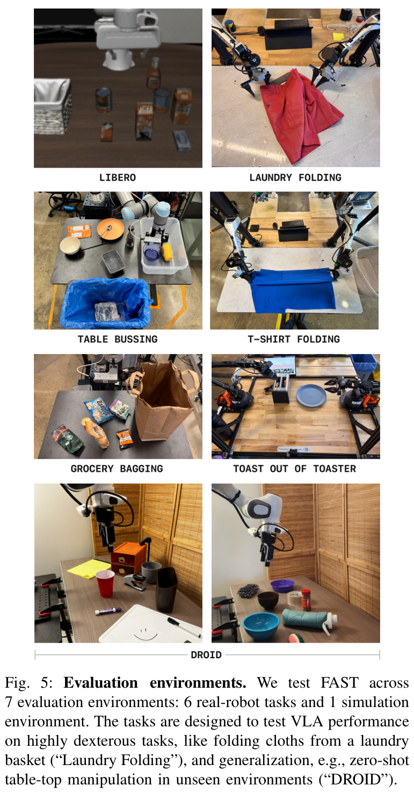

## 图6：分词方法策略对比 · PDF p.8

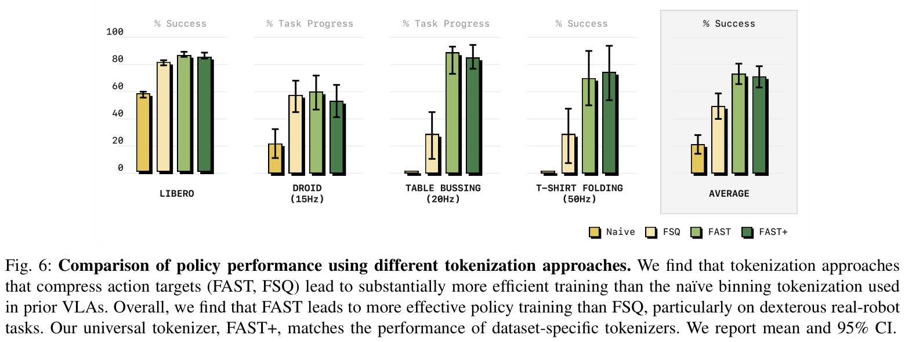

## 图7：三校区定性演示 · PDF p.8

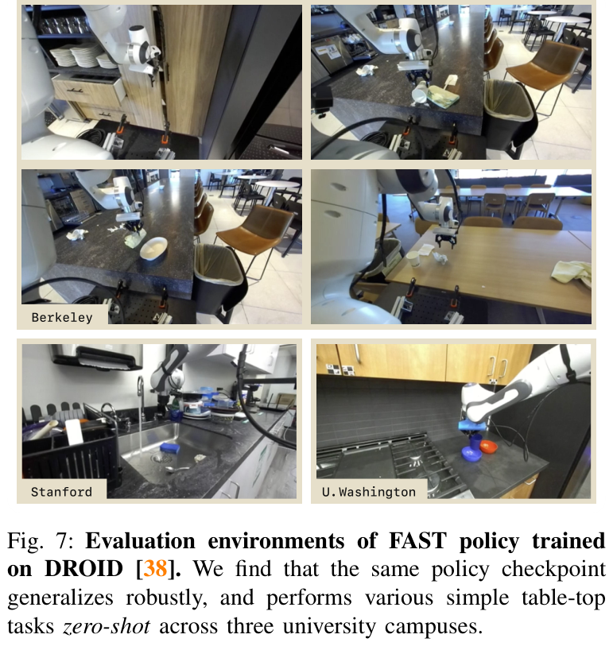

## 图8：FAST+ 离线压缩迁移 · PDF p.8

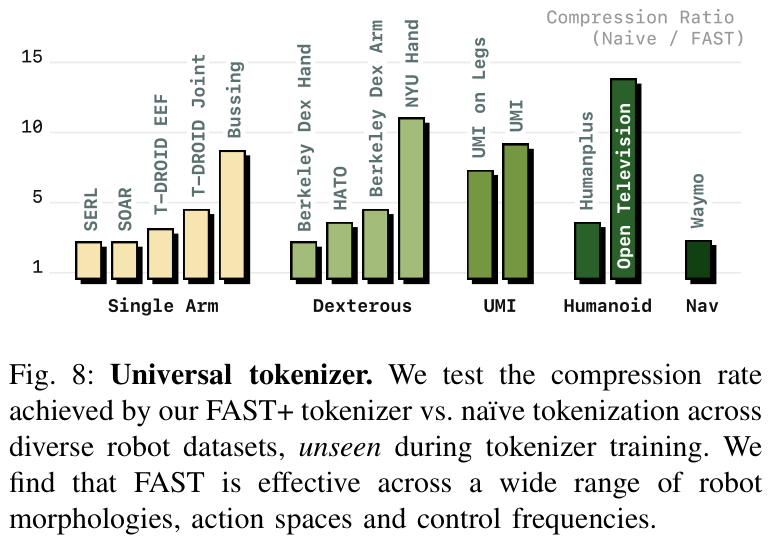

## 未编号消融：OpenVLA 骨干 · PDF p.9

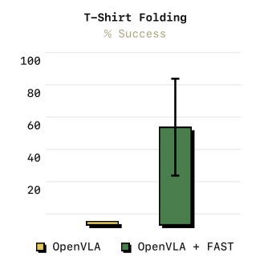

## 未编号消融：移除 BPE · PDF p.9

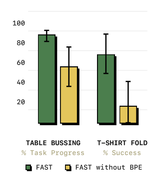

## 图9：单数据集训练与 Flow Matching 对比 · PDF p.9

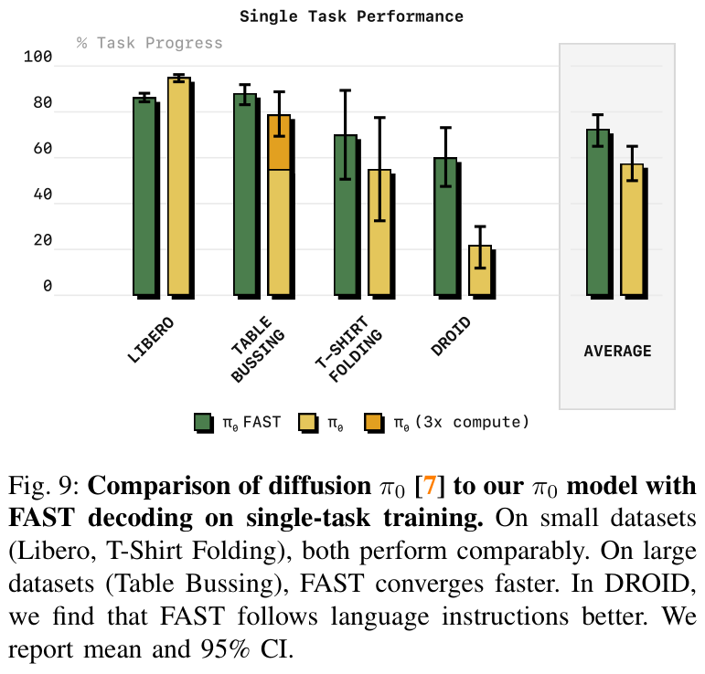

## 图10：洗衣折叠轨迹 · PDF p.10

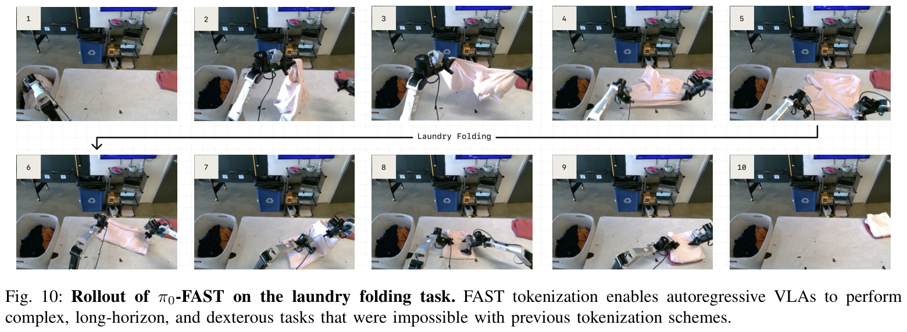

## 图11：通用策略表现 · PDF p.10

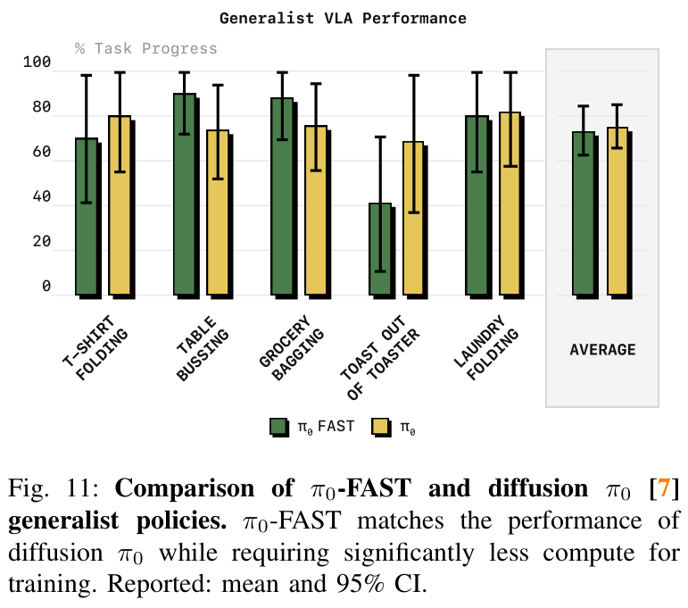

## 图12：压缩与重建误差 · PDF p.16

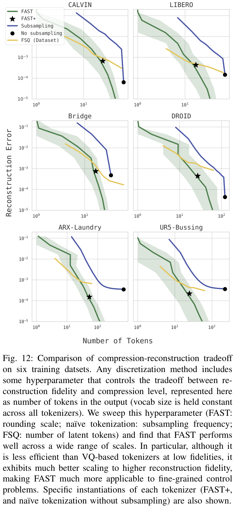

## 图15：相同训练算力对比 · PDF p.18

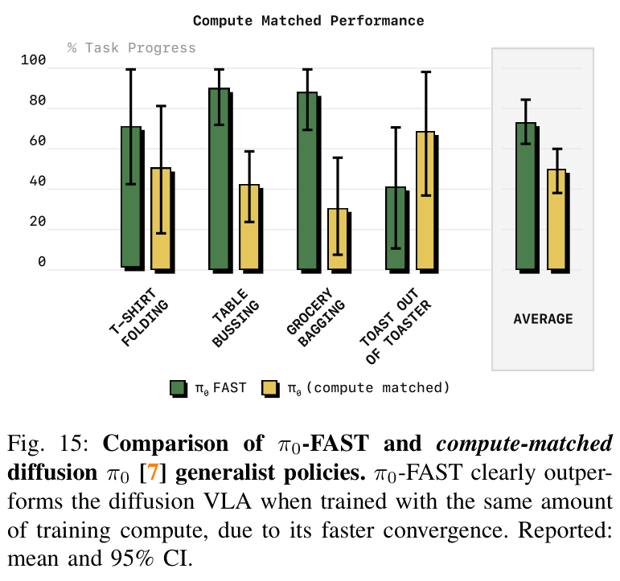
