动作序列的表示方式，会改变 VLA 究竟在学习什么。FAST 的关键做法是：先把平滑动作中的重复信息压缩掉，再让自回归模型预测更短、更有信息量的离散序列。

> **阅读范围**：用户提供的本地 PDF 全部 19 页，覆盖主文、参考文献与附录 A–E。首页标记 arXiv:2501.09747v1；[arXiv 版本记录](https://arxiv.org/abs/2501.09747v1)核实首发日期为 2025-01-16，PDF 生成时间不作为发表日期。本文只分析这一版本，不将后续实现或后续论文的结果混入原文。页码均指 PDF 物理页码，博客笔记创建于 2026-11-15。
>
> **证据标记**：**【原文】** 表示论文陈述、表格数字或图中趋势；**【解读】** 表示阅读者的解释；**【推导】** 表示在注明假设后进行的计算；**【建议】** 表示尚未验证的实验方案。柱状图没有逐项标注的数值不写成精确成功率。本文没有执行策略训练、模型推理或实机复现。

## 1. 先分清 FAST、FAST+ 与 π0-FAST

论文原题是 **FAST: Efficient Action Tokenization for Vision-Language-Action Models**，来自 Physical Intelligence、UC Berkeley 与 Stanford。第一作者 Karl Pertsch 和 Kyle Stachowicz 标记为核心贡献者。[首页，p.1]

| 名称 | 指的是什么 | 需要学习的部分 |
| --- | --- | --- |
| FAST | Frequency-space Action Sequence Tokenization，一套动作分词方法 | 对量化后的频域系数训练 BPE 词表；DCT 本身是解析变换 |
| FAST+ | 使用约 100 万个真实机器人动作块训练的通用动作分词器 | 预先学好的跨数据集 BPE 词表，可作为默认分词器 |
| π0-FAST | 将 π0 所用的 VLM 骨干与 FAST 动作表示结合的自回归 VLA | 视觉、语言和本体状态到动作 token 的条件预测策略 |

**【解读】** FAST+ 能把动作编码为 token，并不意味着它能看图执行任务；π0-FAST 才是策略。FAST+ 的“100 万”主要指用于分词器训练的约 1 秒动作块，不是 100 万条完整长时程机器人示范，也不是 π0-FAST 策略的全部训练数据。[§V-C、VI-F，pp.6、10；附录 A，p.16]

本文最值得记住的三个结果是：

1. 对 50 Hz、14 维双臂动作，1 秒动作块从逐元素分箱的 **700 个 token** 降到平均 **53 个 token**，约压缩 **13.2 倍**，比较在相近重建误差下进行。[表 I，p.7]
2. 在论文的通用策略实验中，π0-FAST 以约 **五分之一 GPU 小时**达到与原 π0 接近的整体表现。[§VI-F、图1、图11，pp.1、10]
3. 原文实现的单块推理约 **750 ms**，而 Flow Matching π0 约 **100 ms**，测于 NVIDIA RTX 4090。训练更快与推理更快是不同结论。[§VI-E，p.9]

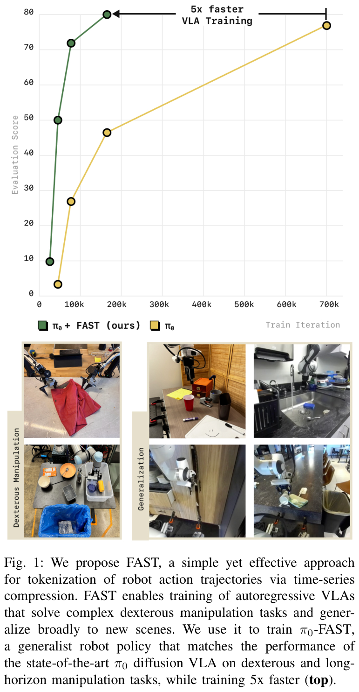

图1的收敛曲线平均了清理餐桌与 T 恤折叠两个代表任务；它不是所有任务的完整学习曲线。后文图11、图15分别补充最终表现与相同训练算力比较。[§VI-F，p.10]

## 2. 问题为什么出在动作分词

### 2.1 动作分块带来的收益与代价

策略接收观察 $o$，包括图像、语言指令和机器人本体状态，预测未来 $H$ 步、每步 $D$ 维的动作块 $A$。将动作离散化后，自回归训练可整理为：

$$
\begin{aligned}
A&\in\mathbb{R}^{H\times D},\qquad z=T_a(A),\\
p_\theta(z\mid o)&=\prod_{i=1}^{n}p_\theta(z_i\mid o,z_{<i}),\\
\mathcal{L}_{\mathrm{AR}}&=-\sum_{i=1}^{n}\log p_\theta(z_i\mid o,z_{<i}).
\end{aligned}
$$

**【推导】** 这是对 §III 与标准 next-token prediction 的符号整理。$H$ 是动作步数，$n$ 是编码后的 token 数，两者不必相等；FAST 的 $n$ 还能随动作内容变化。[§III，p.3]

动作块使局部运动更连贯，也减少每次控制都运行一次大模型的负担。但逐时间步、逐维度分箱会产生很长的目标序列。常见方案把每个动作标量划分为 256 个区间，1 秒、50 Hz、14 维就要预测 $50\times14=700$ 个 token。[§III、表 I，pp.3、7]

### 2.2 问题不仅是序列长，还包括训练捷径

高频采样下，相邻时刻通常很接近。模型在 teacher forcing 训练中看到了真实的历史 token，便可能通过“延续刚才的动作”获得较小损失，而不充分利用图像、指令和运动整体形状。

**【解读】** 假设同一关节轨迹被采样得越来越密，机器人没有获得更复杂的新行为，训练目标却增加了大量“几乎不变”的位置。损失中的容易部分变多，真正决定动作转折和接触的部分可能被稀释。这解释了为什么较低 token loss 未必对应较好的实机控制。

这里的相关性不是说“展平后每两个相邻 token 都来自同一关节”。原始顺序会交错不同维度；同一维度在相邻时刻之间相隔 $D$ 个位置，模型依然很容易访问它。[§III–IV，pp.3–4]

**【原文】** 作者用四个条件点确定一条三次样条，在不改变底层曲线分布的情况下，将目标采样点从 25 增至 800。朴素分箱模型的预测误差随采样密度明显上升，高密度时甚至接近复制起始值；DCT 分词维持较低误差。[§IV、图3，pp.3–4]

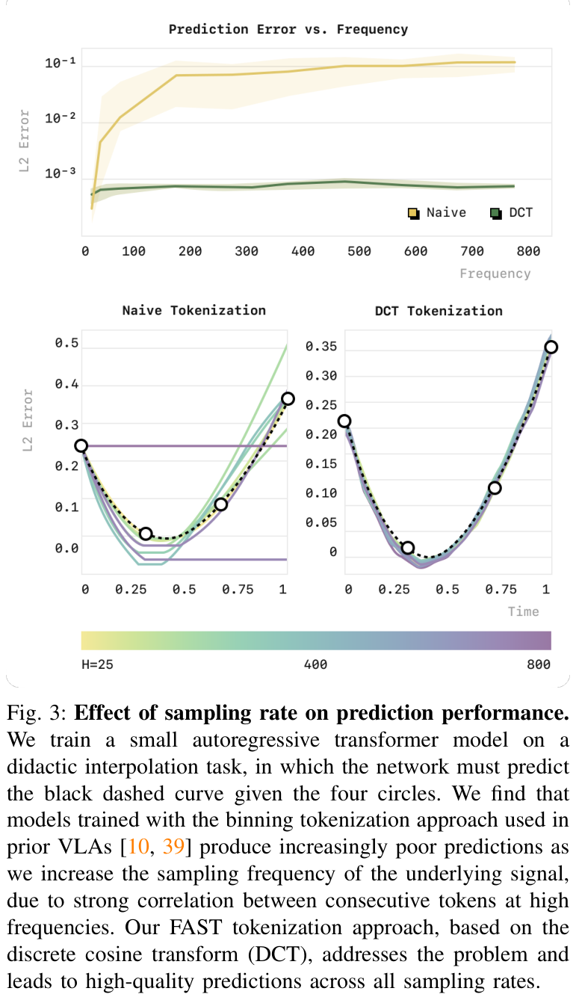

**【解读】** 这个实验隔离了采样密度的影响，为“目标表示妨碍学习”提供证据。不过，它并没有证明所有高频行为克隆都会失败，也没有给出对所有架构成立的收敛定理。文中的“边际信息减少”应理解为对这些平滑、量化序列的机制解释。

## 3. FAST 的五步编码过程

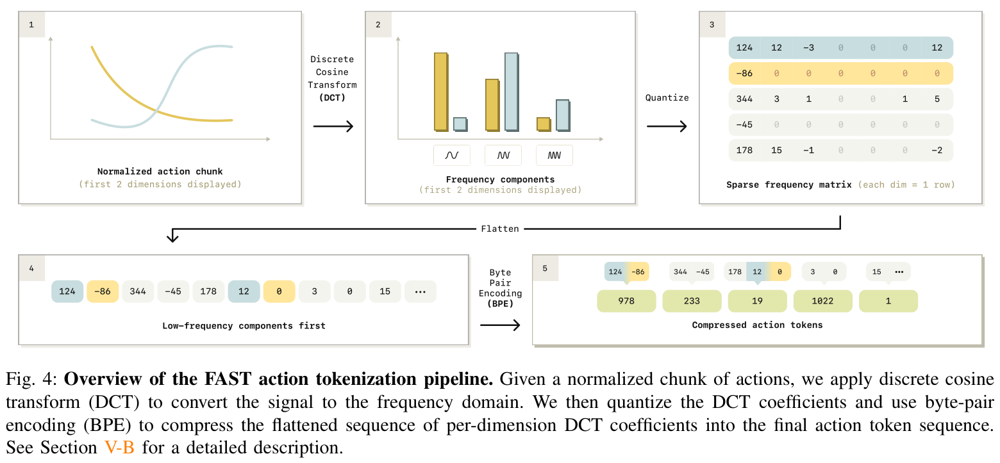

### 3.1 分位数归一化：先统一量纲

**【原文】** 对训练数据每个动作维度，使用第 1 与第 99 百分位，将典型取值范围映射到 $[-1,1]$。这样比使用极小值和极大值更不易被离群动作支配，也方便混合不同机器人和动作尺度。[§V-B，p.4]

**【推导】** 对维度 $d$，其仿射变换可写为：

$$
\begin{aligned}
\widetilde A_{t,d}
&=2\frac{A_{t,d}-q_{01,d}}{q_{99,d}-q_{01,d}}-1,\\
A_{t,d}
&=\frac{\widetilde A_{t,d}+1}{2}
 (q_{99,d}-q_{01,d})+q_{01,d}.
\end{aligned}
$$

**【解读】** 将两个分位点映射到端点，不自动意味着所有值都被裁剪到这个区间。离群值是否裁剪、常量维度如何处理、夹爪是否单独编码，属于需要核对的实现细节。训练和部署必须使用一致的统计量，也应只从训练集估计这些统计量。

### 3.2 沿时间轴做 DCT：换一套坐标描述动作

FAST 对每个动作维度分别做离散余弦变换。低频系数刻画整体趋势，高频系数表达较快的变化或突变。[§V-A/B，p.4]

**【推导】** 用正交归一的 DCT-II 表示，可以整理为：

$$
\begin{aligned}
C_{k,d}&=\alpha_k\sum_{t=0}^{H-1}\widetilde A_{t,d}
\cos\!\left[\frac{\pi}{H}\left(t+\frac12\right)k\right],\\
\alpha_0&=H^{-1/2},\qquad
\alpha_{k>0}=\sqrt{2/H}.
\end{aligned}
$$

这里 $k=0,\ldots,H-1$ 是频率索引，$d$ 是动作维度。公式用于解释变换；论文算法以 `DCT` 简记，公开处理器实现使用 `norm="ortho"`，见[固定版本的官方处理器源码](https://huggingface.co/physical-intelligence/fast/blob/ec4d7aa71691cac0b8bed6942be45684db2110f4/processing_action_tokenizer.py)。

**【解读】** DCT 仍产生 $H\times D$ 个系数，本身没有减少标量个数。它把许多平滑变化集中到少数较大的系数中，为后续量化与压缩创造条件。它也不是对每个关节做傅里叶动力学建模，没有显式学习机器人运动方程。

### 3.3 缩放并取整：真正引入有损部分

$$
Q_{k,d}=\operatorname{round}(\gamma C_{k,d}),
\qquad \widehat C_{k,d}=Q_{k,d}/\gamma.
$$

**【原文】** 缩放系数 $\gamma$ 控制精度与压缩的权衡。较小系数取整后变成零，得到较稀疏的频域矩阵。单数据集实验统一使用 $\gamma=10$、BPE 词表大小 1024。[§V-B、算法1，pp.4–5]

**【解读】** 这一步不是固定“只保留前几个频率”。所有系数都先参与量化，绝对值很小的系数才会被置零；重要的高频成分仍可保留。通常增大 $\gamma$ 能提高重建精度，但会增加非零值和符号种类，使压缩更困难。

### 3.4 低频优先展平：先预测整体形状

对本文使用的 $H\times D$ 系数矩阵，FAST 的顺序是：

$$
s=[Q_{0,1},\ldots,Q_{0,D},
Q_{1,1},\ldots,Q_{1,D},\ldots].
$$

也就是先放所有动作维度的最低频系数，再放下一档频率。原文将矩阵画为“动作维度 × 时间/频率”，因此称其为 column-first；换成本文矩阵方向后，不应只记行优先或列优先这个名字。[§V-B，p.5]

**【解读】** 对自回归模型，这意味着先确定整个动作块的大致形状，再逐步补充细节。这个设计影响的是解码依赖顺序。即使先产生低频系数，本文也不据此假设机器人可以在完整 token 串生成前安全地执行动作。

### 3.5 BPE：把冗余系数串压成密集 token

**【原文】** BPE 将重复出现的整数模式合并成词表项：既压缩连续零，也利用跨动作维度常见的系数组合。固定词表使输出容易接入已有 VLM 的 token 空间。[§V-B，p.5]

例如系数串里反复出现 `[0, 0, 0, 0]`，BPE 可以用更少的符号表示它。每个 BPE token 覆盖的原始系数数量不同，所以最终长度随动作内容变化；“每块约 30–60 个 token”是实验经验，不是编码格式规定的长度。

**【解读】** BPE 对已经量化的整数串是无损编码，但整个 FAST 对连续动作是有损的。BPE 词表需要从数据学习；因此 FAST 无需训练神经编码器，不等于“完全没有训练”。不同于 VQ 类方法，FAST 不需要另外优化一个动作重建神经网络。[§V-B/C，pp.5–6]

## 4. 解码与重建：可逆到哪一层

预测完整动作 token 后，解码依次进行 BPE 解码、重排系数、除以量化尺度、逆 DCT，最后恢复原动作量纲。可简记为：

$$
\begin{aligned}
\widehat Q&=\operatorname{reshape}_{H\times D}
\bigl(\operatorname{BPE}^{-1}(z)\bigr),\\
\widehat{\widetilde A}
&=\operatorname{IDCT}_t(\widehat Q/\gamma).
\end{aligned}
$$

**【解读】** 变长 token 串并不改变动作块原本的时间分辨率。解码器仍要知道 $H$ 与 $D$，恢复完整的高频动作数组。把 700 个标量压成约 53 个 token，不等于把控制降为每秒 53 次，也不是只输出 53 个关节值。

### 4.1 一个有条件的量化误差上界

**【推导】** 假设采用正交 DCT、仅有最近整数取整误差、BPE 精确往返、所有系数均保留且无裁剪，并暂不考虑策略预测错误。每个系数误差至多为 $1/(2\gamma)$；正交变换保持平方能量，因此：

$$
\frac{\|\widehat{\widetilde A}-\widetilde A\|_F^2}{HD}
=\frac{\|Q/\gamma-C\|_F^2}{HD}
\leq\frac{1}{4\gamma^2}.
$$

这个关系解释了尺度对重建误差的影响，**不是论文报告的实测误差，也不是闭环控制误差保证**。它不覆盖模型预测错 token、错误长度、未覆盖符号、反归一化后的单位差异，以及接触动力学放大的影响。

### 4.2 为什么还要看率失真曲线

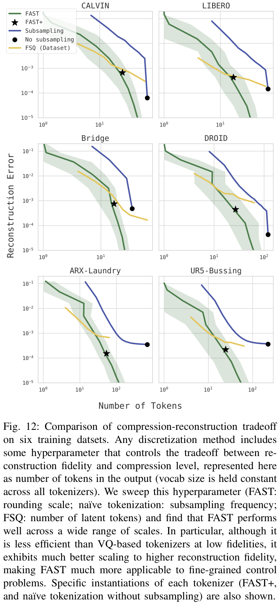

**【原文】** 附录 B 比较了 FAST 的量化尺度、朴素分箱的降采样率和 FSQ 的潜在 token 数。FSQ 在低保真区域可以很紧凑，而 FAST 在要求较高重建精度时有更好的扩展趋势。[图12，p.16]

**【解读】** 只比较 token 数会奖励过度压缩；只比较重建误差又忽略生成成本。需要在相近误差下比较长度，并最终看策略成功率。低离线 MSE 不能证明关键抓取时刻没有被压坏，也不保证模型容易预测这些 token。

## 5. 如何接到 VLA：骨干、输入与训练

**【原文】** 大多数实验使用 PaliGemma-3B 系列的 π0 骨干，也测试基于 Prismatic 7B 的 OpenVLA。动作 token 替换 VLM 词表中较少使用的 token；策略整体微调，不冻结骨干。[§VI-A，p.6]

| 环节 | 论文设置 | 含义 |
| --- | --- | --- |
| 视觉输入 | 两或三路 224×224 图像：外部相机和各手臂腕部相机 | 每路独立经预训练视觉编码器，随后拼接 |
| 语言输入 | 任务指令，沿用语言 tokenizer | 与 VLM 已有输入形式衔接 |
| 本体状态 | 先离散到 256 个 bin，再把整数作为文本输入 | 简单分箱仍用于输入状态；论文批评的重点是高频动作输出 |
| 动作输出 | 约 1 秒动作块，经 FAST 编码 | 标准条件 next-token prediction |
| 优化 | 1k 步线性 warmup；之后学习率 5e-5 | AdamW，β₁=0.9、β₂=0.95，无 weight decay |
| 稳定化 | 梯度裁剪 1；EMA 0.999 | 不同 tokenizer 对比还要控制其余训练因素 |
| 推理解码 | 多数任务 greedy；双臂任务温度 0.7 | 原文称小温度有助于摆脱训练数据中的起始静止动作 |

设置来自附录 C，pp.16–17。温度采样的经验理由不构成“必然避免停滞”的保证。

**【解读】** π0-FAST 不是先运行连续动作专家再把动作压缩一下。这里 FAST 是训练目标与输出表示，模型直接自回归生成离散动作 token；原 π0 的 Flow Matching 动作专家则是另一条动作生成路径。论文将其归入 diffusion VLA 家族，本文保留这一对比口径，不把 Flow Matching 与每一种离散扩散算法视为完全相同。

## 6. FAST+ 的通用性究竟覆盖什么

**【原文】** FAST+ 训练使用约 100 万个 1 秒动作块，涵盖单臂、双臂与移动操作、关节及末端执行器动作表示、不同控制频率。训练混合中的动作填充至 32 维，并加入关节、世界坐标系末端及相机坐标系末端等表示，完整混合权重见附录 A。[§V-C、附录 A，pp.6、16]

这里要区分两组验证：

| 验证 | 训练与测试关系 | 能支持的结论 |
| --- | --- | --- |
| 图6：FAST+ 与数据集专用 FAST 的策略对比 | 通用分词器训练包含这些真实机器人任务的数据 | 预训练词表可以替代逐数据集词表，减轻使用负担 |
| 图8、表 III：新动作数据的离线压缩 | 用于这项测试的数据集未参与分词器训练 | 词表对新的本体、动作空间和频率仍有压缩迁移能力 |

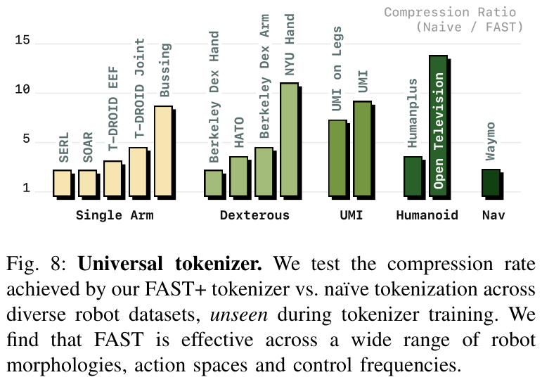

**【原文】** 离线测试包含单臂、灵巧手、UMI、人形机器人与导航数据，FAST+ 广泛减少 token 数，个别域压缩比更高。[§VI-C、图8、表 III，pp.8–9、19]

**【解读】** 同一个分词器能够编码 HumanPlus 或 Waymo 动作，不意味着同一个 VLA 已经学会控制人形机器人或自动驾驶。论文明确指出，真实策略实验主要在静态机械臂操作上完成，其他形态的闭环策略验证属于未来工作。[§VII，p.11]

此外，通用分词器仍需要正确的动作定义、时间跨度、维度顺序和归一化。它统一的是一种表示工具，不会自动解决不同机器人之间的运动学与任务语义差异。

## 7. 实验怎么设计，分数怎么读

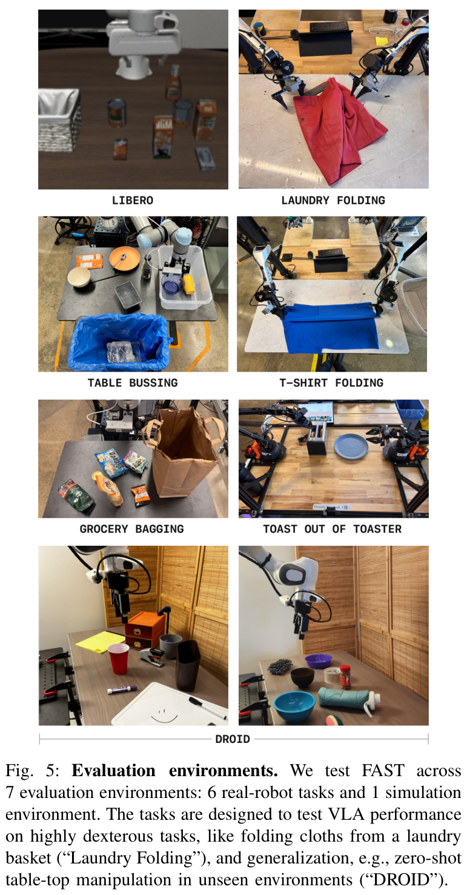

**【原文】** 论文使用一组模拟基准和六类真实机器人任务。并非每种 tokenizer、每个模型都在全部任务上完整交叉比较：前半部分主要比较 LIBERO、DROID、清理餐桌和 T 恤折叠；更难的装袋、取吐司、洗衣折叠用于通用策略评估。[§VI-A，pp.6–7]

| 环境 / 任务 | 频率与平台 | 分数的实际含义 |
| --- | --- | --- |
| LIBERO | 四组模拟任务，合并训练 | 每次 episode 二值成功，按基准汇总 |
| 清理餐桌 | 20 Hz，单臂 UR5/UR5e | 12 件物品中正确放入回收箱或垃圾桶的比例 |
| T 恤折叠 | 50 Hz，双臂 ARX | 人工判断是否完成折叠；评估轮换 5 件训练中见过的衬衫 |
| 杂货装袋 | 20 Hz，单臂 UR5/UR5e | 7 件物品中正确装袋的比例 |
| 从烤面包机取吐司 | 50 Hz，双臂 Trossen ViperX | 两片吐司各有取出、放盘两阶段，共 4 分 |
| 洗衣折叠 | 50 Hz，双臂 ARX | 5 件衣物中成功展开、折叠并堆放的比例 |
| DROID 新场景操作 | 15 Hz，Franka | 根据拿对物体、放对容器等细分标准计算任务进度 |

任务与评分细节见 §VI-A 及附录 E，pp.6–7、17–18。

**【解读】** 图中的 `% Success` 与 `% Task Progress` 不能直接互换。“餐桌得分 80%”通常意味着大部分物体放对了，不代表 80% 的试验把整张桌子完全清理成功。跨任务平均值也混合了不同评分规则，应作为同一套评估下的综合比较。

### 7.1 压缩量是论文中最直接的数字证据

| 数据集 | 维度 | 控制频率 | 朴素 token / 秒块 | FAST 平均 token / 秒块 | 压缩比 |
| --- | ---: | ---: | ---: | ---: | ---: |
| BridgeV2 | 7 | 5 Hz | 35 | 20 | 1.75× |
| DROID | 7 | 15 Hz | 105 | 29 | 3.6× |
| 清理餐桌 | 7 | 20 Hz | 140 | 28 | 5.0× |
| T 恤折叠 | 14 | 50 Hz | 700 | 53 | 13.2× |

表格逐项取自原文表 I，p.7，压缩比保留论文精度。动作维度采用这张表的口径；附录中某些数据表示包含不同状态分量，不能用另一张表的维度替换后继续沿用这里的数字。

**【解读】** 高频平滑轨迹的重复信息更多，因而 FAST 的收益更明显。这四组数据还暗示，每条手臂约几十个 token 就能描述不少 1 秒运动，但没有证明动作复杂度与采样频率永远无关。高速碰撞和接触切换可能使高频成分同样重要。

## 8. 策略表现与消融：压缩是否真的帮助学习

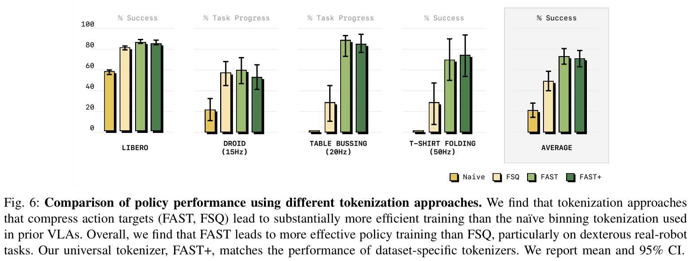

**【原文】** 朴素分箱在清理餐桌和 T 恤折叠上几乎无法取得任务进展；压缩表示明显改善训练。FAST 在精细真实任务上优于或接近更复杂的 FSQ 基线，FAST+ 与逐数据集 FAST 整体接近。[§VI-B、图6，pp.7–8]

**【解读】** FSQ 基线说明收益并非只来自某个特定 DCT 公式：压缩目标本身就有价值。FAST 更有吸引力的地方，是以较简单的解析变换与词表学习获得高保真表示和可用策略；不能将结论扩大为“所有神经动作分词器都不如 DCT”。

### 8.1 换成 OpenVLA 还有效吗

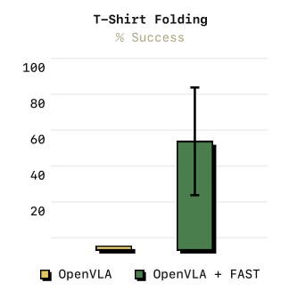

**【原文】** OpenVLA 加入 FAST+ 后可以学习高频 T 恤折叠，而原始分箱方案表现接近零。作者同时修改 OpenVLA，使其接收多张图像并预测 1 秒动作块，以适配任务。[§VI-D，p.9]

**【解读】** 这支持收益可跨骨干迁移。但在介绍复现成本时，不能说“只替换 tokenizer，其他代码完全不用动”；原文已经说明还有输入和动作块适配。

### 8.2 去掉 BPE 会怎样

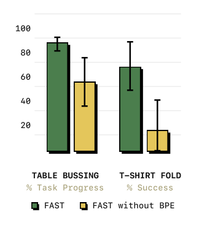

**【原文】** 去掉 BPE 后，清理餐桌和 T 恤折叠的 rollout 表现下降，但仍优于朴素分箱。DCT 集中了信息，然而未压缩的零系数继续占据大量预测位置，也增加自回归解码开销。[§VI-D，p.9]

**【解读】** “DCT 后已经有很多零”不等于“序列已经短了”。FAST 的完整逻辑是：DCT 让结构可压缩，量化让弱系数归零，BPE 才将整串转为较短 token 序列。少了最后一步，模型仍要预测很多低信息符号。

## 9. DROID 的新环境泛化：证据与边界

### 9.1 训练配方是可复现的重要组成

**【原文】** DROID 策略使用一张外部视角与腕部视角；训练时随机选择两路外部相机之一、三条语言标注之一，不使用相机标定信息。动作空间为关节速度加绝对夹爪位置，输出 15 步动作块，部署时开环执行 8 或 15 步。[附录 D，p.17]

数据只保留标记成功的约 75k 个 episode，并过滤全零空闲动作。训练约 3 个 epoch，即 240k 次迭代、batch size 256；论文报告 3B VLA 在 8 张 H100 上约训练 4 天。[附录 D/E，pp.17–18]

**【解读】** 过滤空闲动作与改善 token 表示都可能影响“静止不动”的问题。归因和复现时应保留同样的数据筛选、视角随机化与训练预算，不能只拿一个分词器名称对比。

### 9.2 定量测试与跨校园演示分开看

**【原文】** 定量测试在新场景、物体、相机角度和背景下进行，每个策略共 **44 次试验**，采用任务进度评分。正文称为 16 个任务；表 II 实际列出 17 行任务描述，次数加总仍为 44。本文保留这个原文内部差异，不把它修成未经作者确认的新数字。[附录 E、表 II，p.18]

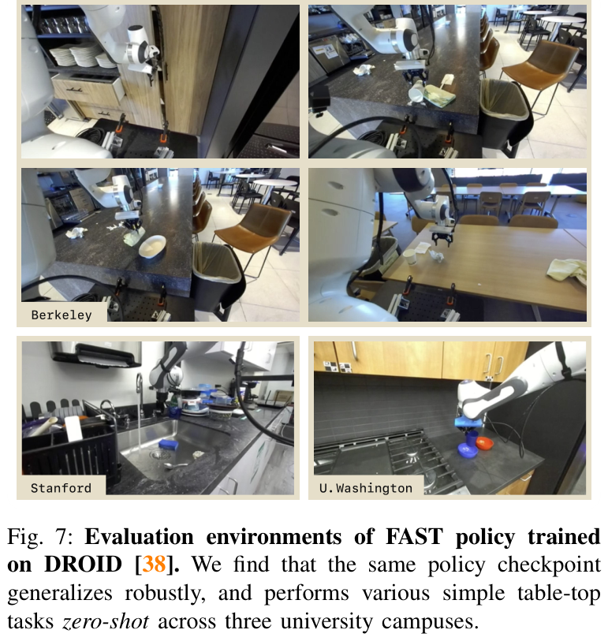

**【原文】** Berkeley、Stanford 与 University of Washington 的跨校园测试属于定性演示，作者明确说没有统计这些测试的成功率，并提供成功和失败视频。[§VI-B、附录 E，pp.8、18]

**【解读】** 这里的零样本指部署到这些新场景时没有再做当地微调，也不是“策略从没学过机器人动作”。策略已经在 DROID 的大规模示范上训练；任务类型和动作接口仍有明确范围。

### 9.3 更好的语言遵循还缺什么证据

**【原文】** 在 DROID 对比中，作者观察到 Flow Matching π0 有时忽略语言指令，自回归 FAST 策略得分更高，但把系统研究语言遵循留给未来工作。[§VI-E，p.9]

**【解读】** 离散输出沿用 VLM 的 next-token 训练形式，可能更容易保留语言条件的作用，这是一个合理假设。现有结果并不能排除优化预算、数据筛选、任务难度和架构差异的影响，因而不足以推出“自回归必然比 Flow Matching 更懂语言”。

## 10. 与原 π0 比较：训练效率和部署效率是两本账

### 10.1 单数据集实验

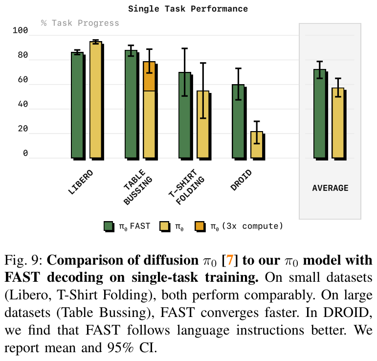

**【原文】** 小于约 50 小时的数据集上，两种 VLA 的表现接近；清理餐桌这类更大数据集上，FAST 达到较好表现需要的训练步数约少 3 倍。图9还展示了增加训练计算量的 π0 对照。[§VI-E，p.9]

**【解读】** 这项“约 3 倍”主要对应这里的收敛步数，不应与通用策略“5 倍 GPU 小时”的口径混为同一个测量。训练步数、每步成本、总 GPU 小时与最终表现都需要同时记录。

### 10.2 大规模通用策略

**【原文】** 通用策略在与 π0 相同来源的跨本体混合上训练，包含自有数据 **903M 个时间步**，另有 **9.1% 的训练混合**来自 BridgeV2、DROID 与 OXE。论文将整体规模概括为约 10k 小时机器人数据。[§VI-F，p.10]

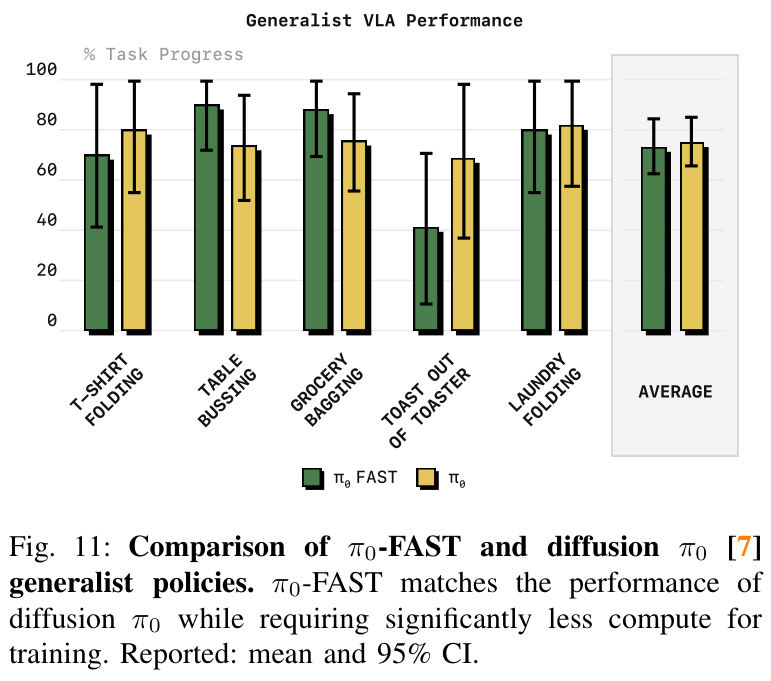

**【原文】** π0-FAST 的整体表现接近原 π0，训练使用约少 5 倍 GPU 小时。各任务存在差异，尤其取吐司任务上 FAST 的柱形更低；均值与 95% 置信区间不能当作所有任务严格等价的证明。[§VI-F、图11，p.10]

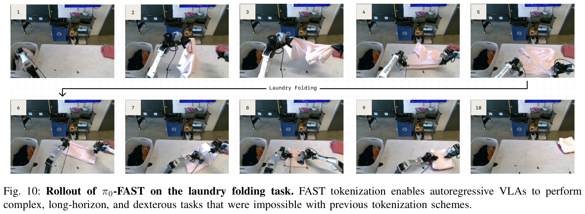

**【原文】** 洗衣折叠需要从篮中取出缠绕衣物、展开、折叠、堆放。主文通用性描述比较简略，但附录明确说明该任务在全量预训练后，额外使用少量高质量任务数据微调；装袋与取吐司则用预训练模型直接评估。[附录 E，p.18]

**【解读】** 因而不能把图11每一个任务都称为完全零样本。图10展示复杂动作链的可行性，也不能单靠一条成功轨迹判断在任意衣物堆、任意家庭中的鲁棒性。

### 10.3 相同训练算力的比较

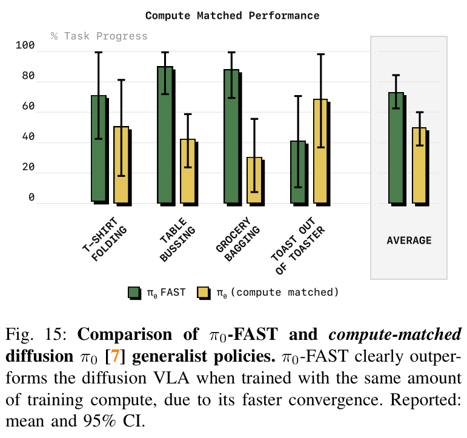

**【原文】** 相同训练算力下，FAST 的平均任务进度明显更高，清理餐桌和装袋等任务的优势突出。但取吐司任务的 FAST 柱形仍低于对照；图15没有包含洗衣折叠。[图15，p.18]

**【解读】** 图15支持“这个系统更快学到可用策略”，没有支持逐任务全面胜出。图1、图11和图15组合起来，比单引一句“5× faster”更能说明训练效率证据。

### 10.4 为什么 token 少了，推理仍比 Flow Matching 慢

| 维度 | π0-FAST | 原 π0 的 Flow Matching 路径 |
| --- | --- | --- |
| 动作生成 | 顺序预测约 30–60 个离散 token | 约 10 次连续动作迭代 |
| 生成阶段主要模型 | 约 2B 参数的语言模型骨干 | 约 300M 参数动作专家 |
| 1 秒动作块延迟 | 约 750 ms | 约 100 ms |
| 文中比较硬件 | NVIDIA RTX 4090 | NVIDIA RTX 4090 |

表格取自 §VI-E，p.9。PaliGemma-3B 指完整 VLM 系列量级，这里的 2B 是语言骨干口径，不是另一个矛盾的模型规模。

**【推导】** 按这组延迟，FAST 单块生成耗时约是对照的 $750/100=7.5$ 倍。这只是该实现、硬件和推理设置下的比值，不能推广为所有自回归模型的固有下限。

**【解读】** 表 I 的 13.2 倍压缩比较的是 FAST 与朴素分箱；750 ms 与 100 ms 比较的是 FAST 与连续动作专家。参照对象不同，结论并不冲突。顺序调用较大的语言骨干几十次，仍可能比调用小动作专家十次更贵。

作者说较慢推理没有明显损伤其静态任务表现，但评估更耗时。对于移动操作、快速接触恢复或人机交互，除了动作执行频率，还要关注观察更新率、动作块生成延迟、开环执行长度与端到端反馈时延。[§VI-E、VII，pp.9、11]

## 11. 放回 ACT、OpenVLA 与 π0 的技术脉络

| 工作 / 路径 | 与本文相关的动作表示思路 | FAST 补充的观察 |
| --- | --- | --- |
| ACT | 预测动作块，并用时间集成改善连续执行 | 动作分块后，块内表示本身仍影响可学性 |
| OpenVLA 原分箱路径 | 将动作标量映射为离散 token | 将该表示直接扩为高频长动作块可能带来严重冗余 |
| π0 Flow Matching | 用连续动作专家建模动作分布 | 高频动作可学，但与自回归路径有不同训练和推理成本 |
| FSQ 压缩基线 | 学习量化的紧凑动作表示 | 压缩有益，但要比较重建精度、训练复杂度和策略表现 |
| FAST / π0-FAST | 频域量化加 BPE，随后自回归生成 | 简单动作编码改动也能显著改变大模型训练结果 |

表格按本论文的相关工作与比较口径整理。[§II、VI，pp.2–3、6–10] 已有博客笔记可继续阅读：[ACT 论文精读](/embodied-ai-learning/posts/paper-act/)、[OpenVLA 论文精读](/embodied-ai-learning/posts/paper-openvla/openvla_论文精读/)、[π0.5 论文精读](/embodied-ai-learning/posts/paper-pi05/test/)。这些链接用于延伸阅读；本文对 FAST 的判断仍以当前 v1 为依据。

**【解读】** FAST 的贡献不是首次预测动作块，也不是发明 DCT 或 BPE，而是识别高频动作离散化对 next-token 学习的不利影响，提出足够简单的压缩表示，并从合成任务、实机任务、骨干消融到大规模训练逐层验证。

## 12. 如果在自己的机器人上使用，应先核对什么

官方将 FAST+ 作为 Hugging Face 处理器发布，示例入口是 `physical-intelligence/fast`。[§V-C，p.6；官方[项目页](https://www.pi.website/research/fast)、[分词器仓库](https://huggingface.co/physical-intelligence/fast)]

**【建议】** 首先进行离线编码与重建检查，确认动作定义、每维顺序、单位、分位数归一化、时间跨度和解码形状一致，再训练策略。下面只演示接口形状，未运行下载或推理；`normalized_actions` 应是已经归一化的 `[B,H,D]` 数组。

```python
# 示意接口：部署时固定审核过的处理器版本。
from transformers import AutoProcessor

tokenizer = AutoProcessor.from_pretrained(
    "physical-intelligence/fast",
    revision="ec4d7aa71691cac0b8bed6942be45684db2110f4",
    trust_remote_code=True,
)
tokens = tokenizer(normalized_actions)
reconstructed = tokenizer.decode(
    tokens,
    time_horizon=normalized_actions.shape[1],
    action_dim=normalized_actions.shape[2],
)
# reconstructed 仍在归一化空间，执行前需恢复动作量纲。
```

该示意依据固定版本的[官方处理器实现](https://huggingface.co/physical-intelligence/fast/blob/ec4d7aa71691cac0b8bed6942be45684db2110f4/processing_action_tokenizer.py)，作为实现补充，不代表本文复现了论文训练配置。处理器本身没有替使用者推断动作语义或完成训练集分位数归一化。

**【建议】** 一个有区分力的小规模实验至少记录下列项目：

| 要回答的问题 | 对照与记录 |
| --- | --- |
| 压缩是否划算 | 相同重建误差下比较朴素分箱、FAST、FAST+ 的平均与尾部 token 长度 |
| 关键动作是否保真 | 除整体 MSE 外，检查夹爪开合、接触前后、关节速度峰值及相位延迟 |
| 学习是否更有效 | 固定数据、骨干、动作时长、图像和语言输入；按 GPU 小时比较任务表现 |
| BPE 是否必要 | FAST 与 DCT 量化但不做 BPE 比较；同时记录序列长度和解码耗时 |
| 语言是否被忽略 | 同一场景换指令、换目标物体，报告正确执行与执行错误指令的比例 |
| 部署是否能闭环 | 测量 P50/P95 单块延迟、观察新鲜度、开环长度及失败后的恢复表现 |

**【解读】** 同样训练步数不必然等价于同样计算成本；同样 GPU 小时也不自动意味着达到同样精度。训练侧与部署侧都需要保留完整成本口径，才能判断 FAST 是否适合具体系统。

## 13. 评价、局限与可继续研究的问题

**【评价】** 这篇论文最强的部分，是把一个常被当作接口细节的动作编码问题，提升为影响训练目标质量的问题。合成实验给出机制线索，表 I 给出可核对的压缩收益，实机和消融说明它不仅改善文件体积，通用策略实验则说明收益能扩展到大数据训练。

它的证据边界也很清楚：

- **闭环范围有限**：灵巧手、人形、导航的证据主要是离线压缩，尚未建立这些平台上的统一策略表现。[§VII，p.11]
- **推理延迟突出**：训练成本下降伴随较慢自回归生成，对动态任务的影响没有充分实测。[§VI-E、VII，pp.9、11]
- **重建指标不等于控制指标**：同样的均方误差可能落在不重要的自由运动阶段，也可能落在决定成败的接触瞬间。[解读]
- **语言收益的因果机制未隔离**：论文给出观察，仍缺少系统性的指令干预和匹配预算消融。[§VI-E，p.9；解读]
- **实验协议存在细节差异**：任务进度与完整成功率混用、洗衣折叠另做微调、DROID 任务数表述不一致，均应在引用结论时保留说明。[附录 E，p.18]
- **“通用”不是免配置**：训练数据覆盖、动作归一化与接口适配依然重要；FAST+ 不会自动解决跨本体控制迁移。[§V-C、VII；解读]

**【建议】** 后续可以研究按接触阶段分配不同量化精度、让不同频段采用更合适的生成方式，以及联合优化重建误差与闭环任务损失。但需要通过匹配算力和延迟的实验检验，不能仅凭“频域更紧凑”就断言控制一定更稳定。

如果给出主观阅读评分，我会评 **8.5/10**：问题定位与证据链较强，方法简洁、实现门槛低；动态闭环能力、语言收益机制与完整部署效率仍有明显研究空间。这个分数是阅读判断，不是作者报告的指标。

对构建 VLA 最直接的启发是：在换更大的模型之前，先检查训练目标中究竟有多少是重复信息，以及模型是否能靠这些重复信息走捷径。FAST 提供了一个具体例子：改变动作的表达方式，就可能改变模型学习控制的难度。

## 原始资料

1. [论文：FAST，arXiv:2501.09747v1](https://arxiv.org/abs/2501.09747v1)；[该版本 PDF](https://arxiv.org/pdf/2501.09747v1)。本文主体依据用户提供的同版本本地全文，图表保留原编号与出处。
2. [Physical Intelligence 项目页与演示](https://www.pi.website/research/fast)，用于核对官方入口与发布日期。
3. [FAST+ 官方处理器仓库](https://huggingface.co/physical-intelligence/fast)；[本文核对的处理器固定版本](https://huggingface.co/physical-intelligence/fast/blob/ec4d7aa71691cac0b8bed6942be45684db2110f4/processing_action_tokenizer.py)。代码用于解释接口，未将当前软件状态当作原论文实验结果。

文中图片来自原论文页面裁剪；编号图保留原图注，两幅未编号消融图来自 p.9。图片索引与源文件校验信息保存在文章目录的 `images/_index.md`、`images/index.json`，仅作本地维护，不提供不存在的网页或下载链接。
