# π0.5 原文图片索引

来源：用户提供的 19 页 PDF，首页标记 arXiv:2504.16054v1。

以下为保留图注的页面裁剪，坐标和源文件 SHA-256 见同目录 index.json。此索引仅供本地维护。

## 原文图 1 · PDF p.1

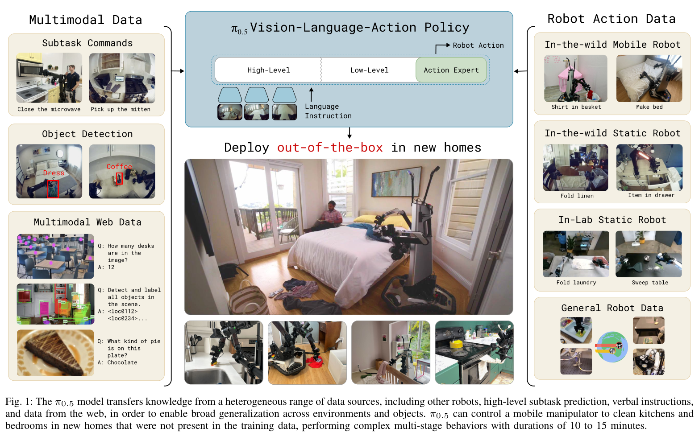

## 原文图 3 · PDF p.4

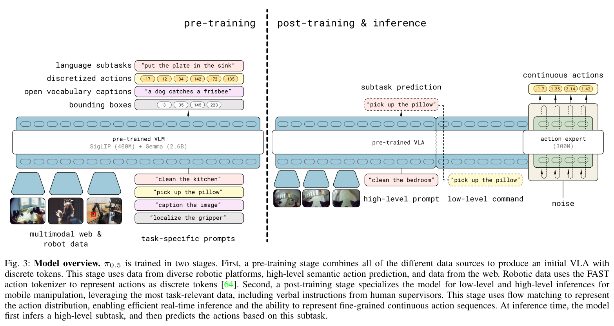

## 原文图 4 · PDF p.6

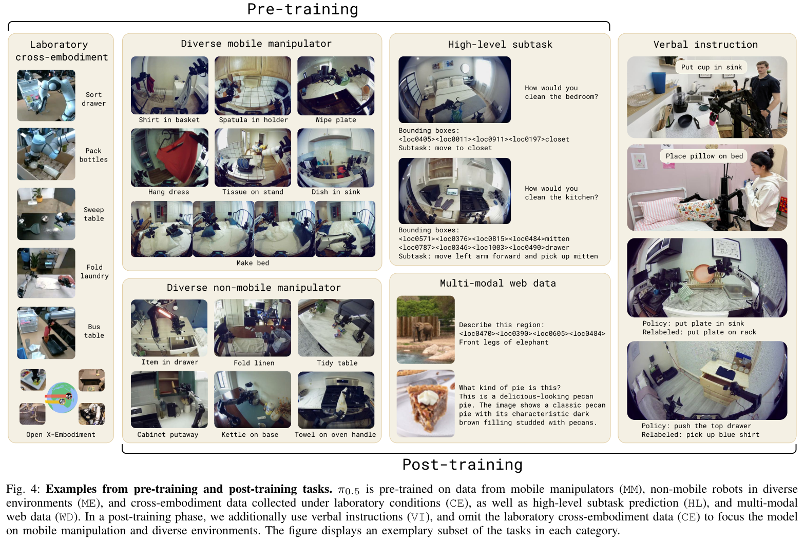

## 原文图 5 · PDF p.7

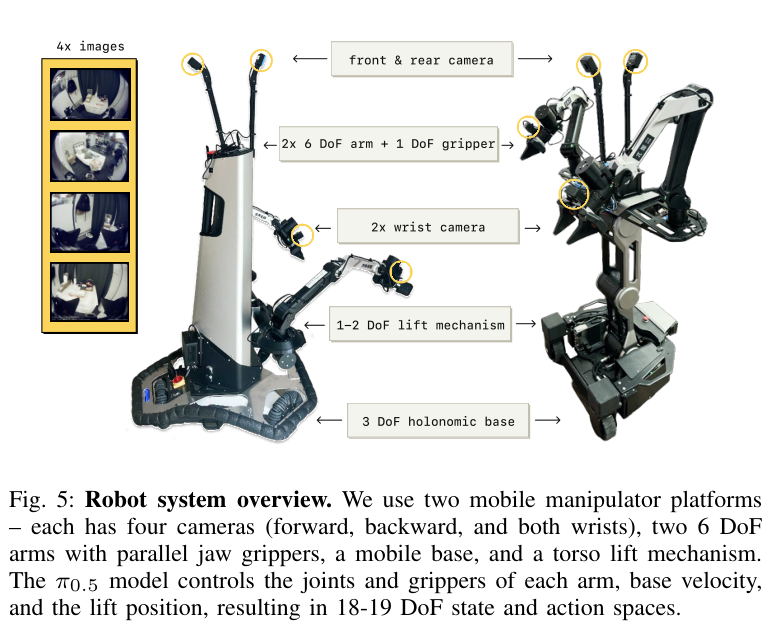

## 原文图 7 · PDF p.8

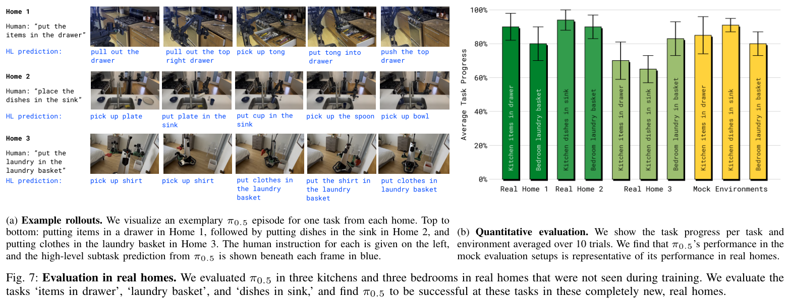

## 原文图 8 · PDF p.9

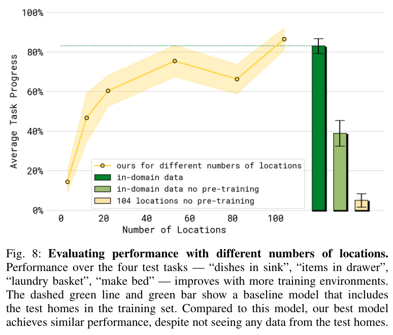

## 原文图 9 · PDF p.9

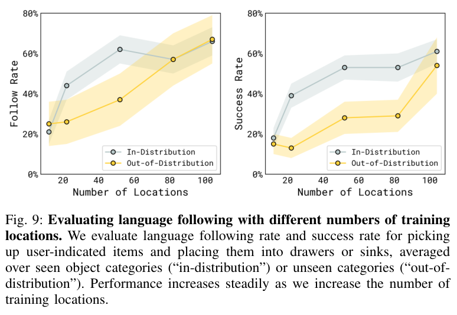

## 原文图 10 · PDF p.10

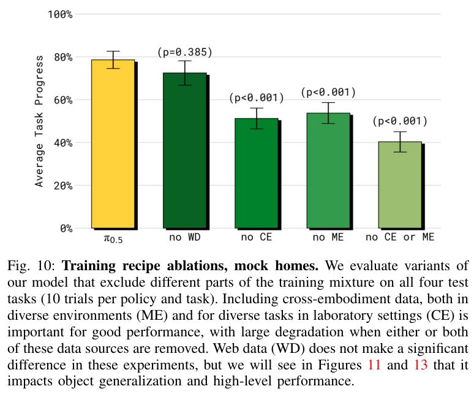

## 原文图 11 · PDF p.10

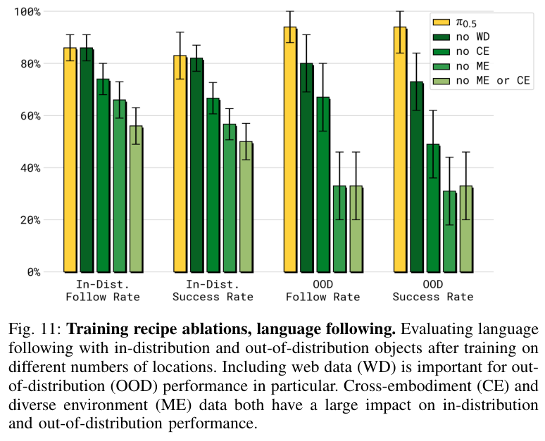

## 原文图 12 · PDF p.10

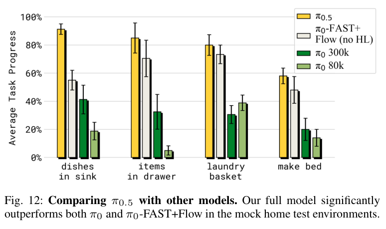

## 原文图 13 · PDF p.11

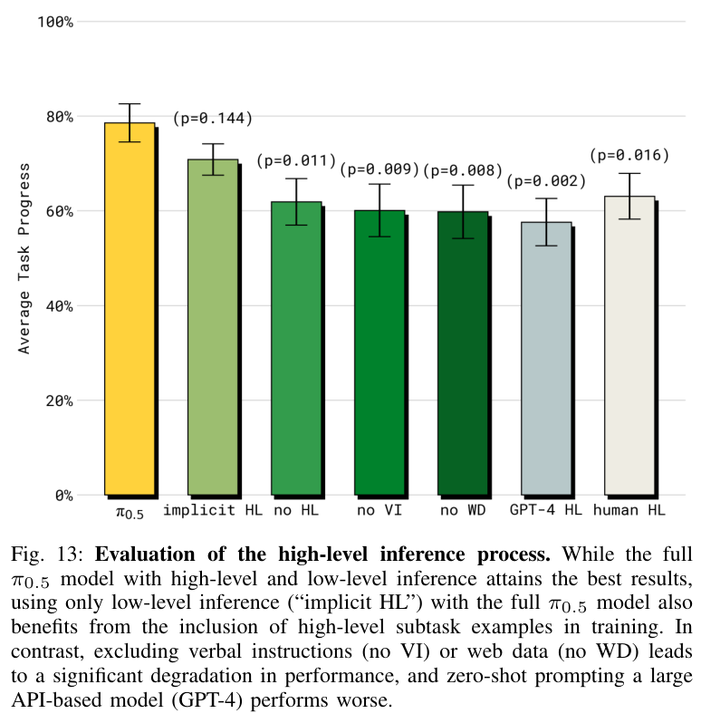

## 原文图 18 · PDF p.19

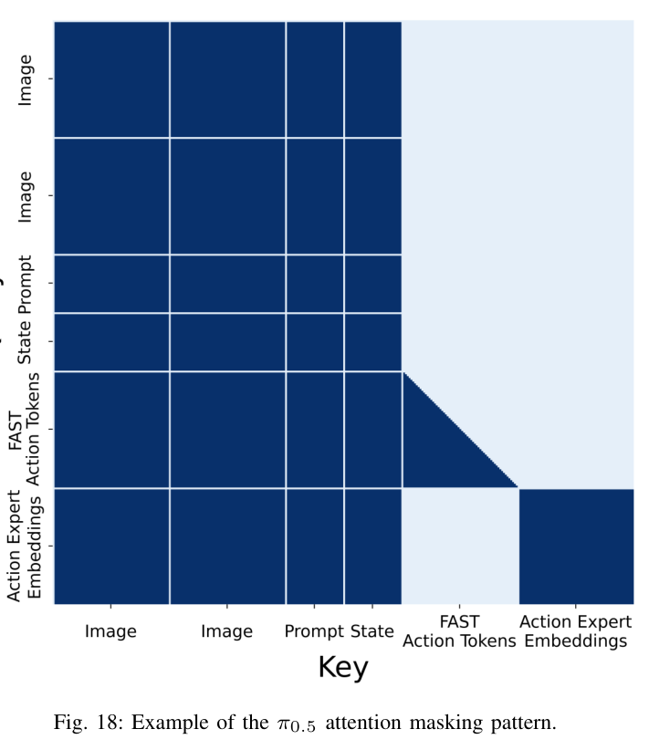
