具身智能相关领域论文精读，本主题对相关论文进行详细拆解。

> **阅读范围**：用户提供的本地 PDF 全部 19 页，覆盖主文、参考文献与附录 A–E。首页标记 arXiv:2504.16054v1，2025-04-22；日期由 [arXiv 官方记录](https://arxiv.org/abs/2504.16054v1)核对，PDF 文件生成时间不作为发表时间。博客保留原入口发布日期，本次补全日期为 2026-11-12。本文页码均指 PDF 物理页码。
>
> **证据标记**：**【原文】** 表示论文陈述或实验结果；**【解读】** 表示我的解释；**【推导】** 表示基于原文的数学整理；**【建议】** 表示尚未验证的研究方案。图中未直接标注的百分比只作近似读数。本文没有执行模型训练、推理或机器人实机复现。

## 1. 论文简介：真正值得记住的贡献

π0.5 的核心是**把不同来源的知识训练进同一个 VLA，再让它在新家庭中同时做语义决策与连续控制**。它把移动操作数据、其他机器人的动作、子任务标签、网络图文和人类语言示范组织进一个训练配方，展示了跨家庭的多阶段操作能力。[§I、IV，pp.1–7]

| 项目 | 核对结果 |
| --- | --- |
| 原题 | π0.5: a Vision-Language-Action Model with Open-World Generalization |
| 作者 / 机构 | Physical Intelligence；Kevin Black、Noah Brown、James Darpinian 等，完整名单见论文首页 |
| 论文版本 | arXiv:2504.16054v1，首次提交 2025-04-22；本文不据此推定会议录用情况 |
| 模型基础 | PaliGemma 视觉语言骨干；继承 π0 的连续动作专家设计，动作专家约 300M 参数 |
| 输入 | 多相机 RGB、离散化的机器人本体状态、语言指令 |
| 输出 | 高层语言子任务，以及条件于子任务的连续动作块 |
| 目标平台 | 两种双臂移动操作机器人，18 或 19 维状态 / 动作空间 |
| 最相关训练数据 | 约 400 小时移动操作示范、约 100 个家庭环境；完整训练还使用大量其他来源 |
| 主要评估 | 新家庭实机评估、训练场景数量缩放、数据消融、模型对比、高层推理消融 |

**【解读】** 这是一篇关于“如何组织监督信号以获得泛化”的系统论文。共训、动作分块、语言分层和 Flow Matching 都有前作；贡献在于把它们组合成可工作的训练系统，并检验各类数据在新环境中的作用。论文支持这个具体配方的有效性，但没有证明它是唯一或最优配方。

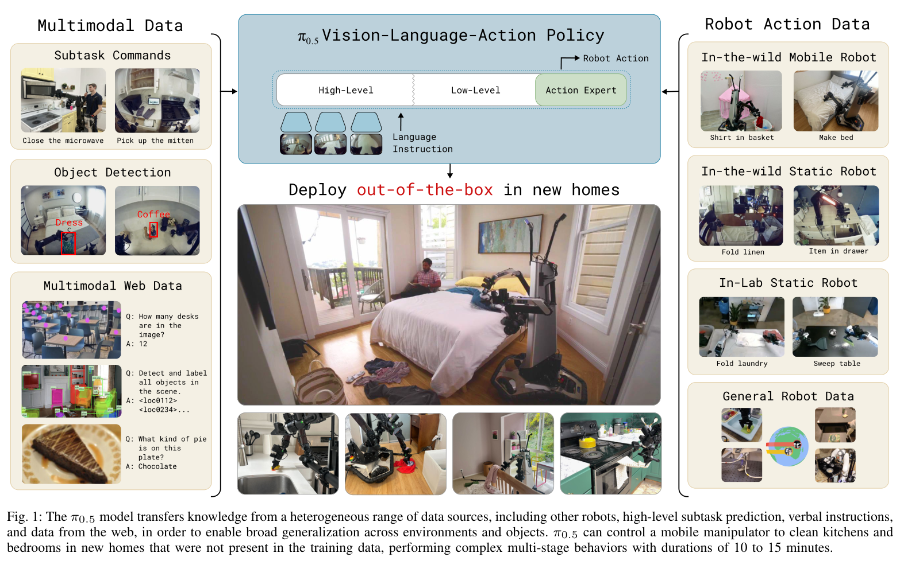

## 2. 研究问题：从会做任务到换个家还能做

### 2.1 这里的开放环境泛化指什么

**【原文】** 实验将机器人放入训练未见的厨房与卧室，任务包括将餐具放入水槽、将物品收进抽屉、把衣物放入篮子和整理床铺。新颖性来自物体实例、背景、布局和部分物体类别，而用于定量评估的四种任务本身属于训练任务范围。[§V，pp.7–11；附录 B–C，pp.17–18]

因此，需要区分几种能力：

| 泛化维度 | 论文提供的证据 | 不能直接外推的结论 |
| --- | --- | --- |
| 新环境 | 主模型在未见家庭、未见 mock rooms 中评估 | 任意建筑、任意地形都适用 |
| 新物体实例 | 在训练中见过的类别上使用新实例 | 已覆盖类别内所有形状和材质 |
| 新物体类别 | OOD 语言实验使用未见类别 | 网络数据中也从未出现这些类别 |
| 多阶段行为 | 根据当前观察选择子任务并连续执行 | 已具备任意长历史记忆和完整任务规划 |
| 跨机器人迁移 | 其他 embodiment 的训练数据改善目标机器人表现 | 任意新机器人无需适配就能部署 |

**【解读】** “新家庭”是很有价值的测试，因为视觉、几何和语义变化会同时出现；但它仍是一个明确任务域内的泛化问题，不能等同于机器人获得了无边界的通用能力。

### 2.2 为什么单纯增加目标机器人数据可能不够

完成“收拾厨房”至少需要三类知识：识别物体和指令的语义、决定下一步该做什么、执行接触和移动动作。昂贵的移动机器人遥操作轨迹同时承载这些信息，却不一定是每种知识最经济的数据来源。

**【解读】** 识别漏斗可以受益于图文和检测数据，学会抓取可以受益于固定机械臂示范，判断“先开抽屉还是先拿物体”则需要任务结构监督。π0.5 选择让这些来源在共享模型中相互补充，而不是要求移动机器人亲自在每种家庭中重复学习全部知识。[§I、IV-C，pp.2、6–7]

## 3. 数据集：六种监督来源各自教什么

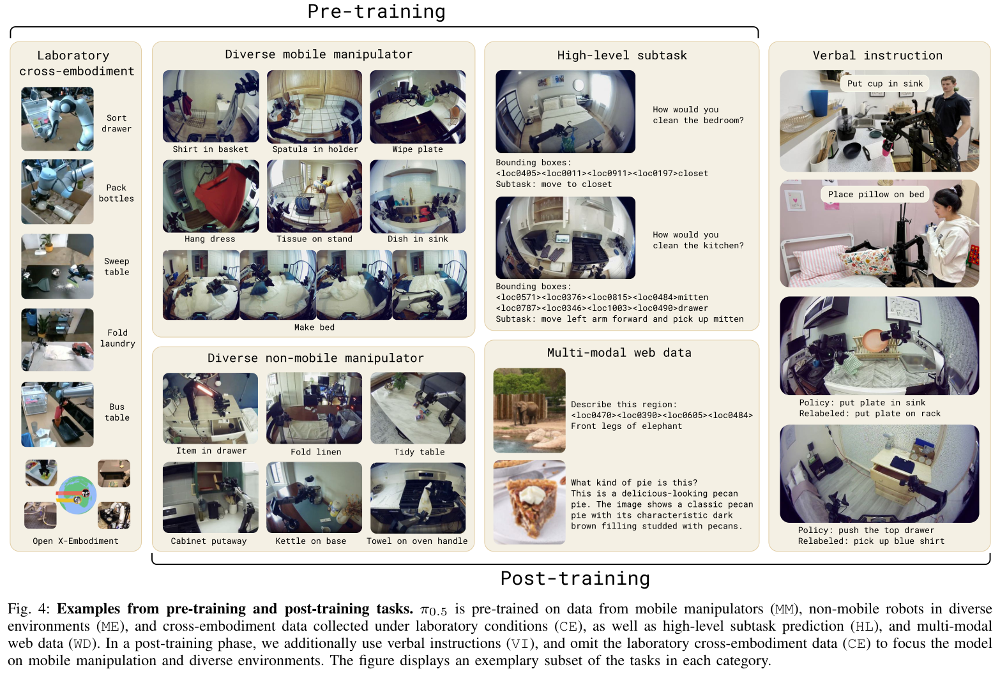

### 3.1 数据配方

| 缩写 | 数据来源 | 监督内容与作用 | 使用阶段 |
| --- | --- | --- | --- |
| MM | 多家庭移动操作机器人数据 | 目标机器人如何在家庭中移动、抓取和整理；约 400 小时、约 100 个环境 | 预训练与后训练 |
| ME | 多家庭非移动机械臂数据 | 更容易搬运的单臂 / 双臂平台，在更多家庭中提供物体与场景变化 | 预训练与后训练 |
| CE | 实验室跨本体动作数据 | 多种机器人和任务，包括与家务相关及不直接相关的操作；也含 OXE | 预训练；后训练动作配方去掉这部分 |
| HL | 高层子任务预测 | 对多阶段轨迹人工标注语义子任务，并标注相关边界框，训练当前观察到下一子任务的映射 | 预训练；后训练保留对应多环境数据的切片 |
| WD | 多模态网络数据 | 图像描述、VQA、物体定位，涉及 CapsFusion、COCO、Cambrian-7M、PixMo、VQAv2 等 | 预训练与后训练 |
| VI | 人类语言示范 | 人通过语言逐步指挥已学会低层技能的机器人，提供合适的高层决策示范 | 后训练新增 |

**【原文】** 第一阶段中，97.6% 的训练样例不来自移动操作机器人家务数据，而来自其他机器人或网络等来源。[§I，p.2]

**【解读】** 这个比例说明迁移来源的规模很大，但它是第一阶段的样例口径，不能写成“整个模型只用了 400 小时数据”，也不能直接换算为训练 token、算力或所有阶段的数据占比。论文没有完整公开各来源总时长、采样权重和全部清洗细节。

### 3.2 HL 与 VI 的区别

HL 是对已有轨迹补充“正在做哪个子任务”的标注。例如，模型观察到抽屉关闭、桌上有勺子，学习预测“打开抽屉”，随后用这个标签作为低层动作条件。

VI 则让人观察机器人在其低层策略下的实际执行状态，并给出下一步语言命令。论文称它为语言形式的 teleoperation：人负责高层选择，机器人自己的低层策略负责执行。[§IV-D，p.7]

**【解读】** 两者可能覆盖不同的状态分布：示范轨迹的标签不一定涵盖机器人执行失误后该怎么做，VI 有机会提供更贴近低层策略实际能力的高层监督。但本文没有把这种分布差异单独做成受控实验，不能把它写成已证实的唯一机制。

**【原文】** VI 约占高层移动操作样例的 11%，去掉它会降低高层评估表现。[§V-E，p.11] 这个 11% 的分母是“高层移动操作样例”，并非全部训练数据。

### 3.3 多本体数据怎样进入同一模型

**【原文】** 动作可表示目标关节位置或末端位姿，用 control mode 文本标记区分。每个数据集按各动作维度的 1% 与 99% 分位数归一化到 $[-1,1]$，动作维度固定为足以容纳最大动作空间的大小，较小本体用零填充。[§IV-C，p.7]

**【解读】** 归一化与 padding 解决的是数值尺度和张量形状的兼容性，不会自动让不同机器人的同一维具有相同物理含义。跨本体迁移是否成功仍需实验验证，后文 ME / CE 消融就是这方面的重要证据。

## 4. 算法核心：同一个模型先决定做什么，再决定怎么动

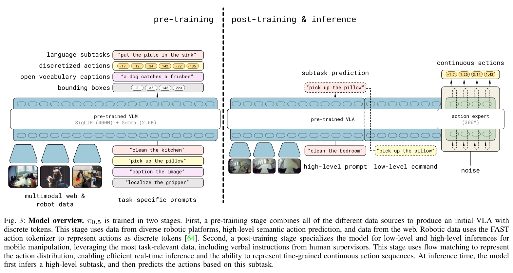

### 4.1 输入、输出与概率分解

记当前观察为

$$
o_t=[I_t^1,\ldots,I_t^n,q_t],
$$

其中 $I_t^i$ 是不同相机的图像，$q_t$ 是机器人本体状态；$\ell$ 是用户的总任务指令，$\hat\ell$ 是模型生成的高层子任务，$A_t=a_{t:t+H}$ 是动作块。

**【原文】** 模型把联合分布分解成

$$
\pi_\theta(A_t,\hat\ell\mid o_t,\ell)
=\pi_\theta(A_t\mid o_t,\hat\ell)
\pi_\theta(\hat\ell\mid o_t,\ell).
$$

高层根据当前场景和总目标生成子任务，低层根据场景和子任务生成动作。论文明确低层这一项不再直接依赖总指令 $\ell$。两项由同一个模型表示。[§IV-A，p.5]

以“把餐具放入水槽”为例，高层可能先输出“拿起杯子”，随后低层根据图像和这句话控制手臂；得到新观察后，高层再选择“把杯子放进水槽”。这不是一次生成完整计划后一直开环执行。

**【解读】** 语言子任务既是可读的中间表示，也构成信息瓶颈：总任务中没有保留在子任务里的约束，低层无法直接读取。若要支持“把杯子放进去，但不要移动红色碗”这类更复杂偏好，需要相应数据和条件设计，不能只靠现有分解自动保证。

### 4.2 统一模型包含专门的动作参数

**【原文】** 骨干采用 PaliGemma，图像经 SigLIP 编码，语言和离散化的本体状态进入 VLM。连续动作由约 300M 参数的 action expert 处理；动作 token 与 VLM 通过 self-attention 交换信息。[附录 E，p.19]

这里的“同一个模型”指共享的多模态系统，不表示所有模态使用完全相同的权重。Action expert 也不是另一个负责生成高层计划的独立语言模型。

附录 E 列出 VLM Transformer 的 width=2048、depth=18，动作专家 width=1024、MLP dimension=4096。正文图3对不同阶段 Gemma 参数量的文字标注存在差异；本文不据此推断训练时替换了更大的语言骨干。

## 5. 为什么训练用 FAST，部署又用 Flow Matching

### 5.1 FAST：让动作加入统一的序列训练

**【原文】** 预训练将动作通过 FAST tokenizer 编码为离散 token，与语言、边界框等输出一起进行 next-token prediction。论文选择这条路线是因为离散动作表示有利于训练效率；连续动作专家则更适合实时生成细粒度动作块。[§III、IV-B/C，pp.4–6]

**【解读】** FAST 提供的是动作序列的压缩表示。本文重点是如何把它用于混合训练，而非重新发明 tokenizer。离散动作 token 可以方便地接入语言模型训练框架，但部署时逐 token 自回归会引入连续控制的时延。

不能把这里的 FAST 简化成“把每个关节值独立分成若干桶”，也不能把连续动作专家理解成逐个解码 FAST token 后的平滑器：它有自己的生成目标和参数。

### 5.2 Flow Matching：从噪声生成整个连续动作块

**【原文】** 论文定义带噪动作

$$
A^{\tau,\epsilon}=\tau A+(1-\tau)\epsilon,
\qquad \epsilon\sim\mathcal N(0,I),
$$

并以 $\epsilon-A$ 为向量场监督，推理用 10 步去噪生成连续动作。[§IV-B，p.5]

**【推导】** 为避免混淆插值系数与积分方向，令 $s=1-\tau$，把同一条路径写成

$$
X_s=(1-s)A+s\epsilon,
\qquad \frac{dX_s}{ds}=\epsilon-A.
$$

此时 $s=1$ 是噪声端，$s=0$ 是真实动作端。用条件 $c$ 表示观察和低层语言指令，向量场的训练可整理为

$$
\mathcal L_{\mathrm{FM}}
=\mathbb E\left[
\left\|v_\theta(X_s,s,c)-(\epsilon-A)\right\|_2^2
\right].
$$

沿 $s:1\rightarrow0$ 反向积分，简单 Euler 示意为

$$
X_{s-\Delta}=X_s-\Delta\,v_\theta(X_s,s,c).
$$

这只是对原文符号的重参数化与方向说明，不表示论文增加了另一种训练算法，也不将这里的 Euler 示意当作完整部署实现。

**【解读】** 一个动作块的全部时刻可以在同一轮向量场计算中处理，避免逐个离散动作 token 自回归。这仍需要多轮网络计算；“10 步”是生成迭代次数，不是机器人只执行 10 个控制时刻。

### 5.3 联合损失与两个阶段

论文式 (1) 可概括为

$$
\mathcal L
=\mathcal L_{\mathrm{CE}}+\alpha\mathcal L_{\mathrm{FM}},
$$

其中交叉熵项监督文本输出，包括 FAST 动作 token；Flow Matching 项监督连续动作专家。

| 阶段 | 训练设置 | 数据与目的 |
| --- | --- | --- |
| 预训练 | 280k 梯度步，$\alpha=0$ | MM、ME、CE、HL、WD；以离散序列任务学习广泛能力 |
| 后训练 | 再训练 80k 步，$\alpha=10$ | 加入随机初始化的 action expert，联合保留 next-token prediction 与连续动作损失 |
| 后训练数据选择 | 动作来自 MM、ME 的成功且低于固定长度阈值的片段；保留 WD、对应 HL，加入 VI | 聚焦移动操作，同时保留视觉语义能力；不是只接入动作头后停止其他训练 |

以上设置来自 §IV-D，p.7。**【解读】** $\alpha=10$ 是损失权重，不能解释成“连续动作占 90.9% 的学习效果”，因为两个损失的尺度、归约方式和梯度大小并不相同。

### 5.4 Attention mask 防止动作表示之间泄漏答案

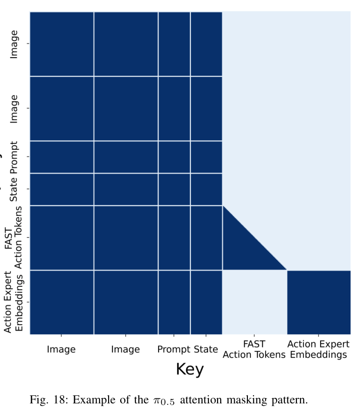

**【原文】** 图像、prompt、本体状态组成可相互关注的 prefix；FAST 动作 token 可看 prefix 和先前动作 token；连续动作专家可看 prefix 和整个带噪动作块，但不能看 FAST 动作 token。VLM 端也不关注动作专家的 embedding，信息流在此结构中从 VLM 指向动作专家。[附录 E，p.19]

**【解读】** 若连续分支在训练时能直接读取代表真值动作的 FAST token，就可能通过这条路径取得答案，形成训练与部署不一致。Mask 隔离了两种动作表示的直接读取，同时允许它们利用共享的观察前缀。

附录还说明，π0.5 通过单独的时间步 MLP 和 adaptive RMSNorm 把 Flow Matching 时间注入动作专家各层，并使用图像裁剪、旋转和颜色扰动等增强。注意力的单向可见性不等于冻结 VLM，也不等于已经定义了停止梯度规则。

## 6. 机器人系统与推理：50 Hz 到底指什么

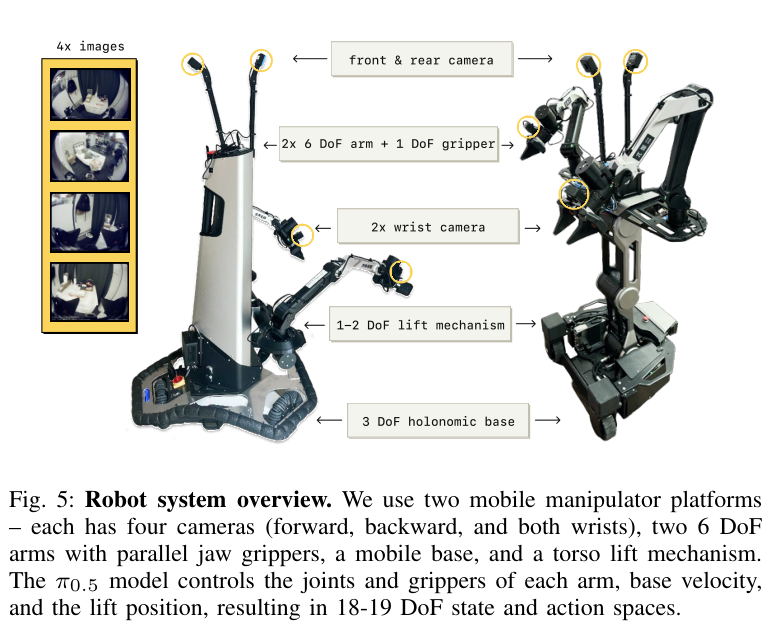

**【原文】** 两个平台均有两只 6 自由度机械臂及夹爪、3 自由度全向底盘、1 或 2 自由度升降机构，总状态 / 动作空间为 18 或 19 维。四路相机包括前、后和双腕；高层使用全部四路，低层使用前视与双腕三路。[§IV-E，p.7]

模型输出手臂、夹爪和升降机构的目标位姿，以及底盘目标速度，底层使用 PD 控制跟踪；论文没有再叠加轨迹规划或碰撞检测。这里的端到端控制仍包含低层执行器控制器。

| 时间量 | 原文信息 | 应怎样理解 |
| --- | --- | --- |
| 机器人目标命令频率 | 50 Hz | 控制目标的执行时间尺度，不能直接当作整个 VLM 的前向频率 |
| 动作块长度 | 50 个动作，即 $H=49$ | $a_{t:t+H}$ 两端均包含，长度为 $H+1$ |
| 单块覆盖时长 | 约 1 秒 | **【推导】** 按 50 个控制时刻和 50 Hz 计算 |
| 连续生成 | 10 次去噪迭代 | 不是 10 个动作，也不是已披露的端到端时延 |
| 高层更新 | 频率低于低层动作推理 | 论文没有给出可据以复现的完整时序、调度与所有硬件时延 |

动作块覆盖 1 秒，并不说明必须整块执行完才观察；本文也不从覆盖时长反推一个未披露的闭环重规划频率。可以确定的是，高层依据新观察选择子任务，低层依据子任务生成后续动作。[§II，p.3；§IV-B/E，pp.5、7；附录 E，p.19]

## 7. 实验先看指标：任务进度不等于整项成功率

### 7.1 四个任务怎样计分

**【原文】** 标准多阶段任务实验报告评分规则总分的百分比；通常每策略、每任务 10 次，四任务合计约 40 次。附录同时说明某些因机器人故障、时间限制等取消的试验被移除，实际样本量会变化；策略交错执行，图中显著性采用双侧 t 检验。[附录 B，p.17]

| 任务 | 评分规则 | 满分 |
| --- | --- | --- |
| 餐具进水槽 | 初始 4 件餐具；每件拿起 +1，放入水槽 +1 | 8 |
| 物品进抽屉 | 拿起、打开抽屉、放入、物品在内时关上抽屉，各 +1 | 4 |
| 衣物进篮子 | 导航并拿起 +1，放到篮内或篮上 +1，衣物完全在内 +1 | 3 |
| 整理床铺 | 毯子盖住床单 +1，两枕头放床头各 +1，毯子非常整齐 +1，双枕非常整齐 +1 | 5 |

**【推导】** 对餐具任务，搬完 3 件、未碰第 4 件得到 $6/8=75\%$；搬完 2 件、拿起但未放好其余 2 件，同样是 $6/8=75\%$。同一个进度分数可以对应不同失败状态，且两者都没有完整完成任务。

**【解读】** 平均任务进度能刻画部分完成能力，却不能推导出整项任务成功率。正文图1提到 10–15 分钟的长行为展示，而 §V-A 的定量 real-home 任务多为约 2–5 分钟，二者应分开陈述。[图1，p.1；§V-A，p.8]

### 7.2 语言实验单独报告两种指标

**【原文】** 实验一次摆放 5 个物体，指定搬其中一个，并故意让目标比干扰物更远，削弱“拿最近物体”的捷径。报告：

- **Language following rate**：是否选中了指令所指的对象。
- **Task success rate**：是否把正确对象成功放到指定位置。

ID 实验使用训练中出现过的类别的新实例；OOD 实验使用漏斗、药瓶、点火器、护目镜等新类别。对完全不理解指令的五选一策略，约 20% 是这一设置下的参考水平，并非任意机器人任务的随机成功率。[附录 C，pp.17–18]

**【解读】** 看懂对象与成功操作是两个环节。这也是为什么评估网络语义数据时，不能只看熟悉物体上的整体任务进度。

## 8. 主要结果：哪些证据支持开放环境泛化

### 8.1 真正进入训练未见的家庭

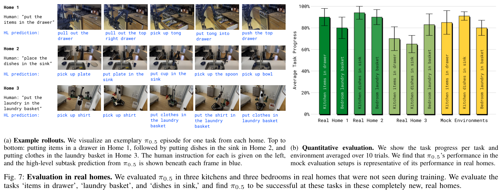

**【原文】** 最终实机评估包括三个真实家庭的厨房和卧室；图7量化了餐具进水槽、物品进抽屉、衣物进篮子等任务，每个任务 / 环境均值按图注来自 10 次试验。受控比较则使用另外搭建的 mock kitchens / bedrooms。[§V-A、图6–7，pp.7–8]

**【解读】** 三个家庭的结果证明系统可以超出采集环境执行较长的操作序列；但家庭数量有限，图中不同任务与家庭的分数也有波动。不能从这些样本声称任意家庭都能达到同样表现。

### 8.2 场景数量增加，表现总体提高，但曲线并不单调

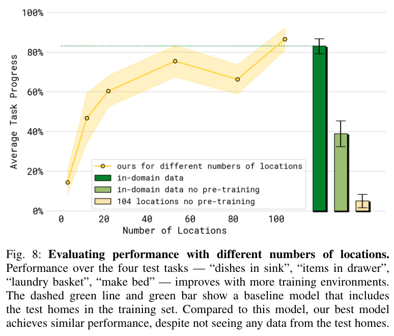

**【原文】** 场景缩放实验使用 3、12、22、53、82、104 个地点。为控制成本，它不是对每个地点数都重跑完整配方：先进行不含 MM 的机器人动作混合预训练，再以不同地点子集后训练 40k 步；作者说明各模型看到相同数量的独特样本，以控制数据量。[§V-B，pp.8–9]

**【解读】** 图8总体趋势向上，但 82 个地点的点低于 53 个地点，不能称为每次加场景都稳定提升。104 地点模型的均值接近包含测试家庭数据的共训对照，说明在这些任务上泛化差距可以缩小；“接近”不是统计等价证明，也不是测试家庭数据成为可有可无。

图中还包含“不用共训预训练”的对照：即使直接使用测试环境数据，表现也明显较低。它支持**数据多样性与预训练配方需要一起看**，不能把图8概括成“只采 100 个家庭就自动泛化”。这里的 104 是该缩放实验的地点设置，也不能擅自替换为全部训练来源的家庭总数。

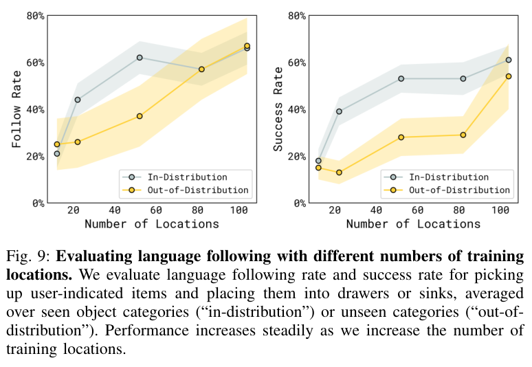

图9使用的是缩放实验模型与语言任务，图11使用的是数据消融设置。两图不属于同一实验配置，不能把它们的最高柱 / 端点拼成一条统一性能曲线。

### 8.3 ME 与 CE 都有用，目标机器人经验不能替代所有迁移来源

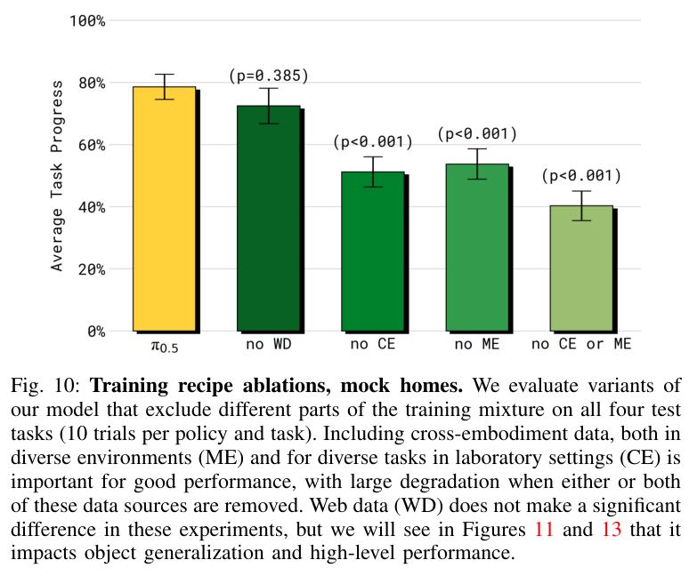

| 训练版本 | 四任务平均进度，按图10近似读取 | 图中相对完整模型的检验 |
| --- | --- | --- |
| 完整 π0.5 | 约 79% | 参照 |
| no WD | 约 73% | $p=0.385$，此实验未显示显著差异 |
| no CE | 约 51% | $p<0.001$ |
| no ME | 约 54% | $p<0.001$ |
| 同时去掉 ME 与 CE | 约 41% | $p<0.001$ |

**【原文】** ME 和 CE 的删除都使性能下降，同时删除下降更多；作者将其解释为来自其他环境和其他任务的跨本体迁移。[§V-C，pp.9–10]

**【解读】** 这些结果支持相应数据在该训练系统中的贡献，但删除一个来源也改变了训练混合。它并不等于在完全匹配训练预算、任务数量、图像多样性等条件下，严格隔离了“本体差异”的单一因果效应。

### 8.4 WD 的价值在 OOD 语义与高层选择中更明显

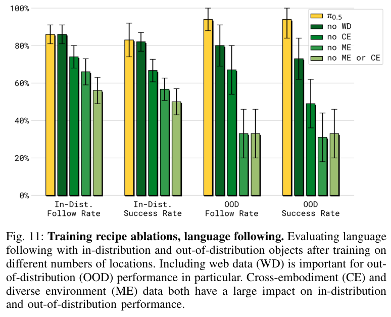

**【原文】** 图10中去掉 WD 的任务进度差异未达显著；图11中，它对 OOD 对象的语言遵循与操作成功影响更大。完整模型的 OOD 两指标约在 94%，去掉 WD 后分别约为 80% 和 74%；这些是图11的近似读数，并非整间厨房的自主清洁成功率。[§V-C、图11，p.10]

**【解读】** 一个模型在常见物体上还能拿稳、放对，不代表它能把“护目镜”这个词映射到从未在机器人动作数据中见过的物体。网络数据可能主要改善对象理解和高层语义，因此只用熟悉任务的总进度评估它，容易低估其作用。论文将这一知识迁移机制表述为解释和猜想，而非直接测得的内部表征事实。

### 8.5 比 π0 更好的结果来自多个变化

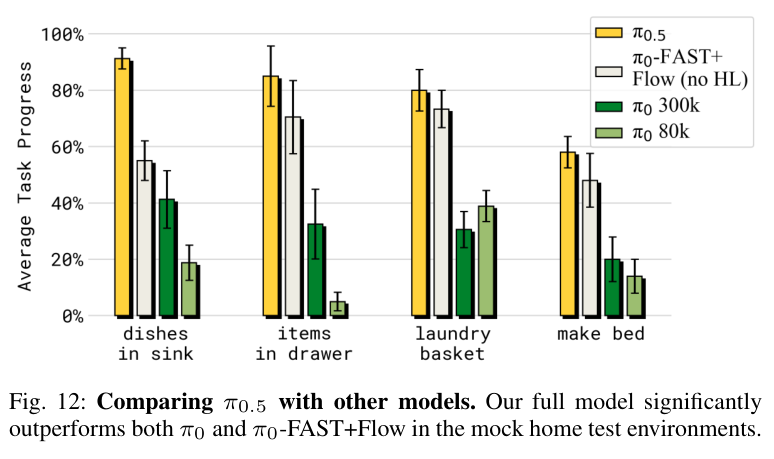

**【原文】** 对照包含原始 π0，以及尽量靠近新配方、但只使用动作数据且不具备高层推理的 π0-FAST+Flow。各模型使用相同跨本体机器人训练集和可比较的训练步数，并额外比较了训练更久的 π0。完整 π0.5 在图12的 mock-home 任务上表现更好。[§V-D，p.10]

**【解读】** 这不是单一结构开关的对比：语义数据、分层能力、离散 / 连续训练安排同时改变。结果不能证明“只换 Flow Matching 就产生开放环境泛化”，也没有在这组实验中直接排出 OpenVLA、所有其他 VLA 的名次。训练步数相近也不自动意味着总 FLOPs 或实际训练时间相同。

## 9. 高层消融：更应该学到的是监督信号的价值

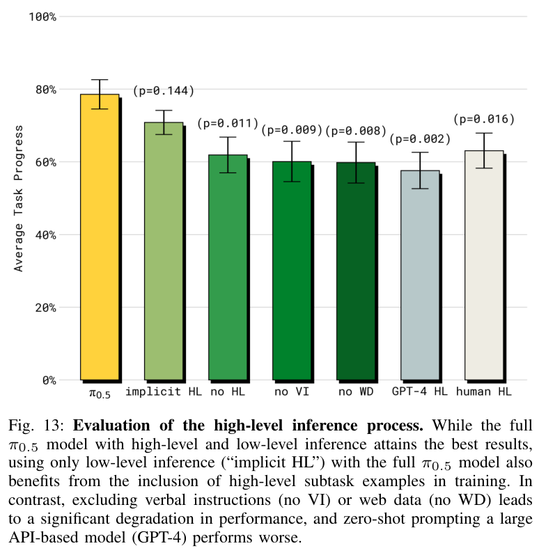

这组实验使用相同的完整 π0.5 低层执行过程，改变高层来源或相关训练设置。[§V-E，pp.10–11]

| 设置 | 改变什么 | 对结果的正确理解 |
| --- | --- | --- |
| 完整模型 | 训练含 HL，部署也显式预测子任务 | 图中均值最高 |
| implicit HL | 训练保留高层监督，部署直接把任务交给低层 | 均值次高；与完整模型比较 $p=0.144$ |
| no HL | 训练与部署都没有高层子任务这一路 | 下降明显；与 implicit HL 一起体现训练监督的价值 |
| no VI | 不用人类语言示范训练高层 | 表现下降；这批数据虽小仍有作用 |
| no WD | 不用网络数据训练高层相关模型 | 表现下降，显示语义知识与高层行为的关联 |
| GPT-4 HL | 外部模型按任务描述和常用标签表选择子任务 | 该零样本提示设置下表现较弱 |
| human HL | 专家人类给子任务，低层仍由机器人执行 | 不是人类直接操纵机械臂，也非保证最优的理论上界 |

**【解读】** 这张图最容易被过度解读。显式高层模型均值约 79%，implicit HL 约 71%，但图中两者的 $p=0.144$。因此，本文只能说“显式高层均值更高”，不能说这组实验已证明它显著优于 implicit HL。高层监督在训练阶段的价值，比“部署必须显式说出每一步”的结论更扎实。

完整模型超过 human HL，也不意味着机器人总体规划能力超过人类。人给出的子任务和低层策略的实际能力可能不匹配，接口表达、延迟和试验波动也可能影响结果；论文没有单独排除这些解释。

同样，GPT-4 这一对照检验的是给定提示和领域适配条件下的高层选择，不能推出所有外部规划器或所有大语言模型都不适合机器人规划。

## 10. 局限：哪些问题仍然没有解决

### 10.1 作者报告的失败类型

**【原文】** 系统仍会遇到陌生抽屉把手、机械上难打开的柜门、机械臂遮挡待擦污渍、反复开关抽屉等问题；可接受的 prompt 较简单，有限上下文也限制了跨房间导航和记住物品位置等能力。[§VI，p.11]

**【解读】** 这几类失败对应不同瓶颈：接触与形状泛化、物理可达性、部分可观测性、任务状态判断。增加一个更大的语言模型未必能同时解决它们。

### 10.2 评估与复现边界

- **任务域有限**：厨房和卧室的四类定量任务，不能覆盖所有家务、新技能或复杂偏好。
- **真实家庭样本有限**：三户家庭能展示迁移实例，仍不足以估计大规模部署下的失败尾部。
- **指标包含部分完成**：任务进度高不代表整项任务可靠完成，也不代表 10–15 分钟行为的无干预成功率。
- **存在试验移除**：附录报告取消 trial 的处理，但没有给出每项所有取消原因与数量；据此很难重新计算完整运行可靠性。
- **消融不是所有因素完全配平**：数据数量、来源多样性、监督类型与训练过程之间仍存在耦合。
- **训练配方披露不完整**：完整混合权重、数据总量、全部优化参数和部署调度等不足以仅凭 PDF 原样复现。
- **系统控制没有独立安全保证**：文中没有额外轨迹规划和碰撞检测，不应从实验表现推导出任意家庭中都能安全运行。

## 11. VLA 与 WAM：这篇论文在方法谱系中的位置

**【解读】** π0.5 学的是条件策略和子任务分布。它没有在本文中训练一个显式预测未来场景的 world model，也没有展示用预测未来观测进行模型规划的过程。因此，把它归为 VLA 很清楚；若使用 WAM 一词，需要先定义具体含义，不能因为它输出动作块就称其已经学会完整的世界动力学。

与本文引用的相关工作相比，可以从三个方向理解它：[§II，p.3]

| 方向 | 与 π0.5 的联系 | 本文强调的变化 |
| --- | --- | --- |
| π0 / 连续动作生成 | 都使用动作专家与生成式动作块 | 用异构共训和两阶段训练扩展到新家庭 |
| FAST / 离散动作训练 | 提供适合序列建模的动作 token | 预训练用离散动作，后训练加入连续分支 |
| Hi Robot / 分层 VLA | 都把任务分解到语言子任务再执行 | 高低层使用同一模型，结合 HL、VI 和网络监督 |

这里的联系来自本论文对相关方法的描述，不等于本文对这些前作做了完整独立评测。站内的 [ACT 精读](/embodied-ai-learning/posts/paper-act/)可帮助理解动作分块；原提纲关联的 [梯度下降笔记](/embodied-ai-learning/posts/gradient-descent/)可作为优化基础补充。两篇站内笔记均不是本论文实验结论的来源。

## 12. 个人思考与可执行研究方向

### 12.1 最有价值的启发：按失败类型寻找监督来源

**【解读】** 当机器人失败时，先区分“没认对物体”“下一子任务错了”“动作没执行好”“缺少历史状态”。这些错误分别需要语义、任务结构、控制和记忆方面的证据。π0.5 的配方有价值，正是因为它让不同来源能对准不同抽象层次，而不只把所有问题都归结为缺少目标机器人轨迹。

### 12.2 能把论文结论推进一步的实验

| 待回答的问题 | 建议的对照 | 应同时报告的指标 |
| --- | --- | --- |
| ME 提升来自新家庭还是新本体？ | 在总样本数、任务类别和预算匹配下，交叉改变场景多样性与本体多样性 | 新场景进度、整项成功率、训练成本 |
| HL 的主要收益在训练还是推理？ | 同一低层、相同数据，比较显式 HL、implicit HL、no HL，并增加重复试验 | 均值与置信区间、失败阶段、高层更新成本 |
| VI 为什么少量也有效？ | 比较专家轨迹标签与策略实际执行状态上的语言示范 | 高层标签准确率、恢复成功率、标注耗时 |
| 低层是否真的受益于 WD？ | 固定高层来源，只改变低层共训数据；再做相反对照 | 选对对象条件下的操作成功率与 OOD 识别率 |
| 失败是否来自缺少记忆？ | 无历史输入、短历史与显式任务状态三组比较 | 重复开关抽屉次数、遮挡恢复、整任务完成时间 |

以上均为 **【建议】**，没有在本文或本地执行。对于资源有限的研究，优先研究统一低层策略上的高层监督与状态表示，可以减少从头复制完整大规模训练系统的成本。

### 12.3 主观阅读评价

**阅读价值：9/10。** 它给出了清楚的系统假设与多组实机消融，对理解“机器人泛化需要哪些数据”很有帮助。方法创新主要体现在训练组织和系统整合；实验结论应限制在其任务、指标与样本范围。若以“仅凭论文能否精确复现整个系统”为标准，公开细节仍有明显缺口。此评分是阅读者判断，不是论文实验指标。

## 13. 参考资料与事实定位

| 本文论点 | PDF 定位 |
| --- | --- |
| 异构共训动机、400 小时、第一阶段 97.6% 来自其他来源 | §I，pp.1–3 |
| 分层概率分解、交叉熵与 Flow Matching 联合目标 | §IV-A/B，p.5 |
| 六类数据与动作归一化 | §IV-C/D，pp.6–7 |
| 280k + 80k 训练、损失权重 10、后训练过滤 | §IV-D，p.7 |
| 相机、18–19 维控制、PD 跟踪 | §IV-E，p.7 |
| 新家庭评估、地点缩放与其简化训练设置 | §V-A/B、图7–9，pp.7–9 |
| 数据和模型消融 | §V-C/D、图10–12，pp.9–10 |
| implicit HL、VI、人类与 GPT-4 高层对照 | §V-E、图13，pp.10–11 |
| 任务评分规则、样本量、取消试验与统计检验 | 附录 B，p.17 |
| 五物体语言实验与 OOD 定义 | 附录 C，pp.17–18 |
| 分任务结果 | 附录 D、图16–17，pp.18–19 |
| 50 动作、$H=49$、动作专家、attention mask 与时间注入 | 附录 E，p.19 |

- [论文官方摘要与版本记录](https://arxiv.org/abs/2504.16054v1)：核对题名、作者、首发日期与版本。
- [论文官方 PDF](https://arxiv.org/pdf/2504.16054v1)：便于对照本文页码；本文分析对象仍是用户提供的本地文件。
- [Physical Intelligence 项目说明与演示](https://www.pi.website/blog/pi05)：官方补充材料，页面的演示不替代本文对 PDF 定量结果的分析。

本文图片均由本地论文 PDF 裁剪，保留原图编号与图注，版权归原作者。图像来源页码和裁剪记录保存在文章 images 目录的本地维护索引中；该索引不作为另一篇公开文章发布。
