# π0 原文图片索引

来源：用户提供的 17 页本地 PDF；公开文献记录为 arXiv:2410.24164。

页面裁剪保留原始图表及图注，坐标和 SHA-256 见同目录 index.json。
本索引供本地维护，由 Astro legacy collection 排除，不是公开文章或下载页。

## fig01 · PDF p.1

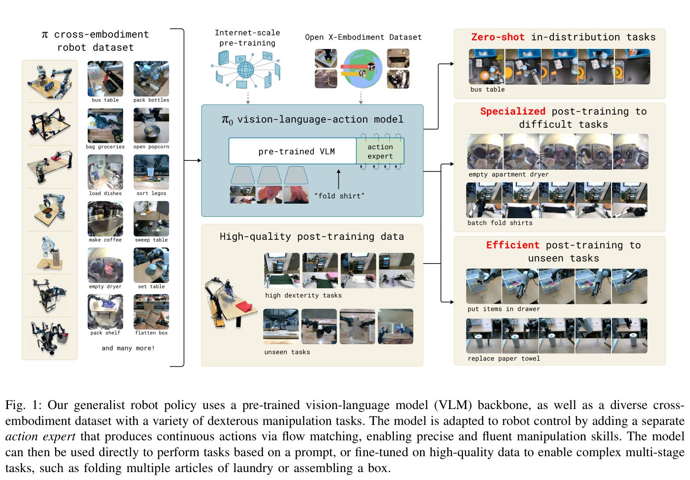

## fig03 · PDF p.4

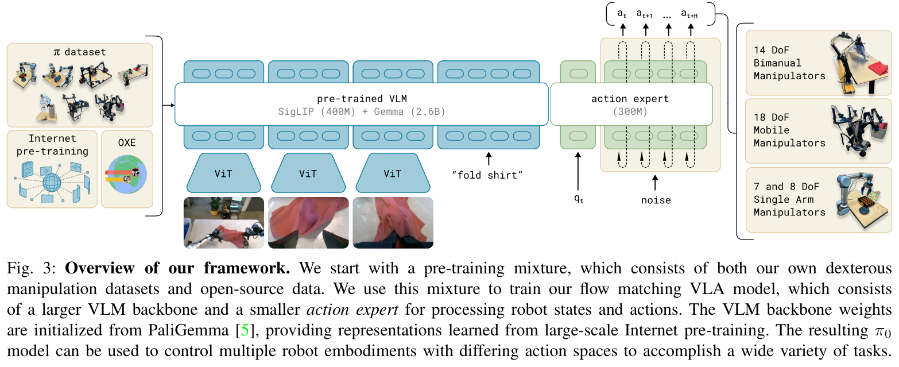

## fig04 · PDF p.5

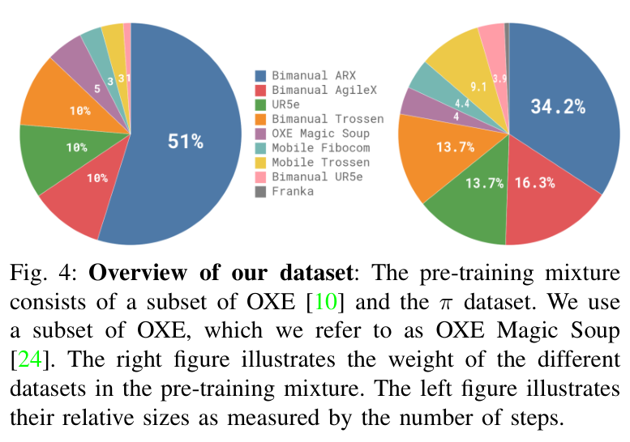

## fig05 · PDF p.6

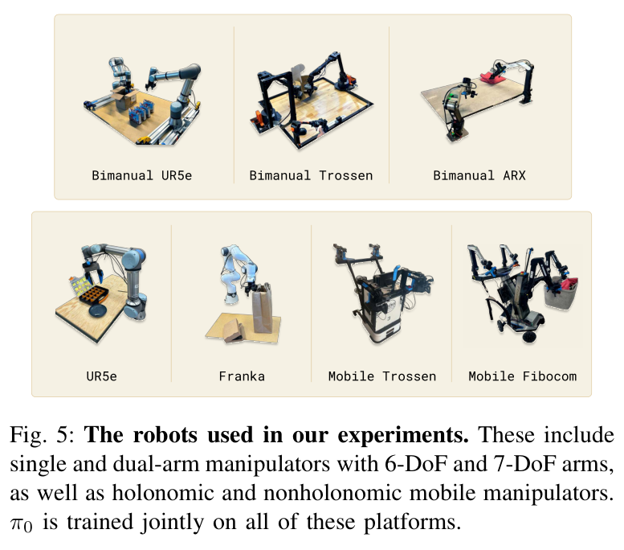

## fig07 · PDF p.8

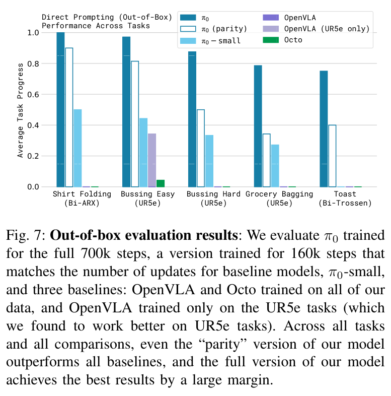

## fig09 · PDF p.9

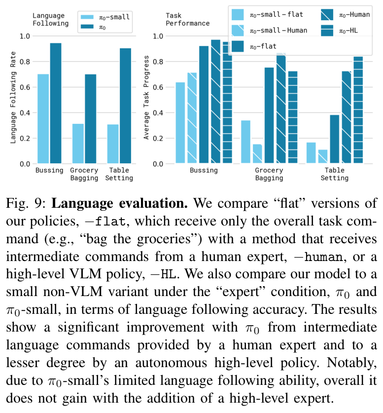

## fig10 · PDF p.9

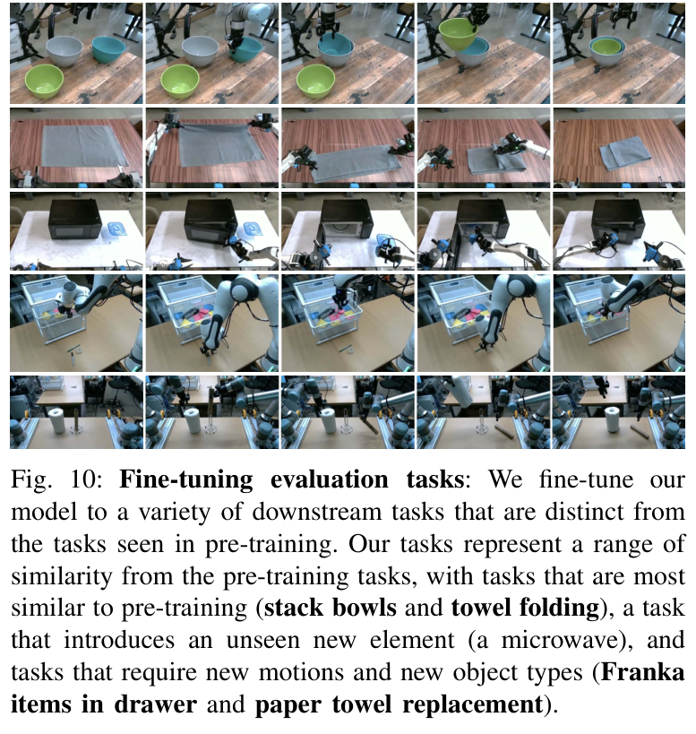

## fig11 · PDF p.10

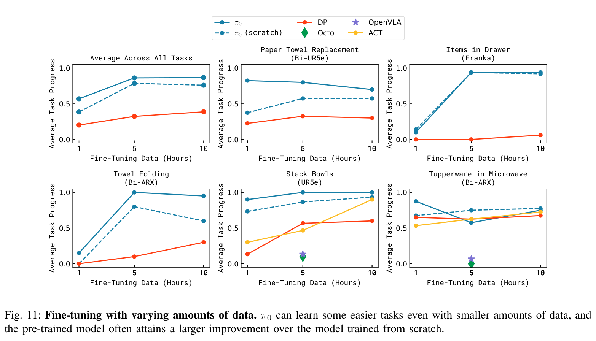

## fig12 · PDF p.11

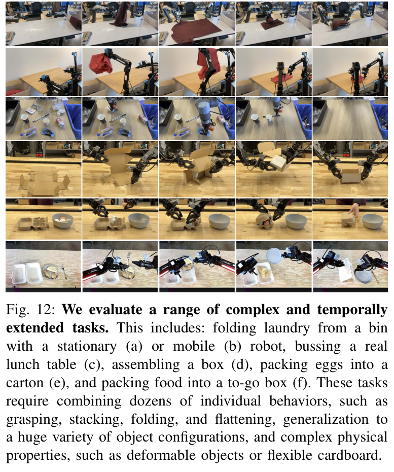

## fig13 · PDF p.11

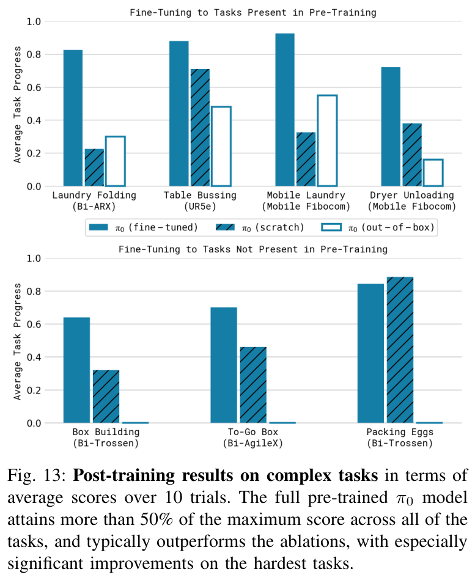

## fig14 · PDF p.16

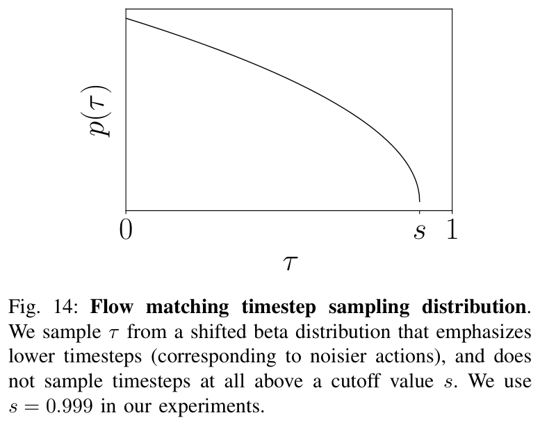

## table01 · PDF p.16

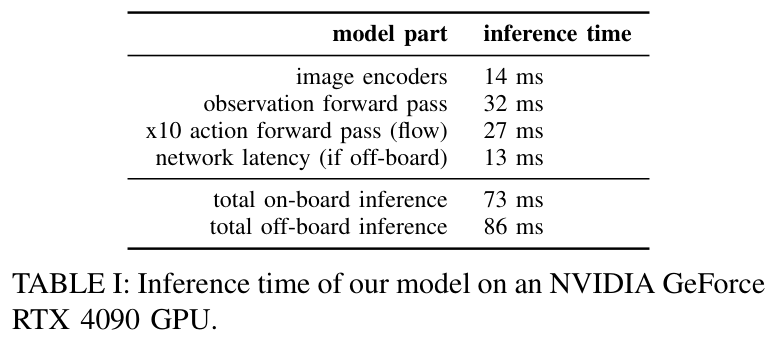
