π0 的关键，是把**从互联网图文中学到的语义表示**与**高频、连续、多模态的动作生成**连接起来，再通过跨机器人预训练和任务后训练，把它变成能完成复杂操作的策略。

> **阅读范围**：用户提供的本地 PDF 全部 17 页，包括主文、参考文献与附录 A–E。本文页码均为 PDF 物理页码。该文件没有明确的 arXiv 版本标记，不能仅凭 PDF 生成日期判定为 v1 或 v4。首发日期 2024-10-31 与 RSS 2025 信息由 [arXiv 官方记录](https://arxiv.org/abs/2410.24164)核对；本文创建于 2026-11-15。
>
> **证据标记**：**【原文】** 表示论文陈述或实验结果；**【解读】** 表示阅读者的解释；**【推导】** 表示基于原文的数学整理；**【建议】** 表示尚未验证的实验方案。图中没有直接标注的数值不当作精确数据。本文没有执行机器人训练或实机复现。

## 1. 论文简介：它把哪些能力接到了一起

| 项目 | 核对结果 |
| --- | --- |
| 原题 | π0: A Vision-Language-Action Flow Model for General Robot Control |
| 作者与机构 | Physical Intelligence；Kevin Black、Noah Brown、Danny Driess 等，完整名单见论文首页 |
| 文献记录 | arXiv:2410.24164，首发 2024-10-31；官方记录标注发表于 RSS 2025 |
| 模型 | 约 3B 参数的 PaliGemma，加上从头初始化的约 300M 动作专家，总计约 3.3B |
| 输入 | 2 或 3 路 RGB、语言指令、机器人本体状态 |
| 输出 | 长度为 50 的连续动作块，机器人控制频率最高 50 Hz |
| 机器人数据 | 约 10,000 小时自采灵巧操作示范，另混合开放机器人数据；自采数据覆盖 7 类机器人配置、68 项任务 |
| 训练范式 | 多任务、多机器人预训练，再直接提示或用高质量任务数据后训练 |
| 主要评估 | 基础模型直接使用、语言跟随、新任务适配、复杂多阶段操作 |

**【原文】** 作者将系统贡献归纳为通用机器人策略架构与预训练／后训练配方的实证研究。[§I–IV，pp.2–5]

**【解读】** Flow Matching、动作分块和 VLM 都有前作。π0 的价值在于让这些部分能够共同训练、有效推理，并在同一组复杂实机任务上工作。它既是模型设计论文，也是一篇数据与训练系统论文。

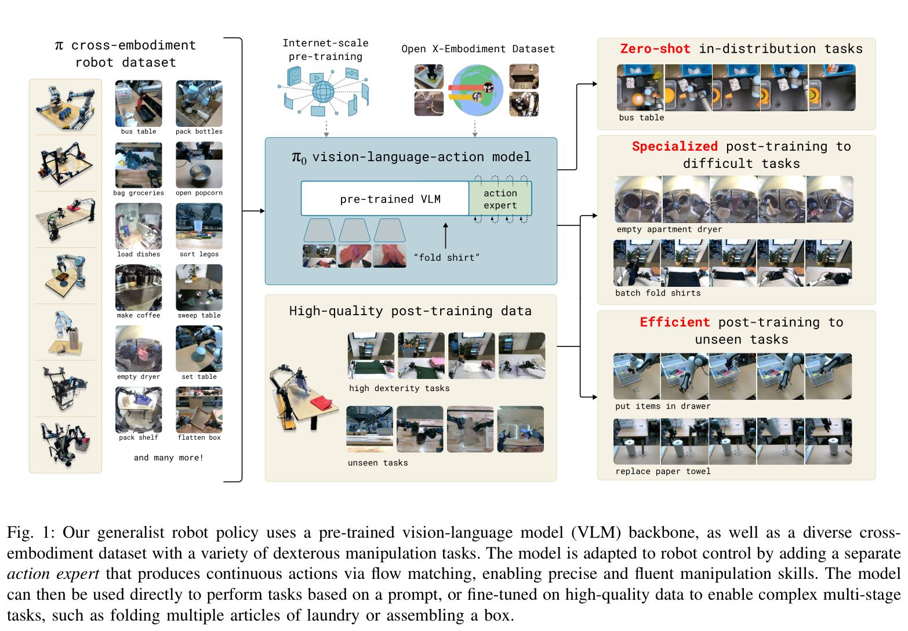

图中的三种使用方式要分清：预训练后直接执行已有任务；对已有但很难的任务进行专门后训练；用新任务数据学习预训练没有覆盖的行为。不能把它们全部称为“零样本新技能”。

## 2. 研究问题：为什么会看图说话还不足以控制机器人

### 2.1 语义知识与动作表示是两个不同瓶颈

VLM 可以帮助理解“杯子”“垃圾”“把盘子放进回收箱”这些语义，但机器人还要回答：双臂下一刻往哪里动、怎样连续折叠柔性物体、面对遮挡或失败是否重试。自然语言的离散 token 接口，不能直接解决这种高频连续控制。

**【原文】** 先前自回归 VLA 将动作离散化后逐 token 生成；π0 用 Flow Matching 建模连续动作块，以支持高频和灵巧操作。[§II、IV，pp.3–5]

**【解读】** 这里有两个独立诉求：表示能力上，要容纳同一个观察下多种合理动作；计算上，要一次产生一段动作，避免逐个动作维度、逐个时间步串行解码。Flow Matching 负责条件动作分布，动作分块负责时间序列的联合预测，二者共同服务于控制接口。

这并不意味着连续生成天然保证动作平滑、接触稳定或物理可行。它仍然是在示范数据上学习条件分布，论文没有在生成器中加入显式动力学约束或控制稳定性证明。

### 2.2 为什么还需要机器人数据预训练

**【原文】** 训练配方先让策略接触多任务、多机器人和多种操作状态，再用更一致、更流畅的高质量示范形成目标行为。作者的直觉是：广泛预训练覆盖错误与恢复，高质量后训练强调有效执行。[§I、V，pp.3、5–6]

**【解读】** “网络图文预训练”“机器人动作预训练”“目标任务后训练”是三个层次。第一层提供视觉和语言基础，第二层学习身体动作及物理交互经验，第三层集中到目标任务。后面的消融必须先明确究竟移除了哪一层。

## 3. 模型结构：动作专家怎样与 VLM 交换信息

### 3.1 输入输出与张量含义

**【原文】** 在机器人时刻 $t$，条件观察和预测目标为：[§IV，p.5]

$$
\begin{aligned}
o_t&=(I_t^1,\ldots,I_t^n,\ell_t,q_t),\\
A_t&=[a_t,\ldots,a_{t+H-1}],\quad H=50.
\end{aligned}
$$

这里 $I_t^i$ 是第 $i$ 路图像，$\ell_t$ 是语言指令，$q_t$ 是本体状态。$A_t$ 是未来动作序列；$t$ 是真实控制时间，后文的 $\tau$ 是生成过程的流时间，两者不是同一个时间轴。

图像由视觉编码器转换为 token，语言沿用 VLM 输入。状态经过线性投影，带噪动作与流时间经过 MLP 编码。**每一个动作时间步对应一个连续动作 token**，因此 50 步动作对应 50 个 token，而不是为每个标量关节值分配一个离散词表编号。[附录 B，p.15]

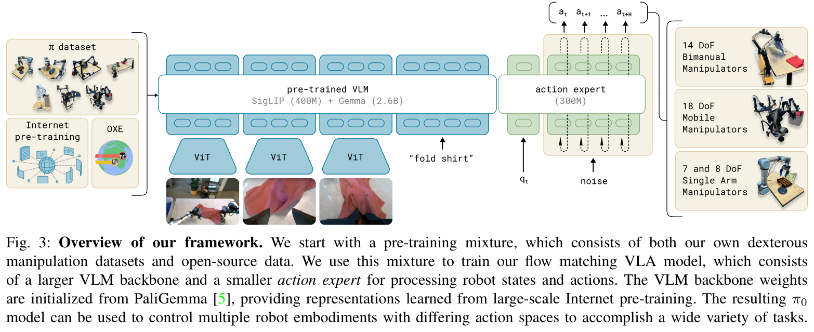

### 3.2 这里的 expert 是按模态分配权重

**【原文】** 模型可以看作一个具有两套权重的 Transformer。图像与语言走较大的 VLM 权重，状态与动作走较小的动作专家；两套权重通过自注意力交换信息。动作专家约 300M 参数，从头初始化。[§IV，p.5；附录 B，p.15]

| 部分 | 输入 token | 主要作用 |
| --- | --- | --- |
| VLM 骨干 | 图像、语言 | 提供预训练视觉语义表示 |
| 动作专家 | 状态、带噪动作 | 融合条件信息并预测连续动作速度场 |
| 输出投影 | 50 个动作位置的隐藏向量 | 还原动作维度上的速度场 |

**【解读】** 这是确定的模态分配。论文没有描述一个根据内容动态选择许多专家的学习式路由器，也不是先让 VLM 输出一段文字，再让另一网络只读取文字。两组 token 可以在 Transformer 内部进行特征交互。

附录给出的 VLM 隐藏宽度为 2048，动作专家为 1024；MLP 维度分别为 16,384 和 4096。专家之间通过注意力接口交互，隐藏宽度无需相同。把需要重复运行的动作分支做小，是推理效率设计的一部分。[附录 B，p.15]

### 3.3 三块注意力掩码同时决定了信息流与缓存

**【原文】** 输入分为三块：图像与语言、状态、带噪动作。块内双向注意力，后面的块可以看前面的块，前面的块不能看后面的块。[附录 B，p.15]

| 查询 token 所在块 | 可看图像与语言 | 可看状态 | 可看全部带噪动作 |
| --- | --- | --- | --- |
| 图像与语言 | 是 | 否 | 否 |
| 状态 | 是 | 是 | 否 |
| 动作 | 是 | 是 | 是 |

**【解读】** 这个结构有三个直接结果：图文表示不必反向依赖新加入的机器人输入，减小与 VLM 预训练接口的变化；状态不随流时间变化，可以与图文一起缓存；动作块内部允许双向交互，可以联合生成整段行为。

“因果”指的是块之间的依赖关系。动作块内部并不是按真实时间逐步自回归，所以训练时让各动作位置互相注意，并不意味着部署时提前获得真实未来动作。部署输入的是整块噪声，输出是模型生成的未来动作。

## 4. Flow Matching：从噪声动作到可执行动作

### 4.1 训练目标为什么是一个速度场

**【原文】** 从标准高斯采样与动作块同形状的噪声 $\epsilon$，用直线路径连接噪声与示范动作：[§IV，p.5]

$$
\begin{aligned}
\epsilon&\sim\mathcal N(0,I),\quad 0\leq\tau\leq1,\\
A_t^\tau&=(1-\tau)\epsilon+\tau A_t.
\end{aligned}
$$

当 $\tau=0$ 时输入是纯噪声，当 $\tau=1$ 时到达示范动作。对路径求导可得条件速度目标：

$$
\frac{\mathrm d A_t^\tau}{\mathrm d\tau}=A_t-\epsilon.
$$

**【原文】** 网络根据带噪动作与观察预测该速度。将原文固定 $\tau$ 的损失连同时间采样一起写出，可整理为：

$$
\mathcal L(\theta)=
\mathbb E_{(o_t,A_t),\,\epsilon,\,\tau}
\left[\left\|v_\theta(A_t^\tau,o_t;\tau)-(A_t-\epsilon)\right\|_2^2\right].
$$

这里显式写出 $\tau$，是为了说明网络也接收流时间；原文主要记为 $v_\theta(A_t^\tau,o_t)$，时间通过动作嵌入进入模型。

**【推导】** 虽然每个训练样本的目标是 $A_t-\epsilon$，在总体平方损失下，最优网络学习的是给定带噪输入、观察与流时间的条件平均速度。推理时不需要知道那条示范动作或对应的真实噪声终点，只需要沿学到的速度场积分。

### 4.2 原文的高斯路径记号有一处需要核对

**【原文】** 本地 PDF p.5 将条件路径写作 $q(A_t^\tau\mid A_t)=\mathcal N(\tau A_t,(1-\tau)I)$，随后给出的实际采样式却是上面的线性插值。

**【推导】** 若高斯记号第二项按通常约定表示协方差，则根据采样式应得到：

$$
\operatorname{Cov}(A_t^\tau\mid A_t)=(1-\tau)^2I.
$$

因此这两种写法的协方差记号并不一致。本文推导采用原文明确给出的采样式、速度目标和 Euler 更新，不把疑似记号疏漏悄悄改写成作者已经给出的结论。若实现使用了不同的噪声系数，速度目标也必须重新推导。

### 4.3 为什么它能够表示多个合理动作

**【解读】** 对同一观察，可以有多种抓取方式或运动路径。直接用均方误差回归一个动作，可能把不同示范平均到一个不好的中间动作。π0 从不同噪声出发生成动作块，使条件分布能够容纳多种结果。

不过，生成式建模提供的是表达多模态的能力。论文没有逐项证明它覆盖了全部动作模式，也没有在完全相同模型、数据与计算预算下隔离比较每一种生成目标，不能把所有提升都归因于 Flow Matching。

### 4.4 流时间采样为什么偏向高噪声

**【原文】** 作者认为，对机器人观察预测合理动作，即使只需预测条件均值也很困难，因此训练强调小 $\tau$、高噪声区域；不采样超过 $s=0.999$ 的时间。[附录 B，pp.15–16]

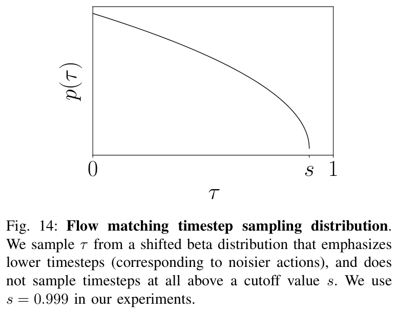

**【推导】** 将附录的移位 Beta 写法整理为可执行的采样过程，可以先取 $z\sim\operatorname{Beta}(1.5,1)$，再令 $\tau=s(1-z)$。按变量变换，归一化密度为：

$$
\begin{aligned}
p(\tau)&=\frac{1.5}{s}\left(1-\frac{\tau}{s}\right)^{1/2},\\
&\qquad 0\leq\tau\leq s.
\end{aligned}
$$

这里的归一化因子来自变量变换，是本文的数学整理。图14和正文说明了这一采样选择，但未给出完整的同预算采样分布消融；其动机与被独立验证的收益应分开理解。

## 5. 推理与控制：三个“时间尺度”不能混在一起

### 5.1 一次生成动作块只需十次积分更新

**【原文】** 推理从高斯噪声开始，用前向 Euler 方法从 $\tau=0$ 积分到 1；实验采用 10 步、步长 $\delta=0.1$。[§IV，p.5]

$$
A_t^{\tau+\delta}=A_t^\tau+
\delta\,v_\theta(A_t^\tau,o_t;\tau).
$$

**【解读】** 这 10 步都在细化同一份包含 50 个动作的张量。它们不是依次执行的 10 条机器人指令，也不是机器人以 10 Hz 运行。

下面是算法级伪代码，省略了机器人接口、输入标准化与调度，不是可直接运行的官方实现：

```python
observation = read_images_language_and_state()
prefix_kv = encode_and_cache(observation)
actions = sample_standard_gaussian(shape=(50, action_dim))

for step in range(10):
    tau = step / 10
    velocity = action_expert(actions, tau, prefix_kv)
    actions = actions + 0.1 * velocity

execute_prefix(actions, execution_steps)
# 读取新观察后重新生成；execution_steps 依机器人平台而定。
```

### 5.2 50 步动作并不意味着全部开环执行

**【原文】** 作者试过 ACT 式 temporal ensembling，但发现其损害当前策略表现，因此不聚合重叠动作块，而是开环执行一段动作后重新推理。[附录 D，p.16]

| 部署项 | UR5e / Franka | 其他机器人 |
| --- | --- | --- |
| 控制频率 | 20 Hz | 50 Hz |
| 每次生成长度 | 50 个动作 | 50 个动作 |
| 实际执行前缀 | 16 个动作 | 25 个动作 |
| 重新推理间隔 | 0.8 秒 | 0.5 秒 |
| 生成块覆盖时长，按频率换算 | 2.5 秒 | 1 秒 |

最后一行是简单换算，前四行来自附录。策略并非每 20 毫秒都重新运行整套 VLM，也并非一次固定执行满 50 个动作。它在块之间用新观察更新计划，在块内执行已生成动作。

**【解读】** 这让吞吐与反馈速度成为不同指标。动作可以按 50 Hz 下发，但针对新扰动的视觉重规划仍受到观察更新、推理与动作前缀长度影响，不能只看控制频率推断闭环响应速度。

### 5.3 缓存让十次动作推理更便宜

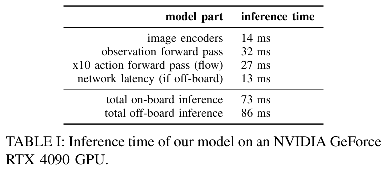

**【原文】** 在三路相机和 RTX 4090 的测量条件下，图像编码约 14 ms，观察前向约 32 ms，**全部十次动作前向合计**约 27 ms；机载总计约 73 ms，离机推理增加约 13 ms 网络延迟，总计约 86 ms。[附录 D，p.16，表 I]

**【解读】** 27 ms 不能再乘以 10。掩码允许固定观察的 KV 只算一次，每次积分更新主要重算动作 token。论文给出的时延是特定硬件和输入条件下的结果，不能直接当作任意平台的性能承诺。

## 6. 数据与训练配方：规模、权重、质量分别解决什么

### 6.1 原始数据量不等于训练采样概率

**【原文】** 自采数据共 903M 个时间步，其中单臂 106M、双臂 797M，覆盖 68 项任务；训练混合中 9.1% 来自开放机器人数据。开放数据控制频率多为 2–10 Hz，覆盖更广泛的物体与环境。[§V-A，pp.5–6]

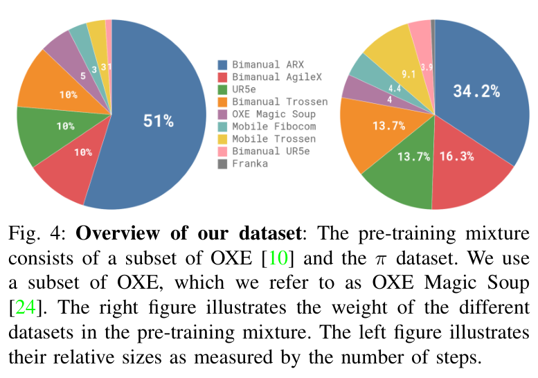

左图是按时间步衡量的数据大小，右图是训练混合的权重。9.1% 的分母是**训练采样混合**，不能据此声称开放数据只占原始采集时长或原始轨迹数量的 9.1%。不同机器人频率不同，也不宜把 903M 步直接按统一 50 Hz 换算成总小时数。

**【原文】** 作者按任务与机器人组合的数据量 $n$ 设置与 $n^{0.43}$ 成正比的采样权重，以减弱大数据组合的支配。[§V-A，p.6]

**【推导】** 若对组合 $i$ 按 $p_i\propto n_i^{0.43}$ 采样，且组合内部均匀采样，则单条样本的采样权重与 $n_i^{-0.57}$ 成正比。这不等于让每个任务完全等权，而是介于按数据量采样和按组合均匀采样之间。

### 6.2 跨机器人输入怎样对齐

**【原文】** 状态与动作补零到数据中最大维度 18；缺少的相机槽位被掩蔽。平台包括单臂、双臂、非完整约束与全向移动操作机器人。[§V-A、V-C，p.6]

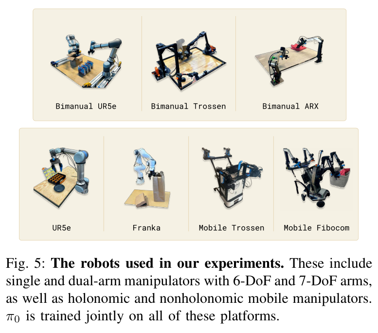

补零统一了张量形状，却不会自动统一关节含义、控制模式或动力学。论文展示的是在这些机器人上联合训练，不是任意新机器人连接模型后即可免数据部署。

**【原文口径】** 本地 PDF 以“7 类配置、68 项任务”描述自采数据；其中 ARX／AgileX、部分移动平台又归为相近配置。§III 曾概述使用整个 OXE，但 §V-A 与图4具体描述的是 OXE 子集 Magic Soup。本文采用更具体的数据配方描述，不据此声称全部 OXE 都以原始比例参与训练。[pp.4–6]

[官方发布页](https://www.pi.website/blog/pi0)另使用“8 个机器人”的表述。这是来源口径差异，不能与 PDF 的配置分类直接混用。

### 6.3 高质量后训练并非强化学习对齐

**【原文】** 后训练使用任务专用的高质量示范；不同任务所需数据差异很大，简单任务约 5 小时，最复杂的任务达到 100 小时或更多。§VI-C 另专门用 1、5、10 小时的数据研究新任务适配。[§V-A、VI-C，pp.6、9–10]

**【解读】** 两处数字对应不同实验范围，不矛盾，也不能选择其中一个当作所有任务的统一数据需求。这里的 post-training 主要仍是示范学习；与语言模型的后训练作类比，并不表示使用了 RLHF 或在线强化学习。

## 7. 实验一：基础模型直接使用，究竟证明了什么

**【原文】** 基础模型在预训练后不进行任务后训练，直接用语言指定五项任务：平铺衬衫折叠、简单清桌、困难清桌、杂货装袋、从烤面包机取面包。这些任务在预训练数据中已有覆盖。[§VI-A，p.7]

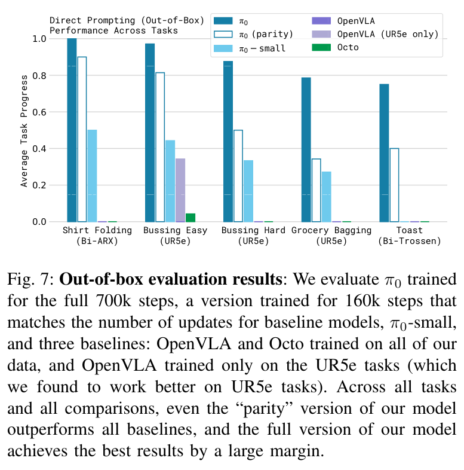

### 7.1 指标是归一化任务进度

**【原文】** 每个任务、每个方法评估 10 次。满分为 1，部分完成也可以得分。例如简单清桌按 7 个物体的正确分类计分，困难清桌按 12 个物体计分，杂货装袋按 7 件物品计分。基础衬衫折叠则是成功／失败二值评价。[§VI-A，p.7；附录 E，p.17]

**【解读】** 同一图中，不同任务可以使用不同评分细则。平均任务进度 0.8 可能表示多次执行都完成大部分步骤，并不必然表示 80% 的执行完整成功；也不能把图中所有柱子统一解释为成功率。

### 7.2 基线的训练条件要和结果一起看

| 方法 | 本组实验的训练与作用 |
| --- | --- |
| π0 | 在完整混合上训练 700k 步 |
| π0 parity | 同一设计，仅训练 160k 步，缓解训练量差异 |
| OpenVLA | 在同一混合上训练 160k 步；另有只使用 UR5e 数据的版本 |
| Octo | 在同一混合上训练 320k 步，约 93M 参数 |
| π0-small | 约 470M 参数，不使用 VLM 初始化；架构也有变化 |

**【原文】** 完整 π0 在五项任务上均最好；parity 版本仍优于所比较基线。作者指出 OpenVLA 的原始自回归动作接口难以支持本组高频动作块，Octo 则模型容量较小。[§VI-A，pp.7–8]

**【解读】** 结果支持“这个系统适合这些高频灵巧任务”，但未隔离证明某一个组件解释全部提升。parity 对齐的是更新步数，不是严格相同的 FLOPs、训练时长或参数规模；π0 与 π0-small 也同时改变了规模、预训练和结构。

更准确的能力名称是：**对预训练覆盖任务的直接调用能力**。困难清桌包含部分未见物体，这提供了对象泛化证据，但整体实验不是对所有新任务、新机器人、新家庭的统一零样本测试。

## 8. 实验二：语言跟随为什么会影响自主任务表现

**【原文】** 作者在清桌、摆桌、杂货装袋中比较三种提示条件：flat 只给总任务，human 给人工中间指令，HL 由高层 VLM 自动产生中间指令。对应数据带有约 2 秒粒度的语言分段标签。[§V-B、VI-B，pp.6、8–9]

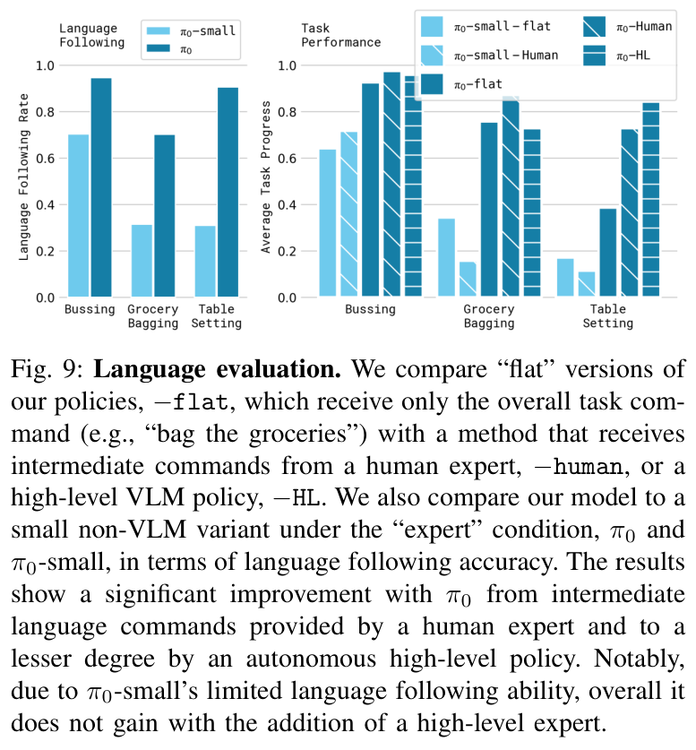

**【解读】** 高层指令提供“先处理哪个物体、放在哪里”，低层 π0 负责把当前视觉与语言落到动作。这是一种分层组合：更好的高层计划只有在低层能理解并执行语言时，才可能转化为任务收益。

**【原文】** π0 的语言跟随优于 π0-small；人工中间指令明显提高整体表现，高层 VLM 的自主指令也带来改善。π0-small 因语言跟随较弱，整体没有从专家指令中获得相同收益。每项任务评估 10 次。[§VI-B，pp.8–9]

评估时 human 条件包含人工帮助，不能与完全自主条件混写。HL 条件无需人工中间指令，但其高层决策来自外部 VLM，也不能据此说低层 π0 本身已经学会完整长程规划。并且本组使用了领域后训练，不应与上一节基础模型直接使用混为一组。

**【证据边界】** 该对比支持“大型预训练 VLM 系统与更好的语言跟随共同出现”，但由于 π0-small 也更小且结构不同，不能把差异定量归结为 VLM 预训练这一单独因素。[§VI-B；附录 C，pp.8、16]

## 9. 实验三：新任务适配是否真的更省数据

### 9.1 五项任务覆盖了不同迁移距离

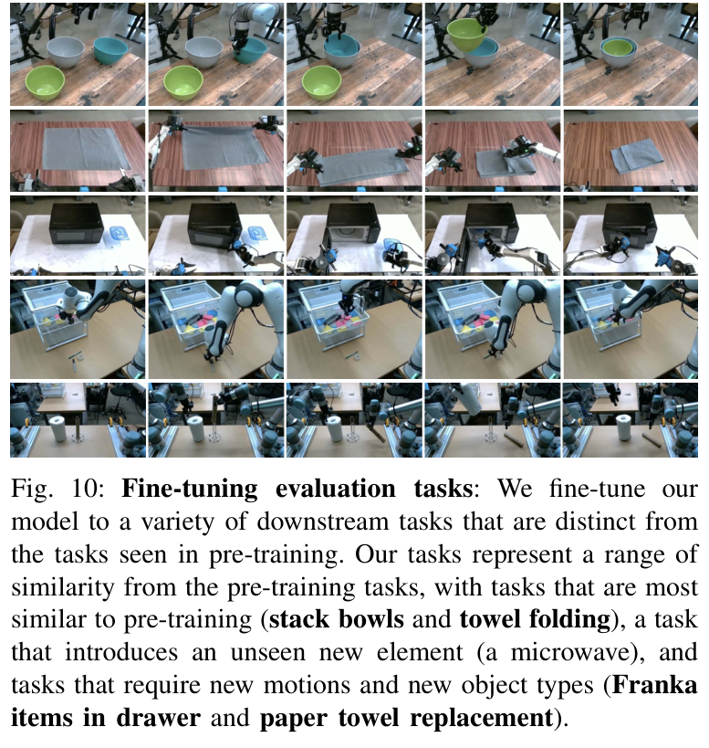

| 任务 | 相对预训练的变化 |
| --- | --- |
| 叠碗 | 与已有餐具抓取相近，评价混合已见和未见碗 |
| 毛巾折叠 | 与预训练衬衫折叠相近 |
| 保鲜盒放入微波炉 | 容器操作相近，但引入未见微波炉 |
| 更换纸巾卷 | 新物体类型和新运动模式 |
| Franka 收纳进抽屉 | 对该机器人而言缺少类似预训练任务 |

**【原文】** 作者使用不同规模的目标任务示范，比较预训练后微调的 π0、没有机器人预训练的 π0 scratch、ACT、Diffusion Policy，以及公开预训练检查点适配的 OpenVLA 和 Octo。[§VI-C，pp.9–10]

### 9.2 scratch 没有移除全部预训练

**【解读】** 此处 π0 scratch 表示跳过大规模**机器人数据预训练**，直接用任务数据训练该架构；它仍采用 π0 的 VLM 初始化。π0-small 才是不使用 VLM 初始化、且具有不同规模与结构的另一模型。这两个对照回答的问题不同。[§VI-C，p.9；附录 C，p.16]

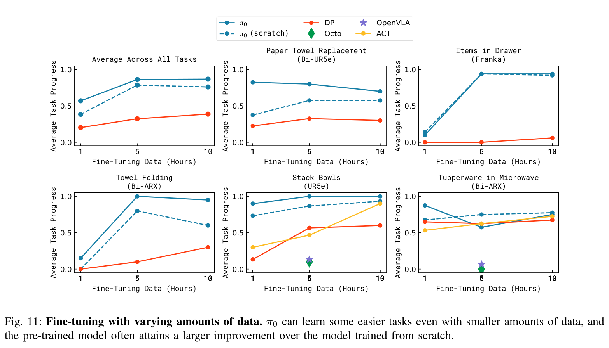

**【原文】** π0 总体优于比较方法；大规模机器人预训练经常带来额外收益，对与预训练相似的任务尤其明显。微波炉任务中，1 小时数据的预训练 π0 相对优势较明显，5 小时版本却与基线接近。作者因实机评估成本，对较弱的 OpenVLA 与 Octo 仅在部分任务和一个数据规模上评估。[§VI-C，pp.9–10]

**【解读】** 这是一组任务相关的数据效率证据，不支持“任何新技能只需一小时”或“每加一点数据都单调提高”的结论。图中的少数非单调现象也提示：每条件 10 次试验不足以稳定刻画完整学习曲线。

还要区分两组基线协议：基础模型实验为 OpenVLA／Octo 使用同一混合重新训练；新任务实验从它们公开检查点适配。因此后者比较的是不同预训练模型与数据配方的综合效果，不能当作纯架构消融。

## 10. 实验四：复杂多阶段任务离“掌握”还有多远

**【原文】** 作者进一步研究揉皱衣物折叠、移动折衣、卸烘干机、复杂清桌、折纸箱、食品打包和装鸡蛋等任务。该类行为可持续 5–20 分钟，部分使用高层语言策略。[§VI-D，pp.10–11]

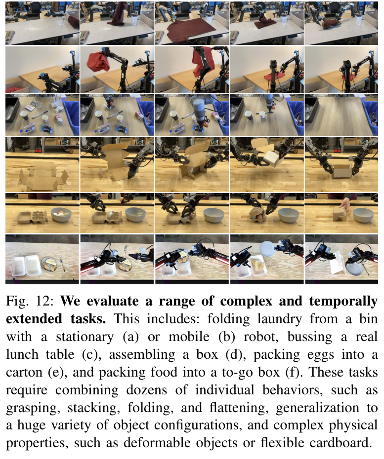

### 10.1 “已有任务”和“新任务”由预训练覆盖决定

**【原文】** 图13将任务分成预训练中存在和不存在两组：折衣、移动折衣、卸烘干机、清桌任务族在前一组；折纸箱、食品打包、装鸡蛋在后一组。复杂清桌的具体对象与杂乱配置又不同于先前测试。[§VI-D，pp.10–11，图13]

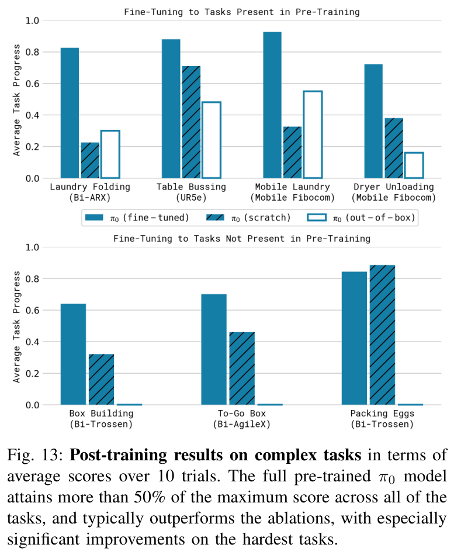

**【原文】** 作者比较预训练后微调、只在后训练数据上学习的 scratch，以及只预训练的 out-of-box。完整配方通常最好，在多数困难任务中收益明显；装鸡蛋中 scratch 已较强，完整配方提升较小。图注表述为所有任务都超过最大得分的 50%。[§VI-D，p.11]

正文描述复杂清桌为预训练中没有的具体任务，图13却按清桌任务族将它放在“存在”组；精确讨论新颖性时，应同时说明这种任务粒度差异。

### 10.2 分步评分不能替代完整流程成功率

| 任务 | 原文评分细则 | 得到部分分数意味着什么 |
| --- | --- | --- |
| 折衣 | 取出、铺平、折好、堆叠，共 4 分 | 只取出并铺平也可得一半分数 |
| 折纸箱 | 拿起、折半、关右盖、关左盖、居中，共 5 分 | 得 3 分仍可能没有完成纸箱 |
| 装鸡蛋 | 6 枚蛋各 1 分，关盖 1 分，共 7 分 | 放入大部分鸡蛋仍可能没关盖 |
| 卸烘干机 | 接近、放篮、开门、取完、关门，共 5 分 | 完成若干阶段不等于全流程成功 |

评分细则来自附录 E p.17。因此“平均进度超过 50%”不能改写为“所有任务完整成功率超过 50%”。基础实验中的平铺衬衫折叠，也明显比这里从随机揉皱衣物开始的折叠更容易。

**【解读】** 长时间完成任务说明策略可以反复根据新观察推进操作，但架构条件主要是当前图像、语言与状态；长任务演示不自动证明存在显式长程记忆或规划机制。外部高层策略、环境中可见的进度以及分块重规划，都可能参与其中。

## 11. 局限与可信度：哪些结论可以带走

### 11.1 比较强的证据

**【原文】** 同一套 VLM 与动作专家架构能够适配多类机器人并完成一组困难操作；在本文协议下，基础模型优于所比较的 OpenVLA／Octo；机器人预训练与目标后训练结合通常优于单独使用任一阶段。[§VI，pp.7–11]

这些结果足以说明该系统配方值得研究。尤其是双臂柔性物体、复杂接触和多阶段任务，比单次物体搬运更接近真实操作中的难点。

### 11.2 尚未被隔离回答的问题

| 问题 | 当前证据的限制 |
| --- | --- |
| VLM 预训练单独带来多少收益 | π0-small 同时改变参数规模和结构 |
| Flow Matching 是否优于所有替代动作生成器 | 缺少控制其他变量后的完整对照 |
| 哪种机器人数据最有价值 | 作者明确表示数据组成、权重与正迁移仍待理解 |
| 能否可靠完成整段任务 | 多数图报告部分得分，每条件通常只有 10 次试验 |
| 能否泛化到任意新身体 | 已训练平台的联合控制不等于新平台零样本部署 |
| 能否推广到足式运动与导航 | 论文将这些更远领域列为未来问题 |

**【原文】** 作者承认没有系统回答最佳数据组成，也不能预测要多少数据才能达到近乎完美的表现；跨更远任务和机器人领域的正迁移仍不明确。[§VII，pp.11–12]

**【解读】** 少量试验可以显示明显的系统差异，却不足以精确估计低频失败和部署可靠性。文中的“显著提升”主要作为作者对结果的描述理解，不应自行补成论文没有报告的显著性检验或置信区间。

### 11.3 阅读评价

**【主观评价】** 我给这篇论文 8.5/10：系统整合与任务难度很强，提出的接口也清楚；扣分主要来自组件归因不充分、数据配方仍经验化，以及任务进度与实际完整成功之间尚有距离。这个分数表示阅读与研究参考价值，不是客观榜单分数。

## 12. 与 ACT、OpenVLA、π0.5 的联系及研究启示

### 12.1 放到已有阅读链条中

| 对照方向 | 可以联系的核心概念 | π0 中需要特别注意的差异 |
| --- | --- | --- |
| ACT | 联合预测一段连续动作 | 分布模型换成 Flow Matching；本文部署未使用 temporal ensembling |
| OpenVLA | 从预训练 VLM 向机器人迁移语义 | 本文使用连续动作专家；比较针对当时的离散自回归版本 |
| Diffusion Policy / Octo | 条件生成式动作块 | π0 将其与较大的预训练 VLM 及跨机器人训练配方结合 |
| π0.5 | 延续连续动作专家基础 | 下一篇重点可转向异构监督与新家庭泛化，不能把后续设计反推成本篇已具备 |

相关站内笔记：[ACT 论文精读](/embodied-ai-learning/posts/paper-act/)、[π0.5 论文精读](/embodied-ai-learning/posts/paper-pi05/test/)。本节关于本篇与前作的关系依据 §II；关于 π0.5 的延伸范围见相应笔记。

### 12.2 对机器人研究最可操作的三个问题

**【建议】** 首先研究动作前缀长度。固定模型和生成块长度，比较执行 5、10、25、50 步后的任务进度、整项成功率、扰动恢复时间和推理开销。由此分离生成吞吐与闭环反馈间隔，不预设越短或越长一定更好。

**【建议】** 其次研究预训练数据的迁移来源。固定目标任务后训练集与预算，分别加入同机器人其他任务、其他机器人相似任务、包含恢复动作的数据，并控制采样权重。这样才能回答“迁移来自相似运动、相似物体还是更多异常状态覆盖”。

**【建议】** 最后研究语言分层的真实贡献。同时报告高层选择正确率、低层条件执行成功率和完整流程成功率，并把人工指令与自动高层策略分开。否则低层动作失败和高层语义失败容易被压成同一个最终分数。

### 12.3 如果继续看官方实现

[官方 openpi 仓库](https://github.com/Physical-Intelligence/openpi)提供模型、检查点和适配示例，也同时包含后续的 π0-FAST 与 π0.5。阅读时应记录实际使用的提交、模型配置与检查点，先确认对象确为本文的 π0；不要把后续版本的 tokenizer、状态编码或训练配方当成本篇细节。本文核对了官方入口，没有用当前仓库复现上述实验。

## 13. 关键事实定位与原始资料

| 要复核的事实 | 本地 PDF 位置 |
| --- | --- |
| 系统目标、跨机器人训练与任务配方 | §I–III，pp.2–4 |
| 3B 骨干、300M 动作专家、50 步动作块 | §IV，pp.4–5 |
| 线性噪声路径、速度目标、10 步 Euler | §IV，p.5 |
| 903M 时间步、9.1% 训练混合、$n^{0.43}$ | §V-A，pp.5–6 |
| 18 维补零与相机缺失掩码 | §V-A，p.6 |
| 基础模型任务、基线训练量、10 次评价 | §VI-A，pp.7–8，图7 |
| 语言跟随、人工与自动高层指令 | §VI-B，pp.8–9，图9 |
| 新任务数据效率与比较协议 | §VI-C，pp.9–10，图10–11 |
| 复杂任务与预训练／后训练对比 | §VI-D，pp.10–11，图12–13 |
| 三块注意力、动作嵌入、专家结构 | 附录 B，p.15 |
| 流时间分布、π0-small、推理时序与延迟 | 附录 B–D，p.16，图14、表 I |
| 各任务逐步得分规则 | 附录 E，pp.16–17 |

- [arXiv 文献记录与版本历史](https://arxiv.org/abs/2410.24164)：用于核对书目信息；本地 PDF 未明确标记版本，本文不强行指定。
- [作者公开 PDF](https://www.pi.website/download/pi0.pdf)：可公开阅读的原始论文入口；本文分析以用户提供的本地文件为准。
- [Physical Intelligence 发布页与演示](https://www.pi.website/blog/pi0)：用于观看成功与失败执行，定量结论仍应结合正文实验协议。
- [官方 openpi 代码仓库](https://github.com/Physical-Intelligence/openpi)：用于进一步研究实现；后续工程版本与原始论文需要分别记录。

正文中的图表均来自原论文，版权归原作者所有；此处用于论文研读与评述。配图保留原始图注，图片来源页码、裁剪坐标和文件校验信息保存在文章目录的本地维护索引中。
