# π*0.6 原文图表维护索引

来源：[arXiv:2511.14759v2](https://arxiv.org/abs/2511.14759v2)，本地 PDF 共 18 页。

本文件以下划线开头，排除在 Astro legacy 文章集合外，不提供公开页面。

图片由原 PDF 页面区域以 3 倍分辨率渲染，保留完整组合图；英文原图注记录在 index.json，页码为 PDF 物理页码。

## 图1 · PDF p.1

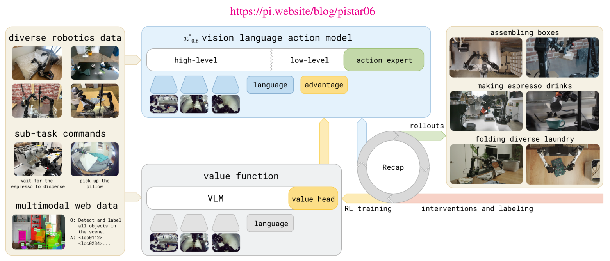

Fig. 1: RECAP enables training VLAs with reward feedback and interventions. Our system starts with a pre-trained VLA that incorporates advantage conditioning, allowing the model to learn effectively from real-world experience. For each task, we deploy the model and collect both autonomous rollouts and online human corrections. We then fine-tune the value function on this online data, improving its estimates of how actions influence performance. Fine-tuning and conditioning the VLA on these updated advantage estimates in turn improves policy behavior.

## 图2 · PDF p.2

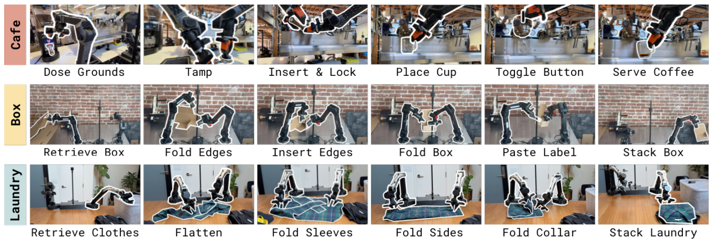

Fig. 2: Some of the tasks learned by RECAP. π∗ 0.6 trained with RECAP can make espresso drinks, assemble cardboard boxes, and fold diverse and realistic laundry with a high success rate. Each task involves realistic variability – flattened unfolded boxes stick together and bend, making espresso drinks requires pouring liquids, and folding laundry requires generalization to a wide range of clothing items.

## 图3 · PDF p.4

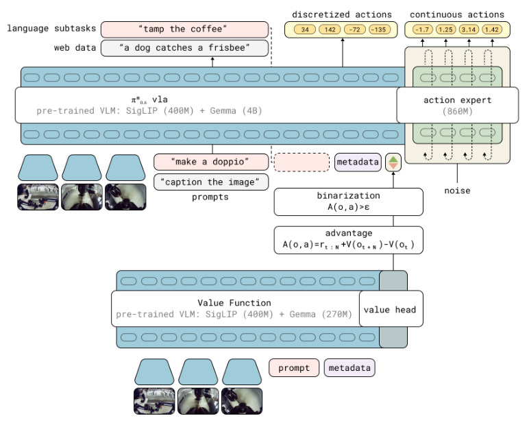

Fig. 3: Interaction between the π∗ 0.6 VLA and value function during RECAP training. The π∗ 0.6 VLA uses a pre-trained VLM backbone. Training follows the KI recipe [73], with next-token prediction on many data sources in pre-training, and an flow-matching action-expert with stop gradient. The VLA is conditioned on a binarized advantage indicator, obtained from a separate value function initialized from a pre-trained but smaller VLM model.

## 图4 · PDF p.5

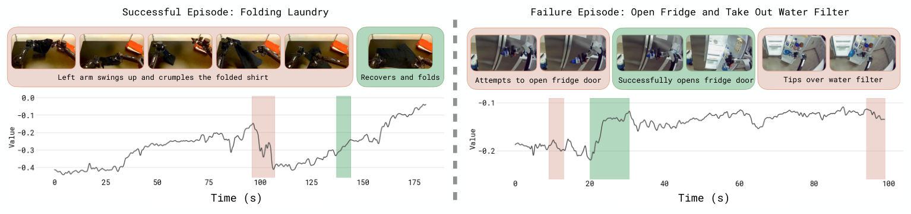

Fig. 4: Visualization of the value functions. We train a multi-task value function to predict the number of steps to success, normalized by maximum task length to (−1, 0), where 0 corresponds to successful completion. We visualize the value function output on a folding task that finished successfully (left), and an unsuccessful example of a manipulation task from the pre-training dataset (right). The red parts highlight a drop in value, and green parts highlight increases; images on top show the corresponding frames of the episode. The visualization shows that the VF correctly identifies mistakes in the episode, as well as the speed of progress.

## 图5 · PDF p.7

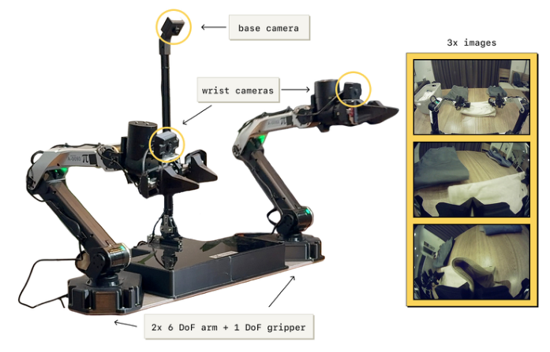

Fig. 5: The robot setup used in our experiments. π∗ 0.6 is trained on data from many different robots in pre-training. For the iterative improvement experiments, we use a static bimanual system with two 6 DoF arms with parallel jaw grippers. The arms are controlled at 50 Hz with joint positions. Observations consist of joint and gripper positions, as well as images from three cameras: a base camera mounted between the arms, and a wrist-mounted camera on each arm. The setup can be mounted flexibly, e.g. on a table.

## 图6 · PDF p.8

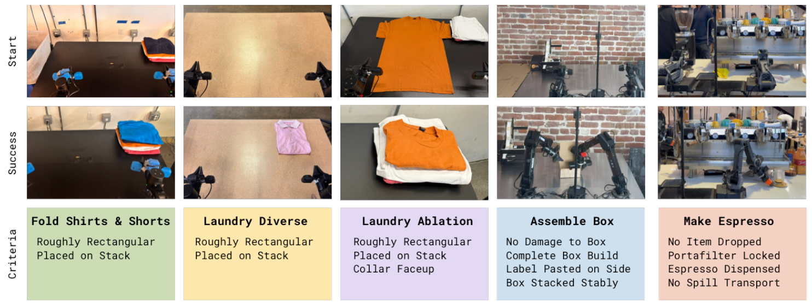

Fig. 6: Illustrations of the tasks used in our experiments. Tasks include three different laundry variants, assembling boxes, and making coffee drinks with an espresso machine.

## 图7 · PDF p.9

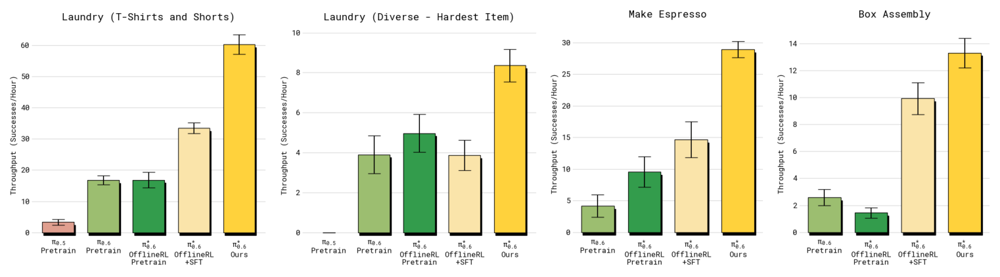

Fig. 7: Throughput. We show the number of successfully completed tasks per hour for laundry (simple and diverse), espresso making, and box assembly. Error bars show standard error. This metric measures both success and speed. In all cases, RECAP applied to π∗ 0.6 (Ours) leads to substantial improvements in throughput. RECAP has the highest impact on throughput for diverse laundry and espresso tasks, more than doubling successful completions per hour.

## 图8 · PDF p.9

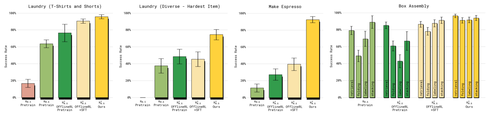

Fig. 8: Success rates. We show the absolute success rates with standard error. Each stage of RECAP improves performance across the tasks, with the challenging diverse laundry and espresso tasks seeing the largest gains success rate, corresponding to more than 2× reduction in failure rates. For the box assembly task we show the success rate for the different subtasks. RECAP leads to the most consistent (and highest) success across all subtasks.

## 图9 · PDF p.10

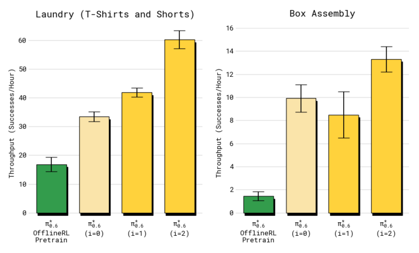

Fig. 9: Improvement in throughput over multiple iterations. Both tasks improve significantly in throughput as we take more iterations of RECAP, with box assembling first dropping and then improving significantly.

## 图10 · PDF p.10

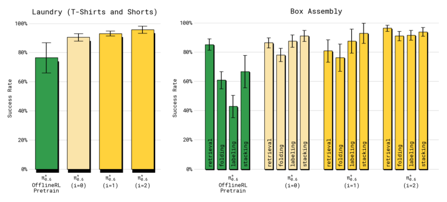

Fig. 10: Improvement in success rate over multiple iterations. The laundry task quickly reaches the maximum success rate (but continues to improve in throughput as shown in Figure 9, while box assembly continues to improve.

## 图11 · PDF p.10

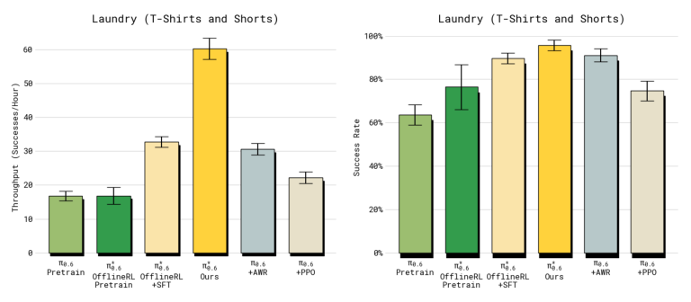

Fig. 11: Comparison of different policy extraction methods. RECAP applied to π∗ 0.6 achieves by far the highest throughput for the laundry task compared to AWR and PPO.

## 图12 · PDF p.10

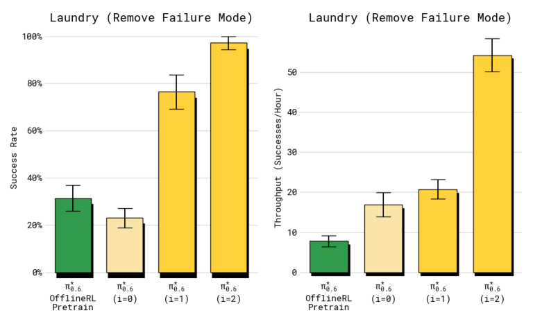

Fig. 12: Failure mode removal. Here we apply RECAP on a variant of the laundry task with one item but a very strict success criteria. RECAP is particularly effective at removing failure modes that would be considered non successful under the strict criteria. Therefore, our method can also be used to alter a policy’s behavior with relatively little data effectively.

## 图13 · PDF p.17

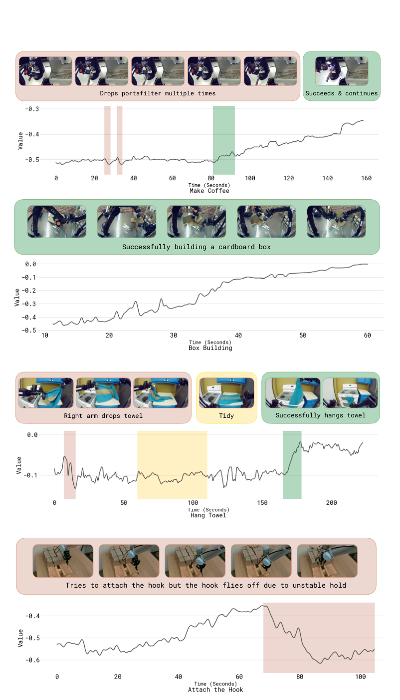

Fig. 13: Additional visualization of value function on five different tasks. Red parts highlight places where value drops, green parts highlight places where value increases, and yellow parts highlight oscillating value regions. Images show the corresponding frames and descriptions of the episode.

