一个已经会叠衣服的机器人，怎样从“能做”进步到“做得快、失败少”？π*0.6 给出的路线是：**先用价值函数判断动作是否比现有行为更有利，再把这种判断变成 VLA 的训练条件，用部署中积累的成功、失败与人工纠正反复改进策略。**

> **阅读范围**：本文依据用户提供的 18 页本地 PDF，覆盖主文与附录 A–F。首页标记为 arXiv:2511.14759v2；[arXiv 官方记录](https://arxiv.org/abs/2511.14759v2)核实首发为 2025-11-18、v2 更新为 2025-11-19。下文页码均指 PDF 物理页码，博客笔记创建于 2026-11-20。
>
> **证据标记**：**【原文】** 为作者陈述或实验；**【解读】** 为本文解释；**【推导】** 为公式整理；**【示意】** 为人工构造的数字或形状；**【建议】** 为尚未验证的方案。图中未印出的柱高仅作近似读图，不补造精确统计。本文未运行机器人训练，也未完成代码复现。

## 1. 先分清 π0.6、π*0.6 与 RECAP

这篇论文的准确题目是 **π*0.6: a VLA That Learns From Experience**，机构为 Physical Intelligence，署名包括团队与 Ali Amin、Raichelle Aniceto、Ashwin Balakrishna、Kevin Black 等 55 位个人作者，完整名单见原文首页。星号是模型命名的一部分，表示这里讨论的是适配强化学习的模型。

| 名称 | 在本文中的含义 | 与实验的关系 |
| --- | --- | --- |
| π0.6 | 从 π0.5 演进的 VLA 基座：更大骨干、动作专家与更多数据 | 纯监督预训练基线之一 |
| π*0.6 | 在 π0.6 中加入二值优势条件，并按 RECAP 配方训练 | 既可指离线 RL 预训练模型，也可指后续改进模型，需看阶段 |
| RECAP | RL with Experience and Corrections via Advantage-conditioned Policies | 数据采集、价值训练、优势条件策略训练组成的完整方法 |
| Offline RL + SFT | 先离线 RL 预训练，再用目标任务示范微调 | 实机迭代的起点，记为 iteration 0 |
| Ours | 加入任务部署数据并完成迭代后的 π*0.6 | 主结果中的最终模型 |

**【原文】** 模型输入包含多视角图像、机器人状态、总体语言任务与元数据；输出包含高层子任务文本和低层连续动作块。策略使用 Gemma 3 4B 语言骨干及 860M 动作专家；价值模型使用更小的 670M VLM。论文将 RECAP 定位为适用于大规模 VLA 的实机学习配方。[§I、IV–V，pp.1–7]

**【解读】** 不能把“更大的 π0.6 比 π0.5 好”全部归因于 RL，也不能把“Offline RL + SFT”当作从未用过 RL 的监督基线。观察 RECAP 的部署收益，最直接的是比较同一模型族的 iteration 0 与加入部署数据后的模型。

开放材料方面，本文确认了论文与首页列出的[官方项目页](https://pi.website/blog/pistar06)地址；核查时项目页返回安全检查页面，未取得可用于核实的正文。本文没有获得并固定与本论文实验对应的完整训练实现、权重和原始部署数据，因此不把其他 π 系列的公开仓库当作这篇论文的代码证据，也不据此断言它们当前一定未开放。本文不填写未经核实的会议录用信息。

## 2. 研究问题：示范为什么还不够

模仿学习主要回答“看到这种状态，人会怎么做”。在机器人实际部署中，还有两个问题：策略会进入示范很少覆盖的错误状态；示范中的动作虽然正确，却未必足够快，遥操作停顿也可能被学进去。

**【原文】** 作者希望利用三类异质数据：已有示范、机器人自主执行轨迹、专家在执行中的纠正。纠正帮助处理严重错误和探索困难，自主轨迹则包含速度、失败及恢复等信息；单靠纠正，难以稳定提供关于细微效率改进的监督。[§I–II、V-D，pp.1–3、7]

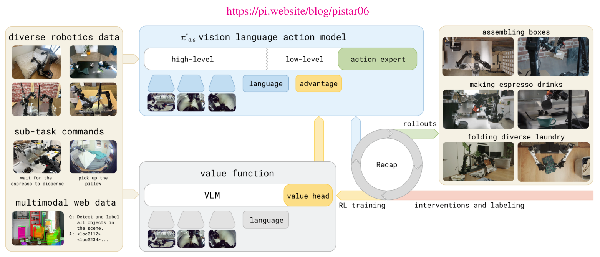

读图从左到右：机器人示范、子任务语言和网络图文支撑模型预训练；中间上方是会输出动作的 VLA，下方是评价进度的价值模型；右侧部署产生新轨迹，人工反馈和纠正回流到训练。**黄色 advantage 信号是在训练数据上构造的条件，不表示每次控制都要调用价值模型搜索动作。**

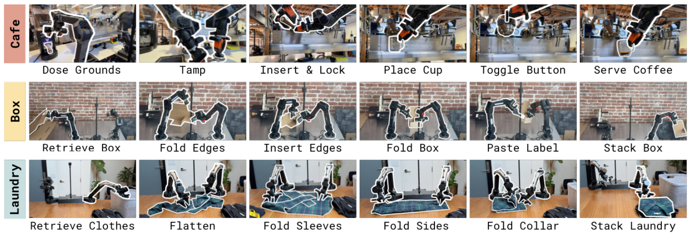

图2说明任务跨度：咖啡涉及磨粉、压粉、锁入手柄、放杯和出杯；组盒涉及取纸板、折叠、贴标、堆放；衣物涉及展开、折袖、折边、折领和堆叠。它们包含液体、柔性物体与接触约束，不能用一次抓取成功率概括。

**【解读】** RECAP 的核心假设是：一个已经能做出合理动作的初始策略，加上能判断进度的价值模型，就有机会从自己的尝试中区分更好的动作。它依赖一个有效起点，并未展示从随机动作开始学会这些长任务。

## 3. 架构：策略负责行动，价值模型负责生成训练标签

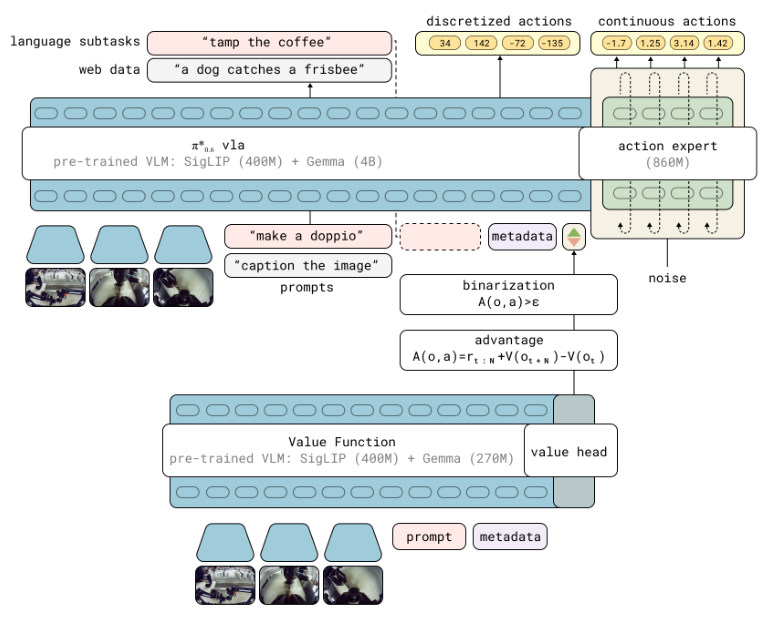

图3有上下两套模型。上方的策略从图像、语言和状态获得条件，预测子任务文本，再生成动作。训练还包含 FAST 离散动作预测；连续动作由独立动作专家生成。下方的价值模型从观察和任务估计价值，通过一段实际轨迹计算优势，再二值化为策略条件。

| 模块 | 输入 → 输出 | 初始化与训练方式 | 原文位置 |
| --- | --- | --- | --- |
| 视觉与语言骨干 | 多视角图像、状态、任务、元数据 → 条件表示与文本 | 图3标注 SigLIP 400M + Gemma 4B；§V-A 指明 Gemma 3，训练包含文本／离散动作目标 | 图3、§V-A，pp.4、6 |
| 高层文本预测 | 观察、总体任务 → 下一子任务文本 | 自回归预测；推理频率低于动作生成 | §V-A，p.6 |
| FAST 动作分支 | 条件表示 → 离散动作 token | 训练时的监督目标，服务 Knowledge Insulation（KI）配方 | §V-A，p.6 |
| 连续动作专家 | 条件表示、带噪动作与流时间 → 连续动作生成所需输出 | 860M 参数；Flow Matching 训练；对骨干连接使用 stop gradient | 图3、§V-A–B，pp.4、6 |
| 价值模型 | 观察、任务与元数据 → 201 个回报区间的概率 | 较小预训练 VLM 加价值头；图3为 400M 视觉 + 270M 语言，总计所述 670M VLM；价值训练另混少量网络图文防过拟合 | §IV-A、V-C，pp.4、7 |

**【原文】** KI 在连续动作专家与其余模型之间阻断相应梯度，同时通过离散 token 监督训练骨干。因此，“训练整个 VLA”与“连续动作损失会更新所有参数”是不同表述，后者不成立。[图3、§V-A]

这里没有足够证据断言所有阶段、所有子模块都使用相同冻结策略、优化器或学习率；论文没有完整列出这些训练超参数。动作专家的具体权重初始化也不能仅凭“基于 π0.5”推定。

另一个关键是序列顺序：**先预测子任务文本，再插入 `Advantage: positive/negative`，然后预测动作。** 优势条件只直接影响动作的条件概率；子任务文本的预测不以这个后置条件为输入。不要据“RL”二字假设它直接重写所有高层规划逻辑。[§V-B，p.6]

## 4. 一条训练样本与实际控制接口

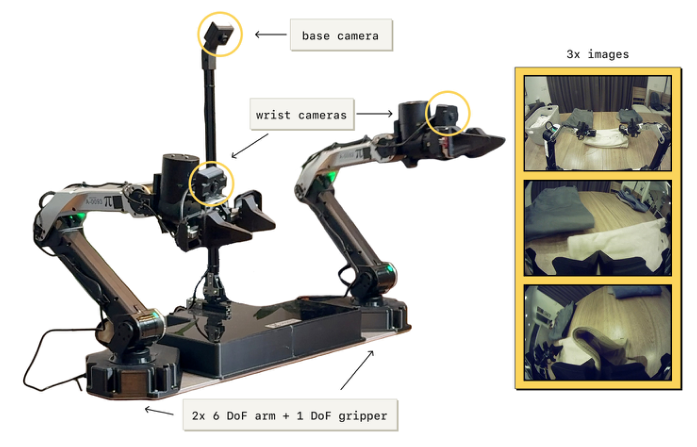

**【原文】** 迭代实验使用固定双臂系统：每臂 6 个机械臂自由度和一个平行夹爪；三路相机分别是基座相机、左腕和右腕相机；观察含关节与夹爪位置，动作是 50 Hz 的关节位置及夹爪命令。[图5、§V-A，pp.6–7]

下表是**结构化示意样本**。其中形状用符号表示，避免把其他 π 模型的默认配置冒充本论文参数。

| 字段 | 形状或结构 | 单位／范围 | 示例 | 依据与边界 |
| --- | --- | --- | --- | --- |
| 三路 RGB | 各为 $h_{img}\times w_{img}\times3$ | 像素；预处理范围未给全 | 基座、左腕、右腕图像 | 三相机为原文；分辨率和 patch 数未核实 |
| 本体状态 $q_t$ | 按硬件可自然表示为 14 个位置分量 | 关节角与夹爪位置；确切单位、顺序和缩放未披露 | 左臂 6 轴、右臂 6 轴、两个夹爪 | 14 为按图5自由度作的结构推断，不是已核实的原始张量维度 |
| 任务及元数据 $\ell$ | token 序列，长度可变 | 文本 | `make me an espresso` | 任务例子来自 §V-A；元数据字段未完整枚举 |
| 子任务 $\hat\ell$ | token 序列 | 文本 | `pick up the coffee cup` | 原文例子；训练监督／推理预测需区分 |
| 连续动作块 $\mathbf a_t$ | $H\times d_a$ | 关节位置与夹爪命令 | 一段双臂控制目标 | 本文约定 $H$ 为块内步数；实际 $H$、padding 与精确 $d_a$ 未核实 |
| 离散动作 $a_t^{disc}$ | 长度可变的 FAST token 序列 | token ID | 对同一动作块编码 | 仅为训练分支；不作为连续专家输入 |
| 轨迹终点与结果 | 终点 $T$，成功布尔值，任务最长时限 | 时间步与人工结果标注 | 成功出杯／手柄掉落导致失败 | 生成奖励与回报监督 |
| 优势条件 $I_t$ | 一个二值标签，以文本输入 | 正／负 | `Advantage: positive` | 由优势及任务阈值确定；人工纠正动作强制为正 |

**【解读】** 训练样本不只是单张图片加一个动作。为了生成优势标签，数据处理至少还需要同轨迹未来观察、奖励、任务身份与纠正区段标记。策略最终看到的是当前条件与标签，标签背后的“未来”仅用于离线训练。

50 Hz 表示底层动作时刻间隔为 20 ms。附录的 $N=50$ 是优势估计向前看的步数，**并不证明动作块长度也是 50，也不证明每秒只调用一次网络**。如果这 50 步与 50 Hz 控制帧一一对应，才可解释为约 1 秒的时间窗；这是条件换算，论文没有完整说明数据重采样。每块实际执行多少步、重规划周期、去噪迭代数和缓存配置均不在本文证据中。[§V-A、附录F]

## 5. 奖励与分布式价值：用结果标签学到“离成功还有多远”

### 5.1 人给结果，训练配方补上时间代价

论文并非为每个折叠动作设计几何奖励。它从每条轨迹是否成功构造奖励，非终点每步扣 1，成功终点为 0，失败终点给大负惩罚：

$$
r_t=\begin{cases}
0,&t=T\text{ 且成功},\\
-C_{\rm fail},&t=T\text{ 且失败},\\
-1,&\text{其他情况}.
\end{cases}
$$

**【原文】** $C_{\rm fail}$ 是让失败轨迹价值足够低的常数；实际数值未披露。回报不使用折扣因子，价值按每个任务的最长轨迹长度归一化，文中描述其范围为 $(-1,0)$，成功终点对应 0。[§III、V-C，pp.3、7]

**【推导】** 对成功轨迹，从时刻 $t$ 到终点的回报为 $R_t=-(T-t)$；同样成功时，用时越少越好。失败轨迹则含剩余时间代价与终点惩罚。因而，所谓“稀疏反馈”主要指人工只需给结果标签，训练目标仍有规则生成的逐步时间成本。

**【示意】** 若某成功轨迹还剩 80 步，任务归一化尺度为 1,000 步，则归一化回报为 $-0.08$。若另一个状态还需 200 步，值为 $-0.20$。这些数是示意，不能反推实际任务的 $C_{\rm fail}$ 或代码中的截断方式。价值也不是成功概率：$V=-0.08$ 不等于“成功率 92%”。

### 5.2 201 个区间不是 201 个动作

作者让模型预测回报的离散分布，用实际轨迹剩余回报的离散标签做交叉熵：

$$
\begin{aligned}
R_t&=\sum_{u=t}^{T}r_u,\qquad b_t=\operatorname{bin}(R_t),\\
\mathcal L_V&=\mathbb E_{\tau\sim D}\!\left[\sum_{o_t\in\tau}-\log p_\phi(b_t\mid o_t,\ell)\right],\\
\hat V(o_t,\ell)&=\sum_{b=1}^{201}p_\phi(b\mid o_t,\ell)\,v_b.
\end{aligned}
$$

这里 $v_b$ 是第 $b$ 个区间所代表的归一化回报，201 是分布输出的类别数；区间编号在本文统一为 1 到 201。原文式(1)对应这一训练目标。[§IV-A，p.4]

**【示意】** 简化成三个区间，代表值 $[-1,-0.5,0]$，概率为 $[0.1,0.3,0.6]$，期望价值就是 $-0.25$。真实模型用 201 个区间，不是这三个。

这是一种 **Monte Carlo 价值拟合**：监督目标来自轨迹实际发生的剩余回报；它没有用 $\max_a Q$ 构造 Bellman 最优目标。后续优势估计会用到未来状态价值，但不能因此把价值训练本身说成 TD／Q-learning。[§IV-A]

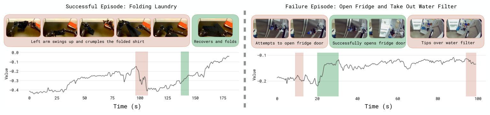

左侧叠衣服时，机械臂弄乱已折好的衣物，价值下降；恢复后又回升。右侧开冰箱取得进展时上升，碰倒水壶时下降。**【解读】** 图说明价值信号能对某些中途错误作出反应，但不是总体校准误差、误报率或所有失败检测能力的统计证明。

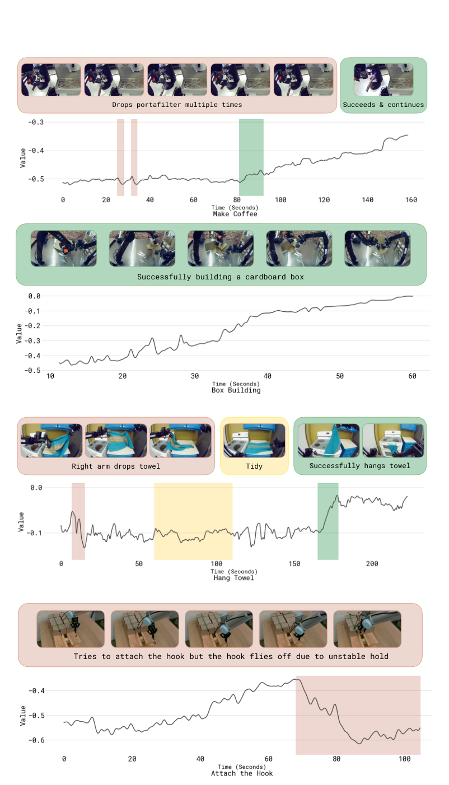

附录图13进一步展示：掉落手柄、丢掉毛巾或挂钩飞脱会伴随价值下降，成功组盒总体向 0 靠近。它支持“可迁移的进度判断”这一解释；仍不能据定性曲线认定价值模型具有精确的因果判断能力。[附录B，pp.16–17]

## 6. 从价值到优势：动作好不好，要扣除正常耗时

后训练使用 $N$ 步优势估计：

$$
\hat A_t=\sum_{u=t}^{t+N-1}r_u+\hat V(o_{t+N},\ell)-\hat V(o_t,\ell).
$$

实际计算时，奖励与价值要使用同一归一化尺度；越过终点时也需正确处理终止。论文附录F给出后训练 $N=50$；终止样本的完整实现规则没有随本文获得。[§III、附录F，pp.3、18]

**【解读】** 只看价值增加会犯一个错误：正常前进 50 步，本来就应该更接近成功。优势还要扣掉这 50 步本身的成本，衡量的是“比该状态下参考行为的预期更好多少”。

**【示意】** 假设归一化尺度为 1,000，50 步奖励和为 $-0.05$，当前值为 $-0.30$：

| 50 步后的值 | 优势计算 | 含义 |
| --- | --- | --- |
| $-0.20$ | $-0.05-0.20+0.30=0.05$ | 比预期更快推进 |
| $-0.25$ | $-0.05-0.25+0.30=0$ | 刚好符合预期 |
| $-0.28$ | $-0.05-0.28+0.30=-0.03$ | 虽有进展，但推进不及预期 |

策略训练使用的是优势二值标签：

$$
I_t=\mathbf 1\!\left[\hat A_t>\epsilon_\ell\right].
$$

阈值 $\epsilon_\ell$ 随任务变化，不能把 `positive` 简化成“整条轨迹成功”，也不能固定理解成“优势大于零”。一条最终失败的轨迹可能包含好的局部动作；一条成功但拖沓的轨迹也可能含未达到阈值的片段。人工接管提供的**纠正动作**直接设 $I_t=1$，这不等于把接管前后的整条轨迹全标为正。[§IV-B，p.5]

### 6.1 阈值配方与预训练公式的两个疑点

**【原文】** 附录F按约 10,000 个随机样本估计任务阈值，让预训练示范约 30% 获得正标签；常规后训练约 40%，简单 T 恤／短裤任务约 10%。附录还给出优势条件以 30% 概率被丢弃。[p.18]

正文 §V-D 却写“value function 预测值的第 30 百分位”。按通常定义，这与“优势超过阈值的样本约占 30%”并不等价：若对优势本身取第 30 百分位再用严格大于，通常会留下约 70%。**【解读】** 本文以附录的正标签比例解释操作意图，同时保留正文冲突；复现时需要代码或作者澄清。

另一个问题是附录把预训练优势写成从 $t'=0$ 到 $T$ 的整条轨迹奖励和减当前价值，而 §IV-A 的价值目标是从当前 $t$ 开始的剩余回报。**【推导】** 与后者一致的 Monte Carlo 优势通常应写作 $R_t-\hat V(o_t,\ell)$。整条回报减剩余价值会额外引入过去已经发生的代价；在每步有时间成本时并不相同。这里不擅自修改原文并声称那就是实际实现。

## 7. 优势条件策略提取：为什么训练像监督学习，却属于 RL

### 7.1 用贝叶斯规则得到一个“更好动作”条件分布

令 $\pi_{ref}$ 表示数据所代表的参考行为分布，$I=1$ 表示超过任务改进阈值。贝叶斯规则给出 $\pi_{ref}(a\mid I=1,o,\ell)$ 与 $\pi_{ref}(a\mid o,\ell)p(I=1\mid o,a,\ell)$ 成正比。再引入锐化系数 $\beta$，论文式(2)写为：

$$
\hat\pi(a\mid o,\ell)\propto
\pi_{ref}(a\mid o,\ell)
\left[\frac{\pi_{ref}(a\mid I=1,o,\ell)}{\pi_{ref}(a\mid o,\ell)}\right]^\beta.
$$

比例中省略了不依赖动作的归一化常数。当 $\beta=1$，目标就是正条件动作分布。这样无需为每个观察在线枚举所有候选动作或显式求解高维 $\arg\max Q$。[§III、IV-B，pp.3–5]

**【示意】** 在一个固定观察下，参考分布对“稳妥抓取”和“反复犹豫”的概率为 0.6、0.4，被标为改进动作的概率为 0.8、0.1。正条件分布中两者未归一化权重是 0.48、0.04，归一化后约为 92.3%、7.7%。这个玩具例子解释了条件化如何改变动作偏好，不是神经网络的真实输出。

### 7.2 负样本仍参与训练

论文的抽象训练目标同时包含无条件与有条件的负对数似然：

$$
\mathcal L_\pi=\mathbb E_D\!\left[-\log\pi_\theta(a_t\mid o_t,\ell)
-\alpha\log\pi_\theta(a_t\mid I_t,o_t,\ell)\right].
$$

实际通过随机丢弃 30% 优势条件，训练同一个模型的两种使用方式，而不是每个样本都必然独立计算上述两项。条件被保留时，正负标签各自参与训练；负样本没有被简单删掉。[式(3)、§V-B、附录F]

**【解读】** 与只保留成功轨迹或按优势给损失加权不同，RECAP 让模型区分“给定这种状态，优于参考行为的动作分布”和“其他动作分布”。这能使用异质数据，但二值化也会丢掉优势大小：略高于阈值和远高于阈值的动作得到同一个标签。

训练形式像监督学习，并不意味着它只是普通行为克隆。监督标签来自奖励和价值估计，部署分布又因策略改变而更新，目标是提高任务回报。反过来，这也不意味着每次梯度更新都用 PPO 或在线策略梯度。

原文引用了理想条件下的策略改进性质，但真实系统的价值有误差、数据混合多个行为策略、函数拟合也不精确。因此，不能把理论结果改写成“实机每轮必然变好”。实际图9中的组盒首轮下降，正好提醒读者区分理想算子与有限数据训练。

## 8. 连续动作怎样训练：FAST、Flow Matching 与梯度隔离

模型的输出可拆成高层文本、FAST 离散动作和连续动作三部分。连续动作与离散动作都以高层文本为条件，但连续动作专家**不读取**离散动作 token。这避免把推理描述成“先完整解码 FAST 动作，再把它转成连续动作”。[§V-A，p.6]

为简洁起见，记连续动作块为 $\mathbf a$，条件为 $c=(o_t,\ell,\hat\ell,I_t)$。原文式(4)及附录C使用：

$$
\begin{aligned}
\mathbf x_\eta&=\eta\mathbf a+(1-\eta)\boldsymbol\omega,
\quad\boldsymbol\omega\sim\mathcal N(0,\mathbf I),\\
\mathcal L_{act}&=\mathbb E_{\eta,\omega}\!\left[
-\log p_\theta(a^{disc}\mid c)
+\alpha_\eta\left\|\boldsymbol\omega-\mathbf a-f_\theta(\mathbf x_\eta,c)\right\|^2\right].
\end{aligned}
$$

其中 $\eta\in[0,1]$ 是**流过程时间**，不是机器人执行时间 $t$；$\alpha_\eta$ 是可以依赖噪声时刻的权重。子任务文本另有自回归交叉熵。上式对应动作部分训练目标的整理，不是把近似下界当作精确连续 log-likelihood；附录以扩散目标与似然下界关系作动机说明，常数项与相关假设不能忽略。[式(4)、附录C，pp.6、16]

**【示意】** 缩小为一个两维动作 $\mathbf a=[0.2,0.6]$、噪声 $\omega=[1,-0.2]$，取 $\eta=0.25$，则带噪输入为 $[0.8,0]$，按原文符号的目标为 $\omega-\mathbf a=[0.8,-0.8]$。若模型输出 $[0.7,-0.6]$，未加权平方误差和是 $0.1^2+(-0.2)^2=0.05$。数值用于解释损失，不代表关节的真实单位。

**【解读】** 有些 Flow Matching 文献使用相反的速度方向。这里保留原文 $\omega-\mathbf a-f_\theta$ 的符号；不能只据这一个损失式，直接把另一篇论文的积分方向和采样代码搬来。本文未获得本模型采样器实现。

### 8.1 推理时的优势条件与 CFG

默认评估直接给 `Advantage: positive`，对应 $\beta=1$。此时价值模型已完成训练标签生成工作，标准动作推理不需要未来观察，也不需要现场知道当前动作的真实优势。

若使用 CFG，论文通过有／无优势条件两种输出近似实现 $\beta>1$ 的分布锐化。这里的“无条件”仅指**去掉优势条件**，图像与任务等条件仍在。附录E指出过大的 CFG 系数可能把动作推向分布边缘，出现过激行为；作者主要通过训练阈值调节选择性，必要时使用约 1.5–2.5 的温和系数。[pp.17–18]

阈值与 CFG 并不等价：前者改变训练样本的正负划分，后者在推理时组合连续动作生成信号。主文还强调 CFG 不会同样改变自回归分支，不应称它为对整个层级策略统一加速的旋钮。

## 9. 数据与训练闭环：从预训练到两轮部署

### 9.1 真实训练顺序

**【原文】** 预训练数据含来自多机器人、多任务的数万小时示范，混入网络图文及子任务语言监督。论文没有给出能完整复原预训练分布的精确总小时数、所有任务列表或采样比例。[§IV、V-D，pp.4、7]

1. 用离线数据训练预训练价值模型 $V_{pre}$，估计回报与任务阈值。
2. 在预训练数据上构造优势条件，训练 $\pi_{pre}$，得到离线 RL 预训练的 π*0.6。
3. 对目标任务用高质量示范做 SFT；§V-D 说明此阶段固定优势标签为正，产生 iteration 0。
4. 部署当前任务策略，记录自主轨迹、人工结果标签，以及可选的接管纠正片段。
5. 将新数据加入该任务的累计数据集，用累计数据重新训练价值与策略。
6. 重复采集与训练，按需要再做一轮或多轮。

一个很容易漏掉的实现细节：**每轮任务价值模型与策略都从各自的预训练检查点重新微调，而不是接着上一轮权重一直训练。** 历史经验保存在累计数据中。作者称这样有助于避免多轮漂移。[算法1、§V-D，pp.6–7]

§IV-C 另提及最终 generalist 从头训练，而任务 specialist 从预训练模型微调。本文的实机循环按算法1解释，不把一句 generalist 描述扩展成“每轮都随机初始化”，也不补造该 generalist 的完整训练配置。

### 9.2 一段折衣轨迹，走两轮

以下是**示意**，用于说明数据与标签如何变化，不是原文实测数字。设任务尺度为 1,000 步，$N=50$，当前阈值 $\epsilon_\ell=0.02$。

| 阶段 | 记录与计算 | 训练时发生什么 |
| --- | --- | --- |
| 第1轮部署：策略犹豫 | $V(o_t)=-0.30$，50 步后 $V=-0.28$，优势 $=-0.03$ | 该段标为负，仍参与有条件与无条件训练 |
| 第1轮部署：专家纠正袖口 | 标记纠正区段，保存真实动作和后续结果 | 纠正动作强制为正；不把整个 episode 都改成正 |
| 第1轮更新 | 将自主与纠正片段加入 $D_1$，从 $V_{pre}$ 拟合 $V_1$，更新累计数据标签 | 从 $\pi_{pre}$ 在 $D_1$ 训练 $\pi_1$；过去标签可随价值估计改变 |
| 第2轮部署：更快推进 | 以该轮 $V_1$ 的估计示意，当前值 $-0.30$，50 步后 $-0.20$，优势 $=0.05$ | 无需接管，这段达到正阈值 |
| 第2轮更新 | 聚合 $D_2=D_1\cup D_{new}$，重新拟合价值并重标数据 | 仍从预训练权重启动；不是只训练第2轮的正片段 |

这里有两层“闭环”：执行层不断观察并输出动作；学习层按批次采集、标注、训练再部署。**【原文】** 本文采用迭代离线更新，明确没有实现一边执行一边实时更新权重的全在线 RL。[§VII，p.11]

### 9.3 训练与推理的信息流

训练时：轨迹结果 → 奖励与剩余回报 → 201 维价值分布 → 标量价值 → 利用同轨迹未来观察计算优势 → 正负标签 → VLA 的动作训练。这里未来观察仅用于构建监督，价值模型输入仍是当前观察与任务。

推理时：三路图像 + 本体状态 + 总体指令／元数据 → 条件表示 → 较低频子任务预测 → 插入正优势文本 → 连续动作专家生成 $H\times d_a$ 动作块 → 位置控制器按 50 Hz 执行 → 获取新观察后继续。高层预测如何缓存、一次执行多少步后重规划，原文未完整量化，因而不画成确定的时间表。

## 10. 实验设计：成功标准与分母先于百分比

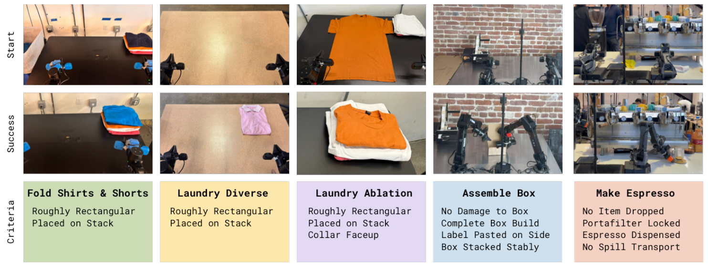

| 评估设置 | 成功定义与时限 | 应保留的边界 |
| --- | --- | --- |
| T 恤与短裤 | 从篮中取衣、展开、折叠并堆在桌角，200 秒内完成 | 相对简单，SFT 已有较高成功率 |
| 多样衣物 | 训练覆盖 11 类衣物；量化以困难的纽扣衬衫为代表，500 秒内正确折叠并堆叠 | 曲线不等于 11 类衣物平均成功率 |
| 失败模式移除 | 固定展开的橙色 T 恤，200 秒内折好，领口居中且朝上 | 特定对抗初始条件，强调严格质量标准 |
| 双份浓缩咖啡 | 完成取手柄、磨粉、压粉、锁入、放杯、萃取和送杯，200 秒内无严重错误 | 视频可展示其他饮品，量化对象仍是 double shot espresso |
| 组盒 | 从平纸板到组装、贴标和放好，600 秒内完成 | 在工厂部署；图8另画各阶段成功率 |

依据为 §VI-A，p.8。多样衣物包含毛巾、纽扣衬衫、毛衣、牛仔裤、T 恤、短裤、Polo、裙子、长袖衫、袜子和内衣。正文概述任务跨度为 5–15 分钟，但具体量化时限以各任务定义为准，不能统一换成 15 分钟。

数据量需要按任务看，不能把“纠正 episode 数”说成等量的人工全程示范：

| 任务 | 论文报告的新增数据 | 证据与待核实项 |
| --- | --- | --- |
| T 恤／短裤 | §VI-C2：每轮 300 条轨迹，4 台机器人，纯自主采集 | 附录F也列 300 条、4 个工位；这 300 条是全体合计，不是每台各 300 |
| 多样衣物 | 450 条 evaluation episode，287 条 correction episode | 附录F，p.18；不是公开完整数据集规模 |
| 咖啡 | 一轮，414 条自主 episode + 429 条纠正 episode | 附录F，p.18 |
| 组盒 | §VI-C2：每轮 600 条自主尝试 + 360 条带干预尝试；附录F称 3 台机器人 | 附录把 600 条称为 demonstrations，命名不一致；无法据此合并成统一数据类型 |
| 失败模式移除 | §VI-C4：每轮 600 条、共两轮；附录F：约 1,000 条自主 + 280+378 条纠正，3 台机器人 | 主文与附录关于是否存在纠正数据不一致，见第12节 |

“evaluation episode”在这里可能是之后加入训练的部署采集轨迹，不自动等于永不参与训练的最终独立测试集。本文没有获得所有主结果的独立评估样本数、完整重置成本和人工工时，不能用上表直接重算全部误差条或样本效率。

## 11. 结果：吞吐量提升与成功率提升是两个问题

### 11.1 主结果说明了什么

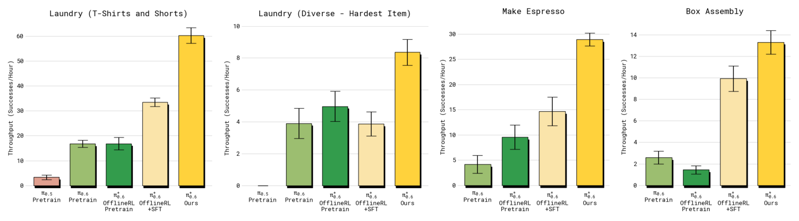

吞吐量按“每小时成功完成的任务数”计，结合了成功率与执行速度。为理解两个因素的关系，可以作如下更新周期近似：

$$
\text{每小时成功数}\approx\frac{3600\,p_{success}}{\mathbb E[T_{episode}]}.
$$

**【推导】** 这里假定连续重复试验、时长以秒计，并把成功／失败试验都计入平均时长；若包含额外重置和人工等待，应加入相应成本。它用于解释指标，不是作者公开的完整计时实现。

**【示意】** 若成功率保持 0.9，而平均 episode 时长从 90 秒降到 60 秒，吞吐量从 36 增至 54 次／小时，增加 50%。因此成功率接近饱和时，RL 仍有改进空间。

| 问题 | 论文支持的结论 | 证据及限制 |
| --- | --- | --- |
| 加入部署数据有用吗 | 作者报告多样衣物与咖啡相对 Offline RL + SFT 的吞吐量超过 2 倍 | §VI-C1、图7；图中咖啡柱高约 15→29 次／小时，接近两倍，不能据图精确证明“严格超过” |
| 简单衣物还能提高吗 | 成功率原本很高，最终模型仍明显提高吞吐量 | 图7–8，p.9 |
| 最终成功率都超过 90% 吗 | 主文称除多样衣物外进入 90%+；多样衣物明显更低 | §VI-C1、图8；组盒展示的是分阶段结果 |
| 失败率减少约一半指什么 | 主要是困难衣物与咖啡等设置，相对相应阶段基线 | 图8；不能写成所有任务失败率统一减半 |

图7的近似读图有助于形成量级：最终简单衣物约 60 次／小时，多样衣物约 8，咖啡约 29，组盒约 13。**这些不是带精确小数的原始表格数据**，也不能由此推定实际无人值守系统的日生产量。

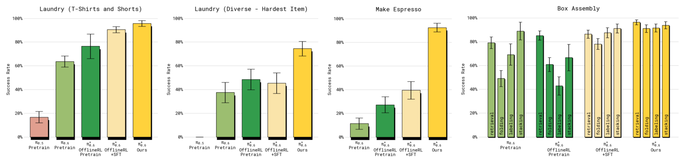

多样衣物最终成功率读图约为 75%，仍存在相当数量失败；咖啡约为九成以上。组盒右图分别标 retrieval、folding、labeling、stacking，不能把四根柱相乘来得到整任务成功率：原文没有给出足够的条件概率定义来支持这种计算，也不能把每一根都称为端到端整任务成功率。

**【解读】** 图7与图8一起看，比只摘“2倍”更有价值：它们表明系统不只是把原先成功的动作执行得更快，还在某些困难任务上减少失败。但多样衣物仍远未达到近乎无失败的水平。

### 11.2 多轮改进会单调吗

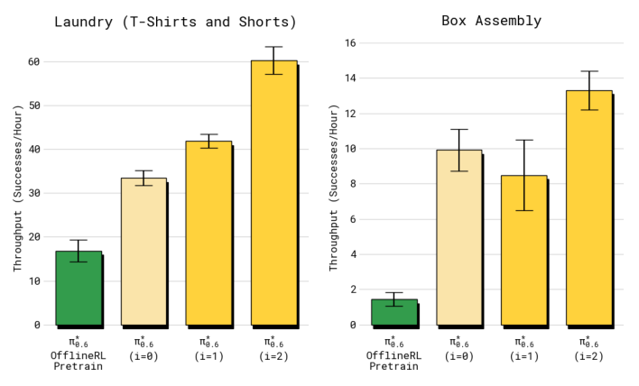

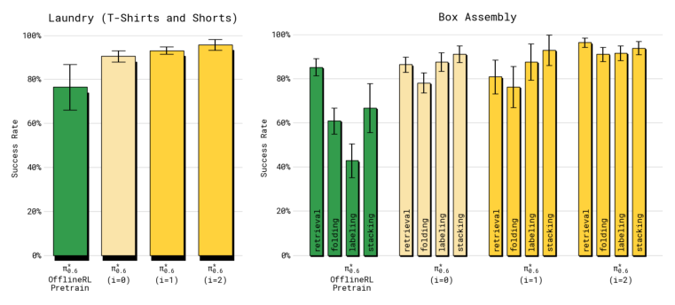

简单衣物从 iteration 0 到第2轮的吞吐量，读图约 33→60 次／小时；成功率第一轮已超过 90%，第二轮主要继续提高速度。组盒的首轮吞吐量先下降，第二轮回升到高于起点。[§VI-C2、图9–10，p.10]

这里还有一处数字口径问题：正文写简单衣物总体约提高 50%、组盒第二轮达到 2 倍；若直接以图9的 iteration 0 为起点，其近似柱高并不对应这两个比例。本文保留图中的阶段和量级，不把正文的比例套成统一且精确的增幅；基线、计时或文字表述仍需要作者说明。

这组实验也提供了较干净的“仅自主数据”证据：**简单 T 恤／短裤的这两轮明确不使用人工纠正**。因此，证明自主经验能改善已有策略，应优先引用这一设置，避免与有争议的失败模式移除实验混用。

### 11.3 与 AWR、PPO 的比较是否充分隔离变量

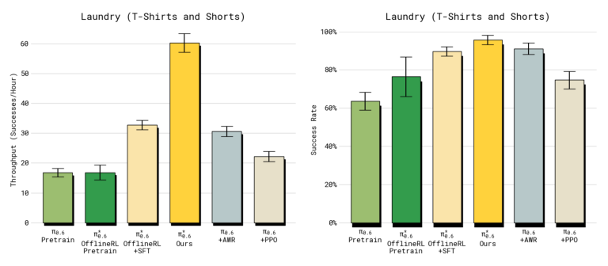

**【原文】** 比较只在 T 恤／短裤任务进行。AWR 与 PPO 使用 RECAP 收集的相同 on-robot 数据；AWR 从不带优势条件的 π0.6 开始，PPO 是面向自回归与流匹配输出定制的变体。作者为稳定 off-policy 训练，采用很小的信任域约束。RECAP 的吞吐量明显更高；AWR 可保持较高成功率，但动作更慢。[§VI-B、VI-C3、附录D，pp.8–10、17]

**【解读】** 这支持该系统配方在这些条件下的实用性，但不是“所有 PPO 方法都不适合 VLA”的证明。除了策略提取目标，预训练过程是否带优势条件也不同；论文没有把所有因素、超参数搜索预算与计算量完全隔离。附录的单步扩散似然近似和替代信任域目标，也不能简单称为未经改动的标准 PPO。

## 12. 失败模式移除：97% 的结果与数据歧义同时保留

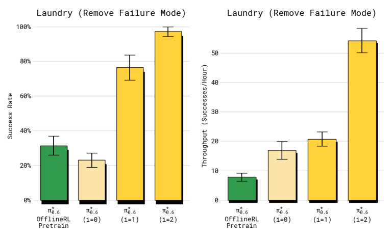

**【原文】** 作者把橙色 T 恤放在容易诱发领口朝下的初始状态，成功标准要求领口居中朝上。§VI-C4 报告两轮后成功率为 **97%**，每轮采集 600 条轨迹，并称无需干预数据或新增示范。[p.11]

但附录F对同名 failure mode removal ablation 写明使用自主与纠正数据，总计约 1,000 条自主轨迹，以及 280+378 条纠正轨迹。[p.18]

**【解读】** 这两处无法在当前材料内直接统一。可能存在实验子集或统计口径差异，但原文没有给出足够映射，本文不替作者补上原因。可靠的表述是“论文报告该严格设置最终达到 97%，但该实验是否完全不含纠正数据存在主文与附录冲突”。不能只转述后半句并当成已经核实的自主 RL 消融。

这个结果的适用范围也需要保留：固定衣物、固定展开状态、特定领口标准。它展示有针对性改变行为的潜力，不等于对全部真实衣物的成功率都是 97%。

## 13. 贡献、局限与值得复现的部分

**【解读】** 这篇论文最有价值的贡献是把三个环节接成了能够运行的系统：用通用价值模型为不同任务提供统一评价方式，用优势条件避免直接对大规模 Flow Matching 策略实施困难的策略梯度优化，再用累计部署数据进行迭代。相关思想分别有前作，贡献主要在组合、规模化训练配方与复杂实机验证。

它的主要限制有清晰的技术原因：

- **人仍在闭环中。** 成功标签、纠正、重置和机器人维护都需要人；作者明确没有实现全自主持续学习。[§VII，p.11]
- **探索依赖有效初始策略。** 随机性与人工纠正承担主要探索作用，遇到策略几乎从不到达的新技能时未必有效。[§VII]
- **价值只学到混合行为的回报。** 累计数据来自人和多轮策略，Monte Carlo 拟合并非当前策略的精确价值，更不是最优价值；优势质量依赖数据覆盖和校准。[§IV-A]
- **纠正动作强制为正是一条假设。** 接管具有延迟和扰动，专家也可能给出低质量动作；标签规则本身无法保证纠正总比基线好。[§IV-B、V-D]
- **观察并非完整状态。** 论文为简化推导，把当前观察视作 Markov 状态；真实遮挡、接触与历史信息可能使这个假设不成立。[§III脚注，p.3]
- **量化范围有限。** 三大任务类别在同一种固定双臂平台上做迭代；多样衣物量化集中在困难衬衫，不能代表所有家庭或所有机器人。
- **复现配方仍有缺口。** 块长、采样器、完整优化配置、独立评估样本数、计时／重置口径及前述文字冲突，没有在当前可核实材料中全部解决。

主文还描述了连续做咖啡 13 小时、在新家折新衣物超过两小时等演示。它们是作者的部署陈述，支持长期运行的可行性；没有按任务、重置和失败事件展开的日志时，不能转换成严格的无人值守可靠性或新环境平均成功率。[§I，p.2]

如果要动手复现，**【建议】** 优先做一个已经有可用初始策略的短任务，并保留如下对照：相同示范与部署数据下比较普通 BC、成功轨迹过滤、AWR、优势条件；再固定预训练阶段，只比较有无优势条件，隔离训练起点的影响。分别记录成功率、成功耗时、失败耗时、重置时长、人工工时和每轮新数据量，避免只报告漂亮的吞吐量。

价值模型建议先检查留出轨迹上的回报误差、正标签比例与失败检测，再进行实机策略更新；阈值应由训练数据估计，不能用最终评估结果反复调到最好。针对本论文，还需先解决阈值分位数、预训练求和起点、失败移除数据组成和迭代增幅口径这四类核查问题。

## 14. 阅读自测与系列衔接

读完后，可以用以下问题检验是否理解了这套方法：

1. **价值升高就表示优势为正吗？** 不一定，还要减去已花费的时间成本，并超过任务阈值。
2. **失败 episode 会全部被丢弃吗？** 不会；它们参与价值和策略训练，局部动作也可能有正优势。
3. **人工接管后整条轨迹都标正吗？** 原文只对纠正动作强制正标签，其他片段仍按规则判断。
4. **机器人上线时需要知道未来回报吗？** 默认不需要。未来轨迹用于离线标签生成，执行时给定正优势条件。
5. **50 Hz、$N=50$ 和动作块长度是同一件事吗？** 分别是控制频率、优势向前看的窗口和动作接口参数，本文没有证据把它们设成相同。
6. **每轮接着上一轮权重训练吗？** 数据累计保留，但任务策略与价值从预训练检查点重新微调。
7. **97% 能证明全部真实衣物都可靠吗？** 不能，它来自固定初始状态的严格 T 恤实验，且数据组成有未解决冲突。

在 π 系列中，可把阅读线索连成：[π0 的连续动作专家与流匹配](/embodied-ai-learning/posts/paper-pi0/) → [FAST 的动作编码](/embodied-ai-learning/posts/paper-pi0-fast/) → [π0.5 的开放世界泛化与层级预测](/embodied-ai-learning/posts/paper-pi05/test/) → 本文的部署经验学习。π*0.6 在这些建模与数据基础上，把“这一步是否比已有行为更好”转成可训练的条件，论文结果与尚未解决的证据缺口都应沿着这条链条理解。

## 原始资料

- [论文记录与版本历史：arXiv:2511.14759v2](https://arxiv.org/abs/2511.14759v2)，已核对日期与作者。
- [论文 PDF：π*0.6: a VLA That Learns From Experience](https://arxiv.org/pdf/2511.14759v2)，本文以本地同版本标记的 PDF 为阅读基准。
- [官方项目页：π*0.6](https://pi.website/blog/pistar06)，地址来自论文首页；本次未取得可核实页面正文，本文事实不依赖其额外内容。

文中13张图片均来自本地论文 PDF，分别对应原图1–13；文章旁的图片维护索引保存页码、裁剪区域、原英文图注及 SHA-256，用于本地核查，不另生成公开文章或下载页。本文保留“原文结果、读图近似、数学推导、示意与建议”的证据层次，后续若核实实际实现，应在同一篇笔记中补充版本与差异。
