# π0.7 原文图表维护索引

本地 PDF 为 arXiv:2604.15483v2，共 25 页。此维护索引由博客 isPost 规则排除，不生成公开文章。

页码为 PDF 物理页码，原始英文图注与裁剪坐标保存在 index.json。

## 原文图1 · PDF p.1

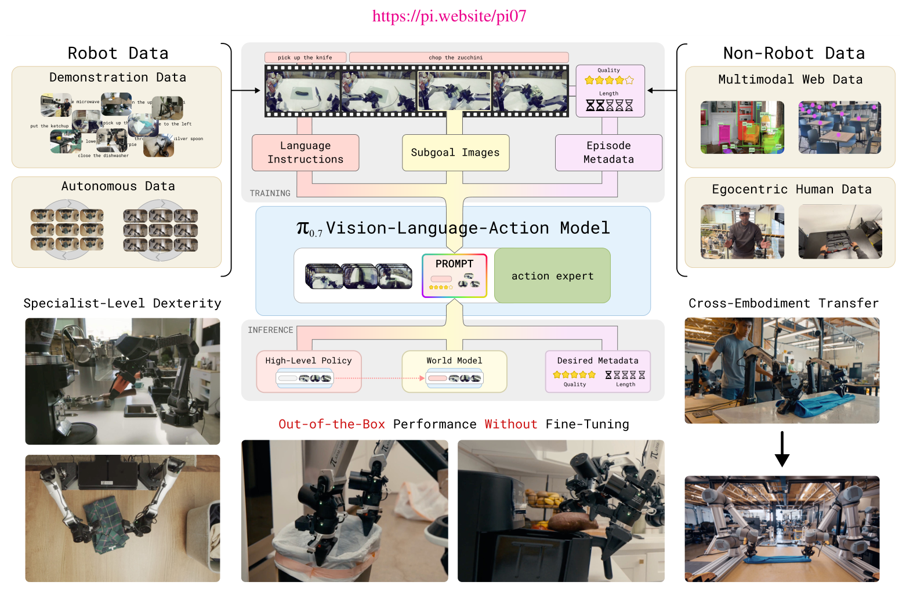

Fig. 1: We introduce π0.7, a steerable generalist robot foundation model that can perform dexterous tasks across many tasks, environments, and robots. π0.7 is trained with diverse prompts that contain not only the task description, but detailed language, generated subgoal images, and episode metadata. This provides richer context about not only what to do, but also how to do it, making it possible for π0.7 to leverage broad set of both robot and non-robot data and compose the skills in this data in new ways to solve new tasks.

## 原文图2 · PDF p.4

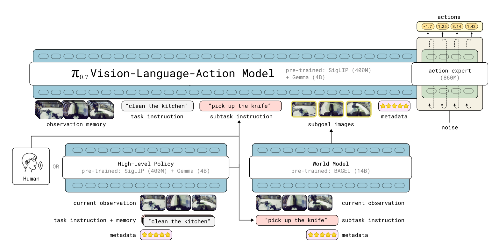

Fig. 2: Architecture overview. The π0.7 model is a 5B-parameter VLA consisting of a 4B VLM backbone, a MEM-style video history encoder and a 860M parameter action expert. The model’s context includes multiple distinct modalities, including language commands, episode metadata that describes the data quality and strategy, and multimodal inputs such as subgoal images. At runtime, the language commands are produced by a high-level semantic policy based on the same architecture, and the subgoal images are produced by a lightweight world model based on the BAGEL image generation model [105].

## 原文图3 · PDF p.6

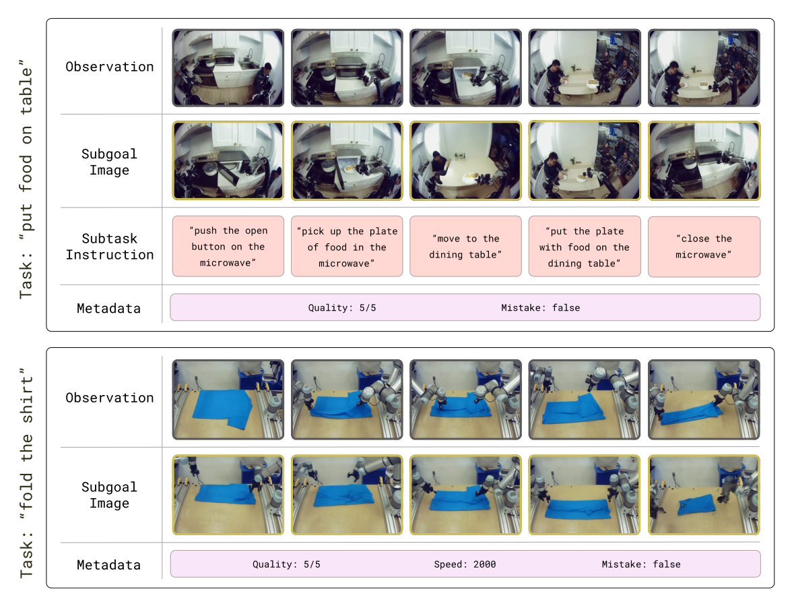

Fig. 3: Prompt overview. π0.7 uses diverse modalities of context in the prompt, including: subtask instructions, subgoal images, and episode metadata. We train the model with dropout for each component, and then prompt the model flexibly combining modalities. For example, when using the UR5e bimanual manipulator to fold a shirt, we use subgoal image and metadata prompting.

## 原文图4 · PDF p.7

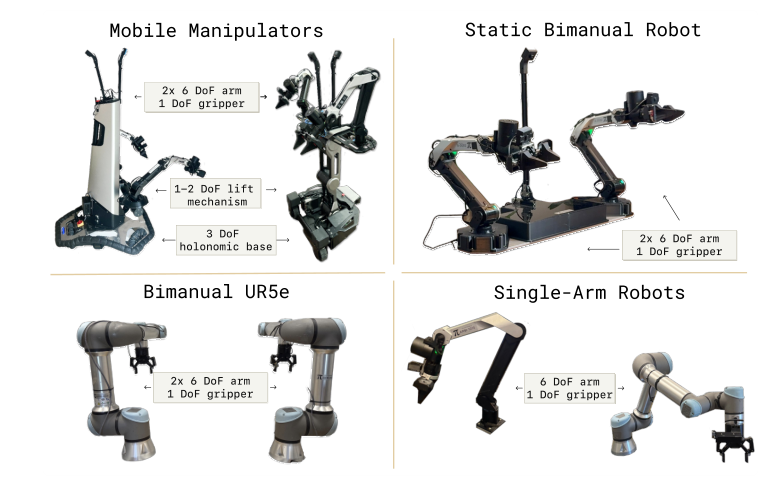

Fig. 4: Illustrations of some of the robots in our experiments. We evaluate π0.7 on a variety of robots, including bimanual mobile manipulators (left), static bimanual robots (middle), and a bimanual UR5e setup (right) that we use for cross-embodiment experiments.

## 原文图6 · PDF p.9

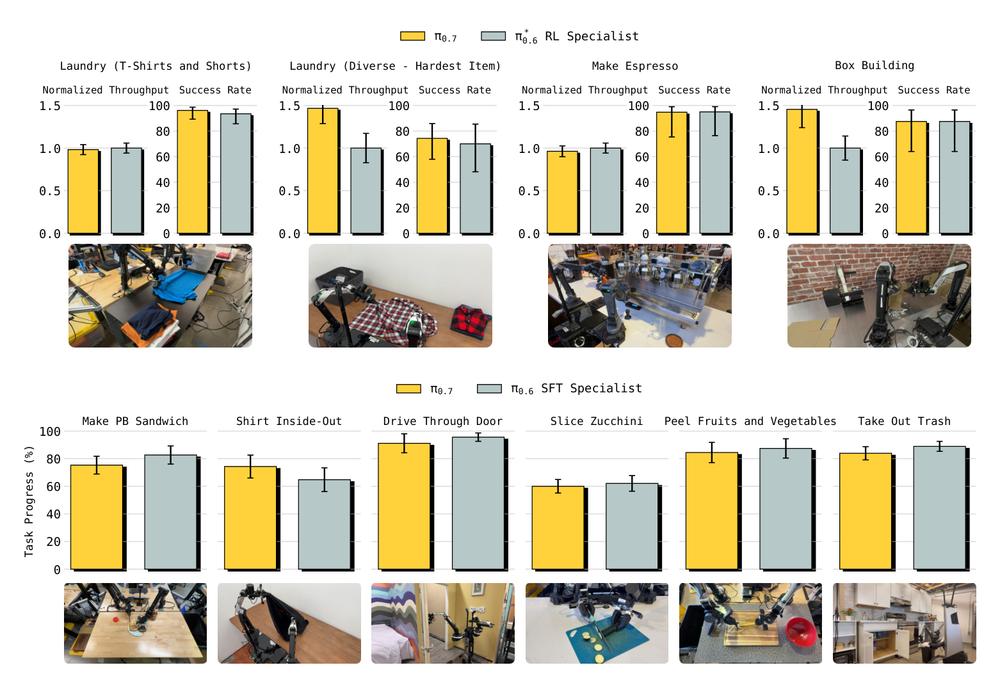

Fig. 6: Out-of-the-box dexterity: π0.7 can perform a wide range of highly dexterous tasks directly out of the box. We consider tasks from π∗ 0.6 [50] (top row) and a number of other dexterous tasks including ones from the “Robot Olympics” experiments (bottom row). For the tasks from π∗ 0.6, we report success rate and normalized throughput (relative to the specialist model; raw throughput means successes per hour), while for other tasks we report task progress. We find that the same π0.7 model can match the performance of the task-specific post-trained specialist policy from π∗ 0.6 or π0.6 for each of these tasks, and even achieve higher throughput than the RL specialists in diverse laundry folding and box building.

## 原文图7 · PDF p.9

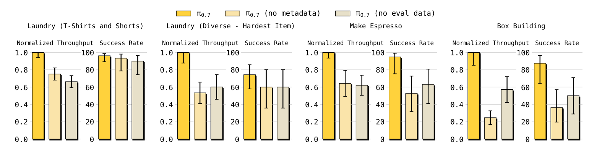

Fig. 7: Impact of prompt composition and evaluation data on out-of-the-box performance: We compare π0.7 with two ablations: one that does not include episode metadata in the context, π0.7 (no metadata), and another that does not include data from autonomous evaluation episodes during training, π0.7 (no eval data). We find that π0.7 outperforms both π0.7 (no metadata) and π0.7 (no eval data) across the board, with the gap most prominent in throughput. Throughput (successes/hour) here is normalized relative to π0.7.

## 原文图9 · PDF p.11

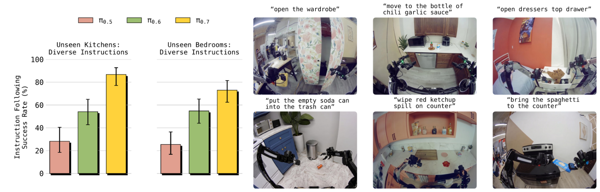

Fig. 9: Broad instruction following in novel environments: We evaluate π0.7 on 14 instruction following scenarios, each of which involve following a sequence of 3-6 open-ended instructions, across 4 unseen kitchen and 2 unseen bedroom environments. We report the instruction following success rate, the percentage of total instructions that were correctly followed across all evaluations. We find that π0.7 significantly outperforms π0.5 and π0.6 across the board, attaining high absolute success rates.

## 原文图10 · PDF p.11

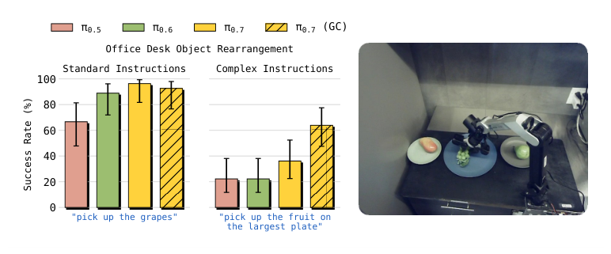

Fig. 10: Following complex referential instructions: π0.7 and prior models all succeed on the simpler re-arrangement instructions (instructions include “pick up the spoon”, “put the spoon to the left of the fork” and “put the spoon to the right of the fork”), but π0.7 performs significantly better on the complex and unusual instructions (instructions include “pick up the largest bowl on the table”, “pick up the object I would use to eat soup” and “pick up the fruit on the largest plate”). Including subgoal images generated by a lightweight world model (π0.7 (GC)) further boosts instruction following performance, making π0.7 significantly more capable at following complex instructions.

## 原文图11 · PDF p.11

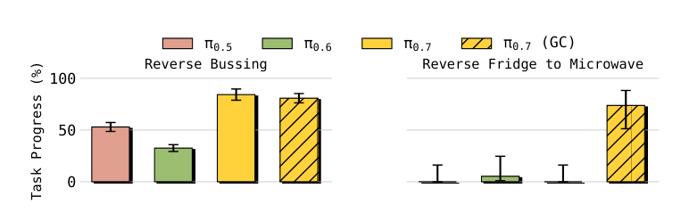

Fig. 11: Breaking dataset biases by following instructions: the improved language-following performance of π0.7 enables it to break strong dataset biases. Prior models struggle on these data bias challenge tasks, which require following instructions that contradict the pattern in the data (e.g., putting dishes in the trash and trash in the dish bin). π0.7, however, can follow instructions sufficiently well that it can break these strong biases to still perform the task. Notably, for the “Reverse Fridge to Microwave” task, including subgoal images from the world model in the context (π0.7(GC)) is critical for success.

## 原文图12 · PDF p.12

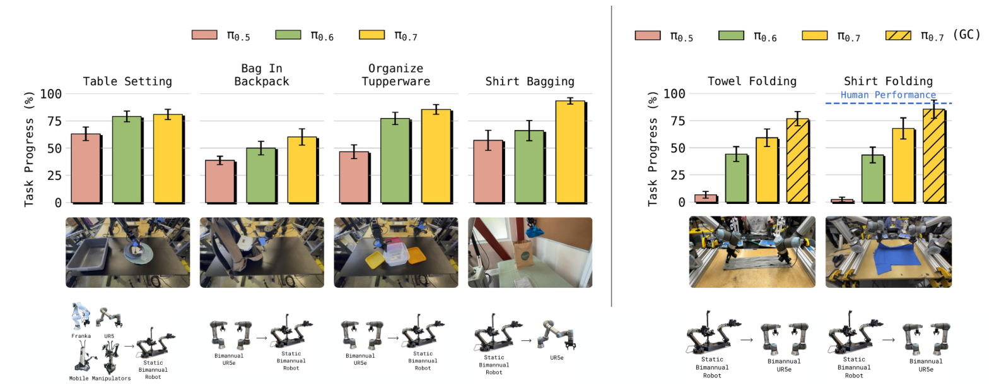

Fig. 12: Cross-embodiment transfer: Left: Both π0.7 and prior models achieve strong cross-embodiment transfer directly out of the box on simpler re- arrangement or repositioning style tasks. For example, for the “Table Setting” task, data was collected with a variety of different robots, and the task was tested on the static bimanual robot. All of the models performed well. For tasks that required transfer from the bimanual UR5e robot to the smaller static bimanual robot (“Bag In Backpack” and “Organize Tupperware”), the embodiment gap is larger, as there is only one source robot that is bigger and heavier than the target robot. Here, π0.5 performed very poorly, but π0.6 still performs quite well. Transferring from the smaller static bimanual robot to the UR5e for the “Shirt Bagging” task introduces the largest embodiment gap, and here the π0.7 model significantly outperforms prior models. Right: for the more dexterous tasks that require folding towels and t-shirts, the embodiment gap poses an even greater challenge. Data for these tasks was collected with the smaller static bimanual robot, and the task was evaluated on the larger bimanual UR5e platform. π0.7 was able to transfer this task successfully, and improved even more when using visual subgoal images generated by our lightweight world model. In fact, task progress matches the “zero-shot” performance of our most experienced human teleoperators, who have operated a diverse set of robots and attempted this task on the UR5e for the first time.

## 原文图13 · PDF p.12

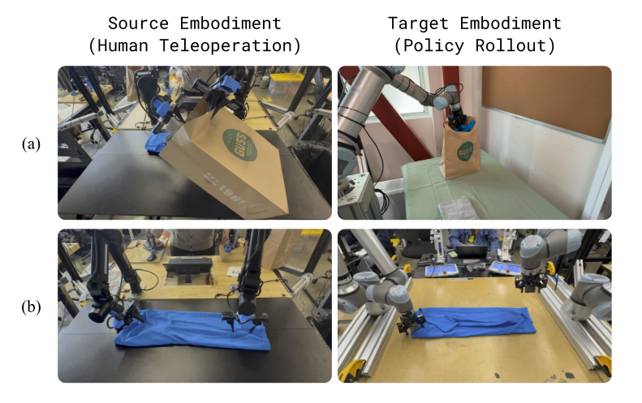

Fig. 13: Cross-embodiment transfer produces emergent strategies adapted to the target embodiment. (a) On the source robot, human teleoperators use one arm to hold the bag open while the other performs insertion. On the UR5e target robot, π0.7 instead discovers a single-arm pick-and-place strategy suited to the robot’s greater reach. (b) Human teleoperators approach the shirt with a tilted end-effector on the source robot, while π0.7 produces vertical grasps on the UR5e, which is more suitable for the larger robot’s arm placement. In both cases, the policy goes beyond replicating source behavior, discovering manipulation strategies for the task that are better suited to the target embodiment.

## 原文图14 · PDF p.13

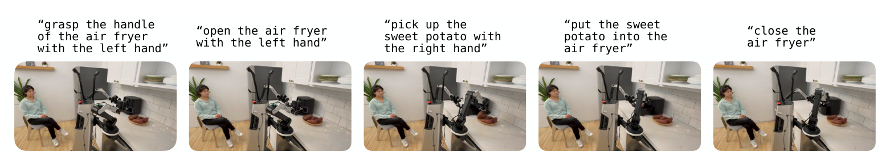

Fig. 14: Example of language coaching: We can “teach” a new task to π0.7 by providing step-by-step verbal instructions. Because of its language following ability, π0.7 can perform new tasks successfully under user instruction, and these instructions can then by used to train a high-level policy that prompts π0.7 so that it can perform the task fully autonomously.

## 原文图15 · PDF p.13

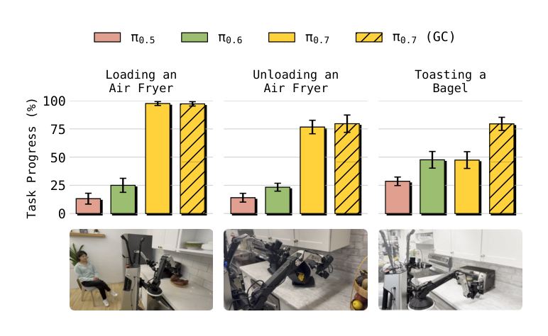

Fig. 15: Coaching to perform new long-horizon tasks: Because π0.7 can follow language instructions effectively, even for unfamiliar skills, it can be “coached” to perform a number of unseen, longer horizon tasks both when conditioned on language and generated subgoal images (π0.7 (GC)). Prior models generally lack the language following ability needed to follow the coaching commands, and thus achieve very poor performance.

## 原文图16 · PDF p.13

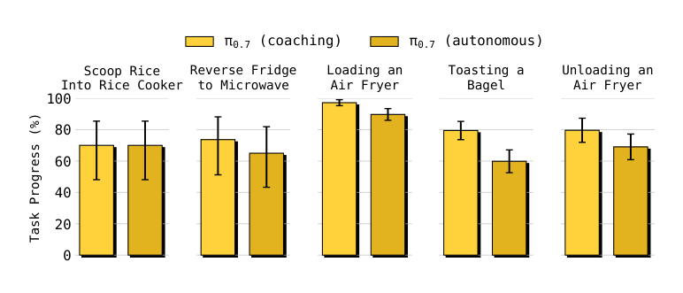

Fig. 16: Acquiring new autonomous capabilities with coaching: We can use the coaching episodes collected for a number of different unseen tasks to train a high-level policy to automatically prompt π0.7 in accordance with the coaching episodes. This allows us to create fully autonomous policies for these tasks (π0.7 (autonomous)) that closely match the performance of the policy with live human coaching (π0.7 (coaching)) without collecting any additional data with teleoperation or any other kind of low-level actions.

## 原文图17 · PDF p.13

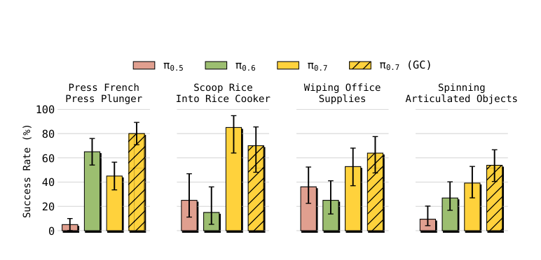

Fig. 17: Performing new short-horizon tasks: π0.7 can perform a number of new short-horizon tasks directly out of the box, including scooping rice into a rice cooker, spinning various objects such as a gear set and desk fan, and wiping down objects with a cloth, such as a ruler and headphones, despite no data being collected for any of these tasks. π0.7 shows roughly equally strong performance when conditioned directly on language instructions (π0.7) or generated image goals (π0.7 (GC)).

## 原文图18 · PDF p.14

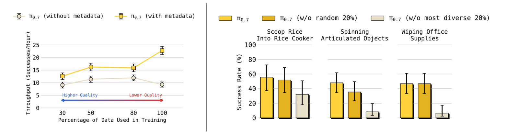

Fig. 18: Scaling of generalization performance with diverse context and data: Left: We find that π0.7 (with metadata) can continuously improve its performance when it is trained on larger datasets, even when the average quality of the data actually decreases. By contrast, without training on rich conditioning information, we find that π0.7 (without metadata) actually can degrade in performance as more lower quality data is introduced. Right: When π0.7 is trained without our robot data with the highest task diversity, its performance degrades substantially. This suggests that π0.7 is able to utilize the task diversity in our robot data to drive substantial improvements in compositional task generalization.

## 原文图19 · PDF p.22

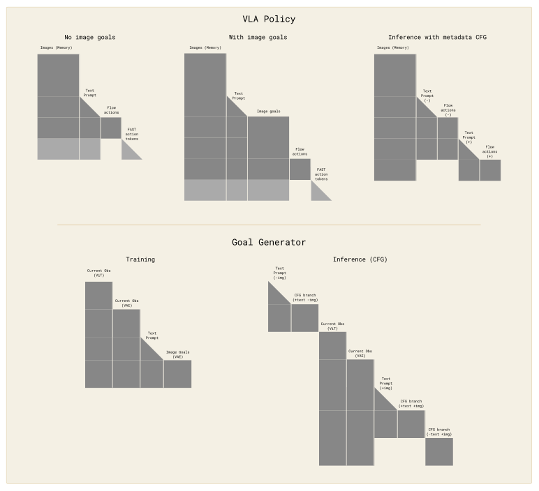

Fig. 19: The π0.7 model and its world model (for generating subgoal images) use several different nontrivial attention patterns during training and inference. From top left: in absence of image goals we use the same attention patterns as in π0.5, with global bidirectional attention between embeddings for all memory-aware image views. Note that the FAST tokens (only available at training time) and the flow actions do not attend to each other. When image goals are present, we include them as an additional block-causal bidirectional block, after the text prompt. When we do classifier-free guidance (at inference time), we pack both the positive and negative example into the same sequence for efficient inference by constructing an “attention tree” with two branches (positive and negative), which do not attend to one another. Following BAGEL, at training time the world model receives three copies of the image, each of which is block-bidirectional within the multiview group: current observation, encoded with ViT; current observation encoded with VAE; noisy image goal encoded with VAE. The world model uses a similar inference-time CFG trick, albeit with a more complex mask because it has three CFG groups rather than two.

## 原文图22 · PDF p.23

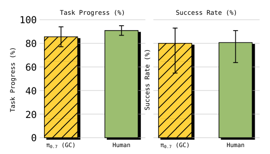

Fig. 22: Comparison of π0.7 (GC) and human. We find that π0.7 (GC) achieves competitive performance compared to the human operators, in the shirt folding task with the UR5e bimanual platform.
