把高质量示范、失败轨迹、强化学习专家的执行经验和人类视频混在一起，机器人会学得更多，还是被其中的坏动作拖累？π0.7 的回答是：**除了告诉模型“做什么”，还要在训练时告诉它“这次是怎样做的”；推理时再指定希望执行的那一种行为。**

这份条件信息不止是长一点的文字，还包括子任务指令、未来目标图像、整条轨迹的速度与质量，以及动作片段是否出错。论文真正值得关注的，是这些条件怎样让一个通用模型同时保留多种行为，并把不同来源的技能重新组合起来。

> **阅读范围**：依据用户提供的 25 页本地 PDF，覆盖主文及附录 A–G。原文题目为 *π0.7: a Steerable Generalist Robotic Foundation Model with Emergent Capabilities*，首页标明 `arXiv:2604.15483v2`、2026-04-24，机构为 Physical Intelligence，署名为团队及 Bo Ai、Ali Amin、Raichelle Aniceto、Ashwin Balakrishna 等 87 位个人作者。[arXiv 官方版本记录](https://arxiv.org/abs/2604.15483v2)核实首发为 2026-04-16、v2 修订为 2026-04-24。本文 `published` 保留首发日期；笔记创建于 2026-11-25，博客展示日期使用 `created`。页码均指 PDF 物理页码。
>
> **证据标记**：**【原文】** 为论文陈述、设置或结果；**【解读】** 为机制解释；**【推导】** 为按明确假设整理的公式；**【示意】** 为人工构造的样本或数字；**【建议】** 为待验证的研究方案。图中未标数值的柱高不补成精确统计。本文完成的是论文分析，没有训练或实机复现。

## 1. 先定位贡献：5B 的 VLA，以及围绕它的上下文系统

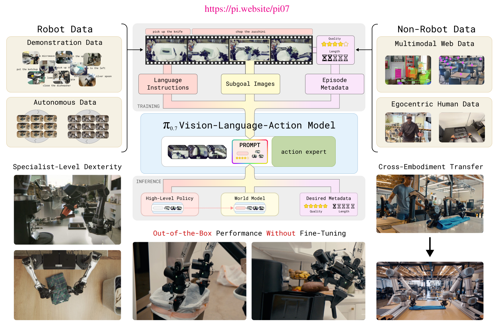

图1上半部分是训练：机器人示范、自主执行数据、网络图文和第一视角人类数据进入训练体系，样本带有不同的上下文。下半部分是使用方式：高层策略或人类提供下一条子任务指令，世界模型生成目标图像，用户选择期望的质量与速度，VLA 据此生成动作。

**【原文】** π0.7 本体由 Gemma3 4B 视觉语言骨干、MEM 视频历史编码器与 860M 动作专家组成，总规模约 5B。它输出连续动作块。目标图像由另一个基于 BAGEL 的 14B 模型生成；高层语义策略也基于 Gemma3 4B 架构。[§IV、VI-B、附录 C–D，pp.3–7、22–23]

因此，“π0.7 是 5B 模型”描述的是 VLA；包含独立高层策略、世界模型的完整运行系统，需要分别核算参数和算力。图中的多个模型框也不能理解成每个动作时刻都依次阻塞调用一次。

| 论文要解决的问题 | 对应做法 | 应观察的证据 |
| --- | --- | --- |
| 不同质量、不同策略的数据混合后难以使用 | 用轨迹元数据说明训练样本所属的行为模式 | 图7、图18左 |
| 语言难以表达抓取位置、折叠外观等细节 | 增加多视角子目标图像 | 图10–12、图15 |
| 长任务既要理解下一步，也要保持控制连续 | 高层语义指令、视觉记忆、流匹配动作专家与 RTC | 图2、图19、算法1 |
| 希望复用技能，减少为新任务收集遥操作动作的需求 | 新短任务直接提示；新长任务先语言指导，再学习高层指令策略 | 图14–17 |

论文主动说明，其贡献重点是**使 VLA 利用异质数据的训练方法及实证结果**，不是声称首创目标图像控制或某一种新 Transformer。[§II，p.3]

可追溯的公开入口是 [arXiv 论文页](https://arxiv.org/abs/2604.15483v2)与原文给出的[官方项目页](https://pi.website/pi07)。核查时成功读取 arXiv 官方记录，项目页请求超时。本文以本地 PDF 为分析依据；未获得并固定与这份论文实验相匹配的完整训练代码、权重与数据快照，因此下文不会把其他 π 系列实现的默认参数当作 π0.7 的证据，也不填写未经核实的会议录用或最新开放状态。

## 2. 动机：为什么“多收数据”可能反而变差

同样是叠一件衣服，轨迹可以很快也可以很慢，可以一次抓准也可以反复补救，最后可以平整也可以歪斜。如果输入只有“叠衣服”，模型必须在同一个条件下拟合这些不同动作。

**【解读】** 条件生成模型可以表示多个动作模式，但如果训练条件不能区分“这是一次低质量的尝试”和“这是一次熟练执行”，部署时也就缺少稳定选择好行为的接口。这里的“平均不同模式”首先是条件不充分的问题，不意味着流匹配网络一定只输出动作的算术平均。

把当前观察历史记作 $O_t$，动作块记作 $A_t$，任务记作 $\ell$。为解释质量混合，暂只考虑离散轨迹元数据 $m$，可以写成下面的概念分解：

$$
p(A_t\mid O_t,\ell)
=\sum_m p(A_t\mid O_t,\ell,m)\,p(m\mid O_t,\ell).
$$

**【推导】** 上式是离散条件的全概率公式，用来解释问题，不是论文新增的训练目标。没有质量条件时，输出分布混有不同质量的轨迹；能够条件化以后，部署时可以请求高质量、无失误的模式。

**【示意】** 假设某类状态下有 60 条快速整齐的示范、40 条慢且多次补抓的示范。只输入任务时，两种行为都要拟合；加入质量、时长和失误标签后，两组样本拥有不同条件。请求 `Quality: 5`、`Mistake: false` 给出了选择方向。但它不保证模型在训练未覆盖的状态中也会正确，更不保证把速度填成任意小值就能实现。

**【原文】** π0.7 的训练数据包含低质量示范、失败、自主评估轨迹、人工介入，以及 π*0.6 在 RL 训练中收集的数据。作者将后一部分视为把专用策略能力蒸馏回通用模型的途径。用于泛化评测任务的自主数据被排除在训练外。[§VI-A及脚注1，pp.5–6]

这也解释了为什么**“没有针对目标任务再微调”不等于“从未见过目标任务数据”**。咖啡、组盒等开箱性能实验本来就研究见过任务的执行水平；新任务泛化需要看另外的实验。

## 3. 架构：记住过去、描述下一步、生成接下来一秒的动作

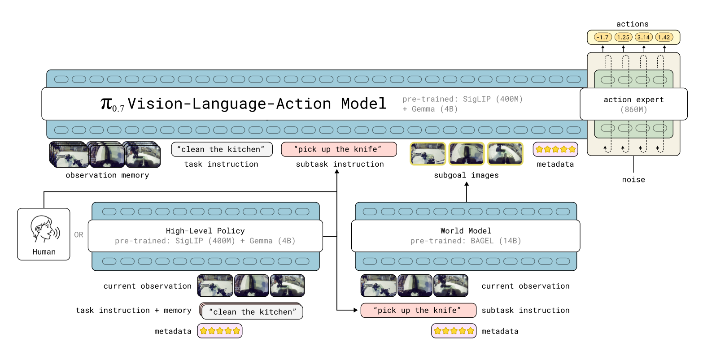

读图先看中间主模型。左侧输入是当前观察和历史，中间是总任务、子任务与目标图像，右侧是元数据和动作专家。图下方的两个模块负责产生部分上下文：左边输出文字子任务，右边输出目标图像。人类也可以直接接替高层策略提供指令。

| 模块 | 输入 → 输出 | 初始化及训练信息 | 依据 |
| --- | --- | --- | --- |
| 视觉历史编码器 | 各相机当前图像及历史 → 压缩的视觉 token | 来自 Gemma3，采用 MEM 的时空压缩设计；共享编码观察和目标图像 | §IV、VI-B |
| VLM 骨干 | 视觉、文本、本体状态等条件 → 条件表示及离散预测 | Gemma3 4B；其中视觉编码器约 400M；使用 KI 的离散监督路径 | §III–IV |
| 本体状态嵌入 | 当前及历史状态向量 → 骨干维度的 token | 线性投影；每个历史状态一个 token，对应历史被丢弃时也屏蔽 | §VI-B |
| 动作专家 | 条件表示、带噪动作、流时间 → 50 步连续动作的生成 | 860M Transformer，adaptive RMSNorm 注入流时间；连续损失不反传进入 VLM 骨干 | §III、VI-B |
| 高层语义策略 | 观察、总体任务、已有子任务历史等 → 下一子任务文本 | 同类视觉语言架构；新任务可用 coaching 记录微调高层策略 | §V-A、IX-D |
| 目标图像生成器 | 当前多视角图像、子任务和元数据 → 三视角目标图像 | BAGEL 14B；7B 理解骨干与 7B 生成骨干；单独训练 | §V-B、附录 C |

**【原文】** 观察最多四路：前视、两个腕视，以及可选后视；每路最多六帧历史输入，历史采样间隔为 1 秒。编码器将历史压缩到与单帧相同数量的视觉 token。目标最多三路，不包含后视。VLA 的观察与目标图像均先缩放至 $448\times448$。[§VI-B，p.6]

**【解读】** “最多六帧”不是六个连续的 20 ms 控制帧；它们以秒为间隔提供较长时域的信息。压缩也不意味着历史免费：虽然输出 token 数固定，附录仍报告启用记忆会增加延迟。论文没有给出本文可直接核实的每视角最终 token 数，不能从 448 像素自行推出。

### 注意力结构与梯度结构要分开读

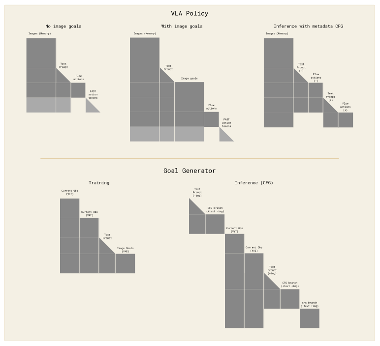

图19左上是无目标图像，正上方是有目标图像，右上是 VLA 的元数据 CFG。观察块内部双向注意；目标图像构成额外的块；文字使用因果关系；动作块内部双向注意并读取相应条件。**FAST 动作 token 与连续 flow 动作不相互注意**，两者是训练中的不同预测分支。[附录 B、图19，p.22]

正文 §VI-B 对观察、目标图像和文字块的描述较概括；图19明确画出了目标图像位于文本之后的具体分块。实现掩码时应按具体序列和图19核查，不能只凭“多模态 Transformer”假设所有 token 完全互见。

KI 的另一条规则是：动作专家虽然读取骨干表示，但**连续动作损失的梯度在通向骨干处被截断**。所以“能注意到”不等于“损失能反传到”。FAST 是训练表示的监督分支，不是推理时先生成 FAST token、再把它们解码成动作的必经步骤。[§III，p.3]

## 4. 一条样本包含什么：图像、状态、动作和整条轨迹的属性

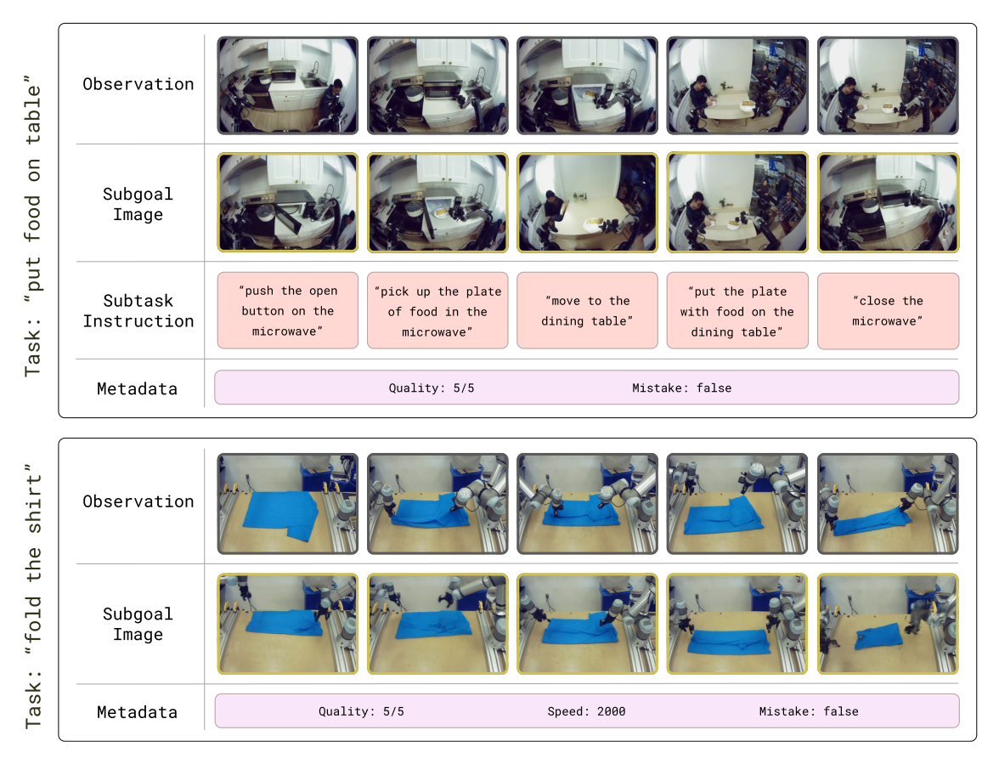

图3上方展示“把食物端上桌”的一串子任务：按开门按钮、取盘、移动、放盘、关微波炉；下方的折衣例子用目标图像与元数据控制，并不要求每一刻都存在子任务文本。这与训练时随机删除部分上下文的设计一致。

下面以静态双臂机器人为例整理样本。表中的 $B$ 是批量大小，$V\leq4$ 是观察视角数，$K\leq6$ 是历史图像槽位数，$V_g\leq3$ 是目标视角数；$d_q,d_a$ 分别为状态和动作维数。为了明确 50 个离散时刻，本文把动作块写成 $A_t=[a_t,\ldots,a_{t+49}]$；原文采用 $a_{t:t+H}$ 的简写。

| 字段 | 形状或结构 | 单位／含义 | 示例与证据边界 |
| --- | --- | --- | --- |
| 当前图像 $I_t$ | 示意批量布局 $B\times V\times448\times448\times3$ | RGB；实际张量轴顺序、像素归一化未披露 | 前视、左腕、右腕及可选后视，§VI-B |
| 历史图像 | 示意布局 $B\times V\times K\times448\times448\times3$ | 以 1 秒间隔采样的历史槽位 | 实际当前帧与历史的数组组织、缺帧掩码仍需核实 |
| 本体状态 $q$ | 当前 $B\times d_q$，历史可表示为 $B\times K\times d_q$ | 关节等本体信息，线性投影为 token | 精确状态顺序、补齐维度与单位未完整列出 |
| 总体任务 $\ell$ | 文本 token 序列 | 长时目标 | `peel vegetables`，原文 prompt 例子 |
| 子任务 $\hat\ell_t$ | 可缺失的文本序列 | 当前语义步骤 | `pick up the peeler`，§V-E |
| 目标图像 $g_t$ | $B\times V_g\times448\times448\times3$ 的结构示意 | 希望达到的未来外观 | 真值未来帧或世界模型生成图，§VI-C |
| 轨迹元数据 $m$ | 文本化标签集合 | 整体时长、整体质量、局部失误 | `Speed: 8000. Quality: 5. Mistake: false.` |
| 控制模式 $c$ | `joint` 或 `ee` | 决定动作语义 | 关节控制或末端执行器控制，§V-D |
| 连续动作 $A_t$ | $B\times50\times d_a$ | 对应模式的控制命令 | 控制频率随平台不同；精确坐标系、姿态编码和尺度未完整披露 |
| FAST token | 可变长度离散序列 | 同一动作的离散监督表示 | 训练时监督骨干，推理使用连续专家 |

**【示意】** 对两条三视角、六历史槽位样本，图像可组织成 $2\times3\times6\times448\times448\times3$。这只是便于理解的布局，不是已核实代码中的数组轴顺序；相机缺失和历史删除还需要掩码。

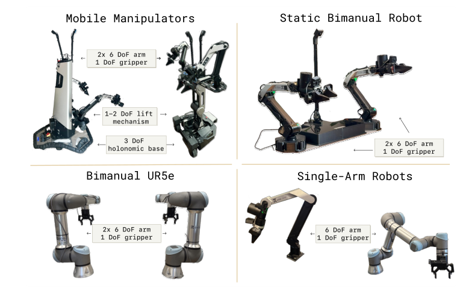

**【原文】** 双臂平台每臂有 6 DoF 机械臂和 1 DoF 夹爪；移动机器人另有底盘与升降机构。UR5e 运行在 20 Hz，其他机器人为 50 Hz。动作通过 PD 控制器执行，末端模式通过数值逆运动学转为目标关节位置。[§VIII，pp.7–8]

从硬件自由度可推测，最简单的静态双臂关节命令含 12 个机械臂分量和两个夹爪分量，但**这不能证明网络张量的 $d_a$ 恰好等于 14**：实际实现可能补齐多机器人动作空间，还可能含额外字段。论文也没有完整交代所有动作是绝对值还是增量、关节角单位和夹爪缩放，不能照搬 π0 的默认配置填空。

### Speed 不是速度控制器的物理单位

**【原文】** `Speed` 实际记录整条 episode 的时长，单位是时间步，按 500 步分箱；1750–2250 步被归入“2000 steps”附近的档位。`Quality` 为 1–5 分，`Mistake` 标注某动作片段是否出错，后两者有人工标注。[§V-C，p.5]

所以 `Speed: 2000` 的含义是“条件化到这一时长档位”，不是 2000 Hz、2000 rad/s，也不是给每个动作统一乘一个缩放系数。仅按物理控制周期换算，2000 步在 50 Hz 下是 40 秒、20 Hz 下是 100 秒；论文没有完整说明跨数据集时间步是否统一重采样，这个换算不能直接变成训练标签的跨机器人比较规则。

## 5. 训练目标：条件模仿与专家蒸馏怎样结合

**【原文】** 原文式(1)把策略训练写成条件动作似然的近似优化：

$$
\max_\theta\;\mathbb E_{\mathcal D}
\left[\log\pi_\theta(A_t\mid O_t,C_t)\right],
\qquad C_t=(\ell,\hat\ell_t,g_t,m,c).
$$

其中 $O_t$ 是最近一段观察，$C_t$ 可以缺少经 dropout 删除的组件。对于流匹配专家，论文指出它优化的是相应近似下界，而不是一个可直接闭式求值的完整动作似然。[§III，p.3]

### 用一个小例子理解连续动作专家

π0.7 论文没有重新列出完整的流插值分布、时间采样密度和所有损失权重。为说明训练在干什么，下面使用一种常见的“噪声到动作”约定，**仅作教学推导，不冒充论文逐项公布的实现**。

$$
z_\tau=(1-\tau)\epsilon+\tau A,
\qquad u^*=A-\epsilon,
\qquad \epsilon\sim\mathcal N(0,I).
$$

$$
\mathcal L_{\mathrm{FM}}
=\mathbb E\left[
\left\|v_\theta(z_\tau,\tau\mid O,C)-u^*\right\|^2
\right].
$$

这里 $\tau$ 是从噪声到动作的**生成时间**，不是机器人执行时间 $t$；$z_\tau$ 与 $A$ 具有相同的动作块形状。模型根据观察和完整上下文，学习把带噪动作朝真实动作移动的方向。

**【示意】** 把完整动作块缩成两个已归一化分量：$A=(0.6,-0.2)$、$\epsilon=(-0.2,0.6)$，取 $\tau=0.25$，则 $z_\tau=(0,0.4)$、目标方向 $u^*=(0.8,-0.8)$。若模型预测 $(0.7,-0.6)$，平方误差和为 $0.01+0.04=0.05$。这个数字只演示损失计算，没有机器人关节或米的物理含义。

推理时从噪声出发逐步积分；原文所有实验用 **5 次去噪步骤**生成 50 步动作块。5 次指网络生成迭代数，50 步指未来控制序列，两者是不同的时间轴。[§VII，p.7]

### KI 让两个监督路径各司其职

可以把训练结构概括为：骨干用 FAST 等离散交叉熵监督学习表示，动作专家用连续流匹配监督学习控制；从连续专家到骨干的相应梯度被截断。论文没有公开一张覆盖所有任务、所有阶段的损失权重与冻结表，因此不能据此断言某个视觉层在全部训练阶段都固定不动。

训练数据的作用也要区分：

| 来源 | 训练价值 | 不能据此推断的事 |
| --- | --- | --- |
| 高质量遥操作示范 | 给出有效动作与完成任务的策略 | 不等于所有示范都高效无失误 |
| 低质量示范、失败与自主 rollouts | 增加状态覆盖，并为质量条件提供对照 | 不等于失败本身会自动变成好的监督 |
| RL 专家执行数据 | 将专家的行为蒸馏进通用策略 | 不等于 π0.7 本身在这些实验中逐任务在线做 RL |
| 人类第一视角视频、网络图文与视频语言任务 | 提供语义、视觉及行为知识，尤其服务目标图像模型 | 不等于人类视频天然带有机器人的关节动作标签 |

**【原文】** 非机器人任务包括目标定位与属性预测、视觉问答、纯文本预测、视频描述等；论文没有给出足够细节让人重建所有模态的 batch 混合比例、无动作样本掩码及动作标签映射。[§VI-A，pp.5–6]

与[π*0.6 / RECAP](/embodied-ai-learning/posts/paper-pi06/)相比，π0.7 这里的关键是**给混合行为标条件再做生成式学习**。不应把前一篇的价值函数、优势二值标签或迭代 RL 过程默认为本篇仍然逐项使用的训练算法。

## 6. 目标图像与上下文 dropout：给提示，也训练没有提示的情况

### 世界模型预测的是下一阶段的外观

**【原文】** 世界模型以当前观察、子任务和元数据为条件，训练目标是真实分段末尾的三视角图像。它从 BAGEL 初始化，混合高质量分段机器人数据、第一视角人类视频、公开图像编辑与视频数据。分段的时间准确性明显影响目标图像质量。[§V-B、附录 C，pp.4–5、22]

可把其任务写成条件分布：

$$
g^*_t\sim p_\psi(g\mid o_t,\hat\ell_t,m),
\qquad g_{\mathrm{target}}=I_{t_{\mathrm{end}}}.
$$

这里的 $I_{t_{\mathrm{end}}}$ 指分段末端的多视角图像，不是完整本体状态向量。原文把未来图像写成相应观察的简写，并用 flow matching 学习。**原文 §V-B 的式子写成最大化 $\mathcal L_{\mathrm{CFM}}$，但同时称它为标准 flow matching loss；该符号的正负约定没有展开。** 若把它解释为通常的非负平方误差，应当最小化；复现时需核实代码或损失定义，不能无说明地把排版公式当成完整实现。

世界模型内部，同一当前图像通过 ViT 和 VAE 两条路径：前者偏语义理解，后者保留生成所需细节。ViT 输入为 $448\times336$，VAE 输入与目标为 $512\times384$，对应 patch size 分别为 14 和 16。[附录 C，p.22]

这与 **VLA 接收的 $448\times448$ 图像**属于不同模型的预处理规格。不能把 512×384 当作动作骨干的输入分辨率。

**【解读】** 目标图像把“下一步应该是什么样”转成视觉条件，可以携带抓取姿态、物体关系等语言难说清的细节。论文没有在这里描述“为许多候选动作逐一模拟未来，再用代价选最优”的 MPC 搜索；这个世界模型主要承担条件生成与知识转移。

### VLA 不能只在完美真值目标上训练

**【原文】** VLA 的目标图像训练同时使用真实未来图与生成图。对真实图像，25% 选择分段终点，75% 从未来 0–4 秒均匀采样；另外预先生成大量目标图像构造训练样本，缓解真值图与生成图之间的分布差异。[§VI-C，p.7]

这里有两个独立的“25%”：一个是**batch 中只有 25% 样本加目标图像**，另一个是**真实目标图的采样规则中，25% 选分段终点**。论文未给出真实与生成目标样本的完整混合权重，不能把它们直接相乘就宣布全部样本中有 6.25% 使用真实终点图。

### dropout 的具体配方

| 条件组件 | 原文删除或采样规则 | 作用 |
| --- | --- | --- |
| 目标图像 | 每个 batch 中只为 25% 样本添加 | 有目标时动作预测更容易，避免训练过度依赖目标 |
| 子任务指令 | 在有目标图像的样本中，以 30% 概率删除 | 允许视觉目标代替部分语义子任务 |
| 元数据整体 | 15% 概率全部删除 | 支持无元数据路径与后续 CFG |
| 元数据各字段 | 速度、质量、失误各额外以 5% 概率删除 | 支持部分元数据组合 |
| 控制模式 | 不删除 | 保持动作语义明确 |
| 历史图像 | 以 0.3 概率整体删除 | 支持没有历史的输入 |
| 可选后视图 | 以 0.3 概率删除 | 兼容不同相机配置 |

依据为 §V-E、VI-B，pp.5–6。不要把“有图像目标时删子任务 30%”误读成所有样本都删子任务 30%。仅按这两条抽样规则推导，整批约 $0.25\times0.30=7.5\%$ 的样本具有“保留目标图、删除子任务”的组合。

**【解读】** 训练时把条件随机拿掉，既让模型能接受不完整提示，也让推理时存在可比较的无某项条件分支。它是后面 classifier-free guidance 能运作的重要前提。

## 7. 推理：三种时钟、异步目标和元数据 CFG

**【原文】** 推理总会指定控制模式和轨迹元数据：质量固定为 5，失误设为 false，期望 episode 时长按任务取该任务长度分布的第 15 百分位。注意这里请求的是较短时长，不是把物理动作速度设置成“第 15 百分位速度”。[§VII，p.7]

对于全新任务，如何得到可靠的时长分布与选择超参数，论文没有完整给出部署规则。这是将方法转到自己任务时需要补的标定步骤。

| 时钟 | 做什么 | 原文设置 |
| --- | --- | --- |
| 底层控制 | 执行动作块里的当前命令 | UR5e 20 Hz；其他平台 50 Hz |
| VLA 重规划 | 从最新条件生成一个 50 步动作块 | 每块执行 $\hat H\in\{15,25\}$ 步后再推理；每次 5 步去噪 |
| 语义／视觉目标更新 | 生成新子任务或目标图像 | 子任务变化或距离上次生成满 4 秒时刷新目标；异步运行 |

**【推导】** 在 50 Hz 下，50 步覆盖 1 秒，执行 15 或 25 步对应 0.3 或 0.5 秒；在 20 Hz 的 UR5e 上，50 步覆盖 2.5 秒，15 或 25 步对应 0.75 或 1.25 秒。论文给出了执行长度集合，没有完整枚举每个任务对应哪一个值，因此这些是两组可能时长，不能替所有任务选定同一重规划频率。

### RTC 处理“计算时机器人还在动”

**【原文】** 训练时的 real-time action chunking 模拟 0–12 个控制步的推理延迟。在 50 Hz 下最大为 240 ms；动作专家学习在推理延迟存在时仍保持轨迹连续。运行时，新动作生成会考虑正在执行的动作前缀。[§VI-B、算法1，p.7]

**【解读】** 新动作不能假定机器人还停在调用网络那一刻。RTC 解决动作块的衔接问题；世界模型异步生成解决较慢图像生成不阻塞动作执行的问题。两个机制服务于不同时间尺度。

### CFG 放大“有期望元数据”与“去掉元数据”的差别

原文用 score 记号说明每次动作去噪的引导。令 $s_c$ 为保留期望元数据的条件分支，$s_u$ 为移除该元数据、保留其他相应条件的分支，则可整理为：

$$
s_{\mathrm{guided}}
=s_c+\beta(s_c-s_u)
=(1+\beta)s_c-\beta s_u.
$$

**【原文】** 实验在元数据上使用 CFG，$\beta\in\{1.3,1.7,2.2\}$。有些提示组件理论上也能做引导，但论文这里报告的是元数据 CFG。[§VII，p.7]

**【示意】** 假设某个抽象生成分量的条件输出为 0.6、无元数据分支为 0.4，取 $\beta=1.3$，结果为 $0.6+1.3\times(0.6-0.4)=0.86$。这不是物理关节命令，而是解释引导方向的数值。也要留意原文的参数约定：$\beta=1.3$ 时条件分支系数是 2.3；若某个库写作 $s_u+w(s_c-s_u)$，对应的 $w$ 是 2.3。

图19右上把正负分支打包成一棵注意力树，共享相应前缀，但两条分支不能彼此读取；世界模型使用更复杂的文本／图像 CFG 分支。它们的“无条件”并非不看机器人观察。[附录 B，p.22]

### 延迟与硬件要按配置读

| 配置 | 论文报告 | 实际含义 |
| --- | --- | --- |
| 最简 VLA：3 路相机、5 步去噪、训练时 RTC | 38 ms | 不代表开启全部模块后的系统延迟 |
| 增加 MEM 和目标图像等开销后的 VLA | 最坏配置 127 ms | VLA 与高层策略基于 Gemma3 4B，论文描述使用单张 H100 推理；未完整交代所有调度细节 |
| 14B 目标图像模型 | 1.25 秒，25 步去噪 | 4 张 H100 做张量并行，8-bit 大矩阵运算与修改的 SageAttention |

依据：附录 D，pp.22–23。目标图像生成较慢，因此 VLA 在生成期间继续执行并使用最近可用的目标。不能把 38 ms 和 1.25 秒简单相加当作每步闭环延迟，也不能拿 38 ms 宣称完整配置达到约 26 Hz 重规划。

## 8. 两轮实例走查：把红薯放入空气炸锅

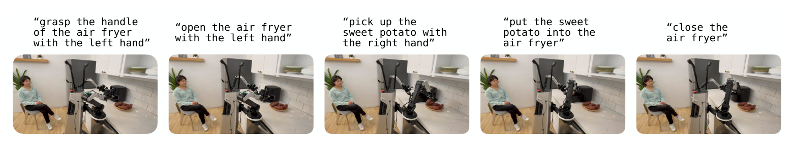

图14依次展示：左手抓把手、左手打开抽屉、右手抓红薯、放进炸锅、关闭炸锅。原文把它用于说明新长任务的语言 coaching；下面压缩成两轮控制走查，补充数字均为**【示意】**。[§IX-D，pp.13–14]

### 第1轮：从“放入红薯”变成“左手抓把手”

总体任务为“把红薯放进空气炸锅”，当前相机看到关闭的炸锅和桌上的红薯。人类给出子任务 `grasp the handle of the air fryer with the left hand`。这一指令与总体任务不同：它明确了当前对象、动作与使用哪只手。

世界模型根据当前三视角图像、这条子任务及元数据，生成“左夹爪到达把手附近并完成抓持”的目标图。VLA 编码观察历史、状态、文字与目标，从噪声经 5 次生成迭代输出 50 步动作块。真实关节数值在论文中没有逐帧公布，因此这里不伪造一串角度。

**【示意】** 若这次运行在 50 Hz 平台、选择每块执行 15 步，则机器人先执行约 0.3 秒；按论文最简配置 38 ms 计算，动作生成期间约会经过 1.9 个控制周期。启用更多上下文后延迟可能更高，RTC 才需要处理已经承诺执行的前缀。这里不是说空气炸锅实验实测采用了 38 ms。

### 第2轮：观察已改变，再决定拉开抽屉

新观察里左夹爪已接近或抓住把手。若语义指令仍是“抓把手”，且 4 秒计时器未到，系统可以继续使用最近可用的目标图，但 VLA 仍基于**新的当前观察与状态**重新规划。保留同一目标，不等于重复播放第一次的动作块。

当人类确认应进入下一步，指令改成 `open the air fryer with the left hand`，目标图像生成被触发。生成是异步的：VLA 不暂停等它算完。真实运行必须处理“子任务刚更新而对应新目标尚未返回”的状态；论文采用最近可用条件的朴素异步策略，没有给出可保证语义同步的完整时间戳协议。

目标返回后，下一次动作生成使用新条件，引导左手拉开炸锅；随后再切换成右手取红薯、放入、关闭。训练阶段可以用真正分段末帧作为监督，推理阶段则必须用生成目标或省略目标，**不能拿未来真实图像作为运行时输入**。

这条流程中的数据去向是：

- 当前与历史图像、状态形成每次动作计算的观察条件；图像历史先压缩。
- 子任务文字和目标图像在不同时间更新，最近结果可以跨若干动作块复用。
- FAST 标签只服务训练，不进入这条运行时闭环。
- 输出 50 步中，只执行前 15 或 25 步；后面的计划在下一轮会被新的观察和 RTC 衔接逻辑更新，不会无条件整块播放到底。

**【解读】** 模型的可引导性，体现在人能通过语义或图像改变低层行为选择。但在这类新长任务中，高层步骤的正确性仍可能来自人，不应把整套过程都归因于 VLA 自主发现了任务计划。

## 9. 开箱性能：通用模型能否吸收专用模型的执行水平

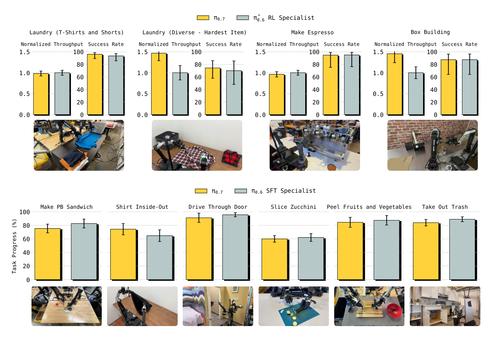

**【原文】** 上排比较叠衣、困难衣物、咖啡与组盒，对手是 π*0.6 的 RL 专家；下排比较花生酱三明治、翻衣、过门、切西葫芦、削皮、换垃圾袋等，对手为基于 π0.6 的 SFT 专家。作者报告，同一个通用 π0.7 可以接近这些逐任务专用策略，困难衣物与组盒的吞吐量还更高。[§IX-A、图6，pp.8–9]

此处任务在训练数据中出现过，目标是衡量**不再逐任务后训练的执行质量**。因为训练已包含包括 RL 专家执行在内的数据，这些结果支持专家能力蒸馏进通用模型，不支持“从未见过咖啡任务仍首次自主学会做咖啡”的说法。

### 三种指标不能互换

| 指标 | 衡量什么 | 阅读风险 |
| --- | --- | --- |
| Success rate | 按任务规则完整成功的比例 | 不直接说明耗时 |
| Throughput | 每小时成功完成数 | 同时受成功率、执行耗时和失败处理影响 |
| Task progress | 按任务评分标准归一化的进度 | 高进度不一定意味着完整成功 |

图6的 normalized throughput 以**专用策略**为参照；图7改为以**完整 π0.7**为参照。它们的 1.0 对应不同基准，不能跨图直接比柱高。

**【示意】** 策略甲每轮含失败平均用时 60 秒、成功率 80%，策略乙用时 90 秒、成功率 95%。在忽略额外复位的简化情形下，前者每小时约成功 $3600\times0.8/60=48$ 次，后者约 38 次；较高成功率不自动等于较高吞吐量。原文实测吞吐量应依其真实统计，不用这个简式反推。

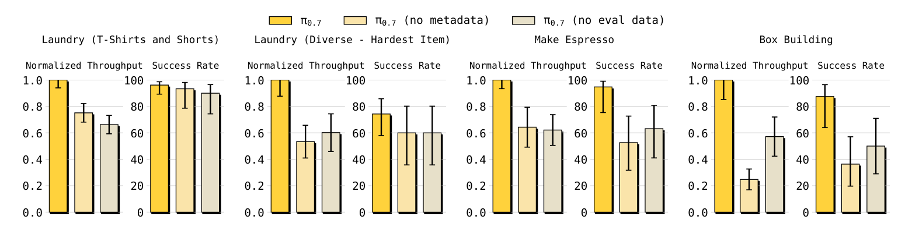

**【原文】** `no eval data` 去掉自主评估轨迹，`no metadata` 去掉上下文中的轨迹元数据。完整模型在这组任务中优于两种消融，吞吐量差异尤其明显。[图7，p.9]

**【解读】** 这支持“数据与标签配套使用”的机制：只有额外轨迹而没有区分条件，和只有条件却没有相应经验，都不足以获得完整效果。不过，实验不是对每一个标签字段、每一种数据来源独立做完整因子分析，不能给质量、速度、失败标签各分配一个已证明的独立收益。

此外，图8还比较了需要记忆的换杯、找物、舀咖啡和擦窗任务，π0.7 在这些任务进度上接近或超过 π0.6-MEM 的逐任务专用策略。这说明记忆相关能力被通用模型保留下来；它并不单独证明 MEM 模块对本篇全部提升的因果贡献。[§IX-A，p.10]

## 10. 指令遵循：看新环境、复杂指代与反数据偏置三种测试

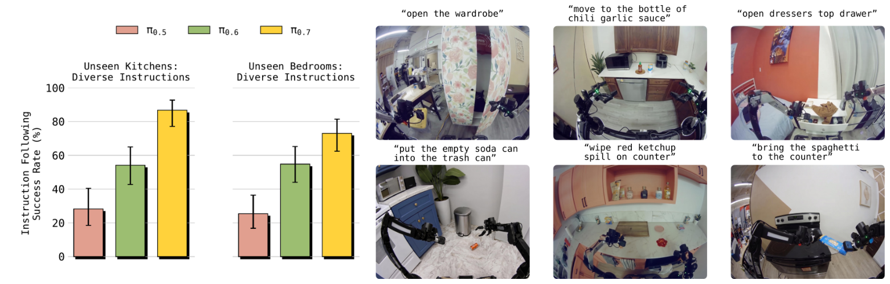

**【原文】** 评测包含 4 个未见厨房、2 个未见卧室，14 类指令场景，每次完成一串 3–6 条指令；指标是所有评测中被正确遵循的指令比例。π0.7 整体优于 π0.5 和 π0.6。[§IX-B、图9，pp.10–11]

“指令成功率”在这里按单条指令统计，不是要求整条 3–6 步任务全成功的 episode 成功率。长序列中，两个指标可以有明显差异。

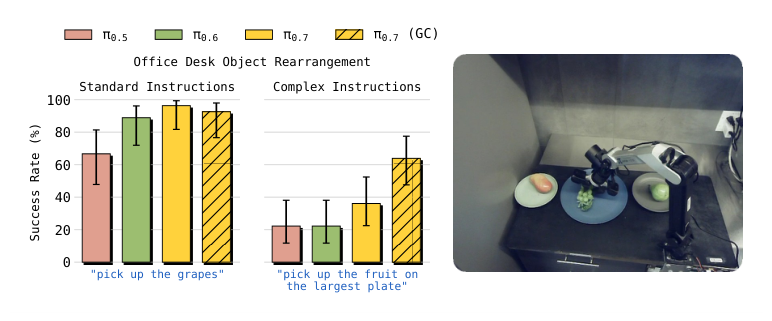

第二组把常规指令与复杂指令分开。常规例子是“拿起勺子”；复杂例子包含“拿起我用来喝汤的物体”“拿起最大盘子上的水果”。图例 `π0.7 (GC)` 表示使用生成目标图像的 goal-conditioned 配置，**不是 classifier-free guidance 的缩写**。[图10，p.11]

**【原文】** π0.7 在复杂指代上优于旧模型，目标图像进一步提高表现。**【解读】** 这里可能是世界模型先把复杂语义映射成更明确的视觉意图，再由 VLA 实现动作；因此比较 GC 时，增加的是包含额外模型与计算的系统条件，不能当成完全同样成本下仅修改几句话。

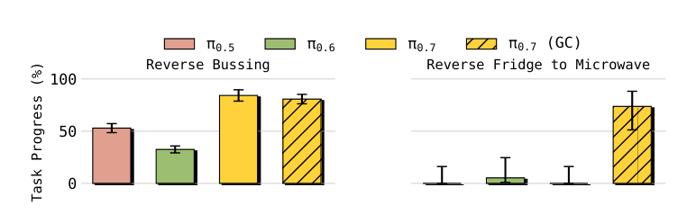

第三组是反数据偏置。训练常见的分拣是垃圾进垃圾桶、餐具进回收餐具箱；测试反过来要求。另一个任务要求食物由微波炉送回冰箱，而训练常见方向是从冰箱送往微波炉。

**【原文】** π0.7 能更好地按指令打破这些惯性；在反向冰箱／微波炉任务中，目标图像对成功至关重要。[图11，p.11]

**【解读】** 这比“换一个同义词仍然能抓取”更直接地测试语言是否真正在决定行为。不过它是专门设计的任务集合，不能据此断言模型对任意数据偏见都已鲁棒。

## 11. 跨本体迁移：换机器人以后，是复用任务还是复制动作

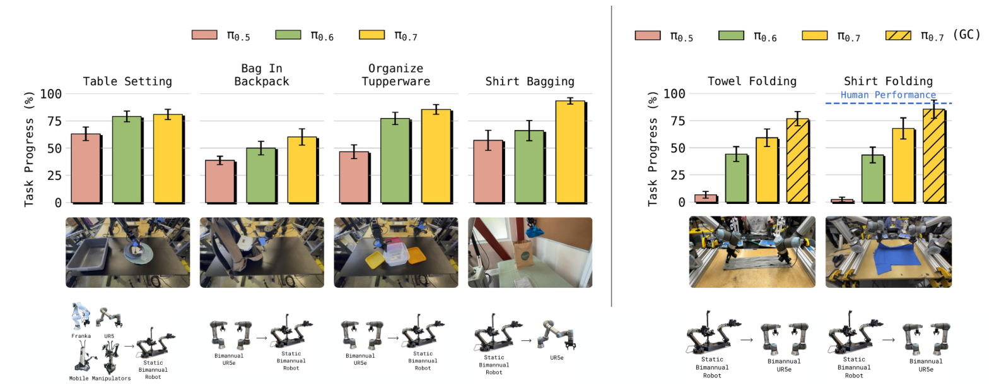

**【原文】** 简单摆桌等任务中，旧模型也能迁移；当源与目标机器人的臂长、重量、放置方式、夹爪和单／双臂结构差异增大，π0.7 的优势更明显。毛巾与 T 恤折叠数据来自较小静态双臂，没有收集 UR5e 折衣数据，测试却使用双臂 UR5e。[§IX-C，pp.10–13]

“零样本”因此指**目标任务与目标本体的组合没有训练数据**；不表示目标机器人完全没在预训练中出现，也不表示源机器人的该技能未训练过。

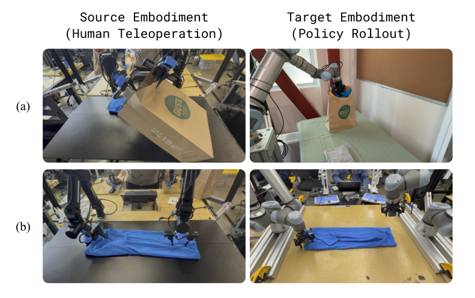

图13给了两类行为证据：源机器人需要一只手撑袋、一只手装衣，较长的目标 UR5e 可采用单臂放入；源机器人常斜着抓衣料，UR5e 则出现更适合其工作空间的垂直抓取。

**【解读】** 这说明迁移结果不仅是复刻原关节轨迹。它仍不能告诉我们网络内部形成了哪一种可解释的运动学表征，或保证所有新本体都能这样适应。主实验采用关节控制；附录 E 比较旧模型的关节与末端控制，没有发现末端控制有明确优势，不能把主结果归结成“换了更好的动作坐标系”。

### 与熟练遥操作员相比，具体是什么水平

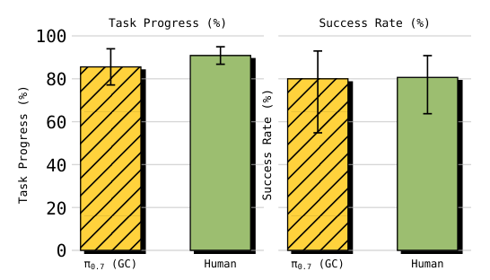

**【原文】** 研究招募 10 名经验排名前 2% 的遥操作员，所有机器人累计经验平均约 375 小时。他们有源平台经验，但没有在 UR5e 上做过这项折衣任务；每人 3 次，共 30 次，无预热，起始衣物、时限和评分规则与策略评测一致。[附录 F，pp.23–24]

| 对象 | 平均 task progress | Success rate | 范围 |
| --- | --- | --- | --- |
| 人类遥操作员 | 90.9% | 80.6% | 该 UR5e 折衣实验的报告值 |
| π0.7 (GC) | 85.6% | 80% | 无 UR5e 折衣训练数据 |

模型进度低 5.3 个百分点，成功率低 0.6 个百分点。论文据此称表现可比，不能改写成机器人总体超过人类。人类“零样本”强调没有该任务／机器人组合的操作经验，并不意味着每位参与者三次尝试都没有任何在线熟悉过程。

还有一个应保留的统计边界：原文同时给出“30 次人类试验”和“80.6% 成功率”，但未充分说明从逐人、逐场景或其他汇总到这一小数的过程。80.6% 不能直接还原为 30 次中的整数成功次数。本文按原报告保留，不擅自改成 24/30，也不据此宣称统计等效。[§IX-C、附录 F]

## 12. 新任务组合：短任务开箱执行，长任务先 coaching

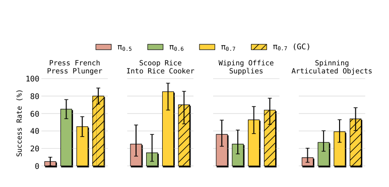

**【原文】** 对按压法压壶、向电饭煲舀米、擦耳机等物体、转动齿轮或桌扇等短任务，没有专门收集这些任务的机器人训练数据，π0.7 能通过提示完成其中相当一部分。GC 在这些任务上并非一致占优。[§IX-D、图17，p.13]

图17也提醒我们不要只记“世界模型越多越好”：例如舀米一项中，带生成目标的柱并不高于不带目标的版本。目标图可能提供有用指引，也可能增加生成误差或不合适的约束；收益取决于任务。

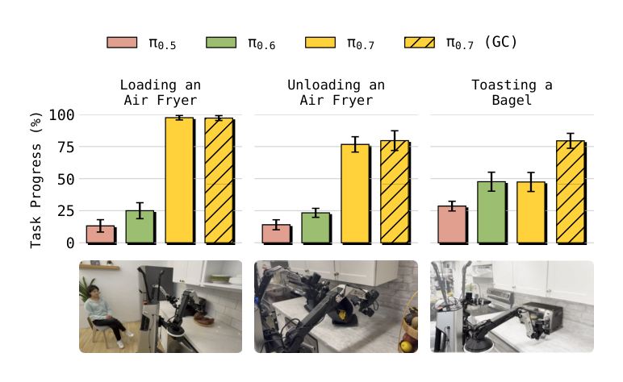

对于空气炸锅装／取食物、烤贝果等最长可达约 5 分钟、多阶段交互的任务，作者明确表示：**只给一个总体任务要求，模型还不能直接可靠完成。** 人逐步发指令后，π0.7 比旧模型更能执行；有些任务加入目标图进一步改善表现。机器人数据中没有这些任务的完整训练 episode，但相似家电和操作可能见于人类数据或外部数据集。[§IX-D，pp.13–14]

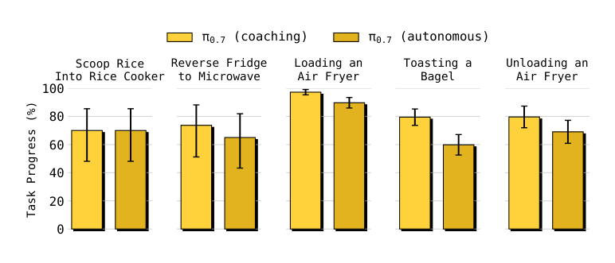

下一步把 coaching 中“什么观察下发出哪条子任务指令”的记录用于训练高层语言策略。图16显示，五个任务中，自主版本能大致接近在线人类指导的进度，但并非所有任务完全一致。[§IX-D，p.14]

| 设置 | 谁选下一步 | 是否增加目标任务监督 | 正确理解 |
| --- | --- | --- | --- |
| 新短任务直接提示 | 原系统按输入指令执行 | 无该任务专门的低层训练示范 | 本文较直接的新技能组合证据 |
| 新长任务 coaching | 人在线给语义子任务 | 有实时语义指导；没有额外遥操作动作示范 | 低层技能可复用，高层计划由人补充 |
| coaching 后 autonomous | 微调后的高层策略 | 使用了目标任务 coaching 记录 | 无需额外遥操作动作数据，不等于整个系统无需训练 |

此外，附录 G 对“Loading an Air Fryer”的评分只包含打开、取红薯、放入、关闭四项。该测试不能扩大成“机器人独立掌握温度设置、烹饪时长及完整熟食流程”。烤贝果任务则有开烤箱、放入、关闭、转旋钮、取盘、取出与装盘的七步评分。[附录 G，p.25]

**【解读】** coaching 的价值在于把新任务的数据需求，从连续低层遥操作示范转向较轻量的语义监督。它仍需要能执行那些语义步骤的基础控制能力，以及正确的指导和后续高层训练。

## 13. 数据扩展实验：更多、更多样、质量更低，是三件事

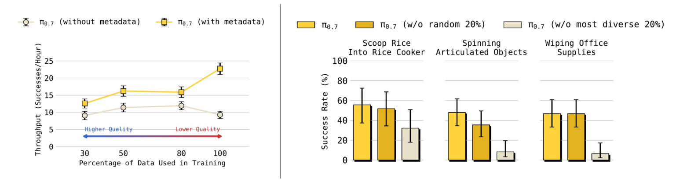

### 左图：加入更多低质量数据，元数据是否让它变得有用

**【原文】** 作者按质量与速度给 T 恤／短裤叠衣数据排序，取最好的 30%、50%、80% 和全部数据。每一档分别训练有、无元数据的模型，共 8 个。结果是：有元数据的版本能随数据增加继续改善；没有元数据的版本在加入更多、平均质量更低的数据后可能退化。[§IX-E，pp.14–15]

**【解读】** 这比单纯报告“我们的模型用了很多数据”更有力，因为它直接测试了混合质量与条件标签之间的关系。但它仍是一项折衣任务上的受控研究，且数据量增加与平均质量下降同时发生，不能视为跨所有任务的普适 scaling law。文中“from scratch”指为各数据条件重新训练对照模型；结合前述初始化描述，不能据此宣布完全不用预训练 VLM。

### 右图：数量相同，删掉最有多样性的部分是否更伤泛化

**【原文】** 两种删数据方式各移除 20%：一种移除任务最丰富的数据，一种随机删。两者剩余数量相同。完整模型与随机删除版本在舀米、转动物件、擦物体等未见短任务上，优于移除最有多样性数据的版本。[§IX-E，p.15]

这支持多样性本身有价值。它没有完整公开“最高多样性 20%”的可复现定义，也无法保证这部分数据除多样性外与其他部分毫无差异；仍需警惕对象、场景、标注质量等一起变化。

论文的证据链因此可以这样连接：**更详细的条件帮助区分混合行为；自主与失败经验扩充覆盖；多样数据提供可组合的技能；生成目标图像把部分语义、空间知识转成动作可使用的提示。** 单独增加模型大小或把 prompt 写长，并不是这条链的全部。

## 14. 局限、歧义与复现缺口

### 泛化有边界，novelty 也难严格划分

**【原文】** 讨论部分指出，见过的任务成功率常超过 90%，未见任务或未见任务／机器人组合通常在 60–80% 范围。这是作者概括，不是某一个统一基准的总均值。作者也承认，在庞大异质数据里很难彻底确定“见过／未见”：相关技能可能出现在别的标签或其他任务中。[§X，p.15]

所以，“没有为此任务有意采集数据”与“模型从未见过任何相关视觉或动作信息”不是同一命题。本文结果有力支持新组合能力，但没有完成逐样本可审计的训练污染排查。

### 系统成绩不能全部归到某一个组件

与旧模型相比，π0.7 同时变化了训练数据、上下文、记忆、图像目标及训练配方。图7和图18提供重要消融，但没有把所有因素做成同规模、同计算量、同数据的完整矩阵。因此可以说“这套方法有效”，却难以精确分摊每个组件的贡献。

生成图像可能出现不存在的物体关系、不适合实际机构的抓取外观；异步调用还可能让新语义与旧图像短暂不一致。论文通过生成图训练、在线重规划等缓解问题，但没有报告覆盖这些失效类型的完整鲁棒性评测。[§VI-C、VII、附录 D]

### 关键工程细节仍不足以直接复现

| 已披露 | 尚缺少完整可核实配置 |
| --- | --- |
| 主骨干与专家规模、图像尺寸、历史间隔、动作块长度 | 所有张量 token 数、动作 padding、坐标和归一化细节 |
| 多种 dropout、目标采样时间、去噪步数 | 全部数据集名称、规模、模态采样权重与生成目标占比 |
| 训练时 RTC 延迟范围、主要推理硬件与延迟 | 优化器、学习率计划、总训练步数、各模块冻结表、随机种子 |
| 人类比较人数和协议、附录任务评分 | 全部任务逐项试验数、误差条的完整定义和人类成功率聚合方式 |

本文保留的两项原文歧义尤其不应悄悄修平：世界模型 CFM 公式的最大化／loss 符号约定，以及 30 次人类试验与 80.6% 成功率的统计关系。它们不抹去主要结果，但限制了逐项复现与统计推断。

### “可引导”不等于“设定后一定满足”

`Quality: 5` 和 `Mistake: false` 是生成条件，不是约束求解器或失误检测证明。过强 CFG、训练外时长条件、错误目标图，仍可能导致不合理输出。论文展示的是更好的行为选择接口，没有证明任务成功或接触过程的形式化保证。

## 15. 放回 π 系列脉络：改变的是数据怎样进入策略

| 工作或机制 | 主要关注点 | 与 π0.7 的关系 |
| --- | --- | --- |
| [π0](/embodied-ai-learning/posts/paper-pi0/) | 视觉语言骨干连接流匹配连续动作专家 | 连续生成动作的基本路线 |
| π0.5 | 开放世界任务、异质数据与层级语义 | π0.7 延续总体任务／子任务框架 |
| [FAST](/embodied-ai-learning/posts/paper-pi0-fast/) 与 KI | 动作离散监督和稳定表示学习 | FAST 在训练监督骨干，连续动作仍由专家生成 |
| π0.6-MEM | 利用历史视觉与状态 | π0.7 的视觉记忆来源 |
| [π*0.6 / RECAP](/embodied-ai-learning/posts/paper-pi06/) | 从自主经验与人工纠正改进专用策略 | RL 专家执行经验可回流为通用模型训练数据 |
| π0.7 | 用更充分的多模态条件组织多质量、多策略数据 | 把专家能力与广泛数据汇入一个更可引导的通用策略 |

**【解读】** 这篇论文最有价值的研究视角，是把数据集里的差异保留下来并显式条件化：不是所有样本都代表同一个理想策略，但它们仍然可能教会模型不同状态、动作后果和行为模式。条件既是训练时解释数据的工具，也是运行时选择行为的接口。

如果要在自己的 VLA 上检验这个想法，最小的**【建议】**实验可以先聚焦一个任务：固定骨干、训练预算和评测设置，比较高质量子集、全部混合数据、全部数据加质量／时长／失误标签，再增加推理元数据引导。分别报告完整成功率、真实吞吐量、失败恢复与标签外推表现，才能区分“更多数据有用”和“条件使低质量数据变得可用”。

随后再单独加入生成目标，测复杂指代、反偏置和跨本体组合，并同时记录图像生成成本、目标错误率与异步延迟。这样的顺序能让每一步改善都有可归因的证据；这是研究建议，不是本文已经完成的复现结果。

我的评价是：**π0.7 提供了通用机器人模型如何使用混合质量经验的一组强实机证据，也给出了可操作的上下文训练配方；对“普遍的新任务自主规划”和“可审计、完全可复现的零样本泛化”，证据还不够。** 阅读时最应带走的是条件、数据和推理系统之间的关系，而不是把所有结果压缩成一个“通用机器人已经开箱全会”的标签。

本文引用的核心来源为 [π0.7 v2](https://arxiv.org/abs/2604.15483v2)，图1–3对应整体方法与提示，图6–7对应专家水平及数据消融，图9–17对应指令、迁移和组合，图18对应扩展研究，图19与附录 C–D对应实现与算力，图22及附录 F–G对应人类比较和评分。原文给出的[项目页](https://pi.website/pi07)可作为进一步查看演示的入口；本文的技术判断与数值以上述本地 PDF 版本为准。
